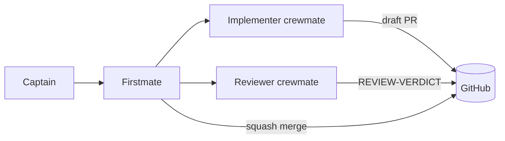

# Factory architecture

## Purpose

The factory turns captain-defined hardware intent into reviewed, verified RTL
with simulation, FPGA and ASIC evidence. It is design-neutral: the same
contract, skills, tools and CI serve any IP placed under `src/`.

## Parts

| Part | What it does | Where |
| --- | --- | --- |
| Contract | Mission, neutrality, non-negotiables, flow exceptions | `CLAUDE.md` |
| Skills | Roles, flow, gates and repeatable procedures | `.claude/skills/` |
| Methods | Best known methods per discipline | `wiki/bkm/` |
| Specs | Per-IP HAS, MAS, DV plan, FPGA and ASIC pages; per-tool specs | `wiki/src/`, `wiki/tools/` |
| Build | Single entry point for checks, sim, regress, FPGA, ASIC, wiki | `build`, `tools/` |
| Regression | Per-IP level lists, exclusive levels L0/L1/L2 | `src/dv/<ip>/regress/` |
| CI | `ci-gate` on PRs, nightly L2 with metrics | `.github/workflows/` |
| Tracker | Metrics history and charts | `wiki/tracker/` |

## Agents

The captain (human) sets intent. The firstmate (root agent) plans issues,
delegates to crewmates (subagents with fresh context in their own worktrees),
and owns review, merge and cleanup. Implementation and review are always done
by different agents.

## Flow

Issue → claim → branch and worktree → implement with specs → validate → draft
PR → independent review → fix loop → merge → cleanup. The `agent-flow` skill
owns the steps and gates, the `firstmate` skill the roles, and `CLAUDE.md` the
exceptions.

## Evidence levels

| Level | Purpose | Where it runs |
| --- | --- | --- |
| L0 | Fast confidence while developing | Locally, and in `ci-gate` |
| L1 | Merge gate for affected IPs | `ci-gate` on self-hosted runners |
| L2 | Full regression, seeds, FPGA and ASIC flows, metrics | Nightly |

The DevOps BKM owns budgets and selection rules; the FPGA and PD BKMs own the
physical flows.
