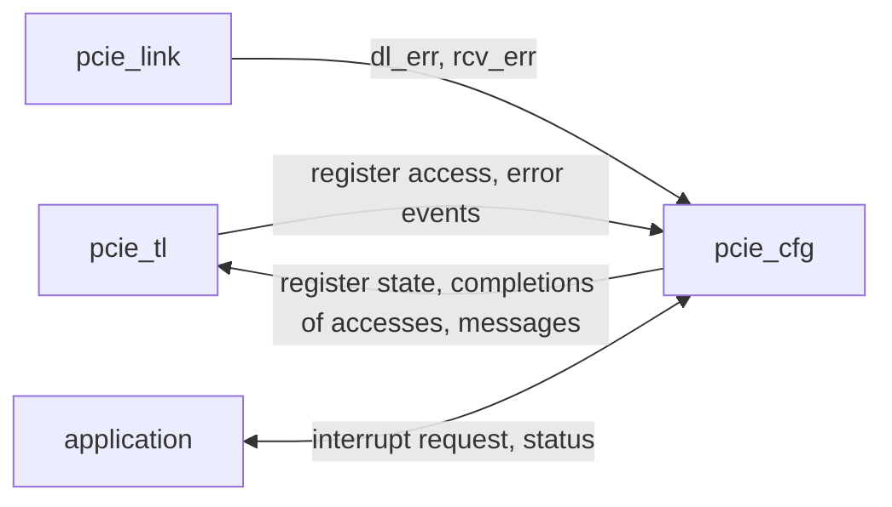

# pcie_cfg HAS

`pcie_cfg` is the configuration space of the [`pcie_core`](../core/HAS.md)
Endpoint: the Type 0 header, the capability list (Power Management, MSI,
MSI-X, PCI Express), the MSI-X table and pending bits, the error status
registers and the decision to send an error message, and the resolution of
the application's interrupt requests (decision record
[0004](../../decisions/0004-m3-grill.md#decisions), Q1, Q2, Q4, F3 to F8).
It sees no TLP: `pcie_tl` hands it register accesses one DW at a time and
sends the messages it asks for, over the
[tl-cfg interface](../core/TL_CFG.md), which this page implements exactly.
It has no AER, no INTx, no PME, no function-level reset and no extended
capability.

The register map is on [REGISTERS.md](REGISTERS.md) (the Type 0 header)
and [CAPS.md](CAPS.md) (the capabilities and BAR2). Rules from the PCIe
Base Spec rev 3.0 are paraphrased and cited, never copied
([wiki BKM](../../../bkm/wiki.md#citations),
[`pcie-base`](../../references.md#pcie-base)).

## Position

`core` integrates it with `tl` over `link` ([`core` stack
wiring](../core/HAS.md#stack-wiring)); it has no sub-IP.

## Interfaces

All ports are synchronous to `clk_i`. The meaning of every `tl`-side port
is the [tl-cfg interface](../core/TL_CFG.md)'s net of the same name, and of
every application port the [application interface](../core/APP.md)'s port
of the same name; this table gives the `cfg` port, its direction and width.

| Port | Dir | Width | Clock | Description |
| --- | --- | --- | --- | --- |
| `clk_i` | in | 1 | — | Core clock, 125 MHz. |
| `rst_i` | in | 1 | `clk_i` | Synchronous, active high. `core` drives it with its `rst_i` OR NOT `dl_up_o` ([reset](#reset)). |
| `reg_req_valid_i`, `reg_req_ready_o` | in, out | 1, 1 | `clk_i` | [Register access](../core/TL_CFG.md#register-access) handshake. |
| `reg_req_bar2_i`, `reg_req_write_i` | in | 1, 1 | `clk_i` | Space (0 configuration, 1 BAR2) and direction. |
| `reg_req_addr_i` | in | 10 | `clk_i` | DW index. |
| `reg_req_be_i`, `reg_req_data_i` | in | 4, 32 | `clk_i` | Byte enables and write data. |
| `reg_req_bus_i`, `reg_req_dev_i` | in | 8, 5 | `clk_i` | Bus and Device Number of a configuration write. |
| `reg_cpl_valid_o`, `reg_cpl_data_o` | out | 1, 32 | `clk_i` | Access finished; read data. |
| `bus_num_o`, `dev_num_o` | out | 8, 5 | `clk_i` | [Register state](../core/TL_CFG.md#register-state): captured numbers. |
| `bar0_base_o`, `bar2_base_o` | out | 32, 32 | `clk_i` | BAR0 and BAR2 addresses. |
| `mem_space_en_o`, `bus_master_en_o`, `d_state_o` | out | 1, 1, 2 | `clk_i` | Command enables and Power State; to `tl` and to the `core` [status](../core/APP.md#status) ports. |
| `tl_err_i` | in | 9 | `clk_i` | [Error events](../core/TL_CFG.md#error-events) from `tl`. |
| `dl_err_i`, `rcv_err_i` | in | 7, 1 | `clk_i` | [Link errors](../core/TL_CFG.md#link-to-cfg). |
| `msg_valid_o`, `msg_ready_i` | out, in | 1, 1 | `clk_i` | [Messages](../core/TL_CFG.md#messages) handshake. |
| `msg_kind_o`, `msg_addr_o`, `msg_data_o` | out | 2, 64, 32 | `clk_i` | Message kind, interrupt write address and data. |
| `irq_valid_i`, `irq_ready_o`, `irq_vector_i` | in, out, in | 1, 1, 6 | `clk_i` | [Interrupt](../core/APP.md#interrupts) request. |
| `irq_done_o`, `irq_status_o` | out | 1, 2 | `clk_i` | Resolution: 0 sent, 1 pending, 2 dropped. |
| `max_payload_o`, `max_read_req_o` | out | 3, 3 | `clk_i` | Device Control fields as written ([status](../core/APP.md#status)). |

## Parameters

The `core` [parameters](../core/HAS.md#parameters) of the same names,
passed unchanged.

| Name | Type | Default | Range | Effect |
| --- | --- | --- | --- | --- |
| `BAR0_ADDR_W` | `int unsigned` | 12 | 12 to 28 | BAR0 is 2^`BAR0_ADDR_W` bytes: its address bits below `BAR0_ADDR_W` read 0. |
| `MSIX_TABLE_SIZE` | `int unsigned` | 8 | 1 to 64 | MSI-X vectors: the table and pending bits in BAR2, and the Table Size field. |
| `VENDOR_ID`, `DEVICE_ID`, `SUBSYS_VENDOR_ID`, `SUBSYS_ID` | `logic [15:0]` | 16'h0000 | any but 16'hFFFF | Header IDs. The defaults are placeholders that claim no assigned vendor (F7, Q12); a product overrides them. |
| `CLASS_CODE` | `logic [23:0]` | 24'hFF0000 | any | Class Code: base class FFh, a device that fits no defined class. |
| `REVISION_ID` | `logic [7:0]` | 8'h00 | any | Revision ID. |

## Behavior

### Reset

While `rst_i` is 1 every register, the MSI-X mask and pending bits, the
MSI pending flag, every error message due and every offer return to their
reset values ([REGISTERS.md](REGISTERS.md), [CAPS.md](CAPS.md)), and the
outputs are: `reg_req_ready_o`, `reg_cpl_valid_o`, `msg_valid_o`,
`irq_ready_o`, `irq_done_o`, `bus_num_o`, `dev_num_o`, `bar0_base_o`,
`bar2_base_o`, `mem_space_en_o`, `bus_master_en_o`, `d_state_o` (D0) and
`max_payload_o` 0, and `max_read_req_o` 2. Data outputs are don't care
while not qualified. The MSI-X table address and data DWs are not reset
(they sit in a RAM): software writes them before it unmasks a vector.

### Register access

- `reg_req_ready_o` is 1 whenever `cfg` is out of reset and holds no
  access; `reg_cpl_valid_o` follows each take after 1 or more cycles, for
  a read and a write alike, and never waits on `msg_ready_i`.
- **Configuration.** `reg_req_addr_i` selects one of the 1024 DWs of the
  4 KiB space [cite: PCIe Base Spec, rev 3.0, §7.2.2]. A read returns the
  whole DW whatever the byte enables, and has no side effect. A write
  changes only the bytes enabled: an RW field takes the written bits, an
  RW1C bit written 1 clears and written 0 stays, and RO and HwInit bits
  ignore it. A DW the map does not list reads 0 and ignores writes: the
  reserved DWs of the header, the gaps between capabilities, the rest of
  the space up to 0xFF and the whole extended space from 0x100 to 0xFFF.
  DW 0x100 reading 0 is the extended capability header with ID 0 and no
  next capability, which says there is none
  [cite: PCIe Base Spec, rev 3.0, §7.9.1].
- **Bus and device number.** Every configuration write that `cfg` takes,
  to any DW, implemented or not, loads `reg_req_bus_i` and `reg_req_dev_i`
  into `bus_num_o` and `dev_num_o` [cite: PCIe Base Spec, rev 3.0, §2.2.6.2].
  Reads load nothing.
- **BAR2.** `reg_req_addr_i[9:0]` is the DW offset in BAR2; the
  [BAR2 layout](CAPS.md#bar2) gives the table and the pending bits, with
  the same byte-enable rules. Any other BAR2 DW reads 0 and ignores writes.
- A write takes effect at the edge `cfg` takes it: every output it changes
  (enables, `d_state_o`, bases) changes at that edge, before
  `reg_cpl_valid_o`.

### Errors

Each event pulse sets its status bits whatever the enables and the power
state, then decides on a message. Default severities: the non-AER table of
[cite: PCIe Base Spec, rev 3.0, §6.2.7]; *advisory* events are non-fatal
errors that a function with role-based error reporting handles as
correctable [cite: PCIe Base Spec, rev 3.0, §6.2.3.2.4].

| Event | Status register | Device Status | Handled as |
| --- | --- | --- | --- |
| `tl_err` 0, UR, posted | — | Unsupported Request Detected | Non-fatal, UR |
| `tl_err` 1, UR, non-posted (completed with UR) | — | Unsupported Request Detected | Correctable (advisory), UR |
| `tl_err` 2, malformed TLP | — | — | Fatal |
| `tl_err` 3, poisoned request | Detected Parity Error | — | Non-fatal |
| `tl_err` 4, poisoned completion | Detected Parity Error; Master Data Parity Error if Parity Error Response is 1 | — | Non-fatal |
| `tl_err` 5, unexpected completion | — | — | Correctable (advisory) |
| `tl_err` 6, completion timeout | — | — | Non-fatal |
| `tl_err` 7, received UR completion | Received Master Abort | — | No error class, no message |
| `tl_err` 8, received CA completion | Received Target Abort | — | No error class, no message |
| `dl_err` 0 to 3 (Bad TLP, Bad DLLP, replay timeout, REPLAY_NUM rollover), `rcv_err` | — | — | Correctable |
| `dl_err` 4 to 6 (DL protocol error, receiver overflow, malformed TLP) | — | — | Fatal |

- The class sets its Device Status bit: Correctable, Non-Fatal or Fatal
  Error Detected [cite: PCIe Base Spec, rev 3.0, §7.8.5].
- **Message decision** [cite: PCIe Base Spec, rev 3.0, §6.2.5]
  [cite: PCIe Base Spec, rev 3.0, §6.2.6]: correctable sends ERR_COR when
  Correctable Error Reporting Enable is 1; non-fatal sends ERR_NONFATAL
  when Non-Fatal Error Reporting Enable or SERR# Enable is 1; fatal sends
  ERR_FATAL when Fatal Error Reporting Enable or SERR# Enable is 1. A UR
  event (either kind) also needs Unsupported Request Reporting Enable 1.
  SERR# Enable never sends ERR_COR [cite: PCIe Base Spec, rev 3.0, §7.5.1.1].
- Outside D0 no message is decided: the status bits still record the
  event ([outside D0](../core/TL_CFG.md#outside-d0)).
- **Signaled System Error** sets when `tl` takes an ERR_NONFATAL or
  ERR_FATAL message while SERR# Enable is 1
  [cite: PCIe Base Spec, rev 3.0, §7.5.1.2].
- Several events of one cycle each count; a message decided while one of
  the same kind is still due merges with it.

### Messages

`cfg` keeps one due flag per error message kind, the application's
request being offered, the MSI pending flag and the MSI-X pending bits.
When `msg_valid_o` is 0 and the function is in D0 it offers, by priority:
ERR_FATAL, ERR_NONFATAL, ERR_COR, the application's interrupt write, the
MSI pending write, the pending MSI-X vector with the lowest number that
may go out. An offer holds its kind, address and data until `tl` takes it
(`msg_ready_i` 1); taking clears what it came from (the due flag, the
request, the MSI flag or the vector's pending bit).

An offer is **withdrawn** (`msg_valid_o` falls without a take) at the
edge where it may no longer go out: any offer when `d_state_o` leaves D0
(an error message is then discarded); an interrupt write when bus
mastering is cleared, or its mode is disabled (MSI Enable cleared or MSI-X
Enable set for MSI; MSI-X Enable cleared for MSI-X), or its vector or the
function is masked. A withdrawn interrupt write becomes pending: the
vector's pending bit, or the MSI pending flag if MSI Enable is still 1
(else the request is dropped). A withdrawn application request then
reports `irq_done_o` with pending (or dropped).

### Interrupts

`cfg` resolves each request by the
[interrupt resolution](../core/TL_CFG.md#interrupt-resolution) rules
[cite: PCIe Base Spec, rev 3.0, §6.1.4], with these refinements:

- `irq_ready_o` is 1 whenever no request is open; one request is open
  from its take to its `irq_done_o`. A dropped or pending request is done
  within 4 cycles; a sent one is done in the cycle `tl` takes its write.
- A request for an MSI-X vector whose pending bit is already set merges
  into it: status pending, one write later. A request under MSI while the
  MSI pending flag is set does the same.
- Unmasking (the vector's Mask bit or Function Mask), setting Bus Master
  Enable, returning to D0 or setting MSI-X Enable makes each pending vector
  eligible again; its pending bit clears when `tl` takes its write, not
  when it is offered.
- Under MSI, `msg_data_o[15:0]` is Message Data and `[31:16]` is 0; under
  MSI-X, `msg_data_o` is the entry's whole Message Data DW. `msg_addr_o`
  is the 64-bit address with bits `[1:0]` 0.

### Power states

The Power State field ([PM](CAPS.md#power-management)) drives `d_state_o`
[cite: PCIe Base Spec, rev 3.0, §5.3.1.4]:

| Transition | Effect |
| --- | --- |
| D0 to D3hot | `tl` answers memory requests with Unsupported Request and takes no `rq` request; `cfg` withdraws its offer, decides no error message and holds every interrupt as pending. Configuration requests are still served. |
| D3hot to D0 | No internal reset (No_Soft_Reset is 1): every register, BAR and enable keeps its value; pending interrupts go out by the rules above. |
| Write of D1 or D2 | Unsupported: the write completes, the field keeps its value. |

## Decisions

Firstmate decisions as the captain's delegate, which the captain may
override; Q and F numbers are the [record](../../decisions/0004-m3-grill.md)'s.

| Choice | Rationale | Rejected |
| --- | --- | --- |
| Capabilities at 0x40 (PM), 0x50 (MSI), 0x60 (MSI-X), 0x70 (PCI Express), in that order | Fixed 16-byte-aligned slots, room for the 60-byte PCI Express capability below 0xB0; the order is free. | PCI Express first (no rule asks for it). |
| No_Soft_Reset 1 | D3hot to D0 keeps the BARs and enables; no second reset path in `cfg`. | An internal reset on D3hot to D0 (software restores the whole header). |
| RW fields with no effect where the standard allows either (Cache Line Size, Interrupt Line, Interrupt Disable, Enable Relaxed Ordering, Enable No Snoop, ASPM Control, Common Clock Configuration, Extended Synch, MSI Multiple Message Enable) | Software reads back what it wrote; nothing in `core` depends on them. | Hardwiring each to 0 (a constraint on what `tl` may send for two of them). |
| Advisory handling for UR completions and unexpected completions only | The two cases the standard requires; a poisoned TLP and a completion timeout stay non-fatal, the simpler reading where advisory handling is optional. | Advisory for every allowed case (more rules, no M3 user). |
| One due flag per error message kind | Bounds the state; the Root Complex learns of the error class, and the status bits keep the detail. | A queue of messages (unbounded under an error burst). |
| Offers withdrawn when they may no longer go out | Keeps the no-wait rule and the outside-D0 rule without letting a stale offer through after D3hot, bus mastering off or a mask. | Holding an offer until taken (a message after leaving D0). |
| MSI-X table address and data not reset | The table is a `common` RAM (F4); the standard leaves them to software before unmask. | Resetting 64 × 3 DWs (flops, not RAM). |

## Targets

| Item | Target | Check |
| --- | --- | --- |
| Enumeration | A host enumeration (IDs, capability walk, BAR sizing and assignment, enables, MSI and MSI-X, one interrupt each way with an MSI-X one pending first) finds no mismatch for any legal parameters. | [`enumeration`](../../../../src/arch/cfg/perf/enumeration.yaml): `enumeration_errors` 0 |
| No interrupt lost | Under random masks, enables, D-state changes and error events, every request reported sent or pending is followed by a write of its vector once allowed and unmasked; no write is taken while blocked; no message is taken outside D0. | [`irq_stress`](../../../../src/arch/cfg/perf/irq_stress.yaml): `interrupts_lost`, `writes_while_blocked`, `messages_outside_d0` 0 |
| Access latency | `reg_cpl_valid_o` at most 4 cycles after the take, BAR2 table reads included; `irq_done_o` for a dropped or pending request at most 4 cycles after the take. | `cfg` testbench, [#289](https://github.com/amichai-bd/pcie-factory/issues/289) |

## Architecture model

[`pcie_cfg_arch.py`](../../../../src/arch/cfg/pcie_cfg_arch.py) models the
register map, the error decisions, the message offer and the interrupt
resolution at the tl-cfg transaction level (one call per access, event,
request or take; no cycles). `enumerate_function` is the host-style
enumeration of the targets. The
[self-tests](../../../../src/arch/cfg/test_pcie_cfg_arch.py) check each
rule above and the register map; `./build arch --ip cfg` writes
`workdir/cfg/arch/perf.json`.

| Scenario | Workload |
| --- | --- |
| [`enumeration`](../../../../src/arch/cfg/perf/enumeration.yaml) | 200 enumerations, random IDs, BAR0 size and table size. |
| [`irq_stress`](../../../../src/arch/cfg/perf/irq_stress.yaml) | 5000 random operations, 8 vectors, then a drain. |

## Open questions

The Base Spec is not in the local cache (`./build specs list`:
`local-not-provided`); every rule here is this design's reading.

| Item | Owner |
| --- | --- |
| The cited sections on this page, [REGISTERS.md](REGISTERS.md) and [CAPS.md](CAPS.md), checked against rev 3.0. | Captain, with a local copy; [#282](https://github.com/amichai-bd/pcie-factory/issues/282) |
| Advisory non-fatal handling without AER: ERR_COR for a UR completion gated by Unsupported Request Reporting Enable and Correctable Error Reporting Enable together; Device Status sets Correctable, not Non-Fatal, Error Detected. | [#282](https://github.com/amichai-bd/pcie-factory/issues/282) |
| A posted UR sends ERR_NONFATAL only with Unsupported Request Reporting Enable 1, SERR# Enable alone does not. | [#282](https://github.com/amichai-bd/pcie-factory/issues/282) |
| **Transactions Pending** (Device Status) reads 0: the tl-cfg interface carries no outstanding-request level from `tl`. A net from `tl` would make it exact. | [#282](https://github.com/amichai-bd/pcie-factory/issues/282) |
| **D3hot without L1:** the standard has the link enter L1 when the function is in D3hot; `link` stays in L0 (F5, the `mac` link power states). | [#282](https://github.com/amichai-bd/pcie-factory/issues/282) |
| **Withdrawing an offer** on the message channel: the tl-cfg page does not say whether `msg_valid` may fall without `msg_ready`; this page needs it. | [#282](https://github.com/amichai-bd/pcie-factory/issues/282) |
