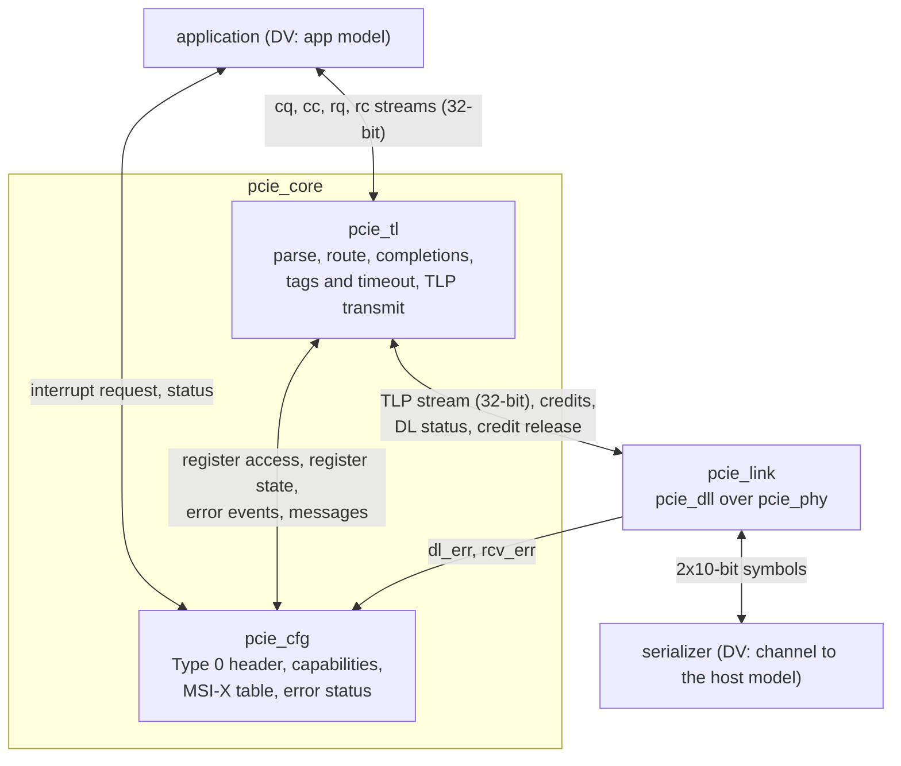

# pcie_core HAS

`pcie_core` is the PCI Express Endpoint of the controller: the transaction
layer `pcie_tl` and the configuration space `pcie_cfg` stacked over the
Gen1 x1 link [`pcie_link`](../link/HAS.md) (decision record
[0004](../../decisions/0004-m3-grill.md#decisions), Q1, Q2). A host
enumerates it through its Type 0 configuration space and uses it through
BAR0; the user logic above it (the application) serves BAR0 and issues its
own memory reads and writes through a valid/ready TLP stream with decoded
headers (Q3), and raises MSI or MSI-X interrupts (Q4). It is not a Root
Port, has one function, no I/O space, no legacy INTx, no AER and no bus
bridge (Q1, Q4, Q7, F1 to F6).

This page owns the endpoint contract: the ports, the stack, reset and
link-down behavior, the parameters and the targets. Its
[application interface page](APP.md) owns the application ports and its
[tl-cfg page](TL_CFG.md) the interface between `tl` and `cfg` (F8). The
`tl` HAS ([#286](https://github.com/amichai-bd/pcie-factory/issues/286))
owns the transaction-layer rules and the `cfg` HAS
([#285](https://github.com/amichai-bd/pcie-factory/issues/285)) the
registers. How it is built is in the [MAS](../../rtl/core/MAS.md); how it
is verified, in the [DV plan](../../dv/core/DV_PLAN.md). Rules from the
PCIe Base Spec rev 3.0 are paraphrased and cited, never copied
([wiki BKM](../../../bkm/wiki.md#citations),
[`pcie-base`](../../references.md#pcie-base)).

## Position

`tl`, `cfg` and `link` are top-level IPs that `pcie_core` integrates, not
sub-IPs: each keeps its own HAS, arch model and unit DV (Q2), as `link`
integrates `dll` and `phy`. `core.rtl.f` reaches their filelists with `-F`
once the stack is integrated ([MAS](../../rtl/core/MAS.md#files)).

## Interfaces

All ports but the lower RX group are synchronous to `clk_i`. Port names
follow the [RTL BKM](../../../bkm/rtl.md#naming).

| Group | Ports | Contract |
| --- | --- | --- |
| Clock and reset | `clk_i`, `rst_i` | [Clocks](#clocks); `rst_i` resets the whole stack. |
| Application streams | `cq_*`, `cc_*`, `rq_*`, `rc_*` | [Application interface](APP.md): completer requests and completions, requester requests and completions. |
| Interrupts | `irq_valid_i`, `irq_ready_o`, `irq_vector_i` (6), `irq_done_o`, `irq_status_o` (2) | [Interrupts](APP.md#interrupts). |
| Function status | `bus_master_en_o`, `mem_space_en_o`, `d_state_o` (2), `max_payload_o` (3), `max_read_req_o` (3) | [Status](APP.md#status). |
| Data link status | `dl_up_o`, `dl_state_o` (2), `dl_err_o` (7) | The `link` ports of the same names ([`link` interfaces](../link/HAS.md#interfaces)). |
| Physical link status | `link_up_o`, `ltssm_state_o` (6), `rcv_err_o` | The `link` ports of the same names. `core` has no link control inputs ([stack wiring](#stack-wiring)). |
| Lower symbol interface | `ser_tx_data_o` (20), `ser_tx_elec_idle_o`, `ser_tx_rxdet_i`, `ser_rx_clk_i`, `ser_rx_data_i` (20), `ser_rx_elec_idle_i` | The `link` ports of the same names ([`phy` lower symbol interface](../phy/HAS.md#lower-symbol-interface)). |

Every `link` port `core` exposes keeps its name, direction, width, clock
and meaning.

## Parameters

| Name | Type | Default | Range | Effect |
| --- | --- | --- | --- | --- |
| `FC_PH`, `FC_PD`, `FC_NPH`, `FC_NPD` | `int unsigned` | 8, 32, 8, 8 | 1 to 127, 8 to 2047, 1 to 127, 2 to 2047 | Passed to `link`: the posted and non-posted credits advertised. Never infinite: `tl` sizes its request queues from them ([credits](#credits)). |
| `TIMEOUT_DIV`, `ERR_TIMEOUT_DIV` | `int unsigned` | 1, 1 | 1 to 1024 | Passed to `link` ([`link` parameters](../link/HAS.md#parameters)). FPGA and ASIC builds use 1. |
| `CPL_TIMEOUT_DIV` | `int unsigned` | 1 | 1 to 1024 | Passed to `tl`: divides its completion timeout, which the `tl` HAS sets ([#286](https://github.com/amichai-bd/pcie-factory/issues/286)). FPGA and ASIC builds use 1; DV uses more to reach a timeout. |
| `BAR0_ADDR_W` | `int unsigned` | 12 | 12 to 28 | BAR0 is 2^`BAR0_ADDR_W` bytes (4 KiB to 256 MiB), 32-bit, non-prefetchable (F3); the width of `cq_addr_o`. |
| `MSIX_TABLE_SIZE` | `int unsigned` | 8 | 1 to 64 | MSI-X vectors (F4). BAR2 is 4 KiB, 32-bit, non-prefetchable: the table at offset 0, the pending-bit array at 0x800. |
| `VENDOR_ID`, `DEVICE_ID`, `SUBSYS_VENDOR_ID`, `SUBSYS_ID` | `logic [15:0]` | 16'h0000 each | any but 16'hFFFF | Passed to `cfg`. Placeholders that claim no assigned vendor (F7). |
| `CLASS_CODE` | `logic [23:0]` | 24'hFF0000 | any | Passed to `cfg`: base class FFh, a device that fits no defined class. |
| `REVISION_ID` | `logic [7:0]` | 8'h00 | any | Passed to `cfg`. |

The completion credits are not parameters: `core` passes `FC_CPLH` and
`FC_CPLD` 0 (infinite) to `link`, as an Endpoint must
[cite: PCIe Base Spec, rev 3.0, §2.6.1]. Fixed (F2): maximum payload and
maximum read request 128 bytes, tags 0 to 7, a 64-byte read completion
boundary, VC0 only, no ECRC.

## Behavior

### Clocks

`clk_i` (125 MHz) runs `tl`, `cfg` and all of `link` but the PCS receive
front end, which runs on `ser_rx_clk_i`. The clock and reset contracts are
the [`link` ones](../link/HAS.md#clocks-and-resets), unchanged: `tl` and
`cfg` add no clock and no crossing.

### Reset

- `rst_i` (synchronous, active high, at least 8 `clk_i` cycles) resets
  `link`, `tl` and `cfg`.
- `tl` and `cfg` are also held in reset in every cycle where the `link`
  `dl_up_o` is 0. For an Upstream Port the link going down is a reset of
  the function [cite: PCIe Base Spec, rev 3.0, §2.9.1]
  [cite: PCIe Base Spec, rev 3.0, §6.6.1]. A Hot Reset from the host takes
  the LTSSM out of L0, so `link_up_o` and then `dl_up_o` fall: it resets
  the function the same way. No function-level reset is offered.
- Reset values, while `rst_i` is 1: the `link` outputs at their
  [reset values](../link/HAS.md#reset-values); while `rst_i` is 1 or
  `dl_up_o` is 0, `cq_valid_o`, `cc_ready_o`, `rq_ready_o`, `rc_valid_o`,
  `irq_ready_o`, `irq_done_o`, `bus_master_en_o`, `mem_space_en_o`,
  `d_state_o` (D0) and `max_payload_o` (128 bytes) 0, and
  `max_read_req_o` 2 (512 bytes, the register's reset value
  [cite: PCIe Base Spec, rev 3.0, §7.8.4]). Data outputs are don't care
  while not qualified.

### Stack wiring

| `core` joins | How |
| --- | --- |
| `link` upper TLP stream, credits available, `dl_up_o` to `tl` | Port for port. `tl` holds `tlp_rx_ready_i` at 1 whenever `dl_up_o` is 1, the [`dll` upper-layer obligation](../dll/HAS.md#receive) for infinite completion credits. |
| `link` `port_role_i` | Tied to 1: upstream port (Q1). |
| `link` `retrain_req_i`, `hot_reset_req_i`, `disable_req_i`, `loopback_req_i` | Tied to 0. Hot Reset and Disabled are downstream-port requests, Retrain Link is a downstream port's register bit [cite: PCIe Base Spec, rev 3.0, §7.8.7], and Loopback master is not used. The `dll` REPLAY_NUM rollover still retrains inside `link`. |
| `link` `dl_err_o`, `rcv_err_o` | To `cfg` ([link to cfg](TL_CFG.md#link-to-cfg)) and to the `core` ports. |
| `tl` and `cfg` | The [tl-cfg interface](TL_CFG.md). |
| Application streams; interrupts and status | To `tl`; to `cfg`. |

### Request routing

What `tl` does with each received TLP, as far as `core` sees it (F1; the
`tl` HAS owns the full rules):

| Received | Goes to |
| --- | --- |
| Memory read or write hitting BAR0 ([BAR hit](TL_CFG.md#register-state)) | The application, on `cq`. |
| Memory read or write hitting BAR2 | `cfg` ([register access](TL_CFG.md#register-access)). |
| Type 0 configuration read or write to function 0 | `cfg`. |
| Completion | The application, on `rc`, by tag; unexpected ones are dropped and reported. |
| Anything else (other memory addresses, I/O, locked, Type 1, messages) | Unsupported Request, or a message handled or dropped as the `tl` HAS states. |

### Credits

`link` advertises finite posted and non-posted credits and infinite
completion credits, and `tl` must take every received TLP at once. So that
the application can stall `cq` and a read can wait for a free handle, `tl`
queues received posted and non-posted requests per class, each queue
sized by the credits advertised, and the credits of a request return to
the host only when the request leaves `tl`'s queue (to the application or
`cfg`, or answered with Unsupported Request), not when `link` delivers
it. This needs a credit-release input on `link` and `dll`, which return
credits at delivery today ([open questions](#open-questions)). Completions
need no release: `tl` reserves room for every outstanding read (8 of at
most 128 bytes).

### Link down

When `dl_up_o` falls, `link` has already abandoned every TLP it holds
([`dll` control states](../dll/HAS.md#data-link-control-states)). `tl` and
`cfg` are reset, so:

- every queued and offered request, every completer read handle and every
  outstanding requester tag is dropped; no completion is sent or delivered
  for them, and no timeout is reported;
- the configuration space returns to its reset values (bus and device
  number, BARs, enables, MSI and MSI-X state, pending bits): the host
  enumerates again after the next link-up;
- the application sees `dl_up_o` 0 and the streams idle, abandons its own
  packets in progress, pending reads and interrupt request, and restarts
  every stream with a `sop` beat once `dl_up_o` is 1 again.

A retrain (Recovery) keeps `dl_up_o` at 1: traffic pauses and resumes,
nothing is lost ([`link` stack wiring](../link/HAS.md#stack-wiring)).

## Decisions

| Choice | Rationale | Rejected |
| --- | --- | --- |
| 32-bit beats on all four streams | One DW per `clk_i` cycle is 500 MB/s per stream, twice the 250 MB/s Gen1 x1 line; it matches the `dll` stream, so `tl` needs no width conversion and the application keeps up with a 128-byte write (32 beats in the 74 cycles it takes on the line). | 64-bit beats (twice the muxes and buffers for no rate gain until Gen2 or a wider link). |
| Decoded headers, data in DWs, `tl` forms completions | The application sees addresses, lengths and byte enables, never TLP formats; splitting on the read completion boundary stays in `tl`. | Raw TLPs (every application re-implements the header rules); the application forming its completions. |
| Completer reads answered by handle (8) | The application returns 3 bits; `tl` keeps the requester ID, tag, attributes and address for the completion. Eight matches the requester side (F2). | Passing the requester ID and tag through the application (wider ports, one more contract to check). |
| The application chooses requester tags 0 to 7 | It already tracks its reads; `tl` checks the tag is free. | `tl` allocating tags (a return path to the application before the read is sent). |
| Credits released when a request leaves `tl` | Bounds `tl`'s queues by the advertised credits and lets the application stall; the host sends no more than `core` can hold. | Releasing at delivery, as `dll` does today: then nothing bounds what the host sends, so either `tl` needs unbounded queues or the application must never stall and must queue unbounded reads itself. |
| Endpoint only: upstream role and no link control inputs | Q1. The downstream-only requests and Retrain Link do not apply. | Exposing the `link` controls (inputs with no legal use). |
| `tl` and `cfg` held in reset while `dl_up_o` is 0 | One rule covers link-down, Hot Reset and power-on alike. | Separate link-down clean-up logic in each IP. |
| Flat `logic` nets between `tl` and `cfg` | They are the top ports of two top-level IPs and mirror the interface this HAS names, the [RTL BKM](../../../bkm/rtl.md#structs-at-interfaces) exception; inside each IP, structs. | Structs in `common_pkg` (a shared package for one pair of IPs). |
| BAR bases cross, not a hit signal | The sizes are parameters both IPs know; `tl` decodes on its own receive path. | A hit signal from `cfg` (a round trip through `cfg` on every request). |
| `cfg` decides error messages; `tl` reports events | Severity, enables and status bits sit together in `cfg`. | `tl` deciding from enables (the enables cross and the rules split). |
| `cfg` resolves interrupts and owns the application's interrupt port | MSI and MSI-X state, the table and pending bits stay in `cfg`; `tl` only sends writes. MSI-X wins if both are enabled. | `tl` reading the table through `cfg` (the state crosses and unmasking needs `tl`). |
| No error inputs from the application, no Completer Abort | Every BAR0 read is answered with data; M3 needs no completer error. | A Completer Abort status on `cc` (no M3 user). |
| BAR2 fixed at 4 KiB, at most 64 vectors | One page holds the largest table (1 KiB) and the pending bits; `tl`'s BAR2 decode is fixed. | A BAR2 size that follows `MSIX_TABLE_SIZE`. |
| Identity defaults all zero, class FFh | Claim no assigned vendor (F7). | Any assigned or commonly reused ID. |

## Targets

Measured with `core` back to back with a host's `link`, error-free, the
application and the host always taking and offering. The line rate and the payload
measure are the [`link` targets](../link/HAS.md#targets)'. `tl` adds no
bytes on the line: each target is a fraction of the `link` payload rate.

| Item | Target | Check |
| --- | --- | --- |
| Host writes in | 128-byte memory writes from the host to BAR0, back to back: payload delivered on `cq` at least **0.98 of the `link` one-way payload rate** (0.98 × 0.85 = 0.833 of the line, 208 MB/s). | `mwr_derived` (closed form); to be confirmed by the `core` arch model, [#287](https://github.com/amichai-bd/pcie-factory/issues/287) |
| Application writes out | The same, the application writing to the host on `rq`. | as above |
| Both ways | Both at once: at least 0.98 of the `link` both-ways payload rate (0.98 × 0.76 = 0.745 of the line, 186 MB/s) in each direction. | as above |
| Enumeration and traffic | Goal items 4 to 6 of the [M3 record](../../decisions/0004-m3-grill.md#goal), end to end against the host model. | [#293](https://github.com/amichai-bd/pcie-factory/issues/293) |
| FPGA clock | `clk_i` and `ser_rx_clk_i` at 50 MHz on the DE2-115 (Quartus): timing and resources only (M1 Q26). | [#295](https://github.com/amichai-bd/pcie-factory/issues/295) |
| ASIC clock | sky130hd (ORFS): the gate is the 100 MHz checkpoint in study mode (M1 Q27); 125 MHz reported nightly, its closure future work ([#235](https://github.com/amichai-bd/pcie-factory/issues/235)). | [#296](https://github.com/amichai-bd/pcie-factory/issues/296) |

The 0.98: a 128-byte write is 35 beats on the `dll` stream and 32 on the
application's, against 74 cycles on the line, so neither `tl` nor the
application limits the rate. The 2% covers the start and drain of a finite
run and the longer credit loop of the [release rule](#credits): 8 posted
header and 32 data credits cover four 128-byte writes, about 296 cycles of
line, against a release loop of about 150 cycles.

## Architecture model

Until [#287](https://github.com/amichai-bd/pcie-factory/issues/287)
composes the `tl`, `cfg` and `link` models,
[`pcie_core_arch.py`](../../../../src/arch/core/pcie_core_arch.py) is a
closed-form placeholder: it takes the `link` model's throughput derivation
and checks that the `dll` stream and the application streams carry a
128-byte write in fewer cycles than the line. `./build arch --ip core`
writes `workdir/core/arch/perf.json`.

| Scenario | Workload |
| --- | --- |
| [`mwr_derived`](../../../../src/arch/core/perf/mwr_derived.yaml) | 128-byte MWr one way, closed form. |
| [`mwr_bidir_derived`](../../../../src/arch/core/perf/mwr_bidir_derived.yaml) | 128-byte MWr both ways, closed form. |

## Open questions

The Base Spec is not in the local cache (`./build specs list`:
`local-not-provided`); every rule below is this design's reading.

| Item | Owner |
| --- | --- |
| **Credit release.** The [credits](#credits) rule needs `link` and `dll` to return posted and non-posted credits on a release from `tl`, not at delivery: a change to two signed-off IPs and to M2 Q5's "unchanged" `link`. The fallback keeps `link` unchanged and makes the application never stall `cq` and queue any number of host reads itself. | Captain |
| **Link down resets the function**, as [reset](#reset) states, including the configuration space. | Captain |
| **D3hot:** memory requests are Unsupported Requests and the function issues no requests or interrupts outside D0 ([BAR hit](TL_CFG.md#register-state), [interrupts](APP.md#interrupts)) [cite: PCIe Base Spec, rev 3.0, §5.3.1.4]. | Captain; [#285](https://github.com/amichai-bd/pcie-factory/issues/285), [#286](https://github.com/amichai-bd/pcie-factory/issues/286) |
| **MSI-X with bus mastering disabled:** this design drops the request; the spec may require setting the pending bit instead. | Captain; [#285](https://github.com/amichai-bd/pcie-factory/issues/285) |
| **Placeholder IDs:** Vendor ID 0x0000 claims no vendor but some host software skips it; a real board needs an assigned ID. | Captain |
| **Throughput targets** from the closed form; the composed model confirms or corrects them. | [#287](https://github.com/amichai-bd/pcie-factory/issues/287) |
| The cited sections on this page and its sub-pages, checked against rev 3.0. | Captain, with a local copy |
