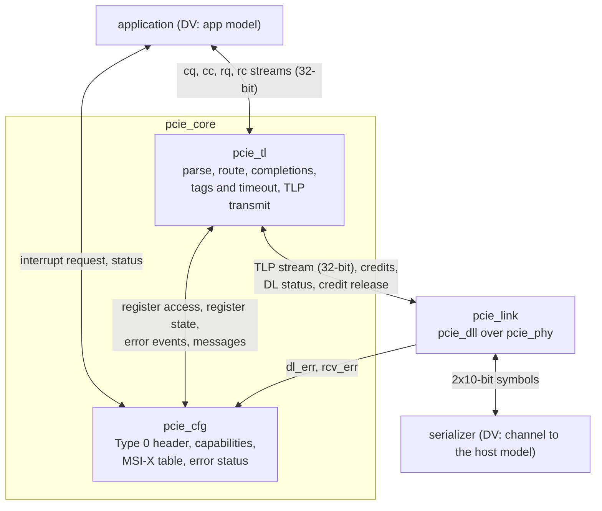

# pcie_core HAS

`pcie_core` is the PCI Express Endpoint of the controller: the transaction
layer `pcie_tl` and the configuration space `pcie_cfg` stacked over the
Gen1 x1 link [`pcie_link`](../link/HAS.md) (decision record
[0004](../../decisions/0004-m3-grill.md#decisions), Q1, Q2). A host
enumerates it through its Type 0 configuration space and uses it through
BAR0; the user logic above it (the application) serves BAR0 and issues its
own memory reads and writes through a valid/ready TLP stream with decoded
headers (Q3), and raises MSI or MSI-X interrupts (Q4). It is not a Root
Port, has one function, no I/O space, no legacy INTx, no AER and no bus
bridge (Q1, Q4, Q7, F1 to F6).

This page owns the endpoint contract: the ports, the stack, reset and
link-down behavior, the parameters and the targets. Its
[application interface page](APP.md) owns the application ports and its
[tl-cfg page](TL_CFG.md) the interface between `tl` and `cfg` (F8). The
`tl` HAS ([#286](https://github.com/amichai-bd/pcie-factory/issues/286))
owns the transaction-layer rules and the `cfg` HAS
([#285](https://github.com/amichai-bd/pcie-factory/issues/285)) the
registers. How it is built is in the [MAS](../../rtl/core/MAS.md); how it
is verified, in the [DV plan](../../dv/core/DV_PLAN.md). Rules from the
PCIe Base Spec rev 3.0 are paraphrased and cited, never copied
([wiki BKM](../../../bkm/wiki.md#citations),
[`pcie-base`](../../references.md#pcie-base)).

## Position

`tl`, `cfg` and `link` are top-level IPs that `pcie_core` integrates, not
sub-IPs: each keeps its own HAS, arch model and unit DV (Q2), as `link`
integrates `dll` and `phy`. `core.rtl.f` reaches their filelists with `-F`
once the stack is integrated ([MAS](../../rtl/core/MAS.md#files)).

## Interfaces

All ports but the lower RX group are synchronous to `clk_i`. Port names
follow the [RTL BKM](../../../bkm/rtl.md#naming).

| Group | Ports | Contract |
| --- | --- | --- |
| Clock and reset | `clk_i`, `rst_i` | [Clocks](#clocks); `rst_i` resets the whole stack. |
| Application streams | `cq_*`, `cc_*`, `rq_*`, `rc_*` | [Application interface](APP.md): completer requests and completions, requester requests and completions. |
| Interrupts | `irq_valid_i`, `irq_ready_o`, `irq_vector_i` (6), `irq_done_o`, `irq_status_o` (2) | [Interrupts](APP.md#interrupts). |
| Function status | `bus_master_en_o`, `mem_space_en_o`, `d_state_o` (2), `max_payload_o` (3), `max_read_req_o` (3) | [Status](APP.md#status). |
| Data link status | `dl_up_o`, `dl_state_o` (2), `dl_err_o` (7) | The `link` ports of the same names ([`link` interfaces](../link/HAS.md#interfaces)). |
| Physical link status | `link_up_o`, `ltssm_state_o` (6), `rcv_err_o` | The `link` ports of the same names. `core` has no link control inputs ([stack wiring](#stack-wiring)). |
| Lower symbol interface | `ser_tx_data_o` (20), `ser_tx_elec_idle_o`, `ser_tx_rxdet_i`, `ser_rx_clk_i`, `ser_rx_data_i` (20), `ser_rx_elec_idle_i` | The `link` ports of the same names ([`phy` lower symbol interface](../phy/HAS.md#lower-symbol-interface)). |

Every `link` port `core` exposes keeps its name, direction, width, clock
and meaning.

## Parameters

| Name | Type | Default | Range | Effect |
| --- | --- | --- | --- | --- |
| `FC_PH`, `FC_PD`, `FC_NPH`, `FC_NPD` | `int unsigned` | 8, 32, 8, 8 | 1 to 127, 8 to 2047, 1 to 127, 2 to 2047 | Passed to `link`: the posted and non-posted credits advertised. Never infinite: `tl` sizes its request queues from them ([credits](#credits)). |
| `TIMEOUT_DIV`, `ERR_TIMEOUT_DIV` | `int unsigned` | 1, 1 | 1 to 1024 | Passed to `link` ([`link` parameters](../link/HAS.md#parameters)). FPGA and ASIC builds use 1. |
| `CPL_TIMEOUT_DIV` | `int unsigned` | 1 | 1 to 1024 | Passed to `tl`: divides its completion timeout, which the `tl` HAS sets ([#286](https://github.com/amichai-bd/pcie-factory/issues/286)). FPGA and ASIC builds use 1; DV uses more to reach a timeout. |
| `BAR0_ADDR_W` | `int unsigned` | 12 | 12 to 28 | BAR0 is 2^`BAR0_ADDR_W` bytes (4 KiB to 256 MiB), 32-bit, non-prefetchable (F3); the width of `cq_addr_o`. |
| `MSIX_TABLE_SIZE` | `int unsigned` | 8 | 1 to 64 | MSI-X vectors (F4). BAR2 is 4 KiB, 32-bit, non-prefetchable: the table at offset 0, the pending-bit array at 0x800. |
| `VENDOR_ID`, `DEVICE_ID`, `SUBSYS_VENDOR_ID`, `SUBSYS_ID` | `logic [15:0]` | 16'h0000 each | any but 16'hFFFF | Passed to `cfg`. Placeholders that claim no assigned vendor (F7). |
| `CLASS_CODE` | `logic [23:0]` | 24'hFF0000 | any | Passed to `cfg`: base class FFh, a device that fits no defined class. |
| `REVISION_ID` | `logic [7:0]` | 8'h00 | any | Passed to `cfg`. |

The completion credits are not parameters: `core` passes `FC_CPLH` and
`FC_CPLD` 0 (infinite) to `link`, as an Endpoint must
[cite: PCIe Base Spec, rev 3.0, §2.6.1]. Fixed (F2): maximum payload and
maximum read request 128 bytes, tags 0 to 7, a 64-byte read completion
boundary, VC0 only, no ECRC.

## Behavior

### Clocks

`clk_i` (125 MHz) runs `tl`, `cfg` and all of `link` but the PCS receive
front end, which runs on `ser_rx_clk_i`. The clock and reset contracts are
the [`link` ones](../link/HAS.md#clocks-and-resets), unchanged: `tl` and
`cfg` add no clock and no crossing.

### Reset

- `rst_i` (synchronous, active high, at least 8 `clk_i` cycles) resets
  `link`, `tl` and `cfg`.
- `tl` and `cfg` are also held in reset in every cycle where the `link`
  `dl_up_o` is 0 (decision record
  [0004](../../decisions/0004-m3-grill.md#updates), Q10). For an Upstream Port the link going down is a reset of
  the function [cite: PCIe Base Spec, rev 3.0, §2.9.1]
  [cite: PCIe Base Spec, rev 3.0, §6.6.1]. A Hot Reset from the host takes
  the LTSSM out of L0, so `link_up_o` and then `dl_up_o` fall: it resets
  the function the same way. No function-level reset is offered.
- Reset values, while `rst_i` is 1: the `link` outputs at their
  [reset values](../link/HAS.md#reset-values); while `rst_i` is 1 or
  `dl_up_o` is 0, `cq_valid_o`, `cc_ready_o`, `rq_ready_o`, `rc_valid_o`,
  `irq_ready_o`, `irq_done_o`, `bus_master_en_o`, `mem_space_en_o`,
  `d_state_o` (D0) and `max_payload_o` (128 bytes) 0, and
  `max_read_req_o` 2 (512 bytes, the register's reset value
  [cite: PCIe Base Spec, rev 3.0, §7.8.4]). Data outputs are don't care
  while not qualified.

### Stack wiring

| `core` joins | How |
| --- | --- |
| `link` upper TLP stream, credits available, `dl_up_o` to `tl` | Port for port. `tl` holds `tlp_rx_ready_i` at 1 whenever `dl_up_o` is 1, the [`dll` upper-layer obligation](../dll/HAS.md#receive) for infinite completion credits. |
| `link` `port_role_i` | Tied to 1: upstream port (Q1). |
| `link` `retrain_req_i`, `hot_reset_req_i`, `disable_req_i`, `loopback_req_i` | Tied to 0. Hot Reset and Disabled are downstream-port requests, Retrain Link is a downstream port's register bit [cite: PCIe Base Spec, rev 3.0, §7.8.7], and Loopback master is not used. The `dll` REPLAY_NUM rollover still retrains inside `link`. |
| `link` `dl_err_o`, `rcv_err_o` | To `cfg` ([link to cfg](TL_CFG.md#link-to-cfg)) and to the `core` ports. |
| `tl` and `cfg` | The [tl-cfg interface](TL_CFG.md). |
| Application streams; interrupts and status | To `tl`; to `cfg`. |

### Request routing

What `tl` does with each received TLP, as far as `core` sees it (F1; the
`tl` HAS owns the full rules):

| Received | Goes to |
| --- | --- |
| Memory read or write hitting BAR0 ([BAR hit](TL_CFG.md#register-state)) | The application, on `cq`. |
| Memory read or write hitting BAR2 | `cfg` ([register access](TL_CFG.md#register-access)). |
| Type 0 configuration read or write to function 0 | `cfg`. |
| Completion | The application, on `rc`, by tag; unexpected ones are dropped and reported. |
| Anything else (other memory addresses, I/O, locked, Type 1, messages) | Unsupported Request, or a message handled or dropped as the `tl` HAS states. |

### Credits

`link` advertises finite posted and non-posted credits and infinite
completion credits, and `tl` must take every received TLP at once. So that
the application can stall `cq` and a read can wait for a free handle, `tl`
queues received posted and non-posted requests per class, each queue
sized by the credits advertised, and the credits of a request return to
the host only when the request leaves `tl`'s queue (to the application or
`cfg`, or answered with Unsupported Request), not when `link` delivers
it (decision record [0004](../../decisions/0004-m3-grill.md#updates),
Q9). `link` and `dll` gain the credit-release input this needs; they
return credits at delivery until then
([#303](https://github.com/amichai-bd/pcie-factory/issues/303)), and
`core` and `tl` assume it. Completions need no release: `tl` reserves room
for every outstanding read (8 of at most 128 bytes).

Non-posted requests may pass one another
[cite: PCIe Base Spec, rev 3.0, §2.4.1], so configuration and BAR2
requests pass BAR0 reads waiting for a free handle: enumeration and
interrupt set-up never wait on the application. How `tl` arranges its
non-posted queue to do so is the `tl` HAS's
([#286](https://github.com/amichai-bd/pcie-factory/issues/286)).

### Link down

When `dl_up_o` falls, `link` has already abandoned every TLP it holds
([`dll` control states](../dll/HAS.md#data-link-control-states)). `tl` and
`cfg` are reset, so:

- every queued and offered request, every completer read handle and every
  outstanding requester tag is dropped; no completion is sent or delivered
  for them, and no timeout is reported;
- the configuration space returns to its reset values (bus and device
  number, BARs, enables, MSI and MSI-X state, the MSI-X vector masks and
  pending bits): the host enumerates again after the next link-up. The
  MSI-X table entries (address and data) sit in a RAM and are not
  cleared: like every other register, software programs them again
  before it unmasks a vector (firstmate decision, F4);
- the application sees `dl_up_o` 0 and the streams idle, abandons its own
  packets in progress, pending reads and interrupt request, and restarts
  every stream with a `sop` beat once `dl_up_o` is 1 again.

A retrain (Recovery) keeps `dl_up_o` at 1: traffic pauses and resumes,
nothing is lost ([`link` stack wiring](../link/HAS.md#stack-wiring)).

## Decisions

Rows citing Q9 to Q12 are the captain's decisions of 2026-10-18
(decision record [0004](../../decisions/0004-m3-grill.md#updates)). The
others are firstmate decisions as the captain's delegate, which the
captain may override.

| Choice | Rationale | Rejected |
| --- | --- | --- |
| 32-bit beats on all four streams | One DW per `clk_i` cycle is 500 MB/s per stream, twice the 250 MB/s Gen1 x1 line; it matches the `dll` stream, so `tl` needs no width conversion and the application keeps up with a 128-byte write (32 beats in the 74 cycles it takes on the line). | 64-bit beats (twice the muxes and buffers for no rate gain until Gen2 or a wider link). |
| Decoded headers, data in DWs, `tl` forms completions | The application sees addresses, lengths and byte enables, never TLP formats; splitting on the read completion boundary stays in `tl`. | Raw TLPs (every application re-implements the header rules); the application forming its completions. |
| Completer reads answered by handle (8) | The application returns 3 bits; `tl` keeps the requester ID, tag, attributes and address for the completion. Eight matches the requester side (F2). | Passing the requester ID and tag through the application (wider ports, one more contract to check). |
| The application chooses requester tags 0 to 7 | It already tracks its reads; `tl` checks the tag is free. | `tl` allocating tags (a return path to the application before the read is sent). |
| Credits released when a request leaves `tl`, through a new `link` and `dll` input (Q9, amending M2 Q5; [#303](https://github.com/amichai-bd/pcie-factory/issues/303)) | Bounds `tl`'s queues by the advertised credits and lets the application stall; the host sends no more than `core` can hold. | Releasing at delivery with `link` unchanged: nothing bounds what the host sends, so the application must never stall `cq` and must queue any number of host reads itself, and `tl` has no bound on the configuration and BAR2 reads and Unsupported Request completions it holds. |
| Endpoint only: upstream role and no link control inputs | Q1. The downstream-only requests and Retrain Link do not apply. | Exposing the `link` controls (inputs with no legal use). |
| `tl` and `cfg`, configuration space included, held in reset while `dl_up_o` is 0; no function-level reset (Q10) | One rule covers link-down, Hot Reset and power-on alike. | Separate link-down clean-up logic in each IP; a function-level reset (no M3 user). |
| Outside D0, memory requests get Unsupported Request and the function issues no `rq` requests and no interrupt writes, but still sends completions (configuration completions, the completion for the Power State write back to D0, Unsupported Request completions); an MSI or MSI-X request that may not go out yet is held pending and sent once allowed (Q11) | No interrupt is lost; one "allowed" rule (bus mastering on, D0) gates every request and interrupt [cite: PCIe Base Spec, rev 3.0, §5.3.1.4]. | Dropping interrupts while bus mastering is off; withholding completions outside D0 (the host could not return the function to D0). |
| No ERR_COR, ERR_NONFATAL or ERR_FATAL message outside D0; the error status bits still record the event, and nothing is held and sent on the return to D0 ([outside D0](TL_CFG.md#outside-d0); firstmate decision) | A function outside D0 originates no requests other than PME, which `core` does not implement [cite: PCIe Base Spec, rev 3.0, §5.3.1.4]; software reads the status bits after it restores D0. | Sending error messages in D3hot; holding them for D0 (a stale report and state to keep). |
| MSI-X pending bits kept while MSI-X is disabled or MSI is chosen, cleared only by reset, and sent only while MSI-X is enabled ([resolution](TL_CFG.md#interrupt-resolution); firstmate decision) | The pending-bit array is software-visible state; keeping it loses no interrupt across a mode switch. | Clearing the bits when MSI-X Enable is cleared (loses interrupts). |
| An offered message may be withdrawn (`msg_valid` falls without `msg_ready`) only when it may no longer go out: outside D0, Bus Master Enable cleared, its interrupt mode's enable cleared, or reset; a withdrawn interrupt becomes pending, a withdrawn error message is discarded ([withdrawal](TL_CFG.md#withdrawal); firstmate decision) | The outside-D0 and no-wait rules together need it: a Power State write to D3hot completes while a message waits for `msg_ready`. `tl` samples a message only in the cycle it takes it. | Holding an offer until taken (a message after leaving D0, or `cfg` stalling the Power State write, which breaks the no-wait rule). |
| Completion Timeout Disable supported, through `cpl_timeout_dis` to `tl`; no programmable range, so the fixed `tl` timeout lies between 50 µs and 50 ms (the `tl` HAS uses 2^21 cycles, about 16.8 ms at 125 MHz) ([register state](TL_CFG.md#register-state); firstmate decision) | An Endpoint that issues requests of its own must support the disable [cite: PCIe Base Spec, rev 3.0, §7.8.15]; a fixed value keeps `tl` simple. | Advertising no disable (non-compliant for a requester); programmable ranges (more `tl` logic, no M3 user). |
| `tl` reports outstanding application non-posted requests on `tl_np_pending` (firstmate decision) | Device Status Transactions Pending must reflect them, and only `tl` tracks tags. | Hardwiring Transactions Pending to 0. |
| MSI-X table address and data not cleared by a link-down reset; masks and pending bits are (firstmate decision) | F4 puts the table in a `common` RAM; software reprograms it after any reset, as it does the rest of the header. | Clearing 64 × 3 DWs in flops. |
| `rq` order kept within posted writes and within reads; a posted write may pass a read waiting for credits ([application ordering](APP.md#requester-requests); firstmate decision) | Posted requests must be able to pass non-posted ones, or a host that withholds non-posted credits until it sees a posted write deadlocks the link [cite: PCIe Base Spec, rev 3.0, §2.4.1]. | One order for all `rq` requests (a write stuck behind a credit-blocked read). |
| Configuration and BAR2 requests pass BAR0 reads waiting for a handle | Enumeration never depends on the application answering; non-posted requests may pass one another. | One strict non-posted order (a slow application blocks configuration). |
| Flat `logic` nets between `tl` and `cfg` | They are the top ports of two top-level IPs and mirror the interface this HAS names, the [RTL BKM](../../../bkm/rtl.md#structs-at-interfaces) exception; inside each IP, structs. | Structs in `common_pkg` (a shared package for one pair of IPs). |
| BAR bases cross, not a hit signal | The sizes are parameters both IPs know; `tl` decodes on its own receive path. | A hit signal from `cfg` (a round trip through `cfg` on every request). |
| `cfg` decides error messages; `tl` reports events | Severity, enables and status bits sit together in `cfg`. | `tl` deciding from enables (the enables cross and the rules split). |
| `cfg` resolves interrupts and owns the application's interrupt port; MSI and MSI-X state stays in `cfg` | The table, masks and pending bits stay where software writes them; `tl` only sends the writes `cfg` asks for. MSI-X wins if both are enabled; MSI ignores the vector. This departs from #284's acceptance wording, which lists MSI and MSI-X state among what `tl` needs. | `tl` reading the table through `cfg` (the state crosses and unmasking needs `tl`). |
| No error inputs from the application, no Completer Abort | Every BAR0 read is answered with data; M3 needs no completer error. | A Completer Abort status on `cc` (no M3 user). |
| BAR2 fixed at 4 KiB, at most 64 vectors | One page holds the largest table (1 KiB) and the pending bits; `tl`'s BAR2 decode is fixed. | A BAR2 size that follows `MSIX_TABLE_SIZE`. |
| Identity defaults all zero, class FFh (Q12 for the Vendor ID) | Claim no assigned vendor (F7); users override the ID parameters. | Any assigned or commonly reused ID. |
| Throughput at least 0.98 of the `link` payload rate | See [targets](#targets); `tl` adds no line bytes. | 1.0 (no margin for start, drain and the longer credit loop). |

## Targets

Measured by the [architecture model](#architecture-model) with `core`
back to back with a host's `link`, error-free, default parameters unless
the row says otherwise, the
application and the host always taking and offering, after the host has
enumerated the function. The line rate and the payload measure are the
[`link` targets](../link/HAS.md#targets)'. `tl` adds no bytes on the line.
Each throughput target has two bounds, both checked: `core`'s payload rate
is at least 0.98 of the `link` payload rate (`fraction_of_link`, against
the `link` closed form), and at least 0.98 of the `link` payload target as
a fraction of the line (`payload_line_fraction`). One-way writes use the
one-way `link` figures (closed form 0.857, target 0.85, so ≥ 0.833); reads
and traffic both ways use the both-ways ones (0.775 and 0.76, so ≥ 0.745),
since the completion direction also carries the Ack and UpdateFC of every
read ([`link` throughput](../link/HAS.md#throughput)).

| Item | Target | Measured | Scenario |
| --- | --- | --- | --- |
| Host writes in | 128-byte memory writes from the host to BAR0, payload on `cq`: ≥ 0.98 of the link rate, ≥ 0.833 of the line (208 MB/s). | 0.999, 0.856 | [`host_write`](../../../../src/arch/core/perf/host_write.yaml) |
| Host reads | 128-byte reads from BAR0, the application answering in 16 cycles: ≥ 0.98, ≥ 0.745 (186 MB/s). | 0.999, 0.774 | [`host_read`](../../../../src/arch/core/perf/host_read.yaml) |
| Split reads | 512 bytes at offset 4: 5 completions; 4 KiB aligned: 32; 128 bytes at offset 4 (across a 64-byte boundary): 1; every field checked by the host stand-in, and a split accepted only while more than 128 bytes are left. | 5, 32, 1; no error | [`host_read_split`](../../../../src/arch/core/perf/host_read_split.yaml), [`host_read_4k`](../../../../src/arch/core/perf/host_read_4k.yaml), [`host_read_unaligned`](../../../../src/arch/core/perf/host_read_unaligned.yaml) |
| Application writes out | 128-byte writes on `rq`: ≥ 0.98, ≥ 0.833. | 0.999, 0.856 | [`app_write`](../../../../src/arch/core/perf/app_write.yaml) |
| Application reads | 128-byte reads on `rq`, host latency 100 cycles: ≥ 0.98, ≥ 0.745. | 0.998, 0.773 | [`app_read`](../../../../src/arch/core/perf/app_read.yaml) |
| Both ways | Host writes in and application writes out at once, in each direction: ≥ 0.98 of the both-ways link rate, ≥ 0.745. | 1.000, 0.774 | [`bidir_write`](../../../../src/arch/core/perf/bidir_write.yaml) |
| Enumeration | IDs, capability walk, BAR sizing and assignment, enables, MSI and MSI-X set-up and one interrupt each way, for default and random parameters: no mismatch. | no mismatch; 4950 cycles (40 µs) from DL_Active | [`enumeration`](../../../../src/arch/core/perf/enumeration.yaml) |
| MSI | Each MSI write reaches the host after the `rq` data the application wrote before the request; none lost. | 50 of 50 | [`msi`](../../../../src/arch/core/perf/msi.yaml) |
| MSI-X | `MSIX_TABLE_SIZE` 64: masked vectors pend, the host reads the pending bits set through BAR2, each unmask sends one write and clears its bit; unmasked requests are sent at once. | 64 vectors, 128 writes | [`msix_pending`](../../../../src/arch/core/perf/msix_pending.yaml) |
| Unsupported Request | An I/O read, a memory read just past BAR0, a memory write hitting no BAR, a configuration read to function 1: Unsupported Request completions for the non-posted ones, Unsupported Request Detected, ERR_COR (advisory) and ERR_NONFATAL with reporting enabled, BAR0 still served. | 3 completions, 1 drop per round; no error | [`unsupported_request`](../../../../src/arch/core/perf/unsupported_request.yaml) |
| Enumeration and traffic | Goal items 4 to 6 of the [M3 record](../../decisions/0004-m3-grill.md#goal), end to end against the host model. | | [#293](https://github.com/amichai-bd/pcie-factory/issues/293) |
| FPGA clock | `clk_i` and `ser_rx_clk_i` at 50 MHz on the DE2-115 (Quartus): timing and resources only (M1 Q26). | | [#295](https://github.com/amichai-bd/pcie-factory/issues/295) |
| ASIC clock | sky130hd (ORFS): the gate is the 100 MHz checkpoint in study mode (M1 Q27); 125 MHz reported nightly, its closure future work ([#235](https://github.com/amichai-bd/pcie-factory/issues/235)). | | [#296](https://github.com/amichai-bd/pcie-factory/issues/296) |

The 0.98: a 128-byte write is 35 beats on the `dll` stream and 32 on the
application's, against 74 cycles on the line, so neither `tl` nor the
application limits the rate. The 2% covers the start and drain of a finite
run and the longer credit loop of the [release rule](#credits): 8 posted
header and 32 data credits cover four 128-byte writes, about 296 cycles of
line, against a release loop of about 150 cycles. The composed model
confirms it: every throughput scenario reaches at least 0.997 of the link
rate.

## Architecture model

[`pcie_core_arch.py`](../../../../src/arch/core/pcie_core_arch.py)
composes the sibling models, loaded unchanged from `src/arch/`: the `tl`
model over the endpoint's end of the `link` model's `LinkPair`, and the
`cfg` model behind the [tl-cfg interface](TL_CFG.md) (register access by
DW index, register state, `tl_err` and `dl_err` events,
`tl_np_pending`, the message channel), with the application's interrupt
port on `cfg` and both held in reset while `dl_up_o` is 0. The other end
of the link is a minimal host stand-in for these scenarios: it enumerates
with configuration and BAR2 requests, sends BAR0 traffic, answers the
application's reads, receives interrupt writes and error messages, and
checks each BAR0 read completion by the splitting rules. It is not the
independent host model DV uses, which is
[#288](https://github.com/amichai-bd/pcie-factory/issues/288)'s. Until
[#303](https://github.com/amichai-bd/pcie-factory/issues/303) the host
stand-in keeps the release rule's credit count itself, as in the `tl`
model. The scenarios are error-free: `rcv_err` is not driven. The [self-tests](../../../../src/arch/core/test_pcie_core_arch.py)
check these pages' examples; `./build arch --ip core` runs the
scenarios of the [targets](#targets) and writes
`workdir/core/arch/perf.json`.

## Open questions

The Base Spec is not in the local cache (`./build specs list`:
`local-not-provided`); every rule below is this design's reading.

| Item | Owner |
| --- | --- |
| The cited sections on this page and its sub-pages, checked against rev 3.0; on [TL_CFG](TL_CFG.md#error-events), the poisoned non-posted request answered with Unsupported Request [cite: PCIe Base Spec, rev 3.0, §2.7.2.2]; outside D0, memory requests answered with Unsupported Request [cite: PCIe Base Spec, rev 3.0, §5.3.1.4]. | Captain, with a local copy; [#282](https://github.com/amichai-bd/pcie-factory/issues/282) |
