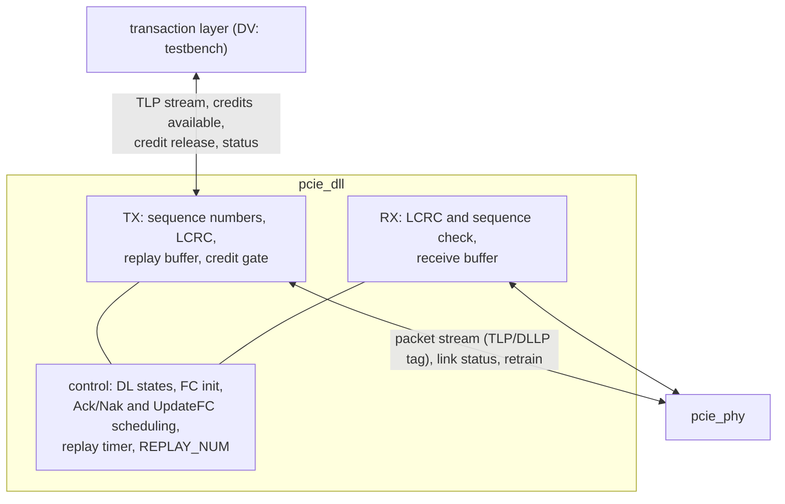

# pcie_dll HAS

`pcie_dll` is the data link layer of the PCI Express controller, for one
Gen1 x1 link on virtual channel 0 (decision record
[0003](../../decisions/0003-m2-grill.md#decisions), Q1, Q4 to Q6). It turns the transaction layer's TLPs into a reliable,
flow-controlled exchange with the link partner: sequence numbers and LCRC,
Ack and Nak, a replay buffer with its timer, credit-based flow control and
the data link control states. Above it sits the transaction layer (a
testbench in M2, the M3 transaction layer later, which adds only the
[credit release](#credit-release); decision record
[0004](../../decisions/0004-m3-grill.md#updates), Q9, amending M2 Q5); below it, the
upper packet stream of [`pcie_phy`](../phy/HAS.md). The `link` IP stacks
`dll` over `phy` (Q4). It is not a transaction layer: it never builds,
orders or checks the contents of a TLP beyond the header fields that flow
control needs, has no ECRC, no power-management handshakes, no extended
features and one virtual channel only (Q6).

The HAS is the normative protocol spec for this design (M1 Q21, carried
over in [0003](../../decisions/0003-m2-grill.md#carried-over-from-m1)): every rule the
design implements is written out here and on its sub-pages, the
[DLLP page](DLLP.md) (types, formats, CRC-16), the
[retry page](RETRY.md) (sequence numbers, LCRC, Ack and Nak, replay) and
the [flow-control page](FLOW_CONTROL.md) (initialisation, accounting,
UpdateFC). Citations point to the PCIe Base Spec rev 3.0 for
cross-checking only; they are paraphrased, never copied
([wiki BKM](../../../bkm/wiki.md#citations),
[`pcie-base`](../../references.md#pcie-base)). How it is built is in the
[MAS](../../rtl/dll/MAS.md); how it is verified, in the
[DV plan](../../dv/dll/DV_PLAN.md).

## Position

One IP, one testbench, no sub-IPs (Q4; M1 Q24): its blocks
are RTL files of `dll` under one filelist, described in the
[MAS](../../rtl/dll/MAS.md), and verified only through the `dll` ports.

## Interfaces

All ports are synchronous to `clk_i`. Port names follow the
[RTL BKM](../../../bkm/rtl.md#naming). Byte order: bits `[7:0]` carry the
earliest byte on the line.

### Clock and reset

| Port | Dir | Width | Clock | Description |
| --- | --- | --- | --- | --- |
| `clk_i` | in | 1 | - | Core clock, 125 MHz, the `phy` `clk_i`. |
| `rst_i` | in | 1 | `clk_i` | Synchronous, active-high reset. |

### Upper TLP stream

One valid/ready stream per direction (Q5). A beat is one DW (4 bytes); a
TLP is its header and data, with no sequence number, LCRC or ECRC, always
a whole number of DWs: 3 to 36 beats. Byte 0 of the TLP (Fmt and Type) is
`[7:0]` of the `sop` beat. A beat is taken at an edge where valid and
ready are both 1.

| Port | Dir | Width | Clock | Description |
| --- | --- | --- | --- | --- |
| `tlp_tx_valid_i` | in | 1 | `clk_i` | A transmit beat is offered. |
| `tlp_tx_ready_o` | out | 1 | `clk_i` | The `dll` takes the beat. |
| `tlp_tx_data_i` | in | 32 | `clk_i` | One DW of the TLP. |
| `tlp_tx_sop_i`, `tlp_tx_eop_i` | in | 1, 1 | `clk_i` | First and last beat. |
| `tlp_rx_valid_o` | out | 1 | `clk_i` | A receive beat is offered. |
| `tlp_rx_ready_i` | in | 1 | `clk_i` | The upper layer takes the beat. |
| `tlp_rx_data_o` | out | 32 | `clk_i` | One DW of a received TLP. |
| `tlp_rx_sop_o`, `tlp_rx_eop_o` | out | 1, 1 | `clk_i` | First and last beat. |

### Credits available

The credits the partner has granted and this side has not used, per class
([flow control](FLOW_CONTROL.md#transmit-accounting)). A field shows all
ones when the partner advertised that field infinite, and 0 outside
DL_Active.

| Port | Dir | Width | Clock | Description |
| --- | --- | --- | --- | --- |
| `fc_ph_avail_o`, `fc_pd_avail_o` | out | 8, 12 | `clk_i` | Posted header and data credits. |
| `fc_nph_avail_o`, `fc_npd_avail_o` | out | 8, 12 | `clk_i` | Non-posted header and data credits. |
| `fc_cplh_avail_o`, `fc_cpld_avail_o` | out | 8, 12 | `clk_i` | Completion header and data credits. |

### Credit release

With `FC_RELEASE` 1, the upper layer returns the posted and non-posted
credits of a delivered TLP when the TLP leaves it, not when the `dll`
delivers it, so it may hold delivered requests in queues bounded by the
advertised credits (Q9). Completions always return at delivery. At most
one release per class per cycle, each a one-cycle pulse for one TLP: 1
header credit and the data credits given.

| Port | Dir | Width | Clock | Description |
| --- | --- | --- | --- | --- |
| `fc_rel_p_i` | in | 1 | `clk_i` | One posted TLP left the upper layer: release 1 posted header credit. |
| `fc_rel_pd_i` | in | 4 | `clk_i` | With `fc_rel_p_i`: its posted data credits, 0 to 8. |
| `fc_rel_np_i` | in | 1 | `clk_i` | One non-posted TLP left the upper layer: release 1 non-posted header credit. |
| `fc_rel_npd_i` | in | 4 | `clk_i` | With `fc_rel_np_i`: its non-posted data credits, 0 to 8. |

- **Credits.** A release names a TLP the `dll` delivered (its `eop` taken
  at an earlier edge) since the last DL_Inactive and not yet released,
  with the credits the `dll` counted for it: 1 header credit and Length
  divided by 4, rounded up, as data credits when Fmt says it has data
  ([classes](FLOW_CONTROL.md#classes-and-credits)). The `dll` delivers no
  payload above 128 bytes, so at most 8. The upper layer may release a
  class's TLPs in any order; only the totals count. The RTL checks the
  data count (at most 8) with an assertion.
- **Timing.** The release taken at an edge adds to CREDITS_ALLOCATED at
  that edge; the class's UpdateFC is due in the next cycle and offered
  then when the DLLP arbiter is free, as for a return at delivery
  ([UpdateFC](FLOW_CONTROL.md#updatefc-scheduling)).
- **Link down.** A release is taken only while DL_Up holds; one in a
  cycle that clears the `dll` (DL_Inactive, or `link_up_i` 0) is ignored.
  The upper layer drops what it holds when `dl_up_o` falls: every
  credit restarts from the advertisement.
- **Tied.** With `FC_RELEASE` 0 (the default) every TLP's credits return
  when its `eop` is taken upward, and the four inputs are tied to 0; the
  RTL checks this with an assertion.

### Status

| Port | Dir | Width | Clock | Description |
| --- | --- | --- | --- | --- |
| `dl_up_o` | out | 1 | `clk_i` | DL_Up: 1 in FC_INIT2 and DL_Active ([control states](#data-link-control-states)). |
| `dl_state_o` | out | 2 | `clk_i` | 0 DL_Inactive, 1 DL_Init in FC_INIT1, 2 DL_Init in FC_INIT2, 3 DL_Active. |
| `err_o` | out | 7 | `clk_i` | One-cycle error pulses ([errors](#errors)). |

### Lower packet stream and link status

The `phy` upper packet stream, its link status and its retrain request,
port for port with the direction reversed: their contract is the
[`phy` HAS](../phy/HAS.md#upper-packet-stream) and the
[`mac` HAS](../mac/HAS.md#behavior). The `dll` never nullifies, so `link`
ties the `phy` `pkt_tx_nullify_i` to 0.

| Port | Dir | Width | Description |
| --- | --- | --- | --- |
| `pkt_tx_valid_o`, `pkt_tx_ready_i` | out, in | 1, 1 | Transmit handshake. |
| `pkt_tx_data_o` | out | 16 | Two packet bytes. |
| `pkt_tx_sop_o`, `pkt_tx_eop_o` | out | 1, 1 | First and last beat. |
| `pkt_tx_dllp_o` | out | 1 | 0 TLP, 1 DLLP; held from `sop` to `eop`. |
| `pkt_rx_valid_i` | in | 1 | A received beat (no ready). |
| `pkt_rx_data_i` | in | 16 | Two packet bytes. |
| `pkt_rx_sop_i`, `pkt_rx_eop_i` | in | 1, 1 | First and last beat. |
| `pkt_rx_dllp_i` | in | 1 | 0 TLP, 1 DLLP. |
| `pkt_rx_err_i`, `pkt_rx_nullify_i` | in | 1, 1 | With `eop`: bad packet, or ended by EDB. |
| `link_up_i` | in | 1 | The `phy` `link_up_o`: the physical layer's LinkUp. |
| `ltssm_state_i` | in | 6 | The `phy` `ltssm_state_o` ([encoding](../mac/LTSSM.md#state-encoding)). The `dll` uses only "in L0": codes `0x20` to `0x2F` (L0 with any L0s sub-state). Every other code (Recovery, Configuration, the power and control states) is "not in L0". |
| `retrain_req_o` | out | 1 | One-cycle pulse to the `phy` `retrain_req_i` on a [REPLAY_NUM rollover](RETRY.md#replay_num). |

## Parameters

The credits this receiver advertises for VC0 (Q6). 0 advertises the field
infinite; otherwise the receive buffer holds that many credits
([receive buffer](FLOW_CONTROL.md#receive-buffer)). One header credit is
one TLP header; one data credit is 16 bytes of payload
[cite: PCIe Base Spec, rev 3.0, §2.6.1].

| Name | Type | Default | Range | Effect |
| --- | --- | --- | --- | --- |
| `FC_PH` | `int unsigned` | 8 | 0, 1 to 127 | Posted header credits. |
| `FC_PD` | `int unsigned` | 32 | 0, 8 to 2047 | Posted data credits (8 is one 128-byte payload). |
| `FC_NPH` | `int unsigned` | 8 | 0, 1 to 127 | Non-posted header credits. |
| `FC_NPD` | `int unsigned` | 8 | 0, 2 to 2047 | Non-posted data credits (2 is one compare-and-swap with 16-byte operands, 32 bytes of data; the `dll` cannot tell TLPs apart, so it must take the largest non-posted payload). |
| `FC_CPLH` | `int unsigned` | 0 (infinite) | 0, 1 to 127 | Completion header credits. |
| `FC_CPLD` | `int unsigned` | 0 (infinite) | 0, 8 to 2047 | Completion data credits. |
| `FC_RELEASE` | `int unsigned` | 0 | 0, 1 | 1: finite posted and non-posted credits return on the [credit release](#credit-release) port; 0: at delivery, the port tied to 0. |

The upper bounds keep every advertisement within half the counter range,
as the accounting requires [cite: PCIe Base Spec, rev 3.0, §2.6.1]. The
posted and non-posted defaults let one direction run at line rate with
128-byte payloads ([Targets](#targets)). Completion credits default to
infinite: an Endpoint, and a Root Port that does not route peer-to-peer,
must advertise them so [cite: PCIe Base Spec, rev 3.0, §2.6.1]. The `dll`
is port-role neutral; a finite `FC_CPLH` or `FC_CPLD` is an override for a
port whose role allows it. Any infinite class binds the upper layer to
never stall the receive stream ([Receive](#receive)). Fixed, not parameters (Q6): maximum payload 128
bytes, VC0 only, no ECRC, a 1024-byte [replay buffer](RETRY.md#replay-buffer),
the [timer values](RETRY.md#timers).

## Behavior

### Reset values

While `rst_i` is high, and in DL_Inactive: `tlp_tx_ready_o`,
`tlp_rx_valid_o`, `tlp_rx_sop_o`, `tlp_rx_eop_o`, every `fc_*_avail_o`,
`dl_up_o`, `dl_state_o`, `err_o`, `pkt_tx_valid_o` and `retrain_req_o`
are 0; data outputs are don't care while not qualified. One exception in
DL_Inactive, not in reset: a packet whose `sop` the `phy` took at or
before the edge that samples `link_up_i` 0 is finished, so
`pkt_tx_valid_o` stays 1 for its remaining beats (at most 2 of a DLLP, 74
of a TLP) up to and including its `eop`, then falls ([Decisions](#decisions)). Reset puts the
`dll` in DL_Inactive with every counter, timer, buffer and flag at the
value listed for DL_Inactive below.

### Data link control states

[cite: PCIe Base Spec, rev 3.0, §3.2]
[cite: PCIe Base Spec, rev 3.0, §3.2.1]

| State | Entered | Does | Leaves |
| --- | --- | --- | --- |
| DL_Inactive | Reset, or `link_up_i` 0 in any state | Starts nothing (only finishes a packet already started, [reset values](#reset-values)); discards every received packet; holds the reset values. | To DL_Init when `link_up_i` is 1. |
| DL_Init, FC_INIT1 | From DL_Inactive | Sends InitFC1 groups, records the partner's credits ([initialisation](FLOW_CONTROL.md#initialisation)); discards received TLPs, Ack and Nak. | To FC_INIT2 when all three classes are recorded and the group being sent is complete. |
| DL_Init, FC_INIT2 | From FC_INIT1 | Sends InitFC2 groups; receives TLPs; `dl_up_o` 1. | To DL_Active on the first received InitFC2, UpdateFC or good TLP, once the group being sent is complete. |
| DL_Active | From FC_INIT2 | Normal operation: TLPs both ways, Ack and Nak, replay, UpdateFC. | To DL_Inactive when `link_up_i` is 0. |

On entry to DL_Inactive everything is cleared: sequence numbers
(NEXT_TRANSMIT_SEQ 0, ACKD_SEQ 4095, NEXT_RCV_SEQ 0), the replay buffer
and REPLAY_NUM, both timers, NAK_SCHEDULED, all flow-control counters and
flags, and the receive buffer, including TLPs not yet taken by the upper
layer. A TLP being accepted or delivered on the upper stream is abandoned;
the upper layer sees `dl_up_o` fall and drops its own state. `link_up_i`
stays 1 through Recovery, so a retrain does not leave DL_Active.

### Transmit

- TLPs are taken and sent only in DL_Active, although `dl_up_o` is
  already 1 in FC_INIT2.
- `tlp_tx_ready_o` is 1 on a `sop` beat only in DL_Active, when no TLP is
  being taken nor had its `eop` taken at the edge before (its LCRC is
  stored then), and when the TLP described by that beat (its first DW, so
  ready may depend on `tlp_tx_data_i`) meets all three of:
  1. the partner's credits for its class cover it
     ([credit gate](FLOW_CONTROL.md#transmit-accounting));
  2. the replay buffer has room for it plus 6 bytes
     ([replay buffer](RETRY.md#replay-buffer), space in use);
  3. fewer than 2047 TLPs are unacknowledged.

  From an accepted `sop` to its `eop`, ready is 1 every cycle; valid may
  drop between beats.
- The upper layer offers only well-formed TLPs: the beat count matches the
  header's Fmt and Length, the payload is at most 128 bytes, and there is
  no TLP prefix. TLPs are otherwise opaque (Q5): the `dll` reads only
  Fmt, Type and Length from the first DW, for the class and credits
  ([classes](FLOW_CONTROL.md#classes-and-credits)) and the replay-buffer
  space, and takes the length it stores from the beat count.
- An accepted TLP gets the next sequence number, its LCRC, and a place in
  the replay buffer; it is sent from there once complete (store and
  forward), so the `dll` never puts a bubble inside a packet on the `phy`
  stream, as the `phy` requires. The `dll` never nullifies a TLP.
- Packets go to `phy` by the [transmit priority](RETRY.md#transmit-priority).

### Receive

- Each packet from `phy` is checked as a whole at its `eop`
  ([TLPs](RETRY.md#receiving-tlps), [DLLPs](DLLP.md#receiving-dllps)). A
  TLP that passes every check is stored without its sequence number and
  LCRC and offered on the upper stream in arrival order; no other TLP is
  ever offered.
- `tlp_rx_valid_o` may drop between beats inside a TLP; `sop` and `eop`
  mark its ends. When the upper layer takes a TLP's `eop` beat, the TLP's
  credits return to the partner
  ([UpdateFC](FLOW_CONTROL.md#updatefc-scheduling)); with `FC_RELEASE` 1
  a posted or non-posted TLP's finite credits return on its
  [release](#credit-release) instead.
- **Upper-layer obligation.** If any `FC_*` parameter is 0 (by default
  the completion credits are), the upper layer holds `tlp_rx_ready_i` at 1
  in every cycle that `dl_up_o` is 1: it never stalls. The RTL checks this
  with an assertion. With every parameter finite it may stall freely; the
  credits bound what the receive buffer must hold
  ([receive buffer](FLOW_CONTROL.md#receive-buffer)).
- A good-LCRC, expected TLP is malformed when its packet length is not
  2 more than a multiple of 4, it is shorter than a 3-DW header, its byte
  count differs from what its header's Fmt and Length give, or its
  payload is above 128 bytes (Q6). It is
  acknowledged (the sequence advances), not delivered, and the credits
  its header states (1 header credit plus the data credits its Length
  implies; none under 4 bytes) are returned at once; Malformed TLP pulses
  ([receiving TLPs](RETRY.md#receiving-tlps)).

### Errors

`err_o` bits are one-cycle pulses, one per event; several events of the
same kind in one cycle give one pulse. The data link layer reports these
errors [cite: PCIe Base Spec, rev 3.0, §3.5.2.1]
[cite: PCIe Base Spec, rev 3.0, §3.5.2.2]
[cite: PCIe Base Spec, rev 3.0, §3.5.3.1]; the upper layer owns logging
and severity. A TLP that `phy` flags with `pkt_rx_err_i` has already
pulsed `rcv_err_o` at the `phy`, and pulses Bad TLP here too: one event,
two reports. The `link` keeps the two as separate ports and counts
neither ([`link` errors](../link/HAS.md#errors)).

| Bit | Name | Event |
| --- | --- | --- |
| 0 | Bad TLP | A received TLP flagged by `phy`, with a bad LCRC, too short to hold an LCRC (below 6 bytes), ended by EDB without the inverted LCRC, or with a sequence number ahead of the expected one ([receiving TLPs](RETRY.md#receiving-tlps)). |
| 1 | Bad DLLP | A received DLLP flagged by `phy` or with a bad CRC-16 ([receiving DLLPs](DLLP.md#receiving-dllps)). |
| 2 | Replay timeout | The [replay timer](RETRY.md#timers) expired. |
| 3 | REPLAY_NUM rollover | A [rollover](RETRY.md#replay_num); `retrain_req_o` pulses in the same cycle. |
| 4 | DL protocol error | An Ack or Nak whose sequence number names no unacknowledged TLP ([Ack and Nak](RETRY.md#received-ack-and-nak)). |
| 5 | Receiver overflow | A good TLP that its class's free credits do not cover ([receive buffer](FLOW_CONTROL.md#receive-buffer)). |
| 6 | Malformed TLP | A good-LCRC, expected TLP with a bad length, a byte count that disagrees with its header, or a payload above 128 bytes ([Receive](#receive)). |

## Decisions

| Choice | Rationale | Rejected |
| --- | --- | --- |
| 32-bit upper beats | A TLP is whole DWs, so no byte enables; 4 bytes per cycle drains faster than the 2-byte line, so a ready upper layer never backs up the receive buffer. | 16-bit beats like `phy` (drain only matches the line rate, so any pause of the upper layer backs the receive buffer up for good); 64-bit (wider buffers for no rate gain). |
| Store and forward both ways | The `phy` takes no bubbles inside a packet and a TLP's LCRC is known only at its end; the upper layer only ever sees good TLPs. Costs one TLP time of latency. | Cut-through transmit (needs nullify on an upper-layer bubble); cut-through receive (the upper layer would need a late discard). |
| The `dll` gates TLPs on credits | One credit rule in one place; the upper layer may also use `fc_*_avail_o` to choose what to send. | Credits as advice only (a faulty upper layer could overflow the partner). |
| One receive buffer in arrival order, sized by the advertised credits | Simplest structure that never overflows a credit-correct partner. Ordering between classes is the transaction layer's (M3). | Per-class queues (bypass rules belong to the transaction layer). |
| A credit-release input, per class a pulse and a 4-bit data count, behind `FC_RELEASE` (decision record [0004](../../decisions/0004-m3-grill.md#updates), Q9; [#303](https://github.com/amichai-bd/pcie-factory/issues/303)) | The transaction layer queues requests sized by the advertised credits, so the partner can never send more than it holds; the ports are the `tl` release outputs ([`tl` credit release](../tl/HAS.md#credit-release)). Completions keep returning at delivery (the transaction layer reserves room for its own reads). The parameter keeps the M2 behaviour, and every M2 user, unchanged. | Returning credits at delivery with the transaction layer unbounded (the `core` HAS decision); a header count per pulse (one TLP leaves per class per cycle); a release for completions (no user). |
| Credit-available as six flat count ports | Mirrors the six counters the spec names; one meaning per port (M1 Q25 keeps single-meaning top ports flat). | One packed struct port (no package shared with M3 exists yet). |
| `dl_up_o` from FC_INIT2 | DL_Up is reported once the partner's credits are recorded [cite: PCIe Base Spec, rev 3.0, §3.2.1]. | DL_Active only. |
| A Nak or timeout during a replay replays again after it | One replay at a time keeps the replay buffer read path simple; the second request is not lost. | Restarting the replay at once. |
| Overflowed TLPs are discarded, neither acknowledged nor Nak'd | Never loses a TLP and needs no extra state. The consequence is spelled out: NEXT_RCV_SEQ does not advance, so the TLPs behind it arrive "ahead", pulse Bad TLP and schedule one Nak, and the partner replays from the overflowed TLP. If the stall persists, each replay overflows again, REPLAY_NUM rolls over and the link retrains. A credit-correct partner with a compliant upper layer never triggers it. The independent link partner ([#210](https://github.com/amichai-bd/pcie-factory/issues/210)) reads the spec as acknowledging an overflowed TLP at the data link layer and dropping it at the transaction layer; the two readings differ only with a credit-incorrect far end, and this design keeps the discard ([#261](https://github.com/amichai-bd/pcie-factory/issues/261)). | Acknowledging and dropping (loses the TLP). |
| Completion credits infinite by default; `dll` port-role neutral | The Endpoint and Root Port rule; one IP serves both roles, and a role that may advertise finite completion credits overrides `FC_CPLH`/`FC_CPLD`. | Finite defaults (non-compliant for an Endpoint). |
| The upper layer never stalls when any class is infinite | An exact, checkable rule. With one FIFO in arrival order, a stall on any TLP would let infinite-class TLPs behind it overrun the reserve even with a credit-correct partner. In M2 the receive side therefore never stalls whenever any class is infinite, which with the default (infinite completion credits) means always; M3's transaction layer must accept every TLP at line rate. | A cycle bound (hard to size and verify); per-class receive queues, rejected on ordering grounds (the bypass rules between classes belong to the transaction layer). |
| An entry UpdateFC and the 2048-cycle refresh for every class, infinite fields sent as 0 | With all classes infinite and link-up skew, the side that leaves FC_INIT2 first would otherwise send nothing that ends the partner's FC_INIT2, so the partner never reaches DL_Active. | Allowing TLPs in FC_INIT2. |
| A TLP still going out when a replay starts is replayed too ([replay](RETRY.md#replay)) (firstmate decision as the captain's delegate, [0003 Updates](../../decisions/0003-m2-grill.md#updates), [#203](https://github.com/amichai-bd/pcie-factory/issues/203#issuecomment-6233941574)) | It was handed to `phy`, so it holds a sequence number behind NEXT_TRANSMIT_SEQ; the far end, which Nak'd an older TLP, discards it as ahead. The RTL and the architecture model resend it; the independent partner, which left it out (one extra Nak per loss, still lossless), is corrected to match ([#212](https://github.com/amichai-bd/pcie-factory/issues/212), from the [#213](https://github.com/amichai-bd/pcie-factory/issues/213) cross-check). | Leaving it out (a second Nak and replay for it). |
| After a REPLAY_NUM rollover, TLPs wait until the LTSSM has left L0 and returned | The replay then never starts into a retrain that would cut it; the `dll` enforces it without relying on `phy` ready timing. | Replaying at once (the first replayed TLP is lost and needs another Nak or timeout). |
| A packet being sent when `link_up_i` falls is finished: once its `sop` was taken, at or before the edge that samples `link_up_i` 0, the remaining beats (at most 2 for a DLLP, 74 for a TLP) go out up to `eop`, then DL_Inactive sends nothing (firstmate decision as the captain's delegate, [#211](https://github.com/amichai-bd/pcie-factory/issues/211)) | The [transmit priority](RETRY.md#transmit-priority) says a started packet is always finished, and the `phy` expects it: the MAC keeps the packet open from its `sop` until an accepted `eop` (its `up_open` clears only on `eop` or reset, whatever the link does), takes and discards the rest, and treats a new `sop` before that `eop` as a contract break (`a_tx_sop_inside_packet`); a cut packet would leave the next link-up's first DLLP inside the old packet. The independent partner follows the same rule, as any far end over a real `phy` must ([#215](https://github.com/amichai-bd/pcie-factory/issues/215), [partner link-down](../../dv/dll/PARTNER.md#link-down)). | Cutting the packet at link-down (the next `sop` lands inside the open packet). |
| Malformed TLPs, bad lengths with a good LCRC included, acknowledged and dropped, credits returned | The data link layer accepted it; the receive buffer is sized from header credits, so it is not stored. The size limit is the 128-byte maximum payload (Q6). The transaction layer's own malformed checks come in M3. | Nak (the partner would replay it until REPLAY_NUM rolls over); a 144-byte packet limit (lets a 132-byte payload with a 3-DW header through). |

## Targets

Measured with two [architecture models](#architecture-model) back to back
through a stand-in for two `phy` stacks: 22 cycles from a packet's last
beat on one `dll`'s transmit stream to its `eop` at the other (the `phy`
TX and RX latency targets), one framing cycle per packet and no SKP (the
`phy` owns it). The `link` HAS sets the end-to-end throughput target; these
are what `dll` contributes. The RTL is checked against the same numbers
in the `dll` and `link` DV.

| Item | Target | Scenario |
| --- | --- | --- |
| Line use | Back-to-back 128-byte memory writes one way with default credits: TLPs occupy at least 99% of the cycles from the first accepted TLP to the last delivered one. | `mwr_max` |
| Replay buffer sizing | The same at 99% with the partner sending Acks at the spec's latest, 118 cycles: the replay buffer never stalls the line ([sizing](RETRY.md#replay-buffer)). | `ack_spec_max` |
| Ack latency | Every good TLP is covered by an Ack or Nak that starts on the `phy` stream within 118 cycles (237 symbol times) of its `eop` from `phy`, error-free, both directions loaded [cite: PCIe Base Spec, rev 3.0, §3.5.3.1]. | `mwr_max`, `mixed_bidir` |
| Lossless | With 2% of packets corrupted, 1% dropped and 1% flagged by `phy`, both ways and for TLPs and DLLPs: every TLP delivered exactly once and in order, no protocol error, no overflow. | `error_recovery` |
| Rollover | TLPs lost one way from a set cycle until the retrain: exactly 4 replay timeouts, 1 rollover, 1 retrain, at most 4 replays, no Bad TLP at the partner, then every TLP delivered once, in order. | `replay_rollover` |
| Credits | No receiver overflow when the upper layer stalls for 4000 and 10000 cycles and otherwise takes 30% of beats (every class finite), or never stalls (all classes infinite); with `FC_RELEASE` 1 and default credits, when it takes every beat but releases in 30% of cycles and not at all for 4000 and 10000 cycles, and then it holds no more credits than advertised. | `credit_starve`, `credits_infinite`, `credit_release` |
| Initialisation | Both ends in DL_Active within 200 cycles of the later `link_up_i`, any skew, finite or all-infinite credits; within 4500 cycles with 10% of DLLPs corrupted. With all credits infinite and 300 cycles of skew, the side that reaches DL_Active last delivers all its TLPs. | `fc_init`, `fc_init_infinite`, `fc_init_errors`, `infinite_skew` |
| TX latency | At most 4 cycles from a TLP's accepted `eop` to its `sop` on the `phy` stream, when nothing else is queued. | budget, `TX_STORE` |
| RX latency | At most 4 cycles from a good TLP's `eop` from `phy` to its `sop` on the upper stream, when the receive buffer is empty. | budget, `RX_CHECK` |
| Clock | 50 MHz on the `link` FPGA (DE2-115) flow, a timing and resource target only (M1 Q26); on the `link` ASIC flow the 100 MHz checkpoint is the gate and 125 MHz is reported ([Q10](../../decisions/0003-m2-grill.md#decisions)). The design's rates are unchanged: `clk_i` is 125 MHz. | `link` flows |

## Architecture model

[`pcie_dll_arch.py`](../../../../src/arch/dll/pcie_dll_arch.py) runs every
rule of this HAS at packet level, one step per cycle: the control states,
flow-control initialisation and accounting (the credit release included,
with `Releaser` as an upper layer that holds and releases), sequence numbers, Ack and Nak,
replay, the timers and the receive checks. The CRCs are in
[`pcie_dll_crc.py`](../../../../src/arch/dll/pcie_dll_crc.py), computed
bit-serially from the polynomials; the
[self-tests](../../../../src/arch/dll/test_pcie_dll_arch.py) check them
against long division and the standard library's CRC-32, never against
values from the spec. `Pair` joins two models through a `Channel` that
injects drops, corruption, `phy` error flags and retrain holds;
`./build arch --ip dll` checks the [targets](#targets) and writes
`workdir/dll/arch/perf.json`. It is written from this HAS and is not the
DV oracle: the independent link partner of Q3 is
[#210](https://github.com/amichai-bd/pcie-factory/issues/210)'s.

| Scenario | Workload |
| --- | --- |
| [`mwr_max`](../../../../src/arch/dll/perf/mwr_max.yaml) | 500 128-byte MWr one way. |
| [`ack_spec_max`](../../../../src/arch/dll/perf/ack_spec_max.yaml) | The same, partner Ack latency 118 cycles. |
| [`mixed_bidir`](../../../../src/arch/dll/perf/mixed_bidir.yaml) | 2000 random TLPs each way. |
| [`error_recovery`](../../../../src/arch/dll/perf/error_recovery.yaml) | 3000 random TLPs each way with injected errors. |
| [`replay_rollover`](../../../../src/arch/dll/perf/replay_rollover.yaml) | All TLPs one way dropped from cycle 5000 to 7000, across the retrain. |
| [`credit_starve`](../../../../src/arch/dll/perf/credit_starve.yaml) | A stalling, slow upper layer with finite credits. |
| [`credits_infinite`](../../../../src/arch/dll/perf/credits_infinite.yaml) | All credits infinite. |
| [`credit_release`](../../../../src/arch/dll/perf/credit_release.yaml) | `FC_RELEASE` 1, default credits: the receiver releases 40 cycles after delivery at the earliest, in 30% of cycles, none in two windows. |
| [`fc_init`](../../../../src/arch/dll/perf/fc_init.yaml), [`fc_init_errors`](../../../../src/arch/dll/perf/fc_init_errors.yaml), [`fc_init_infinite`](../../../../src/arch/dll/perf/fc_init_infinite.yaml) | 200 initialisations with skew: default credits, DLLP errors, all credits infinite. |
| [`infinite_skew`](../../../../src/arch/dll/perf/infinite_skew.yaml) | All credits infinite, 300 cycles of skew, TLPs only from the later side. |

## Open items

Rules below are this design's reading where the cited section could not be
checked: the Base Spec is not in the local cache
(`./build specs list`: `local-not-provided`). Each owner confirms or
corrects the rule and the model together.

| Item | Owner |
| --- | --- |
| Every section number cited on this page and its sub-pages, checked against rev 3.0. | Captain, with a local copy; [#210](https://github.com/amichai-bd/pcie-factory/issues/210) cross-checks |
| The bit and byte mapping of the CRC-16 and LCRC onto the line ([DLLP page](DLLP.md#crc-16), [retry page](RETRY.md#lcrc)): this design takes the standard CRC-32 convention for both. #210's partner, written from the [DLLP page](DLLP.md#crc-16) alone, gets the same CRC-16 bytes (`B3 94` and `7D 70` on its vectors). That shows the page is self-consistent, not that it matches the spec; the captain closes this item against the spec. | Captain; [#210](https://github.com/amichai-bd/pcie-factory/issues/210) |
| DL_Up reported from FC_INIT2, TLP transmission only from DL_Active, and the "group being sent is complete" rule for leaving FC_INIT1 and FC_INIT2. | Captain; [#210](https://github.com/amichai-bd/pcie-factory/issues/210) |
| The timer values: replay timeout 711 symbol times (no L0s adjustment: `dll` makes no ASPM changes and `link` holds the `phy` out of L0s, [`link` power states](../link/HAS.md#power-states)), Ack limit 237 symbol times, InitFC resend at most every 34 µs, UpdateFC refresh at most every 30 µs ([timers](RETRY.md#timers)). | Captain; [#210](https://github.com/amichai-bd/pcie-factory/issues/210) |
| A Nak not resent while NAK_SCHEDULED is set (a lost Nak is recovered by the partner's replay timer), and a phy-flagged TLP treated as a bad TLP that schedules a Nak. | Captain; [#210](https://github.com/amichai-bd/pcie-factory/issues/210) |
| When a running replay "ends", for a replay requested during it: the RTL and the architecture model end it when its last TLP is taken for transmission (so the timer, stopped by the next replay, restarts at that TLP's last beat); the independent partner ends it when that TLP's last beat has gone (so its timer restarts with the next replay's first TLP). Both follow the [replay](RETRY.md#replay) and [timer](RETRY.md#timers) rules as written; the timer of one can expire one TLP's time before the other's in that case. | Captain; [#203](https://github.com/amichai-bd/pcie-factory/issues/203) |
| The minimum advertised credits (`FC_PD` and `FC_CPLD` at least one maximum payload, `FC_NPD` at least 2, the headers at least 1). | Captain; [#210](https://github.com/amichai-bd/pcie-factory/issues/210) |
