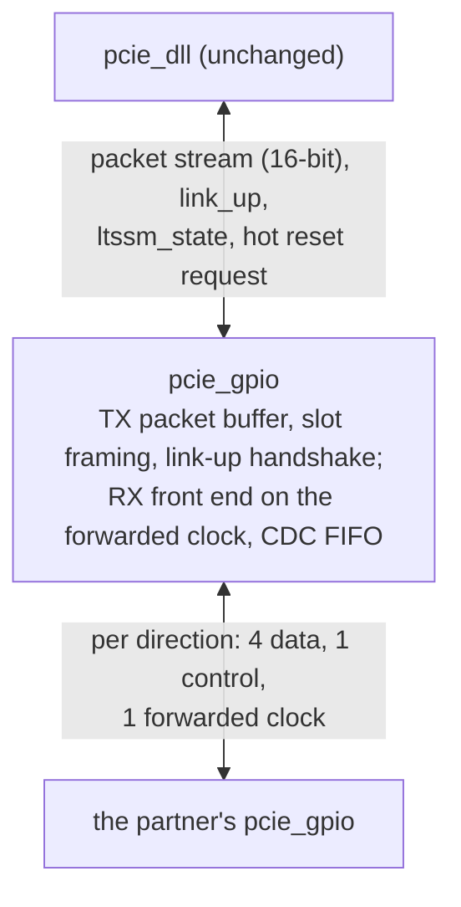

# pcie_gpio HAS

**Draft for captain sign-off**
([#370](https://github.com/amichai-bd/pcie-factory/issues/370)). The RTL
waits for the sign-off (decision record
[0005](../../decisions/0005-m4-grill.md#decisions), F1).

`pcie_gpio` is the GPIO data-link-boundary adapter: a transport that takes
the place of [`pcie_phy`](../phy/HAS.md) under [`pcie_dll`](../dll/HAS.md)
in a board build, and carries the data link layer's packets between two
boards over 12 general-purpose I/O pins, 6 per direction (decision record
[0005](../../decisions/0005-m4-grill.md#decisions), P4, Q4, OP2). Its upper
face is the `phy` packet stream and link status that the `dll` uses, so the
`dll` runs unchanged above it. `link` selects it with its
[lower-layer parameter](../link/HAS.md#lower-layer). It is not a PCI
Express physical layer: no 8b/10b, scrambling, ordered sets or LTSSM, and
it talks only to another `pcie_gpio`. M4 uses it in the `rc` board build
and in the simulated board-build pair; there is no endpoint board build in
M4 (OP3) and no physical link (P3).

How it is built is in the [MAS](../../rtl/gpio/MAS.md); how it is verified,
in the [DV plan](../../dv/gpio/DV_PLAN.md). Rules from the PCIe Base Spec
rev 3.0 are paraphrased and cited, never copied
([`pcie-base`](../../references.md#pcie-base)); the board facts cite the
[DE2-115 manual](../../references.md#de2-115).

## Position

## Interfaces

All ports but the receive pins are synchronous to `clk_i`. Port names
follow the [RTL BKM](../../../bkm/rtl.md#naming).

| Group | Port | Dir | Width | Clock | Description |
| --- | --- | --- | --- | --- | --- |
| Clocks, reset, strap | `clk_i` | in | 1 | - | Core clock: 125 MHz in simulation, 50 MHz on the DE2-115. |
| | `rst_i` | in | 1 | `clk_i` | Synchronous, active high; high for at least 8 cycles. |
| | `port_role_i` | in | 1 | `clk_i` | 0 downstream, 1 upstream; changes only in reset. Selects only the [Hot Reset](#hot-reset) direction. |
| Upper packet stream | `pkt_tx_valid_i`, `pkt_tx_ready_o`, `pkt_tx_data_i` (16), `pkt_tx_sop_i`, `pkt_tx_eop_i`, `pkt_tx_dllp_i` | in, out, in, in, in, in | | `clk_i` | The `phy` transmit stream, same names and meaning ([`phy` upper packet stream](../phy/HAS.md#upper-packet-stream)), without `pkt_tx_nullify_i`: the `dll` never nullifies. |
| | `pkt_rx_valid_o`, `pkt_rx_data_o` (16), `pkt_rx_sop_o`, `pkt_rx_eop_o`, `pkt_rx_dllp_o`, `pkt_rx_err_o`, `pkt_rx_nullify_o` | out | | `clk_i` | The `phy` receive stream, same names and meaning; no ready. `pkt_rx_nullify_o` is always 0. |
| Link status and control | `link_up_o` | out | 1 | `clk_i` | The adapter's link is up ([link-up](#link-up)). |
| | `ltssm_state_o` | out | 6 | `clk_i` | A state code from the [`mac` encoding](../mac/LTSSM.md#state-encoding): `0x00`, `0x04`, `0x19` or `0x20` ([states](#link-up)). |
| | `rcv_err_o` | out | 1 | `clk_i` | One-cycle pulse per [receive error](#receive). |
| | `hot_reset_req_i` | in | 1 | `clk_i` | Level: direct a [Hot Reset](#hot-reset). Downstream role only. |
| Transmit pins | `gpio_tx_clk_o` | out | 1 | `clk_i` | Forwarded clock, `clk_i` / `CLK_DIV`. |
| | `gpio_tx_ctrl_o` | out | 1 | `clk_i` | Control pin ([slots](#slots)). |
| | `gpio_tx_data_o` | out | 4 | `clk_i` | Data pins. |
| Receive pins | `gpio_rx_clk_i` | in | 1 | - | The partner's forwarded clock. |
| | `gpio_rx_ctrl_i` | in | 1 | `gpio_rx_clk_i` | The partner's control pin. |
| | `gpio_rx_data_i` | in | 4 | `gpio_rx_clk_i` | The partner's data pins. |

The `phy` controls `retrain_req_i`, `disable_req_i`, `loopback_req_i` and
`pm_state_req_i` have no adapter port ([simplifications](#simplifications-relative-to-phy)).

## Parameters

| Name | Type | Default | Range | Effect |
| --- | --- | --- | --- | --- |
| `CLK_DIV` | `int unsigned` | 2 | even, 2 to 64 | `clk_i` cycles per transfer: the forwarded clock is `clk_i` / `CLK_DIV`. Both ends of a pair use the same value. |

## Behavior

### Reset values

While `rst_i` is high: `pkt_tx_ready_o`, `pkt_rx_valid_o`, `pkt_rx_sop_o`,
`pkt_rx_eop_o`, `pkt_rx_err_o`, `pkt_rx_nullify_o`, `link_up_o` and
`rcv_err_o` 0; `ltssm_state_o` `0x00`; `gpio_tx_clk_o`, `gpio_tx_ctrl_o`
and `gpio_tx_data_o` 0, so the forwarded clock stops. Data outputs are
don't care while not qualified.

### Clocks and resets

- `clk_i` runs everything but the receive front end, which runs on
  `gpio_rx_clk_i`. One crossing carries received slots into `clk_i`, through
  an approved crossing cell ([`common_cdc_fifo`](../../rtl/common/cdc/common_cdc_fifo.md)).
- The receive-domain reset asserts asynchronously with `rst_i` and releases
  within 3 `gpio_rx_clk_i` edges after `rst_i` falls
  ([`common_cdc_rst`](../../rtl/common/cdc/common_cdc_rst.md)): the partner's
  clock stops whenever the partner is in reset or absent.
- **Clock contract.** The two ends' `clk_i` are nominally equal (each board's
  own oscillator); the adapter works for any ratio between 1/2 and 2.
  Received slots arrive at most once per 4 `gpio_rx_clk_i` cycles and the
  `clk_i` side takes one per cycle, so the receive buffer never fills and
  the receive stream needs no ready.

### Pins and transfers

- Each transfer lasts `CLK_DIV` `clk_i` cycles. `gpio_tx_ctrl_o` and
  `gpio_tx_data_o` change only at the start of a transfer, in the same
  `clk_i` edge at which `gpio_tx_clk_o` falls; `gpio_tx_clk_o` rises
  `CLK_DIV`/2 cycles later, in the middle of the transfer. All three are
  flop outputs with no logic after the flop, and the forwarded clock is never
  a clock inside the sender.
- The receiver captures `gpio_rx_ctrl_i` and `gpio_rx_data_i` on each rising
  edge of `gpio_rx_clk_i`: half a transfer of setup and of hold at the
  sender's pins.
- No transfer rate is claimed for a board-to-board cable; it is measured in
  the two-board milestone ([open items](#open-items)).

### Slots

Four transfers make a **slot**, which carries one 16-bit beat (OP2) and its
3-bit code. Transfer `t` (0 to 3) puts beat bits `[4t+3:4t]` on the data
pins, data pin `i` carrying bit `4t+i`: the earlier byte `[7:0]` goes first,
low nibble first. The control pin carries, per transfer:

| Transfer | Control pin |
| --- | --- |
| 0 | 1: the slot marker. |
| 1, 2, 3 | Code bits 0, 1, 2. |

| Code | Name | Beat | Meaning |
| --- | --- | --- | --- |
| 0 | IDLE | an [idle word](#idle-words) | No packet beat; only between packets. |
| 1 | MID | packet bytes | A beat of the open packet, neither first nor last. |
| 2, 3 | SOP_TLP, SOP_DLLP | packet bytes | First beat of a TLP (2) or a DLLP (3); `dllp` holds until the `eop`. |
| 4 | EOP | packet bytes | Last beat of the open packet. |
| 5 | ABORT | don't care | The open packet is cut by its sender. |
| 6, 7 | ONE_TLP, ONE_DLLP | packet bytes | A one-beat TLP or DLLP (`sop` and `eop`). The `dll` never sends one; the codes keep the `phy` stream contract whole. |

The marker pattern of an IDLE slot, 1, 0, 0, 0 on the control pin, is how
the receiver finds slot boundaries ([link-up](#link-up)). The adapter adds
no check code of its own: the `dll` LCRC and CRC-16 cover every packet byte,
and the code sequence rules ([receive](#receive)) catch damaged framing.

### Idle words

| Word | Name | Sent |
| --- | --- | --- |
| `0x005A`, `0x015A` | TRAIN | While the link is not up and not in Hot Reset. Bit 8 is 1 when the sender's receiver is aligned. |
| `0x00C3` | IDLE | While the link is up, between packets. |
| `0x0096` | HOT_RESET | By a downstream end in [Hot Reset](#hot-reset). |

Any other word is unknown: it pulses `rcv_err_o` and is ignored.

### Link-up

| State | `ltssm_state_o` | `link_up_o` | Sends |
| --- | --- | --- | --- |
| Not aligned (and in reset) | `0x00` | 0 | TRAIN, bit 8 0 |
| Training: aligned, partner not yet seen aligned | `0x04` | 0 | TRAIN, bit 8 1 |
| Up | `0x20` | 1 | Packets and IDLE |
| Hot Reset | `0x19` | 0 | HOT_RESET (downstream) or TRAIN (upstream) |

- **Alignment.** The receiver is aligned after 8 consecutive slots, at one
  slot phase, whose control transfers read 1, 0, 0, 0. It loses alignment
  when a slot's transfer 0 reads 0 (pulsing `rcv_err_o`), or when no slot
  arrives for 64 × `CLK_DIV` `clk_i` cycles (16 slot times; no pulse: the
  partner stopped).
- **Up.** From training, the link goes up when the receiver is aligned and
  either 8 consecutive TRAIN words with bit 8 set or one IDLE word have been
  received. Each end sends bit 8 only once its own receiver is aligned, so
  either condition shows that both directions work.
- **Down.** An up link goes down, back to training (or not aligned), when
  the receiver loses alignment, a TRAIN word arrives (the partner restarted),
  or a [Hot Reset](#hot-reset) starts. Packet slots received while not up are
  dropped silently.
- **Transmit at link-down.** A packet partly sent ends with an ABORT slot;
  every other buffered beat is discarded; beats that the `dll` still offers
  up to its `eop` are taken and discarded ([transmit](#transmit)).
- **Receive at link-down.** An open received packet is closed with an `eop`
  beat carrying `pkt_rx_err_o`, so every `sop` has exactly one `eop`.

### Transmit

- **Ready.** Between packets, `pkt_tx_ready_o` is 1 only while the link is
  up and the transmit buffer has room for a maximum packet: 75 beats, a TLP
  with a 4-DW header, 128 bytes of payload, its sequence number and LCRC
  (M2 Q6). From an accepted `sop` to its `eop`, ready is 1 every cycle
  whatever the link does, as the `phy` guarantees and the `dll` requires.
- **Cut-through.** A packet starts on the pins as soon as its first beat is
  buffered. The `dll` hands a beat every cycle inside a packet, faster than
  the pins send them, so no slot inside a packet is ever short of a beat.
- Between packets the transmitter sends IDLE slots.

### Receive

Each received slot is handled in order, at the `clk_i` side; beats are
delivered at most one per slot, so `pkt_rx_valid_o` has gaps inside a
packet, as the `phy` allows.

| Slot | No packet open | Packet open |
| --- | --- | --- |
| IDLE | Act on the word. | Close the packet with an `eop` beat carrying `pkt_rx_err_o`; pulse `rcv_err_o`; act on the word. |
| SOP_TLP, SOP_DLLP | Deliver the `sop` beat; the packet is open. | Close the open packet with an error `eop`; pulse `rcv_err_o`; discard the new packet. |
| ONE_TLP, ONE_DLLP | Deliver one beat with `sop` and `eop`. | As SOP. |
| MID | Discard; pulse `rcv_err_o`. | Deliver the beat. |
| EOP | Discard; pulse `rcv_err_o`. | Deliver the `eop` beat; the packet is closed. |
| ABORT | Discard; pulse `rcv_err_o`. | Close the packet with an error `eop`; no pulse (the sender's choice). |

**Discard.** After a `rcv_err_o` pulse from this table, the following MID,
EOP and ABORT slots are dropped silently until the next SOP, ONE or IDLE
slot, which is handled as above; one pulse marks one damaged run. A
HOT_RESET word at a downstream end, or one at an upstream end that is not
aligned, is ignored with a `rcv_err_o` pulse.

### Hot Reset

Hot Reset is emulated, so the root port can reset the endpoint as on the
`phy` [cite: PCIe Base Spec, rev 3.0, §4.2.6.11]:

- **Downstream** (`port_role_i` 0): while `hot_reset_req_i` is 1, from any
  state but reset, and then until it has sent at least 32 HOT_RESET words,
  the adapter is in Hot Reset. It then trains. In the upstream role
  `hot_reset_req_i` is ignored.
- **Upstream** (`port_role_i` 1): a HOT_RESET word received while aligned
  enters Hot Reset; the first TRAIN word received leaves it to training.
- `link_up_o` falls on entry, so the `dll` goes to DL_Inactive and the
  layers above see `dl_up_o` fall, as with a `phy` Hot Reset.

### Timing

One beat per slot, so the adapter carries one beat every 4 × `CLK_DIV`
`clk_i` cycles each way (one in 8 at the default), against one per cycle
on the `phy`. The MAS sets the latencies: `L_tx`, from an accepted beat to
its first transfer, and `L_rx`, from a slot's last transfer to its beat on
the stream. The HAS sets no `## Targets` section and the adapter has no
architecture model ([open items](#open-items)).

## Simplifications relative to phy

| Simplification | Consequence for the `dll` |
| --- | --- |
| One beat per 4 × `CLK_DIV` cycles | The replay timeout is too short for long TLPs ([`dll` timers](#dll-timers)). The `dll` and `link` targets measured at the line rate (Ack latency 118 cycles, line use, throughput, initialisation within 200 cycles) do not apply to the board build. |
| Packets buffered ahead of the pins | The `dll` hands a packet over up to a buffer's worth of beats before it leaves, so its replay timer starts early. |
| No retrain: no `retrain_req_i`; the link never enters Recovery | The `dll` REPLAY_NUM rollover requests a retrain that never comes: its rollover hold ends at its 1024-cycle bound ([REPLAY_NUM](../dll/RETRY.md#replay_num)). Retrain Link from above has no effect. |
| No Disabled, Loopback or power states | `link` ignores those requests in the board build; the `dll` sends no power-management DLLPs and `link` already holds L0 ([`link` power states](../link/HAS.md#power-states)). |
| No nullify, no EDB | `pkt_rx_nullify_o` is 0; the `dll` nullified-TLP path is unused. |
| Own link-up handshake, four state codes | The `dll` reads only "in L0" (`0x20` to `0x2F`), which `0x20` gives. Link-up takes slots, not the `phy`'s 12 ms; `TIMEOUT_DIV` and `ERR_TIMEOUT_DIV` have no effect. |
| No 8b/10b, scrambling or check code | A damaged slot reaches the `dll` as a bad or cut packet: Bad TLP or Bad DLLP and a Nak or replay, as for a `phy`-flagged packet. `rcv_err_o` pulses for a different set of causes. |
| No lane or link numbers; `port_role_i` only sets the Hot Reset direction | None: the `dll` is port-role neutral. |

### dll timers

| Timer | Value | Depends on the transport | In the board build |
| --- | --- | --- | --- |
| Replay timeout | 356 cycles | Yes: it must exceed the round trip from a TLP's last beat taken to its Ack [cite: PCIe Base Spec, rev 3.0, §3.5.2.1]. | Too short. With `S` = 4 × `CLK_DIV`, an idle link and an n-beat TLP, the Ack returns about n × (S − 1) + 3 × S + 36 + 2 × (`L_tx` + `L_rx`) cycles after the timer starts (the far `dll`'s 4-cycle check and 32-cycle Ack timer, the 3-beat Ack). At the default, S = 8, a TLP above 42 beats (from a 3-DW-header write with 68 bytes of payload) times out before its Ack arrives, at any adapter latency. Under load the Ack also waits behind the reverse transmit buffer: up to its depth (at least 75 beats; the MAS sets it) × S cycles. Each spurious timeout replays; the far end discards the duplicates and Acks at once, so no TLP is lost, but bandwidth is wasted, and four timeouts with no acknowledging Ack between them roll REPLAY_NUM over. |
| Ack timer | 32 cycles | No: it runs at the receiver. | Unchanged. The 118-cycle Ack limit [cite: PCIe Base Spec, rev 3.0, §3.5.3.1] cannot hold, since an Ack may wait behind a 75-beat packet on the pins. |
| InitFC resend | 128 cycles | Only in rate: a group of three InitFCs is 9 slots [cite: PCIe Base Spec, rev 3.0, §3.3.1]. | At `CLK_DIV` 4 and above a group takes longer than 128 cycles, so groups go out back to back; initialisation still completes. |
| UpdateFC refresh | 2048 cycles | No [cite: PCIe Base Spec, rev 3.0, §2.6.1.2]. | Unchanged. |
| Rollover hold bound | 1024 cycles | Through the retrain. | Always the full 1024 cycles (no retrain). |

## DE2-115 pins

The 12 pins on the DE2-115's 40-pin expansion header, signals `GPIO[0]` to
`GPIO[35]` on header pins 1 to 10, 13 to 28 and 31 to 40, with power on
pins 11 and 29 and ground on pins 12 and 30
[cite: Terasic DE2-115 User Manual, rev unverified, §4.8]. The two
forwarded clocks sit on either side of the ground pin 12.

| Port | Header signal | Header pin |
| --- | --- | --- |
| `gpio_tx_data_o[0]` to `[3]` | `GPIO[0]` to `GPIO[3]` | 1 to 4 |
| `gpio_tx_ctrl_o` | `GPIO[4]` | 5 |
| `gpio_rx_data_i[0]` to `[3]` | `GPIO[5]` to `GPIO[8]` | 6 to 9 |
| `gpio_tx_clk_o` | `GPIO[9]` | 10 |
| `gpio_rx_ctrl_i` | `GPIO[10]` | 13 |
| `gpio_rx_clk_i` | `GPIO[11]` | 14 |

This is the `rc` (downstream) board's map; a straight cable needs the
partner board to swap the transmit and receive groups. The FPGA package
pins, I/O standard and pin timing constraints belong to the `rc` FPGA page
([#379](https://github.com/amichai-bd/pcie-factory/issues/379)); this page
makes no claim about a measured rate.

## Decisions

| Choice | Rationale | Rejected |
| --- | --- | --- |
| IP id `gpio`, a top-level IP that `link` integrates | Not a `link` sub-IP: a sub-IP has no HAS, and the adapter is a peer of `phy` with its own contract ([layout](../../../project/layout.md#ips-and-sub-ips)). | `link_gpio` (a sub-IP id, no HAS). |
| Cut-through transmit with room for one maximum packet | Keeps the `phy` rule that ready stays 1 inside a packet, which the `dll` asserts; the pins never idle inside a packet. | Ready per slot (breaks the `dll` contract); store and forward (one more packet time). |
| Forwarded clock, receive front end on it, one CDC FIFO | The two boards have independent oscillators; mirrors the `phy` `ser_rx_clk_i`. | Oversampling the pins on `clk_i` (needs several samples per transfer); one board clocking both. |
| Data changes as the forwarded clock falls; sampled as it rises | Half a transfer of setup and hold with no PLL or delay tuning. | Double data rate (needs edge-aligned capture); forwarding `clk_i` itself (a clock on a data path). |
| A slot marker and a 3-bit code on the control pin | The marker gives slot alignment on one pin; the code covers every packet event: `sop`, `eop`, `dllp` and an error end (OP2). | A flag per transfer (no alignment); a valid pin (a 13th pin). |
| No check code in the adapter | The `dll` CRCs and replay already make the link lossless; the sequence rules find framing damage. | Parity (no spare pin or transfer). |
| Hot Reset emulated; retrain, Disabled and Loopback not provided | The root port resets the endpoint with Hot Reset (OP4); the rest has no M4 user, and alignment loss already restarts the link. | Emulating every control (logic with no user); no Hot Reset (no reset path for the board build). |

## Open items

| Item | Owner |
| --- | --- |
| The `dll` replay timeout (356 cycles) is too short for this transport ([`dll` timers](#dll-timers)): a `dll` parameter, set by the board build, would remove the spurious replays. It belongs to the `dll` HAS, in its own issue. | Captain |
| The default `CLK_DIV` and the rate a board-to-board cable sustains: measured in the two-board milestone. | Captain; two-board milestone |
| The header pin numbers and signal names checked against the manual; whether the header offers a clock-capable input for `gpio_rx_clk_i`; the I/O standard. | [#379](https://github.com/amichai-bd/pcie-factory/issues/379) |
| Targets and an architecture model, if the captain wants latency or throughput targets for the adapter. | Captain; [#378](https://github.com/amichai-bd/pcie-factory/issues/378) |
| The cited sections on this page, checked against rev 3.0 (the Base Spec is not in the local cache). | Captain, with a local copy |
