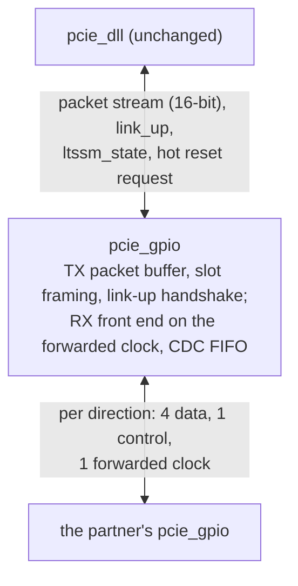

# pcie_gpio HAS

`pcie_gpio` is the GPIO data-link-boundary adapter: a transport that takes
the place of [`pcie_phy`](../phy/HAS.md) under [`pcie_dll`](../dll/HAS.md)
in a board build, and carries the data link layer's packets between two
boards over 12 general-purpose I/O pins, 6 per direction (decision record
[0005](../../decisions/0005-m4-grill.md#decisions), P4, Q4, OP2). Its upper
face is the `phy` packet stream and link status that the `dll` uses, so the
`dll` runs unchanged above it. `link` selects it with its
[lower-layer parameter](../link/HAS.md#lower-layer). It is not a PCI
Express physical layer: no 8b/10b, scrambling, ordered sets or LTSSM, and
it talks only to another `pcie_gpio`. M4 uses it in the `rc` board build
and in the simulated board-build pair; there is no endpoint board build in
M4 (OP3) and no physical link (P3).

How it is built is in the [MAS](../../rtl/gpio/MAS.md); how it is verified,
in the [DV plan](../../dv/gpio/DV_PLAN.md). Rules from the PCIe Base Spec
rev 3.0 are paraphrased and cited, never copied
([`pcie-base`](../../references.md#pcie-base)); the board facts cite the
[DE2-115 manual](../../references.md#de2-115).

## Position

## Interfaces

All ports but the receive pins are synchronous to `clk_i`. Port names
follow the [RTL BKM](../../../bkm/rtl.md#naming).

| Group | Port | Dir | Width | Clock | Description |
| --- | --- | --- | --- | --- | --- |
| Clocks, reset, strap | `clk_i` | in | 1 | - | Core clock: 125 MHz in simulation, 50 MHz on the DE2-115. |
| | `rst_i` | in | 1 | `clk_i` | Synchronous, active high; high for at least 8 cycles. |
| | `port_role_i` | in | 1 | `clk_i` | 0 downstream, 1 upstream; changes only in reset. Selects only the [Hot Reset](#hot-reset) direction. |
| Upper packet stream | `pkt_tx_valid_i`, `pkt_tx_ready_o`, `pkt_tx_data_i` (16), `pkt_tx_sop_i`, `pkt_tx_eop_i`, `pkt_tx_dllp_i` | in, out, in, in, in, in | | `clk_i` | The `phy` transmit stream, same names and meaning ([`phy` upper packet stream](../phy/HAS.md#upper-packet-stream)), without `pkt_tx_nullify_i`: the `dll` never nullifies. |
| | `pkt_rx_valid_o`, `pkt_rx_data_o` (16), `pkt_rx_sop_o`, `pkt_rx_eop_o`, `pkt_rx_dllp_o`, `pkt_rx_err_o`, `pkt_rx_nullify_o` | out | | `clk_i` | The `phy` receive stream, same names and meaning; no ready. `pkt_rx_nullify_o` is always 0. |
| Link status and control | `link_up_o` | out | 1 | `clk_i` | The adapter's link is up ([link-up](#link-up)). |
| | `ltssm_state_o` | out | 6 | `clk_i` | A state code from the [`mac` encoding](../mac/LTSSM.md#state-encoding): `0x00`, `0x04`, `0x19` or `0x20` ([states](#link-up)). |
| | `rcv_err_o` | out | 1 | `clk_i` | One-cycle pulse per [receive error](#receive). |
| | `hot_reset_req_i` | in | 1 | `clk_i` | Level: direct a [Hot Reset](#hot-reset). Downstream role only. |
| Transmit pins | `gpio_tx_clk_o` | out | 1 | `clk_i` | Forwarded clock, `clk_i` / `CLK_DIV`. |
| | `gpio_tx_ctrl_o` | out | 1 | `clk_i` | Control pin ([slots](#slots)). |
| | `gpio_tx_data_o` | out | 4 | `clk_i` | Data pins. |
| Receive pins | `gpio_rx_clk_i` | in | 1 | - | The partner's forwarded clock. |
| | `gpio_rx_ctrl_i` | in | 1 | `gpio_rx_clk_i` | The partner's control pin. |
| | `gpio_rx_data_i` | in | 4 | `gpio_rx_clk_i` | The partner's data pins. |

The `phy` controls `retrain_req_i`, `disable_req_i`, `loopback_req_i` and
`pm_state_req_i` have no adapter port ([simplifications](#simplifications-relative-to-phy)).

## Parameters

| Name | Type | Default | Range | Effect |
| --- | --- | --- | --- | --- |
| `CLK_DIV` | `int unsigned` | 2 | even, 2 to 64 | `clk_i` cycles per transfer: the forwarded clock is `clk_i` / `CLK_DIV`. Both ends of a pair use the same value. |

## Behavior

### Reset values

While `rst_i` is high: `pkt_tx_ready_o`, `pkt_rx_valid_o`, `pkt_rx_sop_o`,
`pkt_rx_eop_o`, `pkt_rx_err_o`, `pkt_rx_nullify_o`, `link_up_o` and
`rcv_err_o` 0; `ltssm_state_o` `0x00`; `gpio_tx_clk_o`, `gpio_tx_ctrl_o`
and `gpio_tx_data_o` 0, so the forwarded clock stops. Data outputs are
don't care while not qualified.

### Clocks and resets

- `clk_i` runs everything but the receive front end, which runs on
  `gpio_rx_clk_i`. One crossing carries received slots into `clk_i`, through
  an approved crossing cell ([`common_cdc_fifo`](../../rtl/common/cdc/common_cdc_fifo.md)).
- The receive-domain reset asserts asynchronously with `rst_i` and releases
  within 3 `gpio_rx_clk_i` edges after `rst_i` falls
  ([`common_cdc_rst`](../../rtl/common/cdc/common_cdc_rst.md)): the partner's
  clock stops whenever the partner is in reset or absent.
- **Clock contract.** The two ends' `clk_i` are nominally equal (each board's
  own oscillator); the adapter works for any ratio between 1/2 and 2.
  Received slots arrive at most once per 4 `gpio_rx_clk_i` cycles and the
  `clk_i` side takes one per cycle, so the receive buffer never fills and
  the receive stream needs no ready.

### Pins and transfers

- Each transfer lasts `CLK_DIV` `clk_i` cycles. `gpio_tx_ctrl_o` and
  `gpio_tx_data_o` change only at the start of a transfer, in the same
  `clk_i` edge at which `gpio_tx_clk_o` falls; `gpio_tx_clk_o` rises
  `CLK_DIV`/2 cycles later, in the middle of the transfer. All three are
  flop outputs with no logic after the flop, and the forwarded clock is never
  a clock inside the sender.
- The receiver captures `gpio_rx_ctrl_i` and `gpio_rx_data_i` on each rising
  edge of `gpio_rx_clk_i`: half a transfer of setup and of hold at the
  sender's pins.
- No transfer rate is claimed for a board-to-board cable; it is measured in
  the two-board milestone ([open items](#open-items)).

### Slots

Four transfers make a **slot**, which carries one 16-bit beat (OP2) and its
3-bit code. Transfer `t` (0 to 3) puts beat bits `[4t+3:4t]` on the data
pins, data pin `i` carrying bit `4t+i`: the earlier byte `[7:0]` goes first,
low nibble first. The control pin carries, per transfer:

| Transfer | Control pin |
| --- | --- |
| 0 | 1: the slot marker. |
| 1, 2, 3 | Code bits 0, 1, 2. |

| Code | Name | Beat | Meaning |
| --- | --- | --- | --- |
| 0 | IDLE | an [idle word](#idle-words) | No packet beat; only between packets. |
| 1 | MID | packet bytes | A beat of the open packet, neither first nor last. |
| 2, 3 | SOP_TLP, SOP_DLLP | packet bytes | First beat of a TLP (2) or a DLLP (3); `dllp` holds until the `eop`. |
| 4 | EOP | packet bytes | Last beat of the open packet. |
| 5 | ABORT | don't care | The open packet is cut by its sender. |
| 6, 7 | ONE_TLP, ONE_DLLP | packet bytes | A one-beat TLP or DLLP (`sop` and `eop`). The `dll` never sends one; the codes keep the `phy` stream contract whole. |

The marker pattern of an IDLE slot, 1, 0, 0, 0 on the control pin, is how
the receiver finds slot boundaries ([link-up](#link-up)). The adapter adds
no check code of its own: the `dll` LCRC and CRC-16 cover every packet byte,
and the code sequence rules ([receive](#receive)) catch damaged framing.

### Idle words

| Word | Name | Sent |
| --- | --- | --- |
| `0x005A`, `0x015A` | TRAIN | While the link is not up, except by a downstream end in Hot Reset (an upstream end in Hot Reset sends TRAIN). Bit 8 is 1 only when the sender's receiver is aligned and its quiet run is over ([states](LINK_UP.md#states)). |
| `0x00C3` | IDLE | While the link is up, between packets. |
| `0x0096` | HOT_RESET | By a downstream end in [Hot Reset](#hot-reset). |

Any other word is unknown: it pulses `rcv_err_o` and is ignored.

### Link-up

The link-state rules are on the [link-up page](LINK_UP.md): states and
their `ltssm_state_o` codes (`0x00` in reset and while not aligned, `0x04`
training, `0x20` up, `0x19` Hot Reset), alignment, the runs of received
slots that take an end up or down, the quiet run of bit-8-clear TRAIN
words that every down starts, and the argument that the pair converges at
any clock ratio from 1/2 to 2. In short: the link goes up after 8 good
slots from an aligned partner; it goes down on alignment loss, on 4
bit-8-clear TRAIN words, on 64 TRAIN words of either value, or on a Hot
Reset; and any down at one end takes the other end down too.

- **Transmit at link-down.** A packet partly sent ends with an ABORT slot;
  every other buffered beat is discarded; beats that the `dll` still offers
  up to its `eop` are taken and discarded ([transmit](#transmit)).
- **Receive at link-down.** An open received packet is closed with an `eop`
  beat carrying `pkt_rx_err_o`, so every `sop` has exactly one `eop`.

### Transmit

- **Ready.** Between packets, `pkt_tx_ready_o` is 1 only while the link is
  up and the transmit buffer has room for a maximum packet: 75 beats, a TLP
  with a 4-DW header, 128 bytes of payload, its sequence number and LCRC
  (M2 Q6). From an accepted `sop` to its `eop`, ready is 1 every cycle
  whatever the link does, as the `phy` guarantees and the `dll` requires.
- **Valid inside a packet.** The `dll` keeps `pkt_tx_valid_i` at 1 from
  `sop` to `eop`. If it drops inside a packet, the beats of that packet
  already buffered go out on the pins as usual, then an ABORT slot ends the
  packet in place of its `eop`; the remaining beats up to the `eop` are
  taken and discarded, as the `phy` ends such a packet with EDB
  ([`phy` packet stream](../phy/HAS.md#packet-stream)).
- **Cut-through.** A packet starts on the pins as soon as its first beat is
  buffered. The `dll` hands a beat every cycle inside a packet, faster than
  the pins send them, so no slot inside a packet is ever short of a beat.
- Between packets the transmitter sends IDLE slots.

### Receive

Each received slot is handled in order, at the `clk_i` side; beats are
delivered at most one per slot, so `pkt_rx_valid_o` has gaps inside a
packet, as the `phy` allows.

| Slot | No packet open | Packet open |
| --- | --- | --- |
| IDLE | Act on the word. | Close the packet with an `eop` beat carrying `pkt_rx_err_o`; pulse `rcv_err_o`. The slot is damaged, so its word feeds no run ([terms](LINK_UP.md#terms)). |
| SOP_TLP, SOP_DLLP | Deliver the `sop` beat; the packet is open. | Close the open packet with an error `eop`; pulse `rcv_err_o`; discard the new packet. |
| ONE_TLP, ONE_DLLP | Deliver one beat with `sop` and `eop`. | As SOP. |
| MID | Discard; pulse `rcv_err_o`. | Deliver the beat. |
| EOP | Discard; pulse `rcv_err_o`. | Deliver the `eop` beat; the packet is closed. |
| ABORT | Discard; pulse `rcv_err_o`. | Close the packet with an error `eop`; no pulse (the sender's choice). |

**Discard.** After a `rcv_err_o` pulse, from this table or from an
unknown idle word, the following MID, EOP and ABORT slots are dropped
silently until the next SOP, ONE or IDLE slot, which is handled as above;
one pulse marks one damaged run, so a single damaged code bit makes one
damaged slot. A slot whose transfer 0 reads 0 is handled the same way: an
open packet is closed with an error `eop`, `rcv_err_o` pulses and the
discard starts. Idle words drive the [link-up](LINK_UP.md#rules) runs; a word that
no run in the current state uses is ignored.

### Hot Reset

Hot Reset is emulated, so the root port can reset the endpoint as on the
`phy` [cite: PCIe Base Spec, rev 3.0, §4.2.6.11]. A downstream end directs
it with `hot_reset_req_i` and sends at least 32 HOT_RESET words; the
upstream end follows on a run of 4. `link_up_o` falls at both ends, so the
`dll` goes to DL_Inactive and the layers above see `dl_up_o` fall. The
rules are on the [link-up page](LINK_UP.md#hot-reset).

### Timing

One beat per slot, so the adapter carries one beat every 4 × `CLK_DIV`
`clk_i` cycles each way (one in 8 at the default), against one per cycle
on the `phy`. The MAS sets the latencies: `L_tx`, from an accepted beat to
its first transfer, and `L_rx`, from a slot's last transfer to its beat on
the stream; the [targets](#targets) bound them.

## Targets

Stated by the [architecture model](../../../../src/arch/gpio/pcie_gpio_arch.py)
and its [scenarios](../../../../src/arch/gpio/perf/), measured by the
[unit DV](../../dv/gpio/DV_PLAN.md) at the clock ratios 1/2, 1 and 2
([#378](https://github.com/amichai-bd/pcie-factory/issues/378); firstmate
[decision](https://github.com/amichai-bd/pcie-factory/issues/370#issuecomment-6267987546), point 4).
`S` is one slot, 4 × `CLK_DIV` cycles.

| Target | Value | Measured at `CLK_DIV` 2 |
| --- | --- | --- |
| `L_tx` | 2 `clk_i` cycles, plus the wait for the next slot start (at most `S` − 1) | 2 to 9 cycles |
| `L_rx` | `CLK_DIV`/2 sender cycles (to the end of the half transfer after the slot), then at most 4 receiver `clk_i` cycles | At most 4.83 receiver cycles |
| `W` ([terms](LINK_UP.md#terms)) | At most 4 slots of the slower end | Model: at most 1.75 slots |
| Line use, back-to-back packets | One beat in every slot: no idle slot between packets under the [ready rule](#transmit) | Model: 0.9999 over 200 maximum TLPs |
| Payload both ways, 128-byte writes, an Ack and an UpdateFC per TLP on the reverse direction | At least 0.78 payload beats per slot | Model: 0.79 |
| Link-up from reset, no damage | Both ends up within 8 + 16 + 8 slots plus 3 × `W` of the later reset release, in slots of the slower end (44) | 22 to 25 slots (model 24.75) |

## Simplifications relative to phy

| Simplification | Consequence for the `dll` |
| --- | --- |
| One beat per 4 × `CLK_DIV` cycles | The default replay timeout is too short for long TLPs ([`dll` timers](#dll-timers)); the board build sets its own ([board-build value](../link/HAS.md#replay-timeout-at-lower-1)). The `dll` and `link` targets measured at the line rate (Ack latency 118 cycles, line use, throughput, initialisation within 200 cycles) do not apply to the board build. |
| Packets buffered ahead of the pins | The `dll` hands a packet over up to a buffer's worth of beats before it leaves, so its replay timer starts early. |
| No retrain: no `retrain_req_i`; the link never enters Recovery | The `dll` REPLAY_NUM rollover requests a retrain that never comes: its rollover hold ends at its 1024-cycle bound ([REPLAY_NUM](../dll/RETRY.md#replay_num)). Retrain Link from above has no effect. |
| No Disabled, Loopback or power states | `link` ignores those requests in the board build; the `dll` sends no power-management DLLPs and `link` already holds L0 ([`link` power states](../link/HAS.md#power-states)). |
| No nullify, no EDB | `pkt_rx_nullify_o` is 0; the `dll` nullified-TLP path is unused. |
| Own link-up handshake, four state codes | The `dll` reads only "in L0" (`0x20` to `0x2F`), which `0x20` gives. Link-up takes slots, not the `phy`'s 12 ms; `TIMEOUT_DIV` and `ERR_TIMEOUT_DIV` have no effect. |
| No 8b/10b, scrambling or check code | A damaged data bit reaches the `dll` as a bad packet, a damaged code bit as a cut, merged or dropped packet: Bad TLP or Bad DLLP, then a Nak or replay, as for a `phy`-flagged packet. A damaged idle word or a single damaged marker changes no link state ([convergence](LINK_UP.md#convergence)); two damaged slots within 8 drop alignment, and both ends go down once. `rcv_err_o` pulses for a different set of causes. |
| No lane or link numbers; `port_role_i` only sets the Hot Reset direction | None: the `dll` is port-role neutral. |

### dll timers

| Timer | Value | Depends on the transport | In the board build |
| --- | --- | --- | --- |
| Replay timeout | 356 cycles | Yes: it must exceed the round trip from a TLP's last beat taken to its Ack [cite: PCIe Base Spec, rev 3.0, §3.5.2.1]. | Too short. With `S` = 4 × `CLK_DIV`, an idle link and an n-beat TLP, the Ack returns about n × (S − 1) + 3 × S + 36 + 2 × (`L_tx` + `L_rx`) cycles after the timer starts (the far `dll`'s 4-cycle check and 32-cycle Ack timer, the 3-beat Ack). At the default, S = 8, and with zero adapter latency (the best case), a TLP above 42 beats (from a 3-DW-header write with 68 bytes of payload) times out before its Ack arrives; any adapter latency lowers the bound. Under load the Ack also waits at the far adapter behind a maximum packet draining and then the packet the far `dll` had already started (the `dll` finishes a started packet, [transmit priority](../dll/RETRY.md#transmit-priority)): two maximum packets of slots. Each spurious timeout replays; the far end discards the duplicates and Acks at once, so no TLP is lost, but bandwidth is wasted, and four timeouts with no acknowledging Ack between them roll REPLAY_NUM over. So the board build raises the `dll` [`REPLAY_TIMEOUT`](../dll/HAS.md#parameters) to the loaded round trip with the far end up to twice as slow, 3214 cycles at the default `CLK_DIV` ([`link` lower layer](../link/HAS.md#replay-timeout-at-lower-1)). |
| Ack timer | 32 cycles | No: it runs at the receiver. | Unchanged. The 118-cycle Ack limit [cite: PCIe Base Spec, rev 3.0, §3.5.3.1] cannot hold, since an Ack may wait behind a 75-beat packet on the pins. |
| InitFC resend | 128 cycles | Only in rate: a group of three InitFCs is 9 slots [cite: PCIe Base Spec, rev 3.0, §3.3.1]. | At `CLK_DIV` 4 and above a group takes longer than 128 cycles, so groups go out back to back; initialisation still completes. |
| UpdateFC refresh | 2048 cycles | No [cite: PCIe Base Spec, rev 3.0, §2.6.1.2]. | Unchanged. |
| Rollover hold bound | 1024 cycles | Through the retrain. | Always the full 1024 cycles (no retrain). |

## DE2-115 pins

The 12 pins on the DE2-115's 40-pin expansion header, signals `GPIO[0]` to
`GPIO[35]` on header pins 1 to 10, 13 to 28 and 31 to 40, with power on
pins 11 and 29 and ground on pins 12 and 30
[cite: Terasic DE2-115 User Manual, rev unverified, §4.8]. The two
forwarded clocks sit on either side of the ground pin 12.

| Port | Header signal | Header pin |
| --- | --- | --- |
| `gpio_tx_data_o[0]` to `[3]` | `GPIO[0]` to `GPIO[3]` | 1 to 4 |
| `gpio_tx_ctrl_o` | `GPIO[4]` | 5 |
| `gpio_rx_data_i[0]` to `[3]` | `GPIO[5]` to `GPIO[8]` | 6 to 9 |
| `gpio_tx_clk_o` | `GPIO[9]` | 10 |
| `gpio_rx_ctrl_i` | `GPIO[10]` | 13 |
| `gpio_rx_clk_i` | `GPIO[11]` | 14 |

This is the `rc` (downstream) board's map; a straight cable needs the
partner board to swap the transmit and receive groups. The FPGA package
pins, I/O standard and pin timing constraints are on the
[`rc` FPGA page](../../fpga/rc/FPGA.md#board-wrapper); this page makes no
claim about a measured rate.

## Decisions

Rows marked "firstmate decision" are firstmate decisions as the captain's
delegate, which the captain may override ([decision](https://github.com/amichai-bd/pcie-factory/issues/370#issuecomment-6267987546) on #370).

| Choice | Rationale | Rejected |
| --- | --- | --- |
| IP id `gpio`, a top-level IP that `link` integrates | Not a `link` sub-IP: a sub-IP has no HAS, and the adapter is a peer of `phy` with its own contract ([layout](../../../project/layout.md#ips-and-sub-ips)). | `link_gpio` (a sub-IP id, no HAS). |
| Cut-through transmit with room for one maximum packet | Keeps the `phy` rule that ready stays 1 inside a packet, which the `dll` asserts; the pins never idle inside a packet. | Ready per slot (breaks the `dll` contract); store and forward (one more packet time). |
| Forwarded clock, receive front end on it, one CDC FIFO | The two boards have independent oscillators; mirrors the `phy` `ser_rx_clk_i`. | Oversampling the pins on `clk_i` (needs several samples per transfer); one board clocking both. |
| Data changes as the forwarded clock falls; sampled as it rises | Half a transfer of setup and hold with no PLL or delay tuning. | Double data rate (needs edge-aligned capture); forwarding `clk_i` itself (a clock on a data path). |
| A slot marker and a 3-bit code on the control pin | The marker gives slot alignment on one pin; the code covers every packet event: `sop`, `eop`, `dllp` and an error end (OP2). | A flag per transfer (no alignment); a valid pin (a 13th pin). |
| No check code in the adapter | The `dll` CRCs and replay already make the link lossless; the sequence rules find framing damage. | Parity (no spare pin or transfer). |
| Hot Reset emulated; retrain, Disabled and Loopback not provided (firstmate decision, point 2) | The root port resets the endpoint with Hot Reset (OP4); the rest has no M4 user (the `rc` HAS ties them to 0 in M4), and alignment loss already restarts the link. | Emulating every control (logic with no user); no Hot Reset (no reset path for the board build). |
| A `dll` replay-timeout parameter, set by the board build, in its own issue [#384](https://github.com/amichai-bd/pcie-factory/issues/384) before the board-build e2e (firstmate decision, point 1) | Spurious replays waste bandwidth and hide real faults; a default that keeps 356 cycles changes nothing else ([`dll` timers](#dll-timers)). | Accepting the replays; a slower `CLK_DIV` (does not close the gap). |
| `CLK_DIV` default 2 (firstmate decision, point 3) | M4 has no physical boards (P3), so there is no cable to measure; 2 gives the fastest centre-aligned transfers. | A slower default chosen with no measurement. |
| Latency targets and an architecture model in [#378](https://github.com/amichai-bd/pcie-factory/issues/378) (firstmate decision, point 4): the [targets](#targets) above | Targets come with a model that checks them. | No targets at all. |
| Every down starts a quiet run of at least 16 bit-8-clear TRAIN words, counted in the sender's own slots; the backstop run is 64 TRAIN words; `W` at most 4 slots of the slower end (firstmate decision as the captain's delegate, [#370 comment](https://github.com/amichai-bd/pcie-factory/issues/370#issuecomment-6268798882)) | Makes every down symmetric by construction at any clock ratio from 1/2 to 2: the partner always sees a run of 4, and the trailing-word bound (48 at a ratio of 2) stays below 64 ([convergence](LINK_UP.md#convergence)). | Relying on the realignment time to send enough bit-8-clear words (only about 4 at a ratio of 1/2); ignoring bit-8-set words while up with no backstop. |
| `gpio_*` ports always present on `link` and `core`, tied off at `LOWER` 0 (firstmate decision, point 5; [`link` lower layer](../link/HAS.md#lower-layer)) | Follows from OP2's `link` parameter; SystemVerilog has no parameter-dependent ports. | A different top per build. |

## Open items

| Item | Owner |
| --- | --- |
| The rate a board-to-board cable sustains, and whether `CLK_DIV` 2 holds on it (the default is decided as 2). | The two-board milestone on the [roadmap](../../roadmap.md#later); record owner [#357](https://github.com/amichai-bd/pcie-factory/issues/357) |
| The cited header table checked against the manual itself, and whether `GPIO[11]` (`AF16`) is one of the device's dedicated clock inputs. The [`rc` FPGA page](../../fpga/rc/FPGA.md#board-wrapper) gives the FPGA pins and the I/O standard (3.3-V LVTTL, JP6 at its default), cross-checked against a published pin table, since the manual was not reachable from the session; the fit routes `gpio_rx_clk_i` as a clock and meets timing. | [#357](https://github.com/amichai-bd/pcie-factory/issues/357) |
| The cited sections on this page, checked against rev 3.0 (the Base Spec is not in the local cache). | [#357](https://github.com/amichai-bd/pcie-factory/issues/357) |
