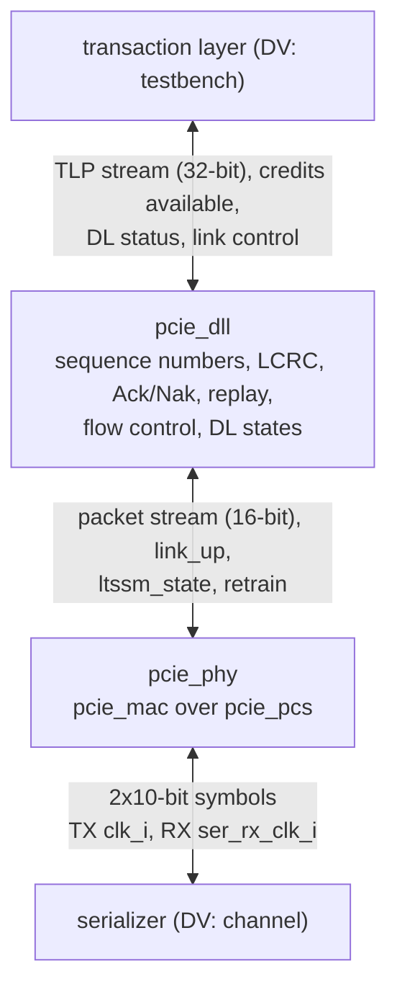

# pcie_link HAS

`pcie_link` is the Gen1 x1 link of the PCI Express controller: the data
link layer [`pcie_dll`](../dll/HAS.md) stacked over the physical layer
[`pcie_phy`](../phy/HAS.md), on one lane at 2.5 GT/s and virtual channel 0
(decision record [0003](../../decisions/0003-m2-grill.md#decisions), Q1,
Q4 to Q7). Above it sits the transaction layer (a testbench in M2, the M3
transaction layer later, unchanged, Q5); below it, a serializer or the DV
channel. It adds no protocol logic of its own: no transaction layer, no
power management, no second virtual channel.

This page owns the stack-level contract: the ports, how `link` joins the
two IPs, the stack targets (throughput, latency, link-up, clocks) and the
end-to-end verification plan. The `dll` HAS owns the data link rules and
the upper stream; the `phy` HAS owns the physical layer and the lower
symbol interface. How it is built is in the [MAS](../../rtl/link/MAS.md);
how it is verified, in the [DV plan](../../dv/link/DV_PLAN.md). Rules from
the PCIe Base Spec rev 3.0 are paraphrased and cited, never copied
([wiki BKM](../../../bkm/wiki.md#citations),
[`pcie-base`](../../references.md#pcie-base)).

## Position

`dll` and `phy` are top-level IPs that `pcie_link` integrates, not
sub-IPs: each keeps its own HAS, arch model and unit DV (Q4; M1 Q19,
Q24), as `phy` integrates `mac` and `pcs`. `link.rtl.f` reaches their
filelists with `-F` once the stack is integrated
([#215](https://github.com/amichai-bd/pcie-factory/issues/215)).

## Interfaces

All ports but the lower RX group are synchronous to `clk_i`. Port names
follow the [RTL BKM](../../../bkm/rtl.md#naming). Byte and symbol order:
bits `[7:0]` (or `[9:0]`) carry the earlier byte (symbol) on the line.

| Group | Ports | Contract |
| --- | --- | --- |
| Clocks, reset, strap | `clk_i`, `rst_i`, `port_role_i` | [`phy` clocks](../phy/HAS.md#clocks-reset-and-strap); `rst_i` resets both layers. |
| Upper TLP stream | `tlp_tx_valid_i`, `tlp_tx_ready_o`, `tlp_tx_data_i` (32), `tlp_tx_sop_i`, `tlp_tx_eop_i`; `tlp_rx_valid_o`, `tlp_rx_ready_i`, `tlp_rx_data_o` (32), `tlp_rx_sop_o`, `tlp_rx_eop_o` | [`dll` upper TLP stream](../dll/HAS.md#upper-tlp-stream), including the [upper-layer obligation](../dll/HAS.md#receive) never to stall the receive stream while any credit class is infinite. |
| Credits available | `fc_ph_avail_o` (8), `fc_pd_avail_o` (12), `fc_nph_avail_o` (8), `fc_npd_avail_o` (12), `fc_cplh_avail_o` (8), `fc_cpld_avail_o` (12) | [`dll` credits available](../dll/HAS.md#credits-available). |
| Data link status | `dl_up_o`, `dl_state_o` (2), `dl_err_o` (7) | The `dll` `dl_up_o`, `dl_state_o` and `err_o` ([status](../dll/HAS.md#status), [error bits](../dll/HAS.md#errors)). |
| Physical link control and status | `link_up_o`, `ltssm_state_o` (6), `rcv_err_o`, `retrain_req_i`, `hot_reset_req_i`, `disable_req_i`, `loopback_req_i` | [`phy` link control](../phy/HAS.md#link-control-and-status), with the retrain and power rules [below](#stack-wiring). |
| Lower symbol interface | `ser_tx_data_o` (20), `ser_tx_elec_idle_o`, `ser_tx_rxdet_i`, `ser_rx_clk_i`, `ser_rx_data_i` (20), `ser_rx_elec_idle_i` | [`phy` lower symbol interface](../phy/HAS.md#lower-symbol-interface). |

Every port keeps the direction, width, clock and meaning it has on the
owning IP; only the `dll` `err_o` is renamed `dl_err_o`, so the two error
reports read apart ([errors](#errors)). The `phy` `pm_state_req_i` and
`pkt_tx_nullify_i` are not `link` ports ([stack wiring](#stack-wiring)).

## Parameters

| Name | Type | Default | Range | Effect |
| --- | --- | --- | --- | --- |
| `FC_PH`, `FC_PD`, `FC_NPH`, `FC_NPD`, `FC_CPLH`, `FC_CPLD` | `int unsigned` | 8, 32, 8, 8, 0, 0 | as the [`dll` parameters](../dll/HAS.md#parameters) | Passed to `pcie_dll`: the credits this receiver advertises (0 infinite). |
| `TIMEOUT_DIV`, `ERR_TIMEOUT_DIV` | `int unsigned` | 1, 1 | 1 to 1024 | Passed to `pcie_phy` ([`phy` parameters](../phy/HAS.md#parameters)). FPGA and ASIC builds use 1; DV uses 1024 where a test must wait one out. |

## Behavior

### Reset values

While `rst_i` is high: the `dll` outputs at their
[reset values](../dll/HAS.md#reset-values) (`tlp_tx_ready_o`,
`tlp_rx_valid_o`, `tlp_rx_sop_o`, `tlp_rx_eop_o`, every `fc_*_avail_o`,
`dl_up_o`, `dl_state_o` and `dl_err_o` 0) and the `phy` outputs at theirs
([clocks and resets](../phy/HAS.md#clocks-and-resets): `link_up_o`,
`ltssm_state_o` and `rcv_err_o` 0, `ser_tx_elec_idle_o` 1). Data outputs
are don't care while not qualified. The `dll` outputs keep these values
whenever `link_up_o` is 0 (DL_Inactive).

### Clocks and resets

`clk_i` (125 MHz) runs all of `dll` and every part of `phy` except the PCS
receive front end, which runs on `ser_rx_clk_i`. The RX clock contract,
the reset contract (`rst_i` high for at least 8 `clk_i` cycles,
synchronous, active high; the RX-domain reset asserted asynchronously and
released within 3 `ser_rx_clk_i` cycles) and the crossing rules are the
[`phy` ones](../phy/HAS.md#clocks-and-resets), unchanged: `dll` adds no
clock and no crossing.

### Stack wiring

| `link` joins | How |
| --- | --- |
| `dll` lower packet stream to `phy` upper packet stream | Port for port, `pkt_tx_*` and `pkt_rx_*` ([`dll` lower stream](../dll/HAS.md#lower-packet-stream-and-link-status)). The `phy` `pkt_tx_nullify_i` is tied to 0: the `dll` never nullifies. |
| `phy` `link_up_o`, `ltssm_state_o` | Both to the `link` ports and to the `dll` `link_up_i` and `ltssm_state_i`. |
| `phy` `retrain_req_i` | The OR of `retrain_req_i` and the `dll` `retrain_req_o` (each a one-cycle pulse; a REPLAY_NUM rollover retrains without the upper layer). |
| `phy` `pm_state_req_i` | Tied to 0 (L0): see [power states](#power-states). |
| `hot_reset_req_i`, `disable_req_i`, `loopback_req_i` | Straight to `phy`. Each takes the LTSSM out of L0 to a state where `link_up_o` falls, so the `dll` goes to DL_Inactive and abandons every TLP it holds; the upper layer sees `dl_up_o` fall. |

`link_up_o` stays 1 through Recovery, so a retrain (either source) keeps
the `dll` in DL_Active: TLPs in flight are replayed, not lost
([REPLAY_NUM](../dll/RETRY.md#replay_num)).

### Power states

`link` holds the `phy` at L0: its transmitter never enters L0s, L1 or L2,
and `link` has no power-state port. This resolves the `dll`'s L0s item:

- The `dll` replay timeout (356 cycles, [timers](../dll/RETRY.md#timers))
  has no allowance for the partner's L0s exit time, so it is correct only
  while neither transmitter uses L0s [cite: PCIe Base Spec, rev 3.0, §3.5.2.1].
  ASPM L0s is not enabled in M2 (no ASPM changes, Q6), so no compliant
  partner enters it either.
- L1 and L2 need the data link layer's DLLP handshake before the
  request, which the `phy` leaves to the layer above it
  ([`phy` power states](../phy/HAS.md#link-up-and-requests)), and the
  `dll` sends no power-management DLLPs
  ([DLLP types](../dll/DLLP.md#types-used)).
- The `phy` receiver still follows a partner into L0s on its own. If a
  non-compliant partner does use L0s, its Acks can arrive after this
  side's replay timeout: the replay resends TLPs the partner already
  holds, which it discards as duplicates. Throughput drops; no TLP is
  lost or duplicated at the upper stream.

### Errors

`dl_err_o` (the `dll` errors) and `rcv_err_o` (the `phy` receiver errors)
are separate one-cycle pulse ports, and `link` keeps no error counter. A
TLP that `phy` flags pulses both: `rcv_err_o` for the symbol or framing
error, then Bad TLP on `dl_err_o` at its `eop`. That is one event with two
reports, so a consumer counting link errors counts each port as its own
class and never adds them ([`dll` errors](../dll/HAS.md#errors)).

## Decisions

| Choice | Rationale | Rejected |
| --- | --- | --- |
| Thin integration: wiring, one tie-off pair and one OR | Mirrors `phy` (Q4); each layer stays verified by its own unit DV and the stack adds nothing to re-verify inside. | Glue logic in `link` (a second home for layer rules). |
| `pm_state_req_i` tied to L0, no power-state port | Resolves the L0s item with no new rule: Q6 rules out ASPM changes, the replay timeout has no L0s allowance and the `dll` has no PM DLLPs for L1 or L2. | Exposing the request (L1 and L2 would skip the DLLP handshake); specifying an L0s replay-timeout allowance (a rule with no M2 user, untestable without L0s traffic). |
| Retrain request ORed with the `dll` rollover pulse | The rollover must retrain without the upper layer; Retrain Link stays available to it. | Only the `dll` source (no Retrain Link); a `link` arbiter (two pulses need none). |
| Hot Reset, Disabled and Loopback passed through | The upper layer owns them, as on `phy`; each drops `link_up_o` and so resets the `dll` with no extra rule. | Tying them off (loses Hot Reset, which a downstream port needs). |
| `dl_err_o` and `rcv_err_o` separate, no counter | One event in two layers is reported twice; only the consumer knows what it counts. | A merged vector, or a counter that matches a `phy` pulse to a later Bad TLP (state for no M2 user). |
| Throughput stated for 128-byte memory writes both ways | The largest payload (Q6) on the posted class gives the best case the design must reach; both ways put the Acks and UpdateFCs on the same lines as the TLPs (goal item 6). | One way only (the Acks ride an idle reverse line, so their cost never shows); a random mix (the number tracks the mix, not the design). |
| Error injection on the line, at symbol level | The e2e drives `link` through its ports only; a decoding injector makes exact classes (an LCRC error with no symbol error, a whole packet removed). | Injecting on the internal `dll`-`phy` stream (not a `link` port); raw bit flips only (cannot make a clean LCRC error or a drop). |

## Targets

Measured with two `link` instances back to back, downstream and upstream,
and checked by the [architecture model](#architecture-model) where a
scenario is named. The line rate is Gen1 x1 after 8b/10b: 250 MB/s each
way, 2 bytes (symbols) per `clk_i` cycle. Payload is the TLP data bytes
only, without header, sequence number, LCRC or framing.

| Item | Target | Check |
| --- | --- | --- |
| Throughput, both ways | 128-byte memory writes (3-DW header) back to back in both directions, default credits, upper layers never waiting: TLP payload at least **0.76 of the line rate (190 MB/s) in each direction**. | `mwr_bidir`; [#216](https://github.com/amichai-bd/pcie-factory/issues/216) |
| Throughput, one way | The same in one direction only: at least 0.85 of the line rate (212.5 MB/s). | `mwr_oneway`; [#216](https://github.com/amichai-bd/pcie-factory/issues/216) |
| Ack latency | Every Ack or Nak starts on the line within 118 cycles of the TLP it covers, with SKP ordered sets and both directions loaded [cite: PCIe Base Spec, rev 3.0, §3.5.3.1]. | `mwr_bidir`, `mixed_bidir` |
| Lossless | Under every [error class](#error-injection): each TLP delivered once, in order, byte for byte; no DL protocol error or receiver overflow. | `error_recovery`, `replay_rollover`; [#215](https://github.com/amichai-bd/pcie-factory/issues/215) |
| Credits | No receiver overflow in any [credit configuration](#credit-configurations), through starvation and recovery. | `dll` `credit_starve`, `credits_infinite`; [#215](https://github.com/amichai-bd/pcie-factory/issues/215) |
| Link-up | `rst_i` release to DL_Active at both ends: the [`phy` link-up target](../phy/HAS.md#targets) plus at most 200 cycles after the later `link_up_o`, finite or all-infinite credits. | `link_init`, `link_init_infinite`; [#215](https://github.com/amichai-bd/pcie-factory/issues/215) |
| TLP latency | From a TLP's accepted `eop` at one `link` to its `sop` at the other: at most B + 30 cycles plus the channel delay, B = (n + 6) / 2 the `phy` beats of an n-byte TLP (103 for a 128-byte write), with nothing else queued and no SKP ordered set inside. The sum of the `dll` TX 4 and RX 4, the `phy` TX 6 and RX 16 (+1 for a packet in the high byte), and the packet's B − 1 beats. | budget; [#215](https://github.com/amichai-bd/pcie-factory/issues/215) |
| FPGA clock | `clk_i` and `ser_rx_clk_i` at 50 MHz on the DE2-115 (Quartus): timing and resources only, no board bring-up; the design's rates are unchanged (M1 Q26, Q2). | [#218](https://github.com/amichai-bd/pcie-factory/issues/218) |
| ASIC clock | sky130hd (ORFS): the **gate** is the 100 MHz checkpoint on both clocks, an explicit clock study (`--study-clock-period 10`, M1 Q27). 125 MHz stays the default target and is reported nightly; its closure is future timing work ([#235](https://github.com/amichai-bd/pcie-factory/issues/235)) and does not block M2 (Q10). | [#219](https://github.com/amichai-bd/pcie-factory/issues/219) |

### Throughput

Line time per item, in symbol times (two per cycle)
[cite: PCIe Base Spec, rev 3.0, §4.2.1.2]
[cite: PCIe Base Spec, rev 3.0, §4.2.7]:

- A TLP of n bytes takes n + 8: STP, 2 sequence-number bytes, the TLP, 4
  LCRC bytes and END. A 128-byte write (n = 140) takes 148, of which 128
  are payload.
- A DLLP takes 8: SDP, 6 bytes, END.
- A SKP ordered set takes 4, once per 1180 symbol times at the most
  frequent `phy` schedule: 0.34% of the line.
- Each class gets an UpdateFC at least every 2048 cycles (4096 symbol
  times) as a refresh [cite: PCIe Base Spec, rev 3.0, §2.6.1.2].

**One way.** The receiver sends one Ack per TLP (its 32-cycle Ack timer
runs out within one 74-cycle TLP time, so Acks do not coalesce) and one
UpdateFC-P per TLP (each delivered TLP returns its credits), but on the
reverse line. The forward line carries the TLPs, the SKP ordered sets and
the sender's three refresh UpdateFCs, 24 per 4096 symbol times (0.59%).
TLPs get 1 − 0.0034 − 0.0059 = **0.991** of the line, and payload
0.991 × 128 / 148 = **0.857** (214 MB/s).

**Both ways.** Each line also carries the Ack and the UpdateFC-P for each
TLP coming the other way: 16 symbols per 148-symbol TLP. The P refresh
never falls due (UpdateFC-P goes out every TLP), so the refresh is 16 per
4096 (0.39%). TLPs get (1 − 0.0034 − 0.0039) × 148 / 164 = **0.896** of
each line, and payload 0.896 × 128 / 148 = **0.775** (194 MB/s).

The [model](#architecture-model) measures 0.990 and 0.857 one way, 0.896
and 0.775 both ways, over 2000 TLPs per direction. The targets keep about
1% (one way) and 2% (both ways) of margin for the start and drain of a
finite run and for clock offset.

## End-to-end plan

The `link` e2e ([#215](https://github.com/amichai-bd/pcie-factory/issues/215),
throughput [#216](https://github.com/amichai-bd/pcie-factory/issues/216))
covers goal items 4 to 6 of the [M2 record](../../decisions/0003-m2-grill.md#goal);
the [DV plan](../../dv/link/DV_PLAN.md) maps it to tests.

- **Bench:** two `pcie_link` instances, downstream (a) and upstream (b),
  each on its own clock, ±600 ppm apart in some tests, joined by a channel
  per direction like the [`phy` e2e](../../dv/phy/DV_PLAN.md#strategy)'s.
  The testbench drives and checks the upper TLP streams only through the
  `link` ports. `TIMEOUT_DIV` 1024 shortens link-up.
- **Second opinion:** the independent DLL link partner of
  [#210](https://github.com/amichai-bd/pcie-factory/issues/210) (Q3) is the
  far end in the `dll` DV. In the `link` e2e it watches each direction
  passively, fed the packets the injector decodes, and flags a TLP sent
  beyond the advertised credits, a sequence number out of order, an Ack or
  Nak for a TLP never sent, and an Ack later than 118 cycles.

### Error injection

An injector on the serial line, per direction, decodes the 8b/10b
symbols with running disparity, descrambles, finds each packet between
its start (STP, SDP) and its END, applies one class, then scrambles and
re-encodes so that the receiver sees no other error.

| Class | Injected | Expected recovery |
| --- | --- | --- |
| LCRC error | One TLP data byte changed, re-encoded cleanly. | Bad TLP and a Nak at the receiver; the sender replays from that TLP. |
| Corrupted TLP | One TLP symbol replaced by an invalid code. | `rcv_err_o`, then Bad TLP and a Nak; replay. |
| Dropped TLP | A whole TLP, framing included, replaced by logical idle. | The next TLP arrives ahead: Bad TLP and a Nak, and replay; if none follows, the sender's replay timeout replays it. |
| Corrupted DLLP | One DLLP byte changed. | Bad DLLP; the DLLP is ignored. A lost Ack is covered by a later Ack or the replay timeout, a lost UpdateFC by a later one or the refresh. |
| Dropped DLLP | A whole DLLP removed. | As a corrupted DLLP, with no error pulse. |
| Nak | A Nak dropped or corrupted, and a TLP of a running replay corrupted. | The receiver does not resend the Nak; the sender's replay timeout replays. A second replay follows the first. |
| Duplicate | Acks dropped until the sender replays TLPs the receiver holds. | The receiver discards the duplicates and Acks at once; no error pulse. |
| REPLAY_NUM rollover | Every TLP one way dropped for longer than 4 replay timeouts (over 1500 cycles). | The fourth replay rolls REPLAY_NUM over: Rollover on `dl_err_o`, a retrain (`ltssm_state_o` leaves L0 and returns; `link_up_o` and DL_Active stay), then traffic resumes. |
| Line impairments | The `phy` channel's bit flips, slips and electrical-idle dropouts. | `rcv_err_o`; packets cut short arrive flagged (Bad TLP, Nak, replay); any Recovery keeps `link_up_o`. |

### Credit configurations

| Configuration | `FC_*` (H, D per class) at both ends unless stated | Upper receive stream |
| --- | --- | --- |
| Default | P 8, 32; NP 8, 8; Cpl infinite | Never stalls (Cpl is infinite). |
| Finite, minimum | P 1, 8; NP 1, 1; Cpl 1, 8 | Stalls of 4000 and 10000 cycles, otherwise takes 30% of beats: starvation, then recovery through UpdateFC. |
| Finite, default sizes | P 8, 32; NP 8, 8; Cpl 8, 32 | As above. |
| All infinite | every class infinite | Never stalls. |
| Asymmetric | a finite minimum, b default | a may stall; b never stalls. |

### Checks

- **No loss, no duplicate, no reorder:** a scoreboard per direction takes
  every TLP accepted on one `link`'s `tlp_tx_*` and requires the next TLP
  delivered on the other's `tlp_rx_*` to equal the oldest one not yet
  delivered, byte for byte. At the end of every test the traffic drains
  and every accepted TLP must have been delivered.
- **Credits:** `dl_err_o` Receiver overflow never pulses. Each
  `fc_*_avail_o` never exceeds what the partner has advertised and
  returned, and with traffic drained every finite one is back at the
  partner's advertised value.
- **Errors:** DL protocol error and Malformed TLP never pulse; every
  injected TLP error yields at least one Bad TLP; the delivered bytes
  rule out any undetected corruption.
- **Link:** `link_up_o` stays 1 and `dl_state_o` stays DL_Active through
  every class, the rollover's retrain included.
- **Liveness:** a test fails if no TLP is delivered for 20000 cycles while
  any is outstanding.
- **Throughput:** with the bench error-free, at 0 ppm, the upper layers
  always offering and taking, payload bytes delivered over at least 2000
  TLPs per direction, from the first accepted to the last delivered, meet
  the [targets](#targets).

## Architecture model

[`pcie_link_arch.py`](../../../../src/arch/link/pcie_link_arch.py) runs
two `dll` architecture models (loaded unchanged from
[`src/arch/dll/`](../../../../src/arch/dll/pcie_dll_arch.py), so the data
link rules have one model) over a line model that adds the `phy`
stack: 2 symbols per cycle, framing, SKP ordered sets between packets on
the `phy` schedule, the 22-cycle `phy` TX plus RX latency, and the `dll`
model's error injection and retrain hold. `derived_fractions` is the
closed form of [Throughput](#throughput); the
[self-tests](../../../../src/arch/link/test_pcie_link_arch.py) check that
the model agrees with it within 0.2% of the line. `./build arch --ip link`
writes `workdir/link/arch/perf.json`.

| Scenario | Workload |
| --- | --- |
| [`mwr_oneway`](../../../../src/arch/link/perf/mwr_oneway.yaml) | 2000 128-byte MWr one way. |
| [`mwr_bidir`](../../../../src/arch/link/perf/mwr_bidir.yaml) | 2000 128-byte MWr each way. |
| [`mixed_bidir`](../../../../src/arch/link/perf/mixed_bidir.yaml) | 2000 random TLPs each way. |
| [`error_recovery`](../../../../src/arch/link/perf/error_recovery.yaml) | 2000 random TLPs each way, TLPs and DLLPs corrupted, dropped and flagged. |
| [`replay_rollover`](../../../../src/arch/link/perf/replay_rollover.yaml) | All TLPs one way dropped from cycle 5000 to 7000. |
| [`link_init`](../../../../src/arch/link/perf/link_init.yaml), [`link_init_infinite`](../../../../src/arch/link/perf/link_init_infinite.yaml) | 200 initialisations with up to 300 cycles of skew, default and all-infinite credits. |

## Open items

| Item | Owner |
| --- | --- |
| The injector's structure (where it sits in the testbench top, how it tracks disparity and the scrambler across SKP) and the partner's monitor hook. | [#215](https://github.com/amichai-bd/pcie-factory/issues/215), [#210](https://github.com/amichai-bd/pcie-factory/issues/210) |
| The cited sections on this page, checked against rev 3.0 (the Base Spec is not in the local cache). | Captain, with a local copy |
