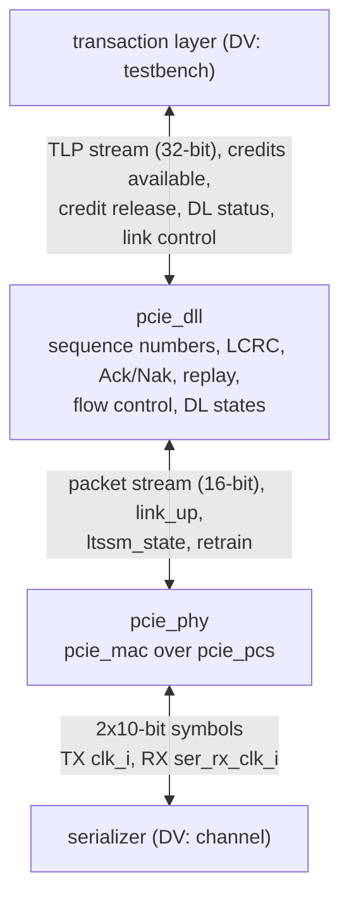

# pcie_link HAS

`pcie_link` is the Gen1 x1 link of the PCI Express controller: the data
link layer [`pcie_dll`](../dll/HAS.md) stacked over the physical layer
[`pcie_phy`](../phy/HAS.md), on one lane at 2.5 GT/s and virtual channel 0
(decision record [0003](../../decisions/0003-m2-grill.md#decisions), Q1,
Q4 to Q7). Above it sits the transaction layer (a testbench in M2, the M3
transaction layer later, Q5, which adds only the `dll` credit release:
decision record [0004](../../decisions/0004-m3-grill.md#updates), Q9);
below it, a serializer or the DV channel. In the downstream role the
root-port stack [`pcie_rc`](../rc/HAS.md) is its upper layer, with no
`link` change (decision record [0005](../../decisions/0005-m4-grill.md#decisions), F2;
its [downstream-role contract](../rc/HAS.md#downstream-role)). It adds no protocol logic of its own: no transaction layer, no
power management, no second virtual channel.

This page owns the stack-level contract: the ports, how `link` joins the
two IPs, the stack targets (throughput, latency, link-up, clocks) and the
end-to-end verification plan. The `dll` HAS owns the data link rules and
the upper stream; the `phy` HAS owns the physical layer and the lower
symbol interface. How it is built is in the [MAS](../../rtl/link/MAS.md);
how it is verified, in the [DV plan](../../dv/link/DV_PLAN.md). Rules from
the PCIe Base Spec rev 3.0 are paraphrased and cited, never copied
([wiki BKM](../../../bkm/wiki.md#citations),
[`pcie-base`](../../references.md#pcie-base)).

## Position



`dll` and `phy` are top-level IPs that `pcie_link` integrates, not
sub-IPs: each keeps its own HAS, arch model and unit DV (Q4; M1 Q19,
Q24), as `phy` integrates `mac` and `pcs`. `link.rtl.f` reaches their
filelists with `-F` ([MAS](../../rtl/link/MAS.md#files)).

## Interfaces

All ports but the lower RX group and the GPIO receive pins are synchronous
to `clk_i`. Port names
follow the [RTL BKM](../../../bkm/rtl.md#naming). Byte and symbol order:
bits `[7:0]` (or `[9:0]`) carry the earlier byte (symbol) on the line.

| Group | Ports | Contract |
| --- | --- | --- |
| Clocks, reset, strap | `clk_i`, `rst_i`, `port_role_i` | [`phy` clocks](../phy/HAS.md#clocks-reset-and-strap); `rst_i` resets both layers. |
| Upper TLP stream | `tlp_tx_valid_i`, `tlp_tx_ready_o`, `tlp_tx_data_i` (32), `tlp_tx_sop_i`, `tlp_tx_eop_i`; `tlp_rx_valid_o`, `tlp_rx_ready_i`, `tlp_rx_data_o` (32), `tlp_rx_sop_o`, `tlp_rx_eop_o` | [`dll` upper TLP stream](../dll/HAS.md#upper-tlp-stream), including the [upper-layer obligation](../dll/HAS.md#receive) never to stall the receive stream while any credit class is infinite. |
| Credits available | `fc_ph_avail_o` (8), `fc_pd_avail_o` (12), `fc_nph_avail_o` (8), `fc_npd_avail_o` (12), `fc_cplh_avail_o` (8), `fc_cpld_avail_o` (12) | [`dll` credits available](../dll/HAS.md#credits-available). |
| Credit release | `fc_rel_p_i`, `fc_rel_pd_i` (4), `fc_rel_np_i`, `fc_rel_npd_i` (4) | [`dll` credit release](../dll/HAS.md#credit-release); tied to 0 unless `FC_RELEASE` is 1. |
| Data link status | `dl_up_o`, `dl_state_o` (2), `dl_err_o` (7) | The `dll` `dl_up_o`, `dl_state_o` and `err_o` ([status](../dll/HAS.md#status), [error bits](../dll/HAS.md#errors)). |
| Physical link control and status | `link_up_o`, `ltssm_state_o` (6), `rcv_err_o`, `retrain_req_i`, `hot_reset_req_i`, `disable_req_i`, `loopback_req_i` | [`phy` link control](../phy/HAS.md#link-control-and-status), with the retrain and power rules [below](#stack-wiring). |
| Lower symbol interface | `ser_tx_data_o` (20), `ser_tx_elec_idle_o`, `ser_tx_rxdet_i`, `ser_rx_clk_i`, `ser_rx_data_i` (20), `ser_rx_elec_idle_i` | [`phy` lower symbol interface](../phy/HAS.md#lower-symbol-interface). |
| GPIO pins | `gpio_tx_clk_o`, `gpio_tx_ctrl_o`, `gpio_tx_data_o` (4), `gpio_rx_clk_i`, `gpio_rx_ctrl_i`, `gpio_rx_data_i` (4) | The [`gpio` pins](../gpio/HAS.md#interfaces), live at `LOWER` 1 ([lower layer](#lower-layer)). |

Every port keeps the direction, width, clock and meaning it has on the
owning IP; only the `dll` `err_o` is renamed `dl_err_o`, so the two error
reports read apart ([errors](#errors)). The `phy` `pm_state_req_i` and
`pkt_tx_nullify_i` are not `link` ports ([stack wiring](#stack-wiring)).

## Parameters

| Name | Type | Default | Range | Effect |
| --- | --- | --- | --- | --- |
| `FC_PH`, `FC_PD`, `FC_NPH`, `FC_NPD`, `FC_CPLH`, `FC_CPLD` | `int unsigned` | 8, 32, 8, 8, 0, 0 | as the [`dll` parameters](../dll/HAS.md#parameters) | Passed to `pcie_dll`: the credits this receiver advertises (0 infinite). |
| `FC_RELEASE` | `int unsigned` | 0 | 0, 1 | Passed to `pcie_dll`: 1 returns finite posted and non-posted credits on the [credit release](../dll/HAS.md#credit-release) port. |
| `TIMEOUT_DIV`, `ERR_TIMEOUT_DIV` | `int unsigned` | 1, 1 | 1 to 1024 | Passed to `pcie_phy` ([`phy` parameters](../phy/HAS.md#parameters)). FPGA and ASIC builds use 1; DV uses 1024 where a test must wait one out. |
| `REPLAY_TIMEOUT` | `int unsigned` | 356 | 356 to 65535 | Passed to `pcie_dll`: the [replay timeout](../dll/HAS.md#parameters). Every `phy` build keeps 356. At `LOWER` 1 the `dll` gets the larger of this and the GPIO build's value ([below](#replay-timeout-at-lower-1)). |
| `LOWER`, `GPIO_CLK_DIV` | `int unsigned` | 0, 2 | [lower layer](#lower-layer) | The lower layer: `phy` (0) or the GPIO adapter (1), and the adapter's `CLK_DIV`. |

## Behavior

### Reset values

While `rst_i` is high: the `dll` outputs at their
[reset values](../dll/HAS.md#reset-values) (`tlp_tx_ready_o`,
`tlp_rx_valid_o`, `tlp_rx_sop_o`, `tlp_rx_eop_o`, every `fc_*_avail_o`,
`dl_up_o`, `dl_state_o` and `dl_err_o` 0) and the `phy` outputs at theirs
([clocks and resets](../phy/HAS.md#clocks-and-resets): `link_up_o`,
`ltssm_state_o` and `rcv_err_o` 0, `ser_tx_elec_idle_o` 1). Data outputs
are don't care while not qualified. The `dll` outputs keep these values
whenever `link_up_o` is 0 (DL_Inactive).

### Clocks and resets

`clk_i` (125 MHz) runs all of `dll` and every part of `phy` except the PCS
receive front end, which runs on `ser_rx_clk_i`. The RX clock contract,
the reset contract (`rst_i` high for at least 8 `clk_i` cycles,
synchronous, active high; the RX-domain reset asserted asynchronously and
released within 3 `ser_rx_clk_i` cycles) and the crossing rules are the
[`phy` ones](../phy/HAS.md#clocks-and-resets), unchanged: `dll` adds no
clock and no crossing.

### Stack wiring

| `link` joins | How |
| --- | --- |
| Upper TLP stream, credits available, credit release, data link status | Straight to and from the `dll` ports of the same names (`err_o` as `dl_err_o`). |
| `dll` lower packet stream to `phy` upper packet stream | Port for port, `pkt_tx_*` and `pkt_rx_*` ([`dll` lower stream](../dll/HAS.md#lower-packet-stream-and-link-status)). The `phy` `pkt_tx_nullify_i` is tied to 0: the `dll` never nullifies. |
| `phy` `link_up_o`, `ltssm_state_o` | Both to the `link` ports and to the `dll` `link_up_i` and `ltssm_state_i`. |
| `phy` `retrain_req_i` | The OR of `retrain_req_i` and the `dll` `retrain_req_o` (each a one-cycle pulse; a REPLAY_NUM rollover retrains without the upper layer). |
| `phy` `pm_state_req_i` | Tied to 0 (L0): see [power states](#power-states). |
| `hot_reset_req_i`, `disable_req_i`, `loopback_req_i` | Straight to `phy`. Each takes the LTSSM out of L0 to a state where `link_up_o` falls, so the `dll` goes to DL_Inactive and abandons every TLP it holds; the upper layer sees `dl_up_o` fall. |

`link_up_o` stays 1 through Recovery, so a retrain (either source) keeps
the `dll` in DL_Active: TLPs in flight are replayed, not lost
([REPLAY_NUM](../dll/RETRY.md#replay_num)).

### Power states

`link` holds the `phy` at L0: its transmitter never enters L0s, L1 or L2,
and `link` has no power-state port. This resolves the `dll`'s L0s item:

- The `dll` replay timeout (356 cycles by default, [timers](../dll/RETRY.md#timers))
  has no allowance for the partner's L0s exit time, so it is correct only
  while neither transmitter uses L0s [cite: PCIe Base Spec, rev 3.0, §3.5.2.1].
  ASPM L0s is not enabled in M2 (no ASPM changes, Q6), so no compliant
  partner enters it either.
- L1 and L2 need the data link layer's DLLP handshake before the
  request, which the `phy` leaves to the layer above it
  ([`phy` power states](../phy/HAS.md#link-up-and-requests)), and the
  `dll` sends no power-management DLLPs
  ([DLLP types](../dll/DLLP.md#types-used)).
- The `phy` receiver still follows a partner into L0s on its own. If a
  non-compliant partner does use L0s, its Acks can arrive after this
  side's replay timeout: the replay resends TLPs the partner already
  holds, which it discards as duplicates. Throughput drops; no TLP is
  lost or duplicated at the upper stream.

### Errors

`dl_err_o` (the `dll` errors) and `rcv_err_o` (the `phy` receiver errors)
are separate one-cycle pulse ports, and `link` keeps no error counter. A
TLP that `phy` flags for a symbol or framing error inside it pulses both:
`rcv_err_o` for the error, then Bad TLP on `dl_err_o` at its `eop`. That
is one event with two reports, so a consumer counting link errors counts
each port as its own class and never adds them
([`dll` errors](../dll/HAS.md#errors)). A TLP cut short because the LTSSM
left L0 or the line went to electrical idle is flagged with no symbol
error: it pulses Bad TLP only.

## Lower layer

A board build replaces `phy` under the `dll` with the GPIO
data-link-boundary adapter [`pcie_gpio`](../gpio/HAS.md) (decision record
[0005](../../decisions/0005-m4-grill.md#decisions), Q4, OP2). One parameter
selects the lower layer; `core` passes it through, so the endpoint gets the
GPIO build too (OP2; the [`core` parameters](../core/HAS.md#parameters);
[#378](https://github.com/amichai-bd/pcie-factory/issues/378)).

| Name | Type | Default | Range | Effect |
| --- | --- | --- | --- | --- |
| `LOWER` | `int unsigned` | 0 | 0, 1 | 0: `phy` under the `dll`, exactly as on the rest of this page. 1: `pcie_gpio` instead. |
| `GPIO_CLK_DIV` | `int unsigned` | 2 | as the [`gpio` `CLK_DIV`](../gpio/HAS.md#parameters) | Passed to `pcie_gpio`; unused at `LOWER` 0. |

**Default unchanged.** At `LOWER` 0 every existing port, parameter and
behaviour of `link` and `core` stays as it is; the only change is six new
ports, `gpio_tx_clk_o`, `gpio_tx_ctrl_o`, `gpio_tx_data_o` (4),
`gpio_rx_clk_i`, `gpio_rx_ctrl_i` and `gpio_rx_data_i` (4), with the
[`gpio` pin contract](../gpio/HAS.md#interfaces). At `LOWER` 0 the new
outputs are held at 0 and the new inputs are ignored (instances tie them
to 0).

**At `LOWER` 1** the stack wiring changes only where `phy` was:

| `link` joins | How |
| --- | --- |
| `dll` lower packet stream | To the `gpio` packet stream, port for port; `pkt_rx_nullify_i` from the `gpio` (always 0). |
| `link_up_o`, `ltssm_state_o`, `rcv_err_o` | From the `gpio`; `link_up_o` and `ltssm_state_o` also to the `dll`. |
| `port_role_i`, `hot_reset_req_i` | To the `gpio`. |
| `retrain_req_i`, the `dll` `retrain_req_o`, `disable_req_i`, `loopback_req_i` | Unused: the adapter has no retrain, Disabled or Loopback ([simplifications](../gpio/HAS.md#simplifications-relative-to-phy)). |
| Lower symbol interface | `ser_tx_data_o` 0, `ser_tx_elec_idle_o` 1; the `ser_*` inputs unused. |
| `TIMEOUT_DIV`, `ERR_TIMEOUT_DIV` | Unused. |
| `dll` replay timeout | The larger of `REPLAY_TIMEOUT` and the GPIO build's value ([below](#replay-timeout-at-lower-1)). |

The [Targets](#targets), the [end-to-end plan](#end-to-end-plan) and the
[architecture model](#architecture-model) on this page are for `LOWER` 0.
At `LOWER` 1 the line-rate targets do not apply and the default `dll`
replay timeout is too short for long TLPs; the [`gpio` HAS](../gpio/HAS.md#dll-timers)
lists each consequence, and the [`gpio` targets](../gpio/HAS.md#targets)
take the place of this page's. Its back-to-back e2e runs on its own top
([DV plan, GPIO lower layer](../../dv/link/DV_PLAN.md#gpio-lower-layer)).

### Replay timeout at LOWER 1

At `LOWER` 1 `link` gives the `dll` the larger of `REPLAY_TIMEOUT` and the
GPIO build's value, **3214** cycles at `GPIO_CLK_DIV` 2
(`pcie_gpio_pkg::replay_timeout`, [#378](https://github.com/amichai-bd/pcie-factory/issues/378)):
the worst-case round trip from a TLP's last beat taken by the adapter to
its Ack acting at the near `dll`, with both directions loaded and the far
end's clock up to twice as slow as the near one, the
[`gpio` clock contract](../gpio/HAS.md#clocks-and-resets)'s limit, so no
replay happens without a loss ([deviation](../dll/RETRY.md#slow-lower-layers)).
Terms, in each end's own `clk_i` cycles:

| Term | Value at `GPIO_CLK_DIV` 2 | Source |
| --- | --- | --- |
| `S`, one slot | 4 × `CLK_DIV` = 8 | [`gpio` timing](../gpio/HAS.md#timing) |
| `D`, transmit buffer depth in beats; a maximum TLP | 75; 75 beats | [`gpio` MAS](../../rtl/gpio/MAS.md#transmit-path), [`gpio` transmit](../gpio/HAS.md#transmit) |
| `L` = `L_tx` + `L_rx` | at most 3 × `S` = 24 | The [MAS bound](../../rtl/gpio/MAS.md#timing) `W` ≤ 4 slots ([terms](../gpio/LINK_UP.md#terms)); about 7 measured |
| Slot-phase wait, each way | at most `S` − 1 | A packet waits for the slot in progress. |
| Far `dll`, `eop` to Ack offered | 35 | The 4-cycle check and 32-cycle Ack timer ([`dll` MAS timing](../../rtl/dll/MAS.md#timing)). |
| Far adapter, the Ack's wait | at most 2 × `D` × `S` | The Ack is taken only on an empty buffer, after a maximum packet drains, and the far `dll` may have started a maximum packet first, which it always finishes ([transmit priority](../dll/RETRY.md#transmit-priority)): it is taken next and drains too. |
| Near `dll`, Ack `eop` to acting, and the timer's compare edge | 3 | [`dll` MAS timing](../../rtl/dll/MAS.md#timing) |

| Case | Round trip, near cycles; `r` the far clock period over the near's | At `GPIO_CLK_DIV` 2 |
| --- | --- | --- |
| Idle link: the `dll` hands the TLP over one beat per cycle, the pins send one per slot, then the Ack's 3 slots | `n`(`S` − 1) + 2(`S` − 1) + 2`L` + 35 + 3`S` + 3 = `n`(`S` − 1) + 5`S` + 2`L` + 36 | 649 |
| Loaded both ways, equal clocks (`r` = 1): the TLP's `D` slots, then at the far end two packets' slots ahead of the Ack | `D`·`S` + (`S` − 1) + `L` + 3 + `r`·(35 + 2`D`·`S` + (`S` − 1) + 3`S` + `L`) | 1924 |
| Loaded both ways, far end twice as slow (`r` = 2) | the same | 3214: the value |

`replay_timeout` evaluates the loaded formula at `r` = 2, clamped to the
`dll`'s 65535 (reached above `GPIO_CLK_DIV` 41). The bound overestimates:
it adds every term at its worst. Evidence ([`link` DV plan](../../dv/link/DV_PLAN.md#gpio-lower-layer),
`gpio_load_*`, 150 maximum-payload writes each way back to back): the
largest round trip measured is 1184 cycles at equal clocks and 2607 and
2371 with one end twice as slow, with no replay timeout at 3214. At 1400,
the value this section held before #378 (a term short: it let the Ack
wait behind one packet only), a mixed run at equal clocks measured 1621
and timed out once, and the far end twice as slow measured 2851 and timed
out 73 times; at 1924 (sized for equal clocks only) the latter still
timed out 57 times. Each spurious timeout replays (bandwidth, and REPLAY_NUM
rollovers with their 1024-cycle hold), so the value covers the whole
ratio range ([#378](https://github.com/amichai-bd/pcie-factory/issues/378)).
The price is that a lost TLP or Ack is recovered after 3214 cycles
instead of 356; a damaged TLP is still recovered at once by its Nak.

## Decisions

| Choice | Rationale | Rejected |
| --- | --- | --- |
| Thin integration: wiring, one tie-off pair and one OR | Mirrors `phy` (Q4); each layer stays verified by its own unit DV and the stack adds nothing to re-verify inside. | Glue logic in `link` (a second home for layer rules). |
| `pm_state_req_i` tied to L0, no power-state port | Resolves the L0s item with no new rule: Q6 rules out ASPM changes, the replay timeout has no L0s allowance and the `dll` has no PM DLLPs for L1 or L2. | Exposing the request (L1 and L2 would skip the DLLP handshake); specifying an L0s replay-timeout allowance (a rule with no M2 user, untestable without L0s traffic). |
| Retrain request ORed with the `dll` rollover pulse | The rollover must retrain without the upper layer; Retrain Link stays available to it. | Only the `dll` source (no Retrain Link); a `link` arbiter (two pulses need none). |
| Hot Reset, Disabled and Loopback passed through | The upper layer owns them, as on `phy`; each drops `link_up_o` and so resets the `dll` with no extra rule. | Tying them off (loses Hot Reset, which a downstream port needs). |
| `dl_err_o` and `rcv_err_o` separate, no counter | One event in two layers is reported twice; only the consumer knows what it counts. | A merged vector, or a counter that matches a `phy` pulse to a later Bad TLP (state for no M2 user). |
| Throughput stated for 128-byte memory writes both ways | The largest payload (Q6) on the posted class gives the best case the design must reach; both ways put the Acks and UpdateFCs on the same lines as the TLPs (goal item 6). | One way only (the Acks ride an idle reverse line, so their cost never shows); a random mix (the number tracks the mix, not the design). |
| A `LOWER` parameter and six always-present `gpio` ports (OP2) | One `link` and one `core` serve both builds; SystemVerilog has no parameter-dependent ports, so the unused group is tied off. | A second stack top for the board build (two copies of the wiring); ports shared between `phy` and `gpio` (different widths and clocks). |
| At `LOWER` 1 the `dll` replay timeout is the larger of `REPLAY_TIMEOUT` and the GPIO build's value, sized for the clock contract's full ratio range (firstmate delegate [decision](https://github.com/amichai-bd/pcie-factory/issues/378#issuecomment-6274868230) on #378, which the captain may override) | Every GPIO build gets a value that never times out without a loss, with no parameter to set in `core` or `rc`; a test may still raise it. | 1400 (a term short, timed out at equal clocks); sizing for equal clocks only and accepting spurious replays off-nominal (measured: 57 timeouts in 150 TLPs at a ratio of 2); a value each integrator passes. |
| Error injection on the line, at symbol level | The e2e drives `link` through its ports only; a decoding injector makes exact classes (an LCRC error with no symbol error, a whole packet removed). | Injecting on the internal `dll`-`phy` stream (not a `link` port); raw bit flips only (cannot make a clean LCRC error or a drop). |

## Targets

Measured with two `link` instances back to back, downstream and upstream,
and checked by the [architecture model](#architecture-model) where a
scenario is named. The line rate is Gen1 x1 after 8b/10b: 250 MB/s each
way, 2 bytes (symbols) per `clk_i` cycle. Payload is the TLP data bytes
only, without header, sequence number, LCRC or framing.

| Item | Target | Check |
| --- | --- | --- |
| Throughput, both ways | 128-byte memory writes (3-DW header) back to back in both directions, default credits, upper layers never waiting: TLP payload at least **0.76 of the line rate (190 MB/s) in each direction**. | `mwr_bidir`; e2e `e2e_throughput_bidir` ([#216](https://github.com/amichai-bd/pcie-factory/issues/216)) |
| Throughput, one way | The same in one direction only: at least 0.85 of the line rate (212.5 MB/s). | `mwr_oneway`; e2e `e2e_throughput_oneway`, `e2e_throughput_short` ([#216](https://github.com/amichai-bd/pcie-factory/issues/216)) |
| Ack latency | Measured at the `dll`-to-`phy` boundary, as the [`dll` target](../dll/HAS.md#targets) is: every good TLP is covered by an Ack or Nak that starts on the `phy` packet stream within 118 cycles (237 symbol times) of the TLP's `eop` from `phy`, with SKP ordered sets and both directions loaded [cite: PCIe Base Spec, rev 3.0, §3.5.3.1]. A SKP ordered set holds `pkt_tx_ready` low, so its wait is inside the 118. Derived bound on the line, from the TLP's last symbol on `ser_rx_data_i` to the covering DLLP's first symbol on `ser_tx_data_o`: 118 + 16 (`phy` RX) + 6 (`phy` TX) = **140 cycles**. | `mwr_bidir`, `mixed_bidir` (`ack_latency_dll_cycles_max`) |
| Lossless | Under every [error class](#error-injection): each TLP delivered once, in order, byte for byte; no DL protocol error or receiver overflow. | `error_recovery`, `replay_rollover`; [#215](https://github.com/amichai-bd/pcie-factory/issues/215) |
| Credits | No receiver overflow in any [credit configuration](#credit-configurations), through starvation and recovery. With the credit release, the both-ways throughput target still holds when each upper layer releases 40 cycles after delivery. | `dll` `credit_starve`, `credits_infinite`, `credit_release`; `mwr_bidir_release`; [#215](https://github.com/amichai-bd/pcie-factory/issues/215), [#303](https://github.com/amichai-bd/pcie-factory/issues/303) |
| Link-up | `rst_i` release to DL_Active at both ends: the [`phy` link-up target](../phy/HAS.md#targets) plus at most 200 cycles after the later `link_up_o`, finite or all-infinite credits. | `link_init`, `link_init_infinite`; [#215](https://github.com/amichai-bd/pcie-factory/issues/215) |
| TLP latency | From a TLP's accepted `eop` at one `link` to its `sop` at the other: at most B + 29 cycles plus the channel delay, B = (n + 6) / 2 the `phy` beats of an n-byte TLP (102 for a 128-byte write), with nothing else queued and no SKP ordered set inside. It is the sum of the `dll` TX 4 and RX 4, the `phy` TX 6 and RX 16, and the packet's B − 1 beats after its first. | budget; [#215](https://github.com/amichai-bd/pcie-factory/issues/215) |
| FPGA clock | `clk_i` and `ser_rx_clk_i` at 50 MHz on the DE2-115 (Quartus): timing and resources only, no board bring-up; the design's rates are unchanged (M1 Q26, Q2). | [#218](https://github.com/amichai-bd/pcie-factory/issues/218) |
| ASIC clock | sky130hd (ORFS): the **gate** is the 100 MHz checkpoint on both clocks, an explicit clock study (`--study-clock-period 10`, M1 Q27). 125 MHz stays the default target and is reported nightly; its closure is future timing work ([#235](https://github.com/amichai-bd/pcie-factory/issues/235)) and does not block M2 (Q10). | [#219](https://github.com/amichai-bd/pcie-factory/issues/219) |

### Throughput

Line time per item, in symbol times (two per cycle)
[cite: PCIe Base Spec, rev 3.0, §4.2.1.2]
[cite: PCIe Base Spec, rev 3.0, §4.2.7]:

- A TLP of n bytes takes n + 8: STP, 2 sequence-number bytes, the TLP, 4
  LCRC bytes and END. A 128-byte write (n = 140) takes 148, of which 128
  are payload.
- A DLLP takes 8: SDP, 6 bytes, END.
- A SKP ordered set takes 4, once per 1180 symbol times at the most
  frequent `phy` schedule: 0.34% of the line.
- Each class gets an UpdateFC at least every 2048 cycles (4096 symbol
  times) as a refresh [cite: PCIe Base Spec, rev 3.0, §2.6.1.2].

**One way.** The receiver sends one Ack per TLP (its 32-cycle Ack timer
runs out within one 74-cycle TLP time, so Acks do not coalesce) and one
UpdateFC-P per TLP (each delivered TLP returns its credits), but on the
reverse line. The forward line carries the TLPs, the SKP ordered sets and
the sender's three refresh UpdateFCs, 24 per 4096 symbol times (0.59%).
TLPs get 1 − 0.0034 − 0.0059 = **0.991** of the line, and payload
0.991 × 128 / 148 = **0.857** (214 MB/s).

**Both ways.** Each line also carries the Ack and the UpdateFC-P for each
TLP coming the other way: 16 symbols per 148-symbol TLP. The P refresh
never falls due (UpdateFC-P goes out every TLP), so the refresh is 16 per
4096 (0.39%). TLPs get (1 − 0.0034 − 0.0039) × 148 / 164 = **0.896** of
each line, and payload 0.896 × 128 / 148 = **0.775** (194 MB/s).

The both-ways figures are the worst case. They count one Ack per TLP,
but an Ack that waits behind a TLP going out can cover two incoming TLPs,
depending on how the two directions line up; that only lowers the
overhead.

The [model](#architecture-model) records 0.990 and 0.856 one way, and
0.896 and 0.774 both ways, over 2000 TLPs per direction. The payload
targets sit 0.7% (one way) and 1.8% (both ways) below those figures. The
margin covers the start and drain of a finite run; the measurement runs
at 0 ppm.

**From the `dll` floor.** The [`dll` line-use target](../dll/HAS.md#targets)
is at least 0.99 of the cycles busy with TLPs, framing included, with no
SKP. A `dll` that only just meets it gives
0.99 × (1 − 0.0034) × 128 / 148 = 0.853 one way, which still meets 0.85.
That leaves under one cycle per TLP of slack: a `dll` that adds an idle
cycle between packets (75 instead of 74 per TLP) gives 0.845 and misses
the target.

## End-to-end plan

The `link` e2e ([#215](https://github.com/amichai-bd/pcie-factory/issues/215),
throughput [#216](https://github.com/amichai-bd/pcie-factory/issues/216))
covers goal items 4 to 6 of the [M2 record](../../decisions/0003-m2-grill.md#goal);
the [DV plan](../../dv/link/DV_PLAN.md) maps it to tests.

- **Bench:** two `pcie_link` instances, downstream (a) and upstream (b),
  each on its own clock, ±600 ppm apart in some tests, joined by a channel
  per direction like the [`phy` e2e](../../dv/phy/DV_PLAN.md#strategy)'s.
  The testbench drives and checks the upper TLP streams only through the
  `link` ports. `TIMEOUT_DIV` 1024 shortens link-up. `ERR_TIMEOUT_DIV` is
  1, so a Recovery timeout to Detect (24 ms) never falls inside a test.
  Even the shortest timeout any divider allows (16384 cycles) is far longer
  than any impairment below.
- **Second opinion:** the independent DLL link partner of
  [#210](https://github.com/amichai-bd/pcie-factory/issues/210) (Q3) is the
  far end in the `dll` DV. In the `link` e2e it runs as a passive
  checker instead ([below](#passive-checker); its
  [passive mode](../../dv/dll/PASSIVE.md),
  [#215](https://github.com/amichai-bd/pcie-factory/issues/215)).

### Error injection

An injector on the serial line, per direction, decodes the 8b/10b
symbols with running disparity, descrambles, finds each packet between
its start (STP, SDP) and its END, applies one class, then scrambles and
re-encodes so that the receiver sees no other error.

| Class | Injected | Expected recovery |
| --- | --- | --- |
| LCRC error | One TLP data byte changed, re-encoded cleanly. | Bad TLP and a Nak at the receiver; the sender replays from that TLP. |
| Corrupted TLP | One TLP symbol replaced by an invalid code. | `rcv_err_o`, then Bad TLP and a Nak; replay. |
| Dropped TLP | A whole TLP, framing included, replaced by logical idle. | The next TLP arrives ahead: Bad TLP and a Nak, and replay; if none follows, the sender's replay timeout replays it. |
| Corrupted DLLP | One DLLP byte changed. | Bad DLLP; the DLLP is ignored. A lost Ack is covered by a later Ack or the replay timeout, a lost UpdateFC by a later one or the refresh. |
| Dropped DLLP | A whole DLLP removed. | As a corrupted DLLP, with no error pulse. |
| Nak | A Nak dropped or corrupted, and a TLP of a running replay corrupted. | The receiver does not resend the Nak; the sender's replay timeout replays. A second replay follows the first. |
| Duplicate | Acks dropped until the sender replays TLPs the receiver holds. | The receiver discards the duplicates and Acks at once; no error pulse. |
| REPLAY_NUM rollover | Every TLP one way dropped for longer than 4 replay timeouts (over 1500 cycles). | The fourth replay rolls REPLAY_NUM over: Rollover on `dl_err_o`, a retrain (`ltssm_state_o` leaves L0 and returns; `link_up_o` and DL_Active stay), then traffic resumes. |
| Line impairments | The `phy` channel's bit flips, slips, and electrical-idle dropouts of at most 1000 cycles. | `rcv_err_o`; packets cut short arrive flagged (Bad TLP, Nak, replay); any Recovery returns to L0 and keeps `link_up_o`. |

### Credit configurations

| Configuration | `FC_*` (H, D per class) at both ends unless stated | Upper receive stream |
| --- | --- | --- |
| Default | P 8, 32; NP 8, 8; Cpl infinite | Never stalls (Cpl is infinite). |
| Finite, minimum | P 1, 8; NP 1, 2; Cpl 1, 8 | Stalls of 4000 and 10000 cycles, otherwise takes 30% of beats: starvation, then recovery through UpdateFC. |
| Finite, default sizes | P 8, 32; NP 8, 8; Cpl 8, 32 | As above. |
| All infinite | every class infinite | Never stalls. |
| Asymmetric | a finite minimum, b default | a may stall; b never stalls. |
| Release | default, `FC_RELEASE` 1 | Never stalls; each end releases its posted and non-posted TLPs in 30% of cycles and not at all for 4000 and 10000 cycles ([credit release](../dll/HAS.md#credit-release)). |

In every configuration, both ends send a random mix, so that each class's
header and data gates both bind:

- memory writes (posted) with payloads of 4 to 128 bytes;
- memory reads (non-posted, no data);
- configuration or I/O writes (non-posted, one DW of data);
- completions with data (completion) of 4 to 128 bytes.

Each kind is at least 20% of the TLPs.

### Checks

- **No loss, no duplicate, no reorder:** a scoreboard per direction takes
  every TLP accepted on one `link`'s `tlp_tx_*` and requires the next TLP
  delivered on the other's `tlp_rx_*` to equal the oldest one not yet
  delivered, byte for byte. At the end of every test the traffic drains
  and every accepted TLP must have been delivered.
- **Credits:** `dl_err_o` Receiver overflow never pulses. With the
  release, an upper layer never holds more unreleased credits than its own
  end advertises. Each
  `fc_*_avail_o` never exceeds what the partner has advertised and
  returned, and with traffic drained every finite one is back at the
  partner's advertised value.
- **Errors:** DL protocol error and Malformed TLP never pulse, and the
  delivered bytes rule out any undetected corruption. Per injected class,
  at the receiving end unless stated:
  - an LCRC error or corrupted TLP yields at least one Bad TLP;
  - a dropped TLP yields Bad TLP and a Nak when a later TLP arrives
    before the sender's replay timeout, and a Replay timeout pulse at the
    sender otherwise;
  - a corrupted DLLP yields Bad DLLP; a dropped DLLP yields no pulse;
  - a rollover yields, at the sender, exactly 4 Replay timeout pulses and
    1 REPLAY_NUM rollover pulse, and no Bad TLP at the receiver;
  - a duplicate yields no pulse.
- **Link:** `link_up_o` stays 1 and `dl_state_o` stays DL_Active through
  every class, the rollover's retrain included.
- **Liveness:** a test fails if no TLP is delivered for 20000 cycles while
  any is outstanding.
- **Ack latency:** at each `link`'s `dll`-to-`phy` boundary, 118 cycles
  ([targets](#targets)), on the packet-stream nets the MAS names, which
  the testbench top taps onto its own ports for the environment to check.
  A check on the line uses the derived 140-cycle bound.
- **Throughput:** with the bench error-free, at 0 ppm, the upper layers
  always offering and taking, payload bytes delivered over at least 2000
  TLPs per direction, from the first accepted to the last delivered, meet
  the [targets](#targets).

### Passive checker

The injector records, per direction and with each packet's start and end
cycle, two decoded packet views:

- **sent:** before injection, what the transmitting `link` put on the line;
- **delivered:** after injection, what the receiving `link` would get from
  a clean channel.

It also records an injection log: cycle, direction, class and the packet
affected. Where each view sits on the line, per direction:

```text
ser_tx_data_o -> injector -> phy channel (delay, flips, slips, idle) -> ser_rx_data_i
                 ^ sent      ^ delivered (timed + channel delay)
```

Both views are timed at a `link` port, so the 140-cycle bound applies to
the line alone: sent at the transmitter's `ser_tx_data_o`, where the
injector sits, and delivered at the receiver's `ser_rx_data_i`, the
injector's output time plus the channel delay. The line impairments
happen after both views, so neither shows them. The partner's passive
checks read both directions together, each from a fixed view:

| Check | Reads | Flags |
| --- | --- | --- |
| Credits | The sender's TLPs from the **sent** view of its own direction. The limits from the InitFC and UpdateFC DLLPs in the **delivered** view of the reverse direction, those that reached the sender's line before the TLP started. | A first transmission of a TLP whose credits exceed that limit. Using line arrival makes the check looser by the `phy` RX latency, never stricter, so it raises no false flag. |
| Sequence | The **sent** view of one direction, with the Acks and Naks in the **delivered** reverse view. | A new TLP whose number is not one past the previous new one, or a replay that does not restart at the oldest TLP the sender has not seen acknowledged and resend in order. |
| Ack and Nak | Acks and Naks in the **sent** view of one direction, against TLPs in the **delivered** view of the other. | A sequence number naming a TLP that did not arrive good and in order. |
| Ack timing | The covered TLP's end in the **delivered** view (a good TLP in order, or a duplicate, which is Acked at once), and the DLLP's start in the reverse **sent** view. | A gap above the derived 140-cycle line bound. |

The injector's own classes (drops, corruptions, duplicates) need no
exemption: they appear only in the delivered view, and each check takes
what an end sent from the sent view and what it received from the
delivered view. The injection log ties each expected error pulse
([checks](#checks)) to its cause. Everything else the views cannot show
needs an exemption or an allowance, each tied to its trigger:

| Trigger | Window | Effect |
| --- | --- | --- |
| Either end out of L0 (a retrain, a rollover's retrain included) | From 140 cycles before it leaves L0 to 140 cycles after it returns | No Ack timing bound: an Ack cannot go out during Recovery. |
| A line impairment on the channel (flip, slip, idle) | From 140 cycles before it to 3000 cycles after | No Ack timing bound, and an Ack delivered in the window counts as maybe seen by its sender (it widens the accepted replay start). A packet the channel damaged reached the receiver bad although the delivered view shows it good, so the Acks that follow it lag until the replay; 3000 cycles cover the longest dropout (1000 cycles), the Recovery that may follow, and the replays after it. |
| An end's link-down | From that link-down to the next | A new epoch for that end: its sequence numbers, credits and NEXT_RCV_SEQ restart; a TLP that arrived within 140 cycles of the receiver's link-down needs no Ack. |
| The sender's REPLAY_NUM rollover pulse | From 20 cycles before the start of the short replay's last TLP to 20 cycles after its end (the rollover comes while that TLP is still going out) | The replay may stop short by its newest TLP only: the rollover withdraws a TLP offered but not started, and the replay after the retrain resends it ([REPLAY_NUM](../dll/RETRY.md#replay_num)). A later rollover cannot have withdrawn it, and at a plain Recovery the offered TLP just waits, so a short replay with no rollover in the window is flagged. A short replay before the sender's link-down is the last of its epoch (previous row), so it needs no window. |
| The sender out of L0, or its link-down | Within 20 cycles of the TLP's end | A TLP cut short on the line (sent view, with a symbol or framing error) still counts as sent: the `phy` cuts a packet when the LTSSM leaves L0 ([errors](#errors)). In L0 a cut TLP is flagged. |

The testbench records the triggers (each end's out-of-L0 ranges, closed
at its return to L0 or at its link-down, its rollover pulses and
link-downs, and the line impairments) and passes them to the
checker. The partner's [passive mode](../../dv/dll/PASSIVE.md) has the
check rules in detail.

## Architecture model

[`pcie_link_arch.py`](../../../../src/arch/link/pcie_link_arch.py) runs
two `dll` architecture models (loaded unchanged from
[`src/arch/dll/`](../../../../src/arch/dll/pcie_dll_arch.py), so the data
link rules have one model) over a line model that adds the `phy`
stack: 2 symbols per cycle, framing, SKP ordered sets between packets on
the `phy` schedule, the 22-cycle `phy` TX plus RX latency, and the `dll`
model's error injection and retrain hold. `derived_fractions` is the
closed form of [Throughput](#throughput); the
[self-tests](../../../../src/arch/link/test_pcie_link_arch.py) check that
the model agrees with it within 0.2% of the line. `./build arch --ip link`
writes `workdir/link/arch/perf.json`.

| Scenario | Workload |
| --- | --- |
| [`mwr_oneway`](../../../../src/arch/link/perf/mwr_oneway.yaml) | 2000 128-byte MWr one way. |
| [`mwr_bidir`](../../../../src/arch/link/perf/mwr_bidir.yaml) | 2000 128-byte MWr each way. |
| [`mwr_bidir_release`](../../../../src/arch/link/perf/mwr_bidir_release.yaml) | The same with the credit release at both ends, 40 cycles after delivery. |
| [`mixed_bidir`](../../../../src/arch/link/perf/mixed_bidir.yaml) | 2000 random TLPs each way. |
| [`error_recovery`](../../../../src/arch/link/perf/error_recovery.yaml) | 2000 random TLPs each way, TLPs and DLLPs corrupted, dropped and flagged. |
| [`replay_rollover`](../../../../src/arch/link/perf/replay_rollover.yaml) | All TLPs one way dropped from cycle 5000 to 7000. |
| [`link_init`](../../../../src/arch/link/perf/link_init.yaml), [`link_init_infinite`](../../../../src/arch/link/perf/link_init_infinite.yaml) | 200 initialisations with up to 300 cycles of skew, default and all-infinite credits. |

## Open items

| Item | Owner |
| --- | --- |
| If the Base Spec measures its Ack limit at the port (on the line), not at the data link layer's boundary, the 32-cycle `dll` Ack timer may be too long. The line bound here is 140 cycles against the 118 limit. The e2e measured up to 125.4 cycles on the line error-free and 126.4 under injection (111 at the `dll` boundary; [MAS timing](../../rtl/link/MAS.md#timing), [#215](https://github.com/amichai-bd/pcie-factory/issues/215)), so on the line the stack does not meet 118. | Captain |
| M3 and later: software-directed L1 and L2 will need a power-state port on `link` and power-management DLLPs in `dll`. That changes the `link` port list again, beyond the credit release Q9 added (decision record [0004](../../decisions/0004-m3-grill.md#updates), amending Q5's "M3 adds it on top unchanged"). | Captain |
| The cited sections on this page, checked against rev 3.0 (the Base Spec is not in the local cache). | Captain, with a local copy |
