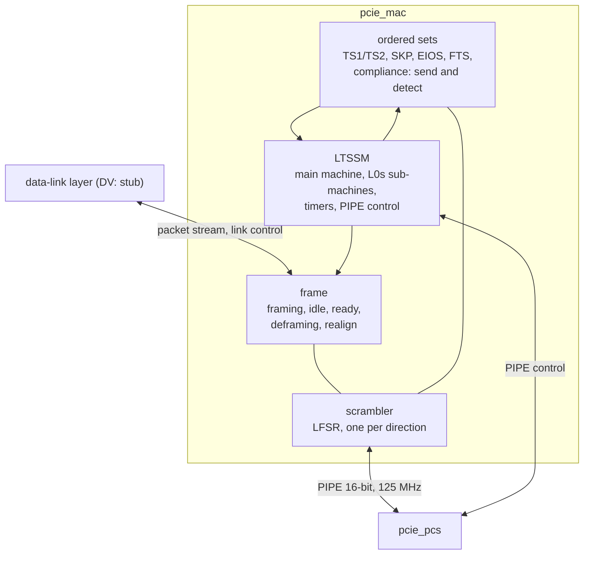

# pcie_mac HAS

`pcie_mac` is the upper half of the Gen1 x1 physical layer: the LTSSM in
both port roles, scrambling, ordered sets and packet framing (decision
record [0002](../../decisions/0002-m1-grill.md), Q3, Q6, Q10, Q11). Above
it is the data-link layer's framed packet stream (a stub in DV); below it,
the PIPE MAC side of [`pcie_pcs`](../phy/PIPE.md). [`pcie_phy`](../phy/HAS.md)
integrates it. It is not a data-link layer (no sequence numbers, LCRC, flow
control or DLLP content), does no 8b/10b coding, and supports one lane at
2.5 GT/s only.

The HAS is the normative protocol spec for this design (Q21): every rule
the design implements is written out here and on its sub-pages: the
[LTSSM page](LTSSM.md) (states, encoding, common rules, what each state
sends), the [arcs page](ARCS.md) (every arc), the
[symbols page](SYMBOLS.md) (ordered sets, TS1/TS2 fields, scrambling,
framing) and the [model page](MODEL.md) (architecture model and link
partner). Citations point to the PCIe Base Spec rev 3.0, Gen1 rules only
(Q9), and to PIPE rev 3.0 (`PIPE Spec`), for cross-checking only; they are
paraphrased, never copied ([wiki BKM](../../../bkm/wiki.md#citations)).
How it is built is in the [MAS](../../rtl/mac/MAS.md); how it is verified,
in the [DV plan](../../dv/mac/DV_PLAN.md).

## Position

One IP, four blocks (decision Q24 on epic
[#65](https://github.com/amichai-bd/pcie-factory/issues/65)): each block is
a file of `mac` under one filelist, described in its own section of the
[MAS](../../rtl/mac/MAS.md), and verified only through the `mac` ports by
one testbench ([DV plan](../../dv/mac/DV_PLAN.md)). There are no sub-IPs.

| Block | Holds | Why separate |
| --- | --- | --- |
| [Scrambler](../../rtl/mac/MAS.md#scrambler) | The [scrambler](SYMBOLS.md#scrambling): LFSR, reset on COM, hold on SKP, a key per symbol; instanced once per direction. A word that is not sent or not received (RxValid 0 or electrical idle) holds the LFSR. | Shared by both directions; reuses the retired `top_lfsr` (Q2). |
| [Ordered sets](../../rtl/mac/MAS.md#ordered-sets) | Ordered-set transmit (TS1/TS2 with given fields, SKP schedule, EIOS, FTS, compliance pattern) and receive (decode TS fields, flag SKP, EIOS, FTS). | One block per symbol format; the LTSSM only sees fields and events. |
| [Frame](../../rtl/mac/MAS.md#frame) | The upper stream: framing, idle, `pkt_tx_ready_o`, abort with EDB; deframing, realignment, `err` and `nullify`, framing errors. | The packet datapath, independent of training. |
| [LTSSM](../../rtl/mac/MAS.md#ltssm) | The [LTSSM](LTSSM.md): main machine, L0s sub-machines, timers, directed requests, PIPE power, detection and loopback control, scrambling control, `link_up_o`, `ltssm_state_o`. | The control path; the largest block. |

The top instances and connects them: a line mux, and one register stage on
each side of PIPE ([MAS, Top](../../rtl/mac/MAS.md#top)).

## Interfaces

All ports are synchronous to `clk_i`. Port names follow the
[RTL BKM](../../../bkm/rtl.md#naming). The upper packet stream and link
control are the `phy` ports of the same names, passed through one to one:
their contract is the [`phy` HAS](../phy/HAS.md#interfaces), and this page
adds only what is particular to the MAC ([Behavior](#behavior)).

### Clocks, reset and strap

| Port | Dir | Width | Clock | Description |
| --- | --- | --- | --- | --- |
| `clk_i` | in | 1 | - | Core clock and PIPE PCLK, 125 MHz. |
| `rst_i` | in | 1 | `clk_i` | Synchronous, active-high reset. |
| `port_role_i` | in | 1 | `clk_i` | 0 downstream, 1 upstream. Changes only while `rst_i` is high. |

### Upper packet stream and link control

| Port | Dir | Width | Description |
| --- | --- | --- | --- |
| `pkt_tx_valid_i`, `pkt_tx_ready_o` | in, out | 1, 1 | Transmit handshake. |
| `pkt_tx_data_i` | in | 16 | Two bytes, `[7:0]` first. |
| `pkt_tx_sop_i`, `pkt_tx_eop_i` | in | 1, 1 | First and last beat. |
| `pkt_tx_dllp_i` | in | 1 | 0 TLP, 1 DLLP; held from `sop` to `eop`. |
| `pkt_tx_nullify_i` | in | 1 | With a TLP's `eop`: end it with EDB. |
| `pkt_rx_valid_o` | out | 1 | A received beat (no ready). |
| `pkt_rx_data_o` | out | 16 | Two bytes, `[7:0]` first. |
| `pkt_rx_sop_o`, `pkt_rx_eop_o` | out | 1, 1 | First and last beat. |
| `pkt_rx_dllp_o` | out | 1 | 0 TLP (STP), 1 DLLP (SDP). |
| `pkt_rx_err_o`, `pkt_rx_nullify_o` | out | 1, 1 | With `eop`: bad, or nullified ([Receive](#receive)). |
| `link_up_o` | out | 1 | Link up ([LTSSM](LTSSM.md#what-each-state-transmits)). |
| `ltssm_state_o` | out | 6 | [State encoding](LTSSM.md#state-encoding). |
| `rcv_err_o` | out | 1 | [Receiver errors](#receiver-errors). |
| `retrain_req_i` | in | 1 | Pulse: L0 to Recovery. |
| `hot_reset_req_i`, `disable_req_i` | in | 1, 1 | Levels; downstream role only. |
| `loopback_req_i` | in | 1 | Level: be the Loopback master. |
| `pm_state_req_i` | in | 2 | 0 L0, 1 L0s allowed, 2 L1, 3 L2. |

### PIPE

The MAC side of the [PIPE interface](../phy/PIPE.md#signals): each
`pipe_<x>` net is `pipe_<x>_o` here when the MAC drives it, `pipe_<x>_i`
when the PCS does; the active-low net `pipe_reset_n` is the port
`pipe_reset_no` ([RTL BKM](../../../bkm/rtl.md#naming)). The names match
the PCS side one to one.

| Port | Dir | Width | Description |
| --- | --- | --- | --- |
| `pipe_reset_no` | out | 1 | PCS reset, active low. |
| `pipe_tx_data_o`, `pipe_tx_datak_o` | out | 16, 2 | Two symbols, `[7:0]` first; bit *i* of `datak` marks byte *i* as K. |
| `pipe_tx_detect_rx_o` | out | 1 | P1: receiver detection. P0: loopback. |
| `pipe_tx_elec_idle_o` | out | 1 | Transmitter in electrical idle. |
| `pipe_tx_compliance_o` | out | 1 | Negative disparity for `[7:0]` of this word. |
| `pipe_rx_polarity_o` | out | 1 | Invert received bits. |
| `pipe_power_down_o` | out | 2 | 0 P0, 1 P0s, 2 P1, 3 P2. |
| `pipe_rx_data_i`, `pipe_rx_datak_i` | in | 16, 2 | Two received symbols, `[7:0]` first. |
| `pipe_rx_valid_i` | in | 1 | Symbol lock. |
| `pipe_phy_status_i` | in | 1 | High in PCS reset, then completion pulses. |
| `pipe_rx_elec_idle_i` | in | 1 | The line is in electrical idle. |
| `pipe_rx_status_i` | in | 3 | Per word ([PIPE page](../phy/PIPE.md#signals)). |

## Parameters

| Name | Type | Default | Range | Effect |
| --- | --- | --- | --- | --- |
| `TIMEOUT_DIV` | `int unsigned` | 1 | 1 to 1024 | Divides the two pure waits, Detect.Quiet's 12 ms and the Hot Reset dwell of 2 ms (**T** on the [LTSSM page](LTSSM.md#common-rules)); the `phy` parameter of the same name, passed through. |
| `ERR_TIMEOUT_DIV` | `int unsigned` | 1 | 1 to 1024 | Divides the error-path timeouts (**E**: 2, 24 and 48 ms), each floored at 16384 cycles (131 µs). At 1 they are the spec values. The floor keeps every divided timeout above Polling.Active's 1024 TS1 (8192 cycles) with margin for reset skew, so training is unchanged. `pcie_phy` passes its own `ERR_TIMEOUT_DIV` through (default 1, the silicon value). |
| `N_FTS` | `int unsigned` | 32 | 1 to 255 | FTS ordered sets this receiver needs to leave L0s; sent in every TS, and sets the `Rx_L0s.FTS` timeout. |
| `L0S_IDLE_CYCLES` | `int unsigned` | 256 | 16 to 875 | Cycles without traffic before transmit L0s entry (875 is 7 µs). |

FPGA and ASIC builds use the defaults; DV may raise both dividers.

## Package

`pcie_mac_pkg` ([source](../../../../src/rtl/mac/pcie_mac_pkg.sv)) holds the
IP's private types: the block-to-block structs, parser and register state
([MAS, Package](../../rtl/mac/MAS.md#package)). The codes the mac shares
with other IPs, `t_ltssm_state` (the main-state codes of the
[encoding](LTSSM.md#state-encoding)), `t_l0s_sub`, `t_power_down`, the
symbol codes and the PIPE bundles, are in the shared
[`common_pkg`](../../rtl/common/common_pkg.md). Both are referenced as
`<pkg>::<name>` without `import`.

## Behavior

### Reset values

`rst_i` overrides everything, including the rule that ready stays 1 from
`sop` to `eop`: a packet being accepted when reset rises is abandoned, and
the upper layer starts again at a `sop` after reset. While `rst_i` is high:

- `pkt_tx_ready_o`, `pkt_rx_valid_o`, `pkt_rx_sop_o`, `pkt_rx_eop_o`,
  `pkt_rx_err_o`, `pkt_rx_nullify_o`, `link_up_o`, `rcv_err_o` are 0, and
  `ltssm_state_o` is 0 (Detect.Quiet), as in the
  [`phy` HAS](../phy/HAS.md#clocks-and-resets);
- `pipe_reset_no` is 0, `pipe_tx_elec_idle_o` 1, `pipe_power_down_o` P1,
  `pipe_tx_detect_rx_o`, `pipe_tx_compliance_o` and `pipe_rx_polarity_o` 0;
- data outputs are don't care while not qualified.

`pipe_reset_no` rises in the first cycle after `rst_i` falls. The LTSSM
starts in Detect.Quiet, and its 12 ms timer starts then; it changes no PIPE
input until `pipe_phy_status_i` is low ([PIPE page](../phy/PIPE.md#handshakes)).

### PIPE use

- **One power change at a time.** The MAC sets `pipe_tx_elec_idle_o`
  before it moves `pipe_power_down_o` away from P0, and waits for the
  `pipe_phy_status_i` pulse after each change before the next change or
  before sending. The PowerDown of each state is on the
  [LTSSM page](LTSSM.md#what-each-state-transmits).
- **Receiver detection** (Detect.Active): in P1 with the transmitter in
  electrical idle, raise `pipe_tx_detect_rx_o` and hold it to the
  `pipe_phy_status_i` pulse; `pipe_rx_status_i` 3 with the pulse means a
  receiver, 0 none; then drop it.
- **Loopback slave**: `pipe_tx_detect_rx_o` high in P0 with electrical
  idle low; the PCS retransmits the received symbols.
- **Polarity**: `pipe_rx_polarity_o` changes only in Polling
  ([arcs](ARCS.md#detect-and-polling)).
- `pipe_tx_compliance_o` is 1 only in Polling.Compliance
  ([symbols page](SYMBOLS.md#ordered-sets)).

### Transmit

Framing, idle, SKP and scrambling are on the
[symbols page](SYMBOLS.md#transmit). The handshake:

- Between packets `pkt_tx_ready_o` is 1 only in L0 with the transmit
  sub-machine in `Tx_L0`, no SKP ordered set due, no exit from L0
  pending, and the upstream port not waiting for L1 or L2 entry (its EIOS
  sent in L0, [arcs, L0](ARCS.md#l0)); a packet offered during that wait
  is taken after the port is back in L0. A beat offered in `Tx_L0s.Idle` starts the L0s exit
  ([arcs](ARCS.md#l0s-sub-machines)).
- A pending L1 or L2 entry is not an exit from L0 for this rule (the
  model's reading): while a downstream port's entry waits, for a packet on
  the line to end or for the receiver to leave `Rx_L0s.Entry`, the port
  stays in `Tx_L0` and may start a packet between packets, and the entry
  then waits for that packet's end. Only a Recovery exit that waits stops
  new packets.
- From an accepted `sop` to its `eop`, `pkt_tx_ready_o` is 1 every cycle,
  whatever the LTSSM does, except during reset (above). If the LTSSM
  leaves L0 inside a packet, the MAC ends it on the line with EDB and takes
  and discards the remaining beats; the data-link layer replays it.
- The MAC never puts a bubble inside a packet; the upper layer keeps
  `pkt_tx_valid_i` high from `sop` to `eop`. If valid drops inside a
  packet, the MAC ends it with EDB as above.

### Receive

Deframing rules are on the [symbols page](SYMBOLS.md#receive). Each packet
reaches the upper stream as beats:

- The first data byte is in `[7:0]` of the `sop` beat, even when the packet
  started in `[15:8]` of a PIPE word (the PCS may add or remove one SKP
  symbol); that realignment costs one cycle of latency.
- `pkt_rx_valid_o` may have gaps inside a packet; every `sop` is followed
  by exactly one `eop`. A packet with an odd byte count (only a cut-short
  or malformed one) has a don't-care high byte in its last beat and ends
  bad.
- On `eop`: `pkt_rx_err_o` is 1 when the packet ends bad (framing or symbol
  error inside it, cut short, a DLLP ended by EDB, or a DLLP that is not 6
  bytes). Otherwise `pkt_rx_nullify_o` is 1 for a TLP ended by EDB. Never
  both.
- A packet cut short by the LTSSM leaving L0 or `Rx_L0`, electrical idle
  or loss of `pipe_rx_valid_i` still ends with an `eop` beat carrying
  `err`.
- A packet with no data byte (STP or SDP followed at once by its end) is
  never delivered; in L0 it counts as a framing error unless leaving
  `Rx_L0` cut it ([symbols page](SYMBOLS.md#receive)).

### Link control

- `retrain_req_i` serves the data-link layer's retrain, which it requests
  when its REPLAY_NUM counter rolls over
  [cite: PCIe Base Spec, rev 3.0, §3.5.2.1], and a downstream port's
  Retrain Link request. It is acted on only in L0 (L0s included) and
  ignored otherwise.
- `hot_reset_req_i` and `disable_req_i` count only in the downstream role.
  Held high, they take the LTSSM from L0 through Recovery to Hot Reset or
  Disabled (or from Configuration.Linkwidth.Start to Disabled) and keep it
  there; released, the LTSSM goes to Detect.
- `loopback_req_i` high makes the port the Loopback master, from L0
  through Recovery or from Configuration.Linkwidth.Start; released, the
  master leaves through Loopback.Exit to Detect.
- `pm_state_req_i`: 1 allows transmit L0s after `L0S_IDLE_CYCLES` of no
  traffic; 2 and 3 enter L1 and L2 when, in either role, the request is
  held and the partner's EIOS is received; the upstream port sends its EIOS
  first ([arcs, L0](ARCS.md#l0)). A request of 0 or 1 leaves L1 through
  Recovery, and a request other than 3 leaves L2 to Detect. The upper layer owns the data-link handshake that
  precedes a request [cite: PCIe Base Spec, rev 3.0, §4.2.6.7].
- The [arcs page](ARCS.md) gives every arc these inputs take.

### Receiver errors

`rcv_err_o` is 1 for one cycle in each cycle in which a received word had
`pipe_rx_status_i` 4 to 7, or a framing error was found
([symbols page](SYMBOLS.md#receive)); several errors in one cycle give one
pulse.

## Decisions

| Choice | Rationale | Rejected |
| --- | --- | --- |
| L0s as two sub-machines inside L0, both shown in the L0 code (`0x20 \| tx << 2 \| rx`) | Transmit and receive L0s are independent; one code shows both without a status bit, which closes the `phy` HAS open item. | A rule that one side wins; an extra status port (a `phy` interface change). |
| `ERR_TIMEOUT_DIV`, floored at 16384 cycles | Error-path timeouts (24 and 48 ms) make 100% arc coverage slow; the floor keeps training intact. `pcie_phy` passes it through with default 1 (silicon), so its DV can divide the same timeouts. | Folding them into `TIMEOUT_DIV` (breaks training, changes the `phy` contract). |
| Receive conditions latch | The partner switches ordered sets as soon as its own counts are met; an unlatched run could be reset by that switch and stall training. | Requiring the run to hold until the send count is met. |
| x1-only Configuration with link 0 and lane 0 | One lane: no width or lane negotiation to make; each substate still checks the echoed numbers, so every arc remains. | Full multi-lane rules. |
| L1 and L2 need the request and a received EIOS in both roles; the upstream port sends its EIOS first and waits in L0 | The standard's L0 rule; a port never sits in L1 while its partner still sends, and a partner that retrains instead takes it to Recovery. | The upstream port entering on the request alone (stuck in L1.Idle if the partner never sends EIOS). |
| Disable Scrambling and Compliance Receive never sent; a received Disable Scrambling is honoured ([symbols page](SYMBOLS.md#scrambling)), Compliance Receive ignored; no modified compliance pattern and no directed compliance entry | No configuration space in M1 to request them; a partner that disables scrambling must still interoperate; Polling.Compliance is reached by the electrical-idle path. | Ignoring a received Disable Scrambling (the link would not come up with such a partner); sending them. |
| Control states: Disabled sends 16 TS1 then one EIOS; a following port leaves on an EIOS then EI exit, or after 2 ms with no EIOS; a following Hot Reset restarts its 2 ms dwell on each TS1 that keeps a run of 2 with the bit; the Loopback master gives up after 2 ms without its echo; Loopback.Exit holds electrical idle 20 ns; TS link and lane are those of the state left ([LTSSM page](LTSSM.md#what-each-state-transmits)) | Each port leaves on what it can observe; the directing port controls how long the pair stays; fixed counts keep model and RTL step for step. | Timers only, without the EIOS (a follower could leave before the directing port's EIOS). |
| A DLLP ended by EDB is an error, not a nullify | DLLPs cannot be nullified. | Reporting it as nullified. |
| Reset wins over ready from `sop` to `eop` | Reset must be immediate; the upper layer is reset with the MAC. | Finishing the packet in reset. |
| The architecture model is also the DV link partner | One statement of the LTSSM serves the arch and the DV (Q4); its injection hooks reach every arc. | A separate DV-only partner. |
| Shared codes in `common_pkg`, private types in `pcie_mac_pkg` | One source for each code and type, referenced by package name (Q22, Q24). | Literals or copies in each block. |

## Targets

Measured with two [architecture models](#architecture-model) back to back
(downstream to upstream); the training targets are checked again on the
RTL against the link partner ([DV plan](../../dv/mac/DV_PLAN.md#plan),
`train_spec`), and every RTL cycle against the model. The
latency budgets are the ones the [`phy` HAS](../phy/HAS.md#targets) gives
the MAC.

| Item | Target | Scenario |
| --- | --- | --- |
| Training | Polling.Active entry to L0 at least 65.536 µs (1024 TS1) and at most 80 µs, at any divider. | `train_spec`, `train_fast` |
| Link-up, dividers 1 | Reset release to L0 between 12.0 and 12.2 ms, simultaneous reset. | `train_spec` |
| Link-up, dividers 1024 | At most 100 µs with up to 2000 cycles of reset skew. | `train_fast` |
| Recovery | `retrain_req_i` to both ports back in L0 within 4 µs. | `retrain` |
| L0s | Transmit L0s reached within `L0S_IDLE_CYCLES` + 16 cycles of the request with no traffic; a packet in `Tx_L0s.Idle` back to `Tx_L0` within 2 x N_FTS + 16 cycles. | `l0s`, `l0s_max_fts` |
| L1 | Entry within 64 cycles of both requests; exit (request 0) to L0 within 4 µs. | `l1` |
| L2 | Entry within 64 cycles; exit to L0 through Detect within 100 µs at dividers 1024. | `l2` |
| Throughput | For back-to-back packets of n bytes, at least 2 x n/(n+2) x 1176/1180 bytes per cycle: at least 1.97 for 274-byte TLPs, 1.49 for DLLPs. | `tlp_274`, `dllp` |
| Lossless | Random TLPs and DLLPs, nullified TLPs, any SKP interval: every packet delivered with its flags, no framing error. | `mixed` |
| TX latency | At most 3 cycles from an accepted beat to its first symbol on `pipe_tx_data_o`. | budget, `MacBudget` |
| RX latency | At most 3 cycles from a packet's first symbol on `pipe_rx_data_i` to its `sop` beat, plus 1 when it starts in `[15:8]`. | budget, `MacBudget` |
| Arc coverage | The link-partner model drives every arc of the [arc list](ARCS.md) (64) on the other model, in each port role. | `arc_smoke` (ci-gate), `partner_arc_sweep` (level 2) |
| Clock | 125 MHz on the `phy` FPGA and ASIC flows. | `phy` flows |

## Architecture model

[`pcie_mac_arch.py`](../../../../src/arch/mac/pcie_mac_arch.py) states this
HAS as a cycle model at the PIPE MAC side and is also the DV link partner
(Q4); `./build arch --ip mac` checks the [targets](#targets). The
[model page](MODEL.md) owns its structure, injection hooks, DV use, perf
scenarios and the arc sweep.

## Open items

Rules below are this design's choices where the cited section could not be
confirmed; each owner confirms or corrects the rule and the model together.

| Item | Owner |
| --- | --- |
| Recovery.RcvrLock timeout target (Configuration when any TS was received, else Detect), Configuration.Lanenum.Accept's 2 ms timeout (taken from its neighbours), and the x1 reading of the Lanenum substates for the upstream role. | [#164](https://github.com/amichai-bd/pcie-factory/issues/164) |
| Electrical-idle inference in L0 at 2.5 GT/s (here: `pipe_rx_elec_idle_i` without an EIOS goes to Recovery). | [#164](https://github.com/amichai-bd/pcie-factory/issues/164) |
| The `Rx_L0s.FTS` timeout (the smaller of 2 x N_FTS + 32 and 4 x N_FTS + 12 cycles here, so it stays within twice the time of N_FTS + 3 FTS), its exit on the SKP ordered set, and the 7 µs bound on the L0s idle time (expected in the active-state power management rules, [cite: PCIe Base Spec, rev 3.0, §5.4.1.1.1]). Also the L1/L2 entry edge case: an EIOS received before the request counts (the receiver is in `Rx_L0s.Entry` or `Rx_L0s.Idle`), so a downstream port can enter L1 or L2 when its partner had only entered transmit L0s; the pair then recovers through Recovery. | [#164](https://github.com/amichai-bd/pcie-factory/issues/164) |
| The upstream port can enter L1 or L2 one step after starting its wait (its receiver already in `Rx_L0s.Entry` or `.Idle`); if its EIOS has started but not finished, L1.Entry or L2.Idle queues a second EIOS. The model does the same, and the partner only sees one more EIOS before electrical idle; whether one EIOS should be sent is to be confirmed. | [#164](https://github.com/amichai-bd/pcie-factory/issues/164) |
| The control-state rules in [Decisions](#decisions) (Disabled's 16 TS1 and the following port's exit, Hot Reset's dwell restart, Loopback's 2 ms entry timeout and 20 ns exit idle) and the Disable Scrambling rule (2 consecutive TS2 in Configuration.Complete, effective from Configuration.Idle to Detect.Quiet): this design's reading, to be checked against the cited sections; Compliance Receive, the modified compliance pattern and directed compliance entry stay out. | [#164](https://github.com/amichai-bd/pcie-factory/issues/164) |
| Section-level citations for the EIOS, FTS and lane polarity inversion definitions (cited here through the states that use them). | [#149](https://github.com/amichai-bd/pcie-factory/issues/149) |
| The `phy` HAS says `retrain_req_i` serves a replay-timeout retrain; the rule is the REPLAY_NUM rollover ([Link control](#link-control)). Correct the `phy` wording with the stack integration. | [#86](https://github.com/amichai-bd/pcie-factory/issues/86) |
