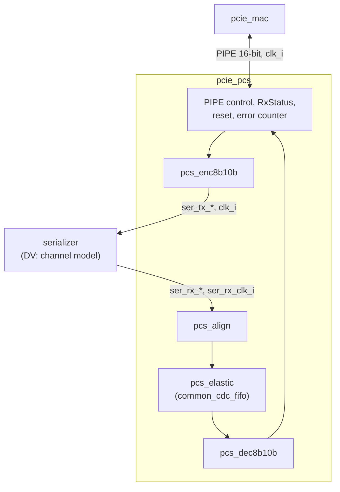

# pcie_pcs HAS

`pcie_pcs` is the physical coding sublayer of the Gen1 x1 physical layer:
8b/10b encode and decode with running disparity, comma alignment and
symbol lock, a SKP elastic buffer from the recovered RX clock into the core
clock, and PIPE control. Above it, `pcie_mac` drives the PCS side of
[PIPE](../phy/PIPE.md) (16-bit at 125 MHz); below it, a serializer or the
DV channel model drives the 2x10-bit symbol interface. [`pcie_phy`](../phy/HAS.md)
integrates both. It is not a serializer, has no analog or CDR function, and
does no scrambling, framing or ordered-set generation (the `mac` does).

This page owns the PCS contract: interfaces, clocks and reset, the
clock-domain crossings, the sub-IP split and the targets. Three sub-pages
hold the normative rules: the [8b/10b code](8B10B.md), the
[receive path](RECEIVE.md) (lock, elastic buffer, RxStatus) and
[PIPE control](PIPE_CONTROL.md) (every handshake, transmit and loopback).
How it is built is in the [MAS](../../rtl/pcs/MAS.md); how it is verified,
in the [DV plan](../../dv/pcs/DV_PLAN.md).

**Normative and self-contained.** Every protocol rule the PCS implements is
written out on these pages, complete enough to build and verify it without
the official documents (decision Q21 in the
[M1 epic](https://github.com/amichai-bd/pcie-factory/issues/65)).
Citations, to PCIe Base Spec rev 3.0 (Gen1 rules, decision record
[0002](../../decisions/0002-m1-grill.md) Q9) and PIPE rev 3.0, only point to
the official text for cross-checking ([wiki BKM](../../../bkm/wiki.md#citations));
the [references page](../../references.md) lists every source;
anything uncertain is an [open item](#open-items). The PIPE rules were
checked against the cached PIPE rev 3.0 text
([#117](https://github.com/amichai-bd/pcie-factory/issues/117)); this
stack's deliberate differences are listed on the
[PIPE control](PIPE_CONTROL.md#differences-from-pipe) page. The 8b/10b
code is the Widmer and Franaszek code (IBM, 1983;
[references](../../references.md#8b10b)).

## Position

Sub-IPs are flat siblings with prefixed ids
([layout](../../../project/layout.md#ips-and-sub-ips)), each with its own MAS
(scope, interfaces, behavior) and DV plan. Their RTL arrives in wave 2.

| Sub-IP | Clock | Holds | Issue |
| --- | --- | --- | --- |
| `pcs_enc8b10b` | `clk_i` | Two symbols per cycle with the transmit RD, TxCompliance, unsupported K to EDB ([code](8B10B.md)). | [#81](https://github.com/amichai-bd/pcie-factory/issues/81) |
| `pcs_dec8b10b` | `clk_i` | RxPolarity inversion, two-symbol decode with RD, code and disparity errors, EDB substitution ([decoder](8B10B.md#decoder-and-error-classes)). | [#82](https://github.com/amichai-bd/pcie-factory/issues/82) |
| `pcs_align` | `ser_rx_clk_i` | Input register, comma search, symbol lock, relock input ([lock](RECEIVE.md#comma-alignment-and-symbol-lock)). | [#83](https://github.com/amichai-bd/pcie-factory/issues/83) |
| `pcs_elastic` | both | SKP removal and packing (write side), the FIFO, SKP addition and start (read side), fill high ([elastic buffer](RECEIVE.md#elastic-buffer)). | [#84](https://github.com/amichai-bd/pcie-factory/issues/84) |
| `pcie_pcs` top | both | PIPE control, RxStatus, the error counter, resets and the other crossings ([PIPE control](PIPE_CONTROL.md)). | [#85](https://github.com/amichai-bd/pcie-factory/issues/85) |

## Interfaces

Port names follow the [RTL BKM](../../../bkm/rtl.md#naming); PIPE ports are
the stack nets of the [PIPE page](../phy/PIPE.md#signals) with a direction
suffix (the active-low net `pipe_reset_n` is the port `pipe_reset_ni`).
The `Clock` column is each input's `cdc-domain` annotation in the RTL
([crossings](../../../bkm/rtl.md#clock-domain-crossings)). Bits `[7:0]` (or
`[9:0]`) carry the earlier byte (symbol) on the line.

| Port | Dir | Width | Clock | Description |
| --- | --- | --- | --- | --- |
| `clk_i` | in | 1 | - | Core clock, 125 MHz; also PIPE PCLK and the TX symbol clock. |
| `rst_i` | in | 1 | `clk_i` | Synchronous, active-high reset of the whole PCS. |
| `pipe_reset_ni` | in | 1 | `clk_i` | PIPE Reset#: active-low PCS reset from the MAC ([what it resets](PIPE_CONTROL.md#reset-and-phystatus)). |
| `pipe_tx_data_i` | in | 16 | `clk_i` | TxData: two bytes. |
| `pipe_tx_datak_i` | in | 2 | `clk_i` | TxDataK: bit i marks byte i as a K symbol. |
| `pipe_tx_detect_rx_i` | in | 1 | `clk_i` | TxDetectRx/Loopback: receiver detection in P1, loopback in P0. |
| `pipe_tx_elec_idle_i` | in | 1 | `clk_i` | TxElecIdle, whole word. |
| `pipe_tx_compliance_i` | in | 1 | `clk_i` | TxCompliance: negative RD before the `[7:0]` symbol. |
| `pipe_rx_polarity_i` | in | 1 | `clk_i` | RxPolarity: invert received bits. |
| `pipe_power_down_i` | in | 2 | `clk_i` | PowerDown: 0 P0, 1 P0s, 2 P1, 3 P2. |
| `pipe_rx_data_o` | out | 16 | `clk_i` | RxData: two bytes. |
| `pipe_rx_datak_o` | out | 2 | `clk_i` | RxDataK. |
| `pipe_rx_valid_o` | out | 1 | `clk_i` | RxValid: both symbols are under symbol lock. |
| `pipe_phy_status_o` | out | 1 | `clk_i` | PhyStatus: high in and after reset, then one-cycle completion pulses. |
| `pipe_rx_elec_idle_o` | out | 1 | `clk_i` | RxElecIdle, synchronized. |
| `pipe_rx_status_o` | out | 3 | `clk_i` | RxStatus per word ([codes](RECEIVE.md#decode-and-rxstatus)). |
| `ser_tx_data_o` | out | 20 | `clk_i` | Two encoded symbols, `[9:0]` first, bit 0 first on the line. |
| `ser_tx_elec_idle_o` | out | 1 | `clk_i` | The transmitter is in electrical idle. |
| `ser_tx_rxdet_i` | in | 1 | `clk_i` | A far-end receiver termination is present. |
| `ser_rx_clk_i` | in | 1 | - | Recovered RX clock, 125 MHz nominal. |
| `ser_rx_data_i` | in | 20 | `ser_rx_clk_i` | Twenty received bits, bit 0 earliest, no alignment. |
| `ser_rx_elec_idle_i` | in | 1 | `ser_rx_clk_i` | The line is in electrical idle. |

The lower ports are exactly the `phy` HAS's
[lower symbol interface](../phy/HAS.md#lower-symbol-interface).

## Parameters

None. Depths, thresholds and timings are fixed by this page and its
sub-pages.

## Package

Each sub-IP owns its types and constants in its own package,
`pcie_pcs__pkg`, and never uses the parent's, so its filelist stands
alone ([RTL BKM](../../../bkm/rtl.md#types-and-constants-live-in-packages)).
The top's package `pcie_pcs_pkg` (`src/rtl/pcs/pcie_pcs_pkg.sv`) holds only
the top's own types and constants: its PIPE encodings and the PIPE-control
timing. The top names a sub-IP's items explicitly as
`pcie_pcs__pkg::<name>`, so dependencies point down the hierarchy.
Code never imports a package (decision Q22 in the
[M1 epic](https://github.com/amichai-bd/pcie-factory/issues/65)). The ports
above, and every sub-IP's ports, stay plain `logic` vectors.

A value two sibling sub-IPs need, such as `K_EDB` in the encoder and the
decoder, is defined in each sub-IP's package from the same row of these
pages; each MAS cites that row and each DV checks the value against the
[architecture model](#architecture-model). A shared package-only block
replaces the copies later
([#133](https://github.com/amichai-bd/pcie-factory/issues/133)).

| Name | Package | Holds |
| --- | --- | --- |
| `t_power_down` | `pcie_pcs_pkg` | enum, 2 bits: `P0`, `P0S`, `P1`, `P2` ([PowerDown](PIPE_CONTROL.md#powerdown)). |
| `t_rx_status` | `pcie_pcs_pkg` | enum, 3 bits: the eight [RxStatus codes](RECEIVE.md#decode-and-rxstatus). |
| `PHY_STATUS_RESET_CYCLES`, `RX_DETECT_CYCLES`, `POWER_ACK_CYCLES` | `pcie_pcs_pkg` | 16, 64 and 4 ([PIPE control](PIPE_CONTROL.md)). |
| `ERR_LIMIT`, `ERR_DECAY_WORDS` | `pcie_pcs_pkg` | 3 and 8 ([relock](RECEIVE.md#comma-alignment-and-symbol-lock)); the error counter is the top's. |
| `t_sym10`, `K_EDB` | each of `pcie_pcs_enc8b10b_pkg`, `pcie_pcs_dec8b10b_pkg` | One raw symbol, bit 0 first on the line; EDB, `8'hFE` ([K symbols](8B10B.md#k-symbols)). |
| `COMMA_MINUS`, `COMMA_PLUS` | `pcie_pcs_align` (module constants) | The two [comma](8B10B.md#comma) forms, matched only there. |
| `t_eb_word`, `EB_ADDR_W`, `EB_NOMINAL`, `EB_HIGH`, `EB_LOW`, `EB_HOLDOFF` | `pcs_elastic`'s own package ([#84](https://github.com/amichai-bd/pcie-factory/issues/84)) | One elastic-buffer word (two raw symbols, the lock tag, the lock-generation bit, two removed-SKP flags, the overflow flag; 25 bits); 4, 8, 9, 7 and 8 ([elastic buffer](RECEIVE.md#elastic-buffer)). |
| `K_COM`, `K_SKP` and the other [K symbols](8B10B.md#k-symbols) | the package of each sub-IP that matches them | 8-bit constants, or their raw 10-bit forms where a sub-IP matches symbols without decoding. |

The RTL has no `` `ifdef `` and writes no assertion directly: invariants
are `COMMON_ASSERT*` macros in the module they belong to, and checkers that
need testbench state live in DV bind modules
([RTL BKM](../../../bkm/rtl.md#assertions)).

## Behavior

### Clocks and reset

- `clk_i` runs PIPE control, the transmit path, the read side of the
  elastic buffer and the decoder. `ser_rx_clk_i` runs only `pcs_align` and
  the write side of the elastic buffer.
- The `phy` HAS fixes the [clock and reset contract](../phy/HAS.md#clocks-and-resets):
  `ser_rx_clk_i` toggles at all times and is within ±600 ppm of `clk_i`;
  `rst_i` is high for at least 8 `clk_i` cycles; the RX-domain reset
  asserts asynchronously with `rst_i` and releases synchronously to
  `ser_rx_clk_i` within 3 of its cycles after `rst_i` falls.
- **RX-domain reset.** `rst_i` goes straight into
  [`common_cdc_rst`](https://github.com/amichai-bd/pcie-factory/issues/119)
  with `ser_rx_clk_i` as its clock. Its output asserts with `rst_i`, with
  no clock edge, and releases on the second `ser_rx_clk_i` edge after
  `rst_i` falls, which meets the contract. The `ser_rx_clk_i` domain and the
  FIFO's write side reset on that output; the FIFO's read side resets on
  `rst_i`, so both sides are in reset together the whole time `rst_i` is
  high (at least 8 `clk_i` and 7 `ser_rx_clk_i` cycles), as the FIFO
  requires.
  ([Decisions](#decisions) give the choice.)
- `pipe_reset_ni` resets only the `clk_i` side
  ([PIPE control](PIPE_CONTROL.md#reset-and-phystatus)).

### Reset values

Held while `rst_i` is 1 or `pipe_reset_ni` is 0:
`pipe_phy_status_o` 1, `pipe_rx_valid_o` 0, `pipe_rx_status_o` 0,
`pipe_rx_elec_idle_o` 1, `ser_tx_elec_idle_o` 1. `pipe_rx_data_o`,
`pipe_rx_datak_o` and `ser_tx_data_o` are don't care.

### Function

| Area | Normative rules |
| --- | --- |
| 8b/10b, running disparity, valid K symbols, error classes, comma | [8b/10b code](8B10B.md) |
| Comma alignment, lock and relock criteria, bit slips | [Receive path](RECEIVE.md#comma-alignment-and-symbol-lock) |
| SKP add and remove, elastic-buffer behavior, depth math | [Receive path](RECEIVE.md#elastic-buffer) |
| RxValid, RxStatus codes and precedence, polarity | [Receive path](RECEIVE.md#decode-and-rxstatus) |
| Reset, PhyStatus, PowerDown, receiver detection, electrical idle, TxCompliance, loopback | [PIPE control](PIPE_CONTROL.md) |

### Clock-domain crossings

Every path between `clk_i` and `ser_rx_clk_i` uses one of these approved
cells; there are no others (Q17,
[RTL BKM](../../../bkm/rtl.md#clock-domain-crossings)).

| # | What crosses | From → to | Cell | Source-side reset | Destination-side reset | Owner |
| --- | --- | --- | --- | --- | --- | --- |
| 1 | Received words: two raw symbols, lock tag, lock generation, removed and overflow flags | `ser_rx_clk_i` → `clk_i` | [`common_cdc_fifo`](../../rtl/common/common_cdc_fifo.md), `WIDTH` 25, `ADDR_W` 4 (its pointers cross inside it through `common_cdc_sync2`) | RX reset (`src_rst_i`) | `rst_i` (`dst_rst_i`) | `pcs_elastic` |
| 2 | RX-domain reset, from `rst_i` | `clk_i` → `ser_rx_clk_i` | `common_cdc_rst` ([#119](https://github.com/amichai-bd/pcie-factory/issues/119)) | none (`rst_i` is the input) | none (it makes the RX reset) | top |
| 3 | Fill high, a level from a `clk_i` flop | `clk_i` → `ser_rx_clk_i` | [`common_cdc_sync2`](../../rtl/common/common_cdc_sync2.md) | `rst_i` (the source flop) | RX reset (`dst_rst_i`) | `pcs_elastic` |
| 4 | Relock request, one event per request | `clk_i` → `ser_rx_clk_i` | [`common_cdc_pulse`](../../rtl/common/common_cdc_pulse.md) | `rst_i` (`src_rst_i`; never `pipe_reset_ni`, so both sides reset together) | RX reset (`dst_rst_i`) | top |
| 5 | Receiver active (not `ser_rx_elec_idle_i`), a level from a `ser_rx_clk_i` flop | `ser_rx_clk_i` → `clk_i` | [`common_cdc_sync2`](../../rtl/common/common_cdc_sync2.md) | RX reset (the source flop) | `rst_i` (`dst_rst_i`) | top |

"RX reset" is the output of crossing 2. No crossing cell resets on
`pipe_reset_ni`.

Crossing 5 carries the inverted level so that its reset value 0 gives
`pipe_rx_elec_idle_o` 1. RxPolarity needs no crossing: it acts after the
buffer, on the `clk_i` side.

## Decisions

| Choice | Rationale | Rejected |
| --- | --- | --- |
| Decode on the `clk_i` side, after the buffer | RxPolarity then applies from the next PIPE word, as the [PIPE page](../phy/PIPE.md#handshakes) states, with no crossing; comma and SKP matching are polarity-blind, so the RX domain needs no decode. | Decoding in the RX domain (needs RxPolarity crossed in, so it applies late). |
| Remove SKP on the write side, add on the read side | Each side then needs at most two symbols per cycle: removing on the read side needs three when no leftover symbol is held, and adding on the write side would need a third. | Both on one side. |
| Remove the first SKP after COM; add a copy right after COM | The change sits next to the COM, so its RxStatus goes on the COM's word as PIPE asks with a one-symbol look-ahead; PIPE allows a bare COM. | Removing a later SKP (the status would need a look-ahead of several symbols). |
| Visible fill from a FIFO output, fill high crossed as a level | One measure, on the side that adds; the remover only needs a level. The FIFO's MAS already foresees fill outputs. | A second Gray write counter through `common_cdc_sync2` (duplicates the FIFO's own pointer crossing). |
| 16-word FIFO, nominal visible fill 8, add at 7 or less, remove at 9 or more | Covers 3.4 symbols of drift, the sampling jitter and the pointer lag both ways, with fill 4 to 12 ([depth math](RECEIVE.md#depth-versus-clock-offset)). This rebalances the `phy` budget's "16 symbols centred at 8": the visible window is still 16 symbols centred at 8 (`PcsBudget.eb_depth_symbols`), and the storage is 32 symbols because each side sees the other's pointer late. A fill of 12 or less keeps RX latency at 12 or less, as the `phy` contract needs. | 8 words (the write side would see it full); a dead band of ±1 (the lowest fill would be 2.6, a margin of under one symbol to underflow). |
| Lock on the first comma, relock on 3 errored words | Fast L0s exit and recovery; a false lock produces errors and relocks. Isolated errors never cost lock. | Several commas before lock (slow); relock on any error. |
| Re-arm the relock request on a lock-generation bit carried in each word | A relock in comma-dense traffic can retake lock in the same cycle, so `pipe_rx_valid_o` need not fall; an unlocked word may also be dropped by recentring. The generation bit always changes. | Re-arming when `pipe_rx_valid_o` falls and rises (can stall for good); forcing an unlocked word per relock (recentring can drop it). |
| Recentre while unlocked | Electrical idle can last long enough to drift any buffer empty or full; data then is not valid anyway. | Resetting the buffer on lock (a reset crossing per lock). |
| RX-domain reset through `common_cdc_rst`, from `rst_i` only | Meets the `phy` contract as signed off (asynchronous assertion); `rst_i` also resets the FIFO's read side, so both sides reset together. Firstmate decision, 2026-10-15. | `common_cdc_sync2` (synchronous assertion, a `phy` contract change); including `pipe_reset_ni` (a short PIPE reset could reset one FIFO side alone). |
| Acknowledge every PowerDown change with one pulse, P0s included | PIPE asks for it among P0, P0s and P1; P2 keeps the same pulse because `clk_i` never stops ([differences](PIPE_CONTROL.md#differences-from-pipe)). | No pulse for P0s; PIPE's P2 handshake (needs a stopped PCLK). |

## Targets

The `phy` HAS sets the [budgets](../phy/HAS.md#targets) the PCS must meet:
transmit 2 cycles, receive 6 cycles plus half the elastic-buffer fill, 16
cycles from reset to PhyStatus low and 64 for receiver detection.
`pcs_budget()` in the model returns them as the `phy` model's `PcsBudget`.

| Item | Target |
| --- | --- |
| TX latency | 2 cycles from a word on `pipe_tx_data_i` to its symbols on `ser_tx_data_o`. |
| RX latency | At most 12 cycles from a symbol's last bit on `ser_rx_data_i` (locked) to `pipe_rx_data_o`, at any offset up to ±600 ppm. That is 6 plus half the highest visible fill (12), so the `phy` RX target holds. |
| Elastic buffer | No overflow, underflow or lost symbol at ±600 ppm, any SKP interval from 1180 to 1538, up to maximum TLPs, and across electrical idle of any length. Visible fill within 4 to 12 symbols; the write side sees at most 12 of 16 words. |
| Lock | The first word of a new lock on `pipe_rx_data_o` within 10 cycles of the comma that gives lock. |
| Bit slip | Relock requested within 32 cycles of a slip, in packet traffic and in comma-dense training traffic alike; lock regained at the next comma. Every slip is detected. |
| Symbol errors | Every isolated single-bit error reported (RxStatus 4 or 7); none costs lock. |
| PIPE timing | PhyStatus low 16 cycles after reset; receiver detection 64 cycles; PowerDown acknowledged after 4 cycles. |
| Code | No run of more than five equal bits on the line; no misaligned comma (K28.7 is never sent). |
| Clocks | `clk_i` and `ser_rx_clk_i` at 125 MHz on the FPGA and ASIC flows. |

## Architecture model

[`pcie_pcs_arch.py`](../../../../src/arch/pcs/pcie_pcs_arch.py) and
[`pcie_pcs_8b10b.py`](../../../../src/arch/pcs/pcie_pcs_8b10b.py) model
the code (computed from [these rules](8B10B.md), not copied), the transmit
encoder, a channel (ppm, bit slips, single-bit errors, electrical idle,
polarity), the receive path as a two-clock simulation (aligner, write-side
removal, Gray-pointer FIFO with two-flop pointer synchronizers, read-side
addition, decode, error counter) and PIPE control
([arch BKM](../../../bkm/arch.md)). `./build arch --ip pcs` writes
`workdir/pcs/arch/perf.json`.

| Scenario | Workload | Targets checked |
| --- | --- | --- |
| [`code_properties`](../../../../src/arch/pcs/perf/code_properties.yaml) | Every symbol, every pair | round trip, disparity, run ≤ 5, commas |
| [`pipe_detect_present`](../../../../src/arch/pcs/perf/pipe_detect_present.yaml), [`pipe_detect_absent`](../../../../src/arch/pcs/perf/pipe_detect_absent.yaml) | Reset, detection, every PowerDown change | 16, 64, 4 cycles; RxStatus 3 or 0 |
| [`eb_max_tlp_fast`](../../../../src/arch/pcs/perf/eb_max_tlp_fast.yaml), [`eb_max_tlp_slow`](../../../../src/arch/pcs/perf/eb_max_tlp_slow.yaml) | 4122-byte TLPs, SKP every 1538, ±600 ppm | lossless, fill 4 to 12, write view ≤ 12, RX ≤ 12, SKP status on COM |
| [`eb_dllp_fast`](../../../../src/arch/pcs/perf/eb_dllp_fast.yaml), [`eb_random_slow`](../../../../src/arch/pcs/perf/eb_random_slow.yaml) | DLLPs at +600, random sizes at -600 ppm, SKP every 1180 | the same |
| [`polarity`](../../../../src/arch/pcs/perf/polarity.yaml) | Inverted lane with RxPolarity | the same |
| [`bit_slips`](../../../../src/arch/pcs/perf/bit_slips.yaml) | 6 slips, +300 ppm | all detected within 32 cycles, lock within 10 |
| [`slips_training_fast`](../../../../src/arch/pcs/perf/slips_training_fast.yaml), [`slips_training_slow`](../../../../src/arch/pcs/perf/slips_training_slow.yaml) | 12 slips in 3000 training sets (a COM every 16 symbols), ±300 ppm | all detected within 32 cycles (relock re-arms on the lock generation), lock within 10 |
| [`symbol_errors`](../../../../src/arch/pcs/perf/symbol_errors.yaml) | 10 single-bit errors, -300 ppm | all reported, no relock |
| [`elec_idle_fast`](../../../../src/arch/pcs/perf/elec_idle_fast.yaml), [`elec_idle_slow`](../../../../src/arch/pcs/perf/elec_idle_slow.yaml) | 3 idle gaps of 20000 symbols, ±600 ppm | no overflow or underflow, lock within 10 |

## Open items

| Item | Owner |
| --- | --- |
| Add a read-side fill output to `common_cdc_fifo` (with its MAS and DV plan), used by `pcs_elastic`. | [#84](https://github.com/amichai-bd/pcie-factory/issues/84) |
| `common_cdc_rst`: name, release-edge parameter (2 here) and directive. | [#119](https://github.com/amichai-bd/pcie-factory/issues/119) |
| Electrical sections for receiver detection and the ±300 ppm reference tolerance; sub-section citations for the 8b/10b decode rules and for lane polarity inversion (cited here at the nearest confident section). The Base Spec is not available locally, so these wait for a copy ([#117](https://github.com/amichai-bd/pcie-factory/issues/117)). | [#85](https://github.com/amichai-bd/pcie-factory/issues/85) |
| Whether the Base Spec asks more of symbol lock than the rules above (for example a minimum number of commas). | [#83](https://github.com/amichai-bd/pcie-factory/issues/83) |
