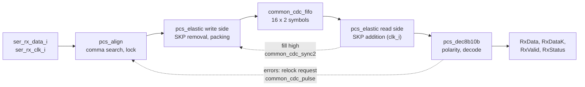

# pcie_pcs receive path

How the [`pcs`](HAS.md) turns the unaligned 20-bit words on
`ser_rx_data_i` into PIPE receive words: comma alignment and symbol lock
in the `ser_rx_clk_i` domain, the SKP elastic buffer into `clk_i`, then
polarity, [8b/10b decode](8B10B.md) and RxStatus. These rules are
normative (decision Q21 in the
[M1 epic](https://github.com/amichai-bd/pcie-factory/issues/65)); the
[architecture model](../../../../src/arch/pcs/pcie_pcs_arch.py) runs them as
a two-clock simulation.

## Comma alignment and symbol lock

Each `ser_rx_clk_i` cycle the aligner registers the incoming word and
looks at a 40-bit window: the previous word then the current one, earliest
bit first.

- **Hunt.** While unlocked, and only when neither word of the window was
  received with `ser_rx_elec_idle_i` high, the aligner searches the window
  at bit offsets 0 to 19 for a [comma](8B10B.md#comma). At the lowest
  offset `p` where one starts, it sets the symbol boundary to `p mod 10`
  and takes **symbol lock** at once, in that cycle.
- **Locked.** The boundary is frozen. Each cycle the aligner sends the two
  10-bit symbols that start at the boundary and at the boundary plus 10,
  tagged locked. Commas at other offsets are ignored.
- **Loss of lock.** Lock drops in the cycle after `ser_rx_elec_idle_i` is
  seen high, and when a relock request arrives from the `clk_i` side. The
  aligner then hunts again.
- **Relock request.** On the `clk_i` side an error counter watches the
  words that leave with `pipe_rx_valid_o` high. A word with a code or
  disparity error adds 1; eight error-free words in a row take 1 away (not
  below 0). At 4 the PCS sends one relock request (a
  [`common_cdc_pulse`](../../rtl/common/common_cdc_pulse.md) to the aligner)
  and clears the counter. It sends no other request until
  `pipe_rx_valid_o` has fallen and risen again; the counter also clears
  when `pipe_rx_valid_o` rises.

So isolated errors never cost lock, while a bit slip, which turns nearly
every later symbol into an error, is caught within a few words. Lock is
taken on the first comma rather than on several: a false lock leads to
errors and a relock, and lock on one comma keeps L0s exit (FTS ordered
sets, one comma each) short. The receiver gets the partner's symbols from
COM in training sets, FTS and SKP ordered sets
[cite: PCIe Base Spec, rev 3.0, §4.2.4.1]
[cite: PCIe Base Spec, rev 3.0, §4.2.7].

## Elastic buffer

The buffer absorbs the offset between `ser_rx_clk_i` and `clk_i` by
adding or removing single SKP symbols inside SKP ordered sets. A SKP
ordered set is a COM followed by SKP symbols; it ends at the first symbol
that is neither. SKP is disparity neutral and its two columns are each
other's complement, so a SKP can be added or removed without disturbing the
decoder, and found without decoding.

- **Storage.** A [`common_cdc_fifo`](../../rtl/common/common_cdc_fifo.md)
  of 16 words (`ADDR_W` 4). A word holds two raw 10-bit symbols, the lock
  tag, a removed-SKP flag per symbol and an overflow flag (24 bits).
- **Visible fill.** The read side's fill is twice the words it can see
  (the FIFO's read-side occupancy: written words whose pointer has
  crossed) plus the symbols held in its one-symbol leftover register. The
  FIFO does not output this today; it gains a read-side fill output in
  [#84](https://github.com/amichai-bd/pcie-factory/issues/84). Nominal fill
  is 8 symbols.
- **Fill high.** A `clk_i` flop is 1 while the visible fill is 10 or more;
  a [`common_cdc_sync2`](../../rtl/common/common_cdc_sync2.md) brings it to
  the write side.
- **Remove (write side).** While fill high is seen, the write side drops a
  locked SKP that directly follows a COM: the first SKP of a SKP ordered
  set, so at most one per set. A set that arrived with one SKP leaves as a
  bare COM, which the MAC accepts ([PIPE](#decode-and-rxstatus)). The
  symbol after the dropped SKP carries the removed flag. A packing register
  joins the remaining symbols back into two-symbol words, so that cycle may
  write no word.
- **Add (read side).** When the read side sends a locked COM while the
  visible fill is 6 or less, it looks at the next symbol (in its leftover
  register or at the FIFO head, without reading it); if that is a SKP, it
  sends one extra copy of it right after the COM: at most one per set. (A
  copy is the right code: it is sent at the same RD as the original, and
  SKP leaves RD unchanged.) That cycle may read no word. If the next symbol
  is not yet visible, nothing is added for that set.
- **Start.** After reset the read side reads nothing until the visible
  fill reaches 8; `pipe_rx_valid_o` stays 0.
- **Unlocked recentring.** Data that is not locked has no SKP to work
  with, yet electrical idle can last milliseconds. While fill high is seen
  and the word is unlocked, the write side drops the whole word, at most
  once per 8 cycles; while the head word is unlocked and the visible fill
  is 6 or less, the read side reads nothing for a cycle, at most once per
  8 cycles. The fill is therefore near 8 whenever lock returns.
- **Overflow and underflow.** If the write side finds the FIFO full, the
  word is lost and the next word written carries the overflow flag
  (RxStatus 5): the word that takes the lost symbols' place in the
  stream. If the read side, once started, has fewer than two symbols
  to send, it sends EDB, EDB as K symbols with RxStatus 6. Neither happens
  within the [targets](HAS.md#targets).

### Depth versus clock offset

| Quantity | Value | Why |
| --- | --- | --- |
| Clock offset | at most 600 ppm | Each end's reference is within ±300 ppm [cite: PCIe Base Spec, rev 3.0, §4.2.7]. |
| Drift | at most 0.0006 symbols per symbol | Offset times symbol count. |
| SKP ordered sets | one every 1180 to 1538 symbols; one due inside a packet waits for its end, and all that are due go out back to back [cite: PCIe Base Spec, rev 3.0, §4.2.7] | The `mac` sends them ([phy HAS](../phy/HAS.md#packet-stream)). |
| Correction rate | at least 1/1538 = 650 ppm | One SKP per ordered set, more than the 600 ppm drift. |
| Longest gap | 1538 + 4123 = 5661 symbols | A set falls due one symbol into a 4124-symbol maximum TLP (4122 bytes plus STP and END). |
| Drift over that gap | 5661 x 0.0006 = 3.4 symbols | Followed by at least 3 back-to-back sets, one correction each. |
| Visible-fill excursion | at most ±6 around 8: 3.4 of drift, 2 of dead band (6 to 10), 1 for word granularity, about 1 of control lag | The window [2, 14] lies inside 0 to 16. |
| Write-side view | at most 14/2 + 3 + 3 = 13 words | Each side sees the other's pointer two or three edges late, so the write side counts up to 3 read words, and the read side up to 3 written words, that have already happened. |
| Storage | 16 words | 13 < 16. Eight words would not hold even the nominal 4 visible words plus 6 in flight. PIPE's minimum for a half-full buffer at 600 ppm is 7 symbols [cite: PIPE Spec, rev 3.0, §6.13]; the pointer lag is what makes this one larger. |

The model measures, at ±600 ppm with maximum TLPs and the longest
interval, a visible fill of 3 to 13 symbols and a write-side view of at
most 10 words (scenarios in the [HAS](HAS.md#architecture-model)).

## Decode and RxStatus

On the `clk_i` side each word read (after any SKP addition) is inverted
when `pipe_rx_polarity_i` is 1 in that cycle, then decoded symbol by symbol
([decoder](8B10B.md#decoder-and-error-classes)). The decoder's RD becomes
unknown at the start of each locked run and when `pipe_rx_polarity_i`
changes. Comma lock and SKP matching do not depend on polarity, so the MAC
finds an inverted lane from the decoded training sets and sets RxPolarity
[cite: PCIe Base Spec, rev 3.0, §4.2.4].

`pipe_rx_valid_o` is 1 when both symbols of the word are locked. Each word
carries one `pipe_rx_status_o` code:

| Code | Meaning | Word that carries it |
| --- | --- | --- |
| 0 | Data OK | Any other word. |
| 1 | One SKP added | The word holding the COM of that SKP ordered set. |
| 2 | One SKP removed | The word holding the COM of that SKP ordered set (the read side sees the removed flag on the symbol after the COM). |
| 3 | Receiver detected | Only with the receiver-detection PhyStatus pulse ([PIPE control](PIPE_CONTROL.md#receiver-detection)). |
| 4 | 8b/10b code error | The word holding the symbol; that byte is EDB with its K bit set. |
| 5 | Elastic-buffer overflow | The first word written after the lost one. |
| 6 | Elastic-buffer underflow | The EDB, EDB word sent in its place. |
| 7 | Disparity error | The word holding the symbol; the byte is the decoded value. |

When several apply to one word, the first in this order wins: 4, 5, 6, 7,
1, 2, then 0; errors therefore win over SKP changes. Codes 4 and 7 are
reported only while `pipe_rx_valid_o` is 1; while it is 0 the code is 0.
A code error is always reported as 4, a disparity error as 7 (PIPE also
allows reporting it as 4; this PCS does not). If the COMs of two SKP
ordered sets share a word, one code covers both changes.

These codes, their meaning, the EDB substitutions, the reporting of SKP
changes on the COM's word and the error precedence agree with PIPE
[cite: PIPE Spec, rev 3.0, §5.1] [cite: PIPE Spec, rev 3.0, §6.13]
[cite: PIPE Spec, rev 3.0, §6.14]. PIPE allows removing the only SKP of a
set, leaving a bare COM [cite: PIPE Spec, rev 3.0, §6.13], and asks for
inverted data within 20 PCLK cycles of RxPolarity
[cite: PIPE Spec, rev 3.0, §6.16]; this PCS inverts from the next word.
