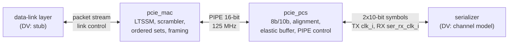

# pcie_phy HAS

`pcie_phy` is the Gen1 x1 physical layer of the PCI Express controller: 2.5
GT/s on one lane, 8b/10b coded. It stacks two top-level IPs joined by PIPE,
[`pcie_mac`](#position) above and [`pcie_pcs`](#position) below, and adds no
logic of its own ([decision record 0002](../../decisions/0002-m1-grill.md),
Q6 to Q12). Above it sits a data-link layer, which a stub stands in for in
DV; below it, a serializer or the DV channel model. It is not a data-link
layer (no sequence numbers, LCRC or flow control), not an analog PHY, and
supports no crosslink: `port_role_i` fixes the role.

This page owns the stack-level contract: the upper packet stream, link
control, the lower symbol interface, clocks and the stack targets; its
[PIPE page](PIPE.md) owns the interface between the two IPs. The `mac` and
`pcs` HAS pages own their internals. How it is built is in the
[MAS](../../rtl/phy/MAS.md); how it is verified in the
[DV plan](../../dv/phy/DV_PLAN.md).

**References.** Rules come from the PCIe Base Spec rev 3.0, Gen1 rules only
(Q9), and PIPE from rev 3.0 of Intel's PIPE specification, cited as
`PIPE Spec` ([PIPE page](PIPE.md)). Both are paraphrased and cited, never
copied ([wiki BKM](../../../bkm/wiki.md#citations)); their links and access
terms are on the [references page](../../references.md)
([`pcie-base`](../../references.md#pcie-base), [`pipe`](../../references.md#pipe),
[`8b10b`](../../references.md#8b10b)).

## Position

`mac` and `pcs` are top-level IPs that `pcie_phy` integrates, not sub-IPs:
each keeps its own HAS, arch model and unit DV (Q8, Q19). `phy.rtl.f`
reaches their filelists with `-F` ([MAS](../../rtl/phy/MAS.md)).

## Interfaces

All ports but the lower RX group are synchronous to `clk_i`. Port names
follow the [RTL BKM](../../../bkm/rtl.md#naming). Byte and symbol order:
bits `[7:0]` (or `[9:0]`) carry the earlier byte (symbol) on the line.

### Clocks, reset and strap

| Port | Dir | Width | Clock | Description |
| --- | --- | --- | --- | --- |
| `clk_i` | in | 1 | - | Core clock, 125 MHz. It is also PIPE PCLK and the TX symbol clock. |
| `rst_i` | in | 1 | `clk_i` | Synchronous, active-high reset of the whole stack. |
| `port_role_i` | in | 1 | `clk_i` | Strap: 0 downstream port, 1 upstream port. Changes only while `rst_i` is high. |

`ser_rx_clk_i` is in the [lower interface](#lower-symbol-interface).

### Upper packet stream

A 16-bit valid/ready stream per direction; one beat is two bytes. A packet
is what the data-link layer hands down: a TLP (sequence number, header,
data, optional ECRC, LCRC) or a 6-byte DLLP, always a whole number of beats.

| Port | Dir | Width | Clock | Description |
| --- | --- | --- | --- | --- |
| `pkt_tx_valid_i` | in | 1 | `clk_i` | A transmit beat is offered. |
| `pkt_tx_ready_o` | out | 1 | `clk_i` | The beat is taken at this edge when valid and ready are both 1. |
| `pkt_tx_data_i` | in | 16 | `clk_i` | Two packet bytes. |
| `pkt_tx_sop_i` | in | 1 | `clk_i` | First beat of a packet. |
| `pkt_tx_eop_i` | in | 1 | `clk_i` | Last beat of a packet; may coincide with `sop`. |
| `pkt_tx_dllp_i` | in | 1 | `clk_i` | Tag: 0 TLP, 1 DLLP. Held from `sop` to `eop`. |
| `pkt_tx_nullify_i` | in | 1 | `clk_i` | With the `eop` beat of a TLP: end it with EDB instead of END. Ignored for a DLLP. |
| `pkt_rx_valid_o` | out | 1 | `clk_i` | A received beat; the upper layer takes every one. |
| `pkt_rx_data_o` | out | 16 | `clk_i` | Two packet bytes. |
| `pkt_rx_sop_o` | out | 1 | `clk_i` | First beat of a packet. |
| `pkt_rx_eop_o` | out | 1 | `clk_i` | Last beat of a packet. |
| `pkt_rx_dllp_o` | out | 1 | `clk_i` | Tag: 0 TLP (started by STP), 1 DLLP (started by SDP). |
| `pkt_rx_err_o` | out | 1 | `clk_i` | With `eop`: the packet is bad (a framing or symbol error inside it, or cut short; see [Behavior](#packet-stream)). |
| `pkt_rx_nullify_o` | out | 1 | `clk_i` | With `eop`: the packet ended with EDB (nullified) and no error. Never with `pkt_rx_err_o`. |

### Link control and status

| Port | Dir | Width | Clock | Description |
| --- | --- | --- | --- | --- |
| `link_up_o` | out | 1 | `clk_i` | The link is up (see [Behavior](#link-up-and-requests)). |
| `ltssm_state_o` | out | 6 | `clk_i` | LTSSM state and substate. 0 is Detect.Quiet; the other codes are owned by the `mac` HAS. |
| `rcv_err_o` | out | 1 | `clk_i` | One-cycle pulse per receiver error: 8b/10b decode or disparity error, elastic-buffer overflow or underflow, or a framing error. |
| `retrain_req_i` | in | 1 | `clk_i` | One-cycle pulse: direct the LTSSM from L0 to Recovery. Either role; ignored outside L0. |
| `hot_reset_req_i` | in | 1 | `clk_i` | Level: direct the LTSSM to Hot Reset and hold it there. Downstream role only. |
| `disable_req_i` | in | 1 | `clk_i` | Level: direct the LTSSM to Disabled and hold it there. Downstream role only. |
| `loopback_req_i` | in | 1 | `clk_i` | Level: enter Loopback as the master and stay while high. Either role. |
| `pm_state_req_i` | in | 2 | `clk_i` | Directed power state: 0 L0, 1 L0 with L0s entry allowed, 2 L1, 3 L2. Either role. |

### Lower symbol interface

Two 10-bit symbols per `clk_i` cycle (2.5 GT/s = 250 Msymbol/s = 2 x
125 MHz). Bit 0 of a symbol is the first bit on the line (the 8b/10b bit
`a`) [cite: PCIe Base Spec, rev 3.0, §4.2.1.1].

| Port | Dir | Width | Clock | Description |
| --- | --- | --- | --- | --- |
| `ser_tx_data_o` | out | 20 | `clk_i` | Two encoded symbols, `[9:0]` first. Don't care while `ser_tx_elec_idle_o` is 1. |
| `ser_tx_elec_idle_o` | out | 1 | `clk_i` | The transmitter is in electrical idle. |
| `ser_tx_rxdet_i` | in | 1 | `clk_i` | A receiver termination is present at the far end, as a receiver-detect circuit would sense it; sampled during receiver detection. |
| `ser_rx_clk_i` | in | 1 | - | Recovered RX clock, 125 MHz nominal (see [Clocks and resets](#clocks-and-resets)). |
| `ser_rx_data_i` | in | 20 | `ser_rx_clk_i` | Twenty received bits, bit 0 earliest. No symbol alignment is guaranteed. |
| `ser_rx_elec_idle_i` | in | 1 | `ser_rx_clk_i` | The line is in electrical idle: 1 for any word that holds an idle bit. The bits of that word before the idle starts are line data (the end of the stream, such as an EIOS's last IDL); the bits after it are don't care. The same contract as the [`pcs` HAS](../pcs/HAS.md) and its [loss of lock](../pcs/RECEIVE.md#comma-alignment-and-symbol-lock). |

## Parameters

| Name | Type | Default | Range | Effect |
| --- | --- | --- | --- | --- |
| `TIMEOUT_DIV` | `int unsigned` | 1 | 1 to 1024 | Divides exactly two pure-wait timeouts: Detect.Quiet's 12 ms and the 2 ms Hot Reset dwell [cite: PCIe Base Spec, rev 3.0, §4.2.6.1] [cite: PCIe Base Spec, rev 3.0, §4.2.6.11]. Every other timeout and every ordered-set count stay at spec values, so training is unchanged. At 1024 the two become 1464 and 244 cycles, still above the 2 TS1 (16 cycles) a partner needs to follow a Hot Reset. FPGA and ASIC builds use 1; DV may use more. |

## Behavior

### Clocks and resets

- `clk_i` runs the MAC, PIPE, the PCS transmit path and the read side of
  the elastic buffer. `ser_rx_clk_i` runs only the PCS receive front end.
- **RX clock contract.** The serializer delivers `ser_rx_clk_i` glitch-free
  and toggling at all times: while `rst_i` is high, during electrical idle
  and across loss and regain of CDR lock (it then follows its reference).
  Its frequency is within ±600 ppm of `clk_i`: each end's reference is
  within ±300 ppm [cite: PCIe Base Spec, rev 3.0, §4.2.7].
- **Reset contract.** `rst_i` is high for at least 8 `clk_i` cycles, which
  is at least 7 `ser_rx_clk_i` cycles at any allowed offset. The RX-domain
  reset asserts asynchronously with `rst_i`, needing no RX clock edge, and
  releases synchronously to `ser_rx_clk_i` within 3 of its cycles after
  `rst_i` falls. The elastic buffer is the only crossing of data. Every
  crossing uses an approved `common_` cell (Q17):
  [`common_cdc_sync2`](../../rtl/common/common_cdc_sync2.md),
  [`common_cdc_pulse`](../../rtl/common/common_cdc_pulse.md) or
  [`common_cdc_fifo`](../../rtl/common/common_cdc_fifo.md).
- Reset values, held while `rst_i` is high: `pkt_tx_ready_o`,
  `pkt_rx_valid_o`, `pkt_rx_sop_o`, `pkt_rx_eop_o`, `pkt_rx_err_o`,
  `pkt_rx_nullify_o`, `link_up_o` and `rcv_err_o` 0; `ltssm_state_o` 0
  (Detect.Quiet); `ser_tx_elec_idle_o` 1. Data outputs are don't care while
  not qualified.

### Packet stream

- **Transmit framing.** The MAC frames each packet with STP (TLP) or SDP
  (DLLP) before it and END (or EDB when nullified) after it, sends logical
  idle between packets, and scrambles everything but K codes
  [cite: PCIe Base Spec, rev 3.0, §4.2.1.2]
  [cite: PCIe Base Spec, rev 3.0, §4.2.1.3]. Packets and SKP ordered sets
  have even lengths, so each packet starts in the low byte of a word.
- **Transmit flow.** Between packets, `pkt_tx_ready_o` is 1 only in L0 and
  only when the MAC is not inserting framing or SKP ordered sets. From an
  accepted `sop` beat to its `eop` beat, ready is 1 every cycle whatever the
  LTSSM does, and the upper layer keeps `pkt_tx_valid_i` high. If the LTSSM
  leaves L0, or valid drops, inside a packet, the MAC ends the packet on the
  line with EDB (when the transmitter is still sending) and takes and
  discards the remaining beats up to `eop`; the data-link layer replays it.
- **SKP.** The MAC schedules a SKP ordered set every 1180 to 1538 symbol
  times; one that falls due inside a packet goes out after it, and all that
  are due go out back to back [cite: PCIe Base Spec, rev 3.0, §4.2.7].
- **Receive.** The MAC strips framing, idle and ordered sets, descrambles,
  and delivers each packet with its tag. A packet may start in either byte
  of a PIPE word (the PCS adds and removes single SKP symbols); the MAC
  realigns it so `[7:0]` is its first byte. `pkt_rx_valid_o` may have gaps
  inside a packet. Every `sop` is followed by exactly one `eop`. A packet
  cut short (a framing or symbol error, the LTSSM leaving L0, electrical
  idle or loss of `pipe_rx_valid`) still ends with an `eop` beat carrying
  `pkt_rx_err_o`; its data is don't care.

### Link-up and requests

- The LTSSM implements the full Gen1 state set (Q3)
  [cite: PCIe Base Spec, rev 3.0, §4.2.5]; the `mac` HAS lists the states
  and arcs. Training uses TS1 and TS2 ordered sets
  [cite: PCIe Base Spec, rev 3.0, §4.2.4.1].
- `link_up_o` rises on every entry of the LTSSM to L0 (from
  Configuration.Idle or Recovery.Idle). It stays high through Recovery,
  L0s, L1, L2, and a Recovery-to-Configuration pass back to L0. It falls when the LTSSM enters Detect, Polling,
  Disabled, Hot Reset or Loopback, and on reset.
- `port_role_i` selects the downstream behavior (proposes link and lane
  numbers in Configuration, may direct Hot Reset and Disabled) or the
  upstream behavior (follows them)
  [cite: PCIe Base Spec, rev 3.0, §4.2.6.3]
  [cite: PCIe Base Spec, rev 3.0, §4.2.6.9]
  [cite: PCIe Base Spec, rev 3.0, §4.2.6.11]. In the upstream role,
  `hot_reset_req_i` and `disable_req_i` are ignored.
- `retrain_req_i` serves both the data-link layer's replay-timeout retrain
  and a downstream port's Retrain Link request
  [cite: PCIe Base Spec, rev 3.0, §4.2.6.5].
- **Power states.** The upper layer owns any handshake before a request
  (the data-link layer's DLLP exchange); the MAC acts on the directed state.
  - L0s (`pm_state_req_i` 1): the transmitter enters L0s when idle (the
    `mac` HAS sets the idle time). `pkt_tx_valid_i` in L0s makes it exit
    with FTS ordered sets; ready stays 0 until it is back in L0. The
    receiver follows the partner on its own
    [cite: PCIe Base Spec, rev 3.0, §4.2.6.6].
  - L1 (2): entered when no packet is in progress; a request of 0 or 1
    leaves it through Recovery [cite: PCIe Base Spec, rev 3.0, §4.2.6.7].
  - L2 (3): entered like L1; a request other than 3 leaves it to Detect, so
    `link_up_o` falls [cite: PCIe Base Spec, rev 3.0, §4.2.6.8].
  - Beacon and WAKE signalling are out of scope; the lower interface has
    no beacon.
- Receiver detection and the power-state handshakes on PIPE are on the
  [PIPE page](PIPE.md#handshakes)
  [cite: PCIe Base Spec, rev 3.0, §4.2.6.1].

## Decisions

| Choice | Rationale | Rejected |
| --- | --- | --- |
| PIPE rev 3.0 | Matches Base Spec rev 3.0, so Gen2 and Gen3 signals are added later without re-pinning (Q9). | rev 2.00 (no Gen3); a 4.x or 5.x revision (adds features M1 does not use). |
| PCLK, and the TX symbol clock, are `clk_i` | Both IPs sit in one clock domain; a clock generated in the PCS would break the no-generated-clock rule ([RTL BKM](../../../bkm/rtl.md#reset-and-clocks)). Confirmed reading of Q12 ([0002 Updates](../../decisions/0002-m1-grill.md#updates)). | PCLK as a PCS output; a separate TX clock port. |
| Ready only on transmit | The physical layer cannot stall the partner; flow control is the data-link layer's. Confirmed reading of Q11 ([0002 Updates](../../decisions/0002-m1-grill.md#updates)). | `pkt_rx_ready_i` with a buffer and a drop rule. |
| No bubbles inside a transmit packet | The link cannot pause inside a TLP; a bubble would need a whole-packet buffer in the MAC. | A store-and-forward buffer. |
| Leaving L0 inside a packet ends it with EDB | Ready never drops inside a packet, so the upper layer has one rule; the partner discards the packet and the data-link layer replays it. | Dropping ready and making the upper layer abandon the packet. |
| Single-SKP add and remove | Standard PIPE elastic-buffer behavior; the MAC realigns packets that start in the high byte. | Pairs of SKPs (breaks with a partner that starts packets on odd symbols). |
| `TIMEOUT_DIV` scales two pure waits | Configuration by parameter; 12 ms is 1.5 million cycles in simulation, and no handshake depends on these waits. | Dividing every timeout (breaks training); a simulation-only `ifdef`. |
| `ltssm_state_o` 6 bits | The Gen1 substates need about 25 codes; Gen2 and Gen3 add more. | 4 bits (major states only), 5 bits (no headroom). |

## Targets

Measured back to back (downstream to upstream) with the
[architecture model](#architecture-model)'s budgets; the e2e
([#86](https://github.com/amichai-bd/pcie-factory/issues/86)) checks the RTL
against the same numbers. Throughput counts packet bytes as the data-link
layer hands them down (sequence number, TLP, LCRC), not TLP payload.

| Item | Target |
| --- | --- |
| Link-up, `TIMEOUT_DIV` 1 | `rst_i` release to `link_up_o` between 12.0 and 12.2 ms, simultaneous reset. This design's choice: Detect.Quiet's timeout taken at exactly 12 ms, plus training [cite: PCIe Base Spec, rev 3.0, §4.2.6.1]. |
| Training | Polling entry to L0 at most 80 µs, and at least 65.536 µs (1024 TS1 in Polling.Active) [cite: PCIe Base Spec, rev 3.0, §4.2.6.2]; the same at any `TIMEOUT_DIV`. |
| Link-up, `TIMEOUT_DIV` 1024 | At most 100 µs with up to 2000 cycles of reset skew. |
| Throughput | For back-to-back packets of n bytes, at least 2 x n/(n+2) x 1176/1180 bytes per cycle: framing plus a SKP ordered set in every 1180 symbols. At least 1.97 bytes per cycle (246 MB/s; about 231 MB/s of payload) for 274-byte TLPs with 256-byte payloads, and 1.49 for DLLPs. |
| Lossless | No packet lost or corrupted and no elastic-buffer overflow at ±600 ppm, any SKP interval in range, up to maximum-size TLPs. |
| TX latency | At most 6 cycles from an accepted beat to its first symbol on `ser_tx_data_o`. |
| RX latency | At most 16 cycles from a packet's first symbol on `ser_rx_data_i` (once aligned) to its `sop` beat, with the elastic buffer at 12 symbols or fewer. |
| Clocks | `clk_i` and `ser_rx_clk_i` at 125 MHz on the FPGA and ASIC flows. |

The budgets the `mac` and `pcs` HAS pages must meet or rebalance: MAC
transmit 3 and receive 3 cycles (+1 for a packet in the high byte), PCS
transmit 2 and receive 6 cycles plus half the elastic-buffer fill, an
elastic buffer of 16 symbols centred at 8, 64 cycles for receiver detection
and 16 cycles from reset to `pipe_phy_status` low.

## Architecture model

[`pcie_phy_arch.py`](../../../../src/arch/phy/pcie_phy_arch.py) models
transmit framing with SKP scheduling, receive deframing, the elastic buffer
under a clock offset, the stack latency and a link-up estimate from a
reduced LTSSM, with `TIMEOUT_DIV` applied as [above](#parameters) (Hot
Reset is not modelled) ([arch BKM](../../../bkm/arch.md)). It is the shared
stack reference for the e2e. The `mac` and `pcs` models plug in through its
`MacBudget` and `PcsBudget` objects; the `mac` model replaces the reduced
LTSSM. `./build arch --ip phy` writes `workdir/phy/arch/perf.json`.

| Scenario | Workload | Targets checked |
| --- | --- | --- |
| [`tlp_256_ppm`](../../../../src/arch/phy/perf/tlp_256_ppm.yaml) | 2000 274-byte TLPs, SKP every 1180, +600 ppm | throughput >= 1.97, TX <= 6, RX <= 16, lossless |
| [`dllp_slow_rx`](../../../../src/arch/phy/perf/dllp_slow_rx.yaml) | 4000 DLLPs, SKP every 1180, -600 ppm | throughput >= 1.49, TX <= 6, RX <= 16, lossless |
| [`max_tlp`](../../../../src/arch/phy/perf/max_tlp.yaml) | 200 4122-byte TLPs, SKP every 1538, +600 ppm | throughput >= 1.97, RX <= 16, buffer fill <= 12, lossless |
| [`mixed_long`](../../../../src/arch/phy/perf/mixed_long.yaml) | 3000 random TLPs and DLLPs, 5% nullified, +300 ppm | RX <= 16, lossless |
| [`link_up_spec`](../../../../src/arch/phy/perf/link_up_spec.yaml) | `TIMEOUT_DIV` 1, no skew | link-up 12.0 to 12.2 ms, training 65.536 to 80 µs |
| [`link_up_fast`](../../../../src/arch/phy/perf/link_up_fast.yaml) | `TIMEOUT_DIV` 1024, skew up to 2000 cycles | link-up <= 100 µs, training 65.536 to 80 µs |

## Open items

| Item | Owner |
| --- | --- |
| Cite the electrical sub-block's exact sections for receiver detection and the ±300 ppm transmitter tolerance (the citations above use the nearest confident sections). | [#85](https://github.com/amichai-bd/pcie-factory/issues/85) |
| Refine the PIPE citations on the [PIPE page](PIPE.md) from chapter to section level. The TxCompliance byte (`[7:0]`) and the P0s PhyStatus pulse were confirmed against PIPE rev 3.0, and the stack's differences from PIPE listed, in the [`pcs` PIPE control page](../pcs/PIPE_CONTROL.md#differences-from-pipe). | [#85](https://github.com/amichai-bd/pcie-factory/issues/85) |
| LTSSM state codes; what `ltssm_state_o` shows when transmit and receive L0s differ (a code cannot show both; a status bit or a rule); the exact rules behind the model's reduced LTSSM. | [#72](https://github.com/amichai-bd/pcie-factory/issues/72) |
| The stack targets measured on the RTL in the e2e. | [#86](https://github.com/amichai-bd/pcie-factory/issues/86) |
