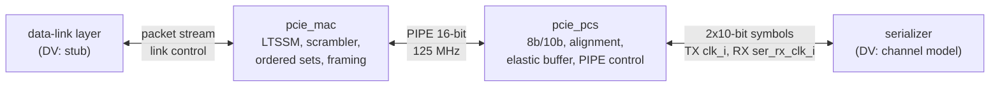

# pcie_phy HAS

`pcie_phy` is the Gen1 x1 physical layer of the PCI Express controller: 2.5
GT/s on one lane, 8b/10b coded. It stacks two top-level IPs joined by PIPE,
[`pcie_mac`](#position) above and [`pcie_pcs`](#position) below, and adds no
logic of its own ([decision record 0002](../../decisions/0002-m1-grill.md),
Q6 to Q12). Above it sits a data-link layer, which a stub stands in for in
DV; below it, a serializer or the DV channel model. It is not a data-link
layer (no sequence numbers, LCRC or flow control) and not an analog PHY.

This page owns the stack-level contract: the upper packet stream, link
control, the PIPE interface between the two IPs, the lower symbol
interface, clocks and the stack targets. The `mac` and `pcs` HAS pages own
their internals. How it is built is in the [MAS](../../rtl/phy/MAS.md); how
it is verified in the [DV plan](../../dv/phy/DV_PLAN.md).

**References.** Rules come from the PCIe Base Spec rev 3.0, Gen1 rules only
(Q9), and the PIPE interface from Intel's PHY Interface for the PCI Express
Architecture, pinned at **rev 3.0** and cited as `PIPE Spec`. Both are
paraphrased and cited, never copied ([wiki BKM](../../../bkm/wiki.md#citations)).

## Position

`mac` and `pcs` are top-level IPs that `pcie_phy` integrates, not sub-IPs:
each keeps its own HAS, arch model and unit DV (Q8). The stack integration
(the instances and the `-F` lines) arrives with the integrating-IP support
of [#107](https://github.com/amichai-bd/pcie-factory/issues/107) and the
stack RTL of [#86](https://github.com/amichai-bd/pcie-factory/issues/86).

## Interfaces

All ports but the lower RX group are synchronous to `clk_i`. Port names
follow the [RTL BKM](../../../bkm/rtl.md#naming). Byte and symbol order:
bits `[7:0]` (or `[9:0]`) carry the earlier byte (symbol) on the line.

### Clocks, reset and strap

| Port | Dir | Width | Clock | Description |
| --- | --- | --- | --- | --- |
| `clk_i` | in | 1 | - | Core clock, 125 MHz. It is also PIPE PCLK and the TX symbol clock. |
| `rst_i` | in | 1 | `clk_i` | Synchronous, active-high reset of the whole stack. |
| `port_role_i` | in | 1 | `clk_i` | Strap: 0 downstream port, 1 upstream port. Changes only while `rst_i` is high. |

`ser_rx_clk_i` is in the [lower interface](#lower-symbol-interface).

### Upper packet stream

A 16-bit valid/ready stream per direction; one beat is two bytes. A packet
is what the data-link layer hands down: a TLP (sequence number, header,
data, optional ECRC, LCRC) or a 6-byte DLLP, always a whole number of beats.

| Port | Dir | Width | Clock | Description |
| --- | --- | --- | --- | --- |
| `pkt_tx_valid_i` | in | 1 | `clk_i` | A transmit beat is offered. |
| `pkt_tx_ready_o` | out | 1 | `clk_i` | The beat is taken at this edge when valid and ready are both 1. |
| `pkt_tx_data_i` | in | 16 | `clk_i` | Two packet bytes. |
| `pkt_tx_sop_i` | in | 1 | `clk_i` | First beat of a packet. |
| `pkt_tx_eop_i` | in | 1 | `clk_i` | Last beat of a packet; may coincide with `sop`. |
| `pkt_tx_dllp_i` | in | 1 | `clk_i` | Tag: 0 TLP, 1 DLLP. Held from `sop` to `eop`. |
| `pkt_tx_nullify_i` | in | 1 | `clk_i` | With the `eop` beat of a TLP: end it with EDB instead of END. Ignored for a DLLP. |
| `pkt_rx_valid_o` | out | 1 | `clk_i` | A received beat; the upper layer takes every one. |
| `pkt_rx_data_o` | out | 16 | `clk_i` | Two packet bytes. |
| `pkt_rx_sop_o` | out | 1 | `clk_i` | First beat of a packet. |
| `pkt_rx_eop_o` | out | 1 | `clk_i` | Last beat of a packet. |
| `pkt_rx_dllp_o` | out | 1 | `clk_i` | Tag: 0 TLP (started by STP), 1 DLLP (started by SDP). |
| `pkt_rx_err_o` | out | 1 | `clk_i` | With `eop`: discard the packet (ended by EDB, a framing error, or a symbol error inside it). |

### Link control and status

| Port | Dir | Width | Clock | Description |
| --- | --- | --- | --- | --- |
| `link_up_o` | out | 1 | `clk_i` | The link is up (see [Behavior](#link-up-and-requests)). |
| `ltssm_state_o` | out | 6 | `clk_i` | LTSSM state and substate. 0 is Detect.Quiet; the other codes are owned by the `mac` HAS. |
| `rcv_err_o` | out | 1 | `clk_i` | One-cycle pulse per receiver error: 8b/10b decode or disparity error, elastic-buffer overflow or underflow, or a framing error. |
| `hot_reset_req_i` | in | 1 | `clk_i` | Level: direct the LTSSM to Hot Reset and hold it there. Downstream role only. |
| `disable_req_i` | in | 1 | `clk_i` | Level: direct the LTSSM to Disabled and hold it there. Downstream role only. |
| `loopback_req_i` | in | 1 | `clk_i` | Level: enter Loopback as the master and stay while high. Either role. |
| `pm_state_req_i` | in | 2 | `clk_i` | Directed power state: 0 L0, 1 L0 with L0s entry allowed, 2 L1, 3 L2. Either role. |

### Lower symbol interface

Two 10-bit symbols per `clk_i` cycle (2.5 GT/s = 250 Msymbol/s = 2 x
125 MHz). Bit 0 of a symbol is the first bit on the line (the 8b/10b bit
`a`) [cite: PCIe Base Spec, rev 3.0, §4.2.1.1].

| Port | Dir | Width | Clock | Description |
| --- | --- | --- | --- | --- |
| `ser_tx_data_o` | out | 20 | `clk_i` | Two encoded symbols, `[9:0]` first. Don't care while `ser_tx_elec_idle_o` is 1. |
| `ser_tx_elec_idle_o` | out | 1 | `clk_i` | The transmitter is in electrical idle. |
| `ser_tx_rxdet_i` | in | 1 | `clk_i` | A receiver termination is present at the far end, as a receiver-detect circuit would sense it; sampled during receiver detection. |
| `ser_rx_clk_i` | in | 1 | - | Recovered RX clock, 125 MHz nominal. |
| `ser_rx_data_i` | in | 20 | `ser_rx_clk_i` | Twenty received bits, bit 0 earliest. No symbol alignment is guaranteed. |
| `ser_rx_elec_idle_i` | in | 1 | `ser_rx_clk_i` | The line is in electrical idle; data is don't care. |

### PIPE

Internal: `pcie_mac` drives and `pcie_pcs` receives the MAC-to-PHY signals,
and the reverse; neither is a `pcie_phy` port. This is the Gen1 subset of the
pinned revision in its 16-bit, 125 MHz mode [cite: PIPE Spec, rev 3.0, §5].
Each stack net `pipe_<x>` is the port `pipe_<x>_o` of one IP and
`pipe_<x>_i` of the other.

| PIPE signal | Stack net | Width | Dir | Meaning here |
| --- | --- | --- | --- | --- |
| PCLK | `clk_i` | 1 | - | Not a separate clock: the stack's `clk_i` (see [Decisions](#decisions)). |
| Reset# | `pipe_reset_n` | 1 | MAC→PCS | Active-low PCS reset, synchronous to `clk_i`. |
| TxData | `pipe_tx_data` | 16 | MAC→PCS | Two bytes, `[7:0]` first. |
| TxDataK | `pipe_tx_datak` | 2 | MAC→PCS | Bit *i* marks byte *i* as a K code. |
| TxDetectRx/Loopback | `pipe_tx_detect_rx` | 1 | MAC→PCS | In P1: run receiver detection. In P0: loop received symbols back to the transmitter. |
| TxElecIdle | `pipe_tx_elec_idle` | 1 | MAC→PCS | Put the transmitter in electrical idle (whole word). |
| TxCompliance | `pipe_tx_compliance` | 1 | MAC→PCS | Force negative running disparity for the symbol in `[7:0]` of this word. |
| RxPolarity | `pipe_rx_polarity` | 1 | MAC→PCS | Invert the received bits. |
| PowerDown | `pipe_power_down` | 2 | MAC→PCS | 0 P0, 1 P0s, 2 P1, 3 P2. |
| RxData | `pipe_rx_data` | 16 | PCS→MAC | Two bytes, `[7:0]` first. |
| RxDataK | `pipe_rx_datak` | 2 | PCS→MAC | Bit *i* marks byte *i* as a K code. |
| RxValid | `pipe_rx_valid` | 1 | PCS→MAC | Symbol lock: `pipe_rx_data` is valid. |
| PhyStatus | `pipe_phy_status` | 1 | PCS→MAC | High during reset until the PCS is ready; then a one-cycle completion pulse. |
| RxElecIdle | `pipe_rx_elec_idle` | 1 | PCS→MAC | The line is in electrical idle (synchronized to `clk_i`). |
| RxStatus | `pipe_rx_status` | 3 | PCS→MAC | Per word, see below. |

`pipe_rx_status` codes: 0 data OK, 1 one SKP added, 2 one SKP removed,
3 receiver detected, 4 8b/10b decode error, 5 elastic-buffer overflow,
6 elastic-buffer underflow, 7 disparity error. A decode error also
replaces that byte with EDB as a K code [cite: PIPE Spec, rev 3.0, §5]. Which code wins when several apply
in one word is owned by the `pcs` HAS. Gen2 and Gen3 signals (Rate,
de-emphasis, margining, equalization) are absent and are added when those
rates are.

## Parameters

| Name | Type | Default | Range | Effect |
| --- | --- | --- | --- | --- |
| `TIMEOUT_DIV` | `int unsigned` | 1 | 1 to 65536 | Divides every LTSSM timeout (not ordered-set counts). 1 is spec timing and is what FPGA and ASIC builds use; DV uses larger values to shorten Detect.Quiet. |

## Behavior

### Clocks and resets

- `clk_i` runs the MAC, the PIPE interface, the PCS transmit path and the
  read side of the elastic buffer.
- `ser_rx_clk_i` runs only the PCS receive front end. It runs continuously,
  also during electrical idle, and may be up to ±600 ppm off `clk_i`: each
  end's reference is within ±300 ppm
  [cite: PCIe Base Spec, rev 3.0, §4.2.7]. The elastic buffer is the only
  crossing of data; the PCS derives its RX-domain reset from `rst_i`. Every
  crossing uses an approved `common_` cell (Q17).
- Reset values, held while `rst_i` is high: `pkt_tx_ready_o`,
  `pkt_rx_valid_o`, `pkt_rx_sop_o`, `pkt_rx_eop_o`, `pkt_rx_err_o`,
  `link_up_o` and `rcv_err_o` 0; `ltssm_state_o` 0 (Detect.Quiet);
  `ser_tx_elec_idle_o` 1. Data outputs are don't care while not qualified.

### Packet stream

- **Transmit.** The MAC frames each packet with STP (TLP) or SDP (DLLP)
  before it and END (or EDB when nullified) after it, sends logical idle
  between packets, and scrambles everything but K codes
  [cite: PCIe Base Spec, rev 3.0, §4.2.1.2]
  [cite: PCIe Base Spec, rev 3.0, §4.2.1.3]. Packets and SKP ordered sets
  have even lengths, so each packet starts in the low byte of a word.
- From an accepted `sop` beat to its `eop` beat the upper layer keeps
  `pkt_tx_valid_i` high and the MAC keeps `pkt_tx_ready_o` high. If valid
  drops inside a packet, the MAC ends the packet with EDB and drops the
  rest of its beats. Ready is low outside L0 and while the MAC inserts
  framing or SKP ordered sets between packets.
- **SKP.** The MAC schedules a SKP ordered set every 1180 to 1538 symbol
  times; one that falls due inside a packet goes out after it, and all that
  are due go out back to back [cite: PCIe Base Spec, rev 3.0, §4.2.7].
- **Receive.** The MAC strips framing, idle and ordered sets, descrambles,
  and delivers each packet with its tag. A packet may start in either byte
  of a PIPE word (the PCS adds and removes single SKP symbols); the MAC
  realigns it so `[7:0]` is its first byte. `pkt_rx_valid_o` may have
  gaps inside a packet. Every `sop` is followed by exactly one `eop`; a
  packet cut short by an error still ends with an `eop` beat carrying
  `pkt_rx_err_o`.

### Link-up and requests

- The LTSSM implements the full Gen1 state set (Q3)
  [cite: PCIe Base Spec, rev 3.0, §4.2.5]; the `mac` HAS lists the states
  and arcs. Training uses TS1 and TS2 ordered sets
  [cite: PCIe Base Spec, rev 3.0, §4.2.4.1].
- `link_up_o` rises when the LTSSM enters L0 from Configuration and falls
  when it enters Detect, Polling, Disabled, Hot Reset or Loopback, or on
  reset. It stays high through Recovery, L0s, L1 and L2.
- `port_role_i` selects the downstream behavior (proposes link and lane
  numbers in Configuration, may direct Hot Reset and Disabled) or the
  upstream behavior (follows them)
  [cite: PCIe Base Spec, rev 3.0, §4.2.6.3]
  [cite: PCIe Base Spec, rev 3.0, §4.2.6.9]
  [cite: PCIe Base Spec, rev 3.0, §4.2.6.11]. In the upstream role,
  `hot_reset_req_i` and `disable_req_i` are ignored.
- The upper layer owns any handshake before a power-state request (the
  data-link layer's DLLP exchange); the MAC acts on the directed state
  [cite: PCIe Base Spec, rev 3.0, §4.2.6.6]
  [cite: PCIe Base Spec, rev 3.0, §4.2.6.7]
  [cite: PCIe Base Spec, rev 3.0, §4.2.6.8].
- Receiver detection: in Detect, the MAC sets P1 and raises
  `pipe_tx_detect_rx`; the PCS samples `ser_tx_rxdet_i` and answers with a
  `pipe_phy_status` pulse and `pipe_rx_status` 3 (present) or 0
  [cite: PCIe Base Spec, rev 3.0, §4.2.6.1] [cite: PIPE Spec, rev 3.0, §6].
- Power states: the PCS acknowledges every `pipe_power_down` change with
  one `pipe_phy_status` pulse; the MAC raises `pipe_tx_elec_idle` before it
  leaves P0 [cite: PIPE Spec, rev 3.0, §6]. `clk_i` keeps running in P2.

## Decisions

| Choice | Rationale | Rejected |
| --- | --- | --- |
| PIPE rev 3.0 | Matches Base Spec rev 3.0, so Gen2 and Gen3 signals are added later without re-pinning (Q9). | rev 2.00 (no Gen3); a 4.x or 5.x revision (larger, adds features M1 does not use). |
| PCLK is `clk_i` | Both IPs sit in one clock domain; a clock generated in the PCS would break the no-generated-clock rule ([RTL BKM](../../../bkm/rtl.md#reset-and-clocks)). | PCLK as a PCS output. |
| Ready only on transmit | The receive side cannot stall the link and the layer has no flow control, so the upper layer takes every beat; Q11's valid/ready applies to transmit. | `pkt_rx_ready_i` with a buffer and a drop rule. |
| No bubbles inside a transmit packet | The link cannot pause inside a TLP; a bubble would need a whole-packet buffer in the MAC. | A store-and-forward buffer. |
| Single-SKP add and remove | Standard PIPE elastic-buffer behavior; the MAC realigns packets that start in the high byte. | Pairs of SKPs to keep word alignment (breaks with a partner that starts packets on odd symbols). |
| `TIMEOUT_DIV` | Configuration by parameter; a 12 ms Detect.Quiet is 1.5 million cycles in simulation. | A simulation-only `ifdef`. |
| `ltssm_state_o` 6 bits | The Gen1 substates need about 25 codes; Gen2 and Gen3 add more. | 4 bits (major states only), 5 bits (no headroom). |

## Targets

Measured back to back (downstream to upstream) with the
[architecture model](#architecture-model)'s budgets; the e2e
([#86](https://github.com/amichai-bd/pcie-factory/issues/86)) checks the RTL
against the same numbers.

| Item | Target |
| --- | --- |
| Link-up, `TIMEOUT_DIV` 1 | `rst_i` release to `link_up_o` between 12.0 and 12.2 ms, simultaneous reset (Detect.Quiet's 12 ms timeout plus training) [cite: PCIe Base Spec, rev 3.0, §4.2.6.1]. |
| Training | Polling entry to L0 at most 80 µs, and at least 65.536 µs (1024 TS1 in Polling.Active) [cite: PCIe Base Spec, rev 3.0, §4.2.6.2]. |
| Link-up, `TIMEOUT_DIV` 1024 | At most 100 µs with up to 2000 cycles of reset skew. |
| Throughput | For back-to-back packets of n bytes, at least 2 x n/(n+2) x 1180/1184 bytes per cycle: framing plus the most frequent SKP. At least 1.97 bytes per cycle (246 MB/s) for 274-byte TLPs (256-byte payload) and 1.49 for DLLPs. |
| Lossless | No packet lost or corrupted and no elastic-buffer overflow at ±600 ppm, any SKP interval in range, up to maximum-size TLPs. |
| TX latency | At most 6 cycles from an accepted beat to its first symbol on `ser_tx_data_o`. |
| RX latency | At most 16 cycles from a packet's first symbol on `ser_rx_data_i` (once aligned) to its `sop` beat. |
| Clocks | `clk_i` and `ser_rx_clk_i` at 125 MHz on the FPGA and ASIC flows. |

The budgets the `mac` and `pcs` HAS pages must meet or rebalance: MAC
transmit 3 and receive 3 cycles (+1 for a packet in the high byte), PCS
transmit 2 and receive 6 cycles plus the elastic-buffer fill, an elastic
buffer of 16 symbols centred at 8, 64 cycles for receiver detection and
16 cycles from reset to `pipe_phy_status` low.

## Architecture model

[`pcie_phy_arch.py`](../../../../src/arch/phy/pcie_phy_arch.py) models
transmit framing with SKP scheduling, receive deframing, the elastic buffer
under a clock offset, the stack latency and a link-up estimate from a
reduced LTSSM ([arch BKM](../../../bkm/arch.md)). It is the shared stack
reference for the e2e. The `mac` and `pcs` models plug in through its
`MacBudget` and `PcsBudget` objects; the `mac` model replaces the reduced
LTSSM. `./build arch --ip phy` writes `workdir/phy/arch/perf.json`.

| Scenario | Workload | Targets checked |
| --- | --- | --- |
| [`tlp_256_ppm`](../../../../src/arch/phy/perf/tlp_256_ppm.yaml) | 2000 274-byte TLPs, SKP every 1180, +600 ppm | throughput >= 1.97, TX <= 6, RX <= 16, lossless |
| [`dllp_slow_rx`](../../../../src/arch/phy/perf/dllp_slow_rx.yaml) | 4000 DLLPs, SKP every 1180, -600 ppm | throughput >= 1.49, TX <= 6, RX <= 16, lossless |
| [`max_tlp`](../../../../src/arch/phy/perf/max_tlp.yaml) | 200 4122-byte TLPs, SKP every 1538, +600 ppm | throughput >= 1.97, RX <= 16, buffer fill <= 16, lossless |
| [`mixed_long`](../../../../src/arch/phy/perf/mixed_long.yaml) | 3000 random TLPs and DLLPs, 5% nullified, +300 ppm | RX <= 16, lossless |
| [`link_up_spec`](../../../../src/arch/phy/perf/link_up_spec.yaml) | `TIMEOUT_DIV` 1, no skew | link-up 12.0 to 12.2 ms, training 65.536 to 80 µs |
| [`link_up_fast`](../../../../src/arch/phy/perf/link_up_fast.yaml) | `TIMEOUT_DIV` 1024, skew up to 2000 cycles | link-up <= 100 µs, training 65.536 to 80 µs |

## Open items

| Item | Owner |
| --- | --- |
| Cite the electrical sub-block's exact sections for receiver detection and the ±300 ppm transmitter tolerance (the citations above use the nearest confident sections). | [#73](https://github.com/amichai-bd/pcie-factory/issues/73) |
| Refine the PIPE citations from chapter to section level, confirm the published title of rev 3.0, and confirm the TxCompliance byte and the P0s PhyStatus handshake in 16-bit mode. | [#73](https://github.com/amichai-bd/pcie-factory/issues/73) |
| LTSSM state codes, timeouts that `TIMEOUT_DIV` scales, and the exact rules behind the reduced LTSSM in the model. | [#72](https://github.com/amichai-bd/pcie-factory/issues/72) |
| Stack integration of `pcie_mac` and `pcie_pcs`. | [#107](https://github.com/amichai-bd/pcie-factory/issues/107), [#86](https://github.com/amichai-bd/pcie-factory/issues/86) |
