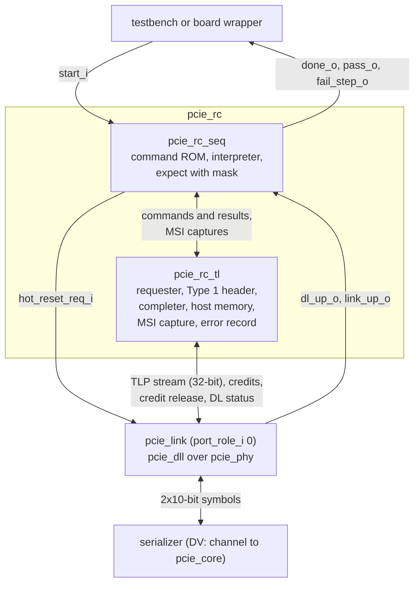

# pcie_rc HAS

`pcie_rc` is the root-port stack of the controller: the root-port
transaction layer `pcie_rc_tl` and the command-ROM test sequencer
`pcie_rc_seq` over the Gen1 x1 link [`pcie_link`](../link/HAS.md) in the
downstream role (decision record [0005](../../decisions/0005-m4-grill.md#decisions),
Q3, OP1). It is the host side of a back-to-back pair with the endpoint
[`pcie_core`](../core/HAS.md): with no CPU (P2), `rc_seq`'s programs
enumerate the endpoint, size and assign its BARs, read and write its BAR0,
and check its DMA and MSI writes against a host memory inside `rc`, and
its error reports (Q2). It is not a general Root Complex: one root port,
no CPU or bus bridge, no Type 1 configuration requests, no switches, no
peer-to-peer, no I/O space, no AER and no INTx (epic non-goals).

This page owns the root-port contract: the ports, the stack, the root
port's Type 1 header, the host memory and MSI window, the routing rules,
reset and link-down behavior, the downstream-role contract with `link`,
the parameters and the targets. Its [tl-seq interface page](TL_SEQ.md)
owns the interface between `rc_tl` and `rc_seq`. The `rc_tl` MAS
([#368](https://github.com/amichai-bd/pcie-factory/issues/368)) owns tags,
outstanding requests, the completion timeout value and how each error is
detected; the `rc_seq` MAS
([#369](https://github.com/amichai-bd/pcie-factory/issues/369)) owns the
command encoding, the ROM size and the program format. How `rc` is built
is in the [MAS](../../rtl/rc/MAS.md); how it is verified, in the
[DV plan](../../dv/rc/DV_PLAN.md). Rules from the PCIe Base Spec rev 3.0
are paraphrased and cited, never copied
([wiki BKM](../../../bkm/wiki.md#citations),
[`pcie-base`](../../references.md#pcie-base)).

## Position

`rc_tl` and `rc_seq` are sub-IPs of `rc` (OP1): each has its own MAS,
testbench and DV plan, and `rc.rtl.f` reaches their filelists with `-F`
([layout](../../../project/layout.md#ips-and-sub-ips)). `link` is a
top-level IP that `rc` integrates, unchanged (F2): it keeps its own HAS,
arch model and unit DV. The board build replaces `phy` inside `link` with
the GPIO adapter; the adapter HAS
([#370](https://github.com/amichai-bd/pcie-factory/issues/370)) owns that
lower interface and the `link` parameter that selects it.

## Interfaces

All ports but the lower RX group are synchronous to `clk_i`. Port names
follow the [RTL BKM](../../../bkm/rtl.md#naming).

| Group | Ports | Contract |
| --- | --- | --- |
| Clock and reset | `clk_i`, `rst_i` | [Clocks and reset](#clocks-and-reset). |
| Sequencer | `start_i`, `done_o`, `pass_o`, `fail_step_o` (16) | [Sequencer run](#sequencer-run). |
| Data link status | `dl_up_o`, `dl_state_o` (2), `dl_err_o` (7) | The `link` ports of the same names ([`link` interfaces](../link/HAS.md#interfaces)). |
| Physical link status | `link_up_o`, `ltssm_state_o` (6), `rcv_err_o` | The `link` ports of the same names. The `link` control inputs are driven inside `rc` ([downstream role](#downstream-role)). |
| Lower symbol interface | `ser_tx_data_o` (20), `ser_tx_elec_idle_o`, `ser_tx_rxdet_i`, `ser_rx_clk_i`, `ser_rx_data_i` (20), `ser_rx_elec_idle_i` | The `link` ports of the same names ([`phy` lower symbol interface](../phy/HAS.md#lower-symbol-interface)). |

Every `link` port `rc` exposes keeps its name, direction, width, clock and
meaning. Everything else a test checks it checks through `rc_seq`'s
result (`pass_o`, `fail_step_o`) or on the line: the
[host model](https://github.com/amichai-bd/pcie-factory/issues/372)
watches both directions as a passive shadow (P5, goal item 8).

## Parameters

| Name | Type | Default | Range | Effect |
| --- | --- | --- | --- | --- |
| `FC_PH`, `FC_PD`, `FC_NPH`, `FC_NPD` | `int unsigned` | 8, 32, 8, 8 | 1 to 127, 8 to 2047, 1 to 127, 2 to 2047 | Passed to `link`: the posted and non-posted credits advertised for the endpoint's DMA writes, MSI writes, messages and DMA reads. Never infinite: `rc_tl` sizes its inbound queues from them ([credits](#credits)). |
| `TIMEOUT_DIV`, `ERR_TIMEOUT_DIV` | `int unsigned` | 1, 1 | 1 to 1024 | Passed to `link` ([`link` parameters](../link/HAS.md#parameters)). The FPGA build uses 1. |
| `CPL_TIMEOUT_DIV` | `int unsigned` | 1 | 1 to 1024 | Passed to `rc_tl`: divides its completion timeout ([#368](https://github.com/amichai-bd/pcie-factory/issues/368) sets the value). The FPGA build uses 1; DV uses more to reach a timeout. |
| `HOST_MEM_ADDR_W` | `int unsigned` | 12 | 8 to 16 | Host memory is 2^`HOST_MEM_ADDR_W` bytes (256 B to 64 KiB). |
| `HOST_MEM_BASE` | `logic [31:0]` | 32'h0000_0000 | aligned to the host memory size | System address of host memory byte 0. |
| `MSI_ADDR` | `logic [31:0]` | 32'hFEE0_0000 | 4 KiB aligned, outside host memory | System address of the 4 KiB [MSI window](#msi-window). |
| `VENDOR_ID`, `DEVICE_ID` | `logic [15:0]` | 16'h0000 each | any but 16'hFFFF | The root port's IDs in its [Type 1 header](#type-1-header). Placeholders that claim no assigned vendor, as `core`'s. |
| `REVISION_ID` | `logic [7:0]` | 8'h00 | any | The root port's Revision ID. |

Fixed, not parameters: completion credits infinite (`FC_CPLH`, `FC_CPLD`
0), `FC_RELEASE` 1, `port_role_i` 0 ([downstream role](#downstream-role));
maximum payload and maximum read request 128 bytes, VC0 only, no ECRC
(M2 Q6, carried over); memory requests from `rc` use 32-bit addresses
(3-DW headers). The ROM image parameter that selects `rc_seq`'s program
joins this table with the `rc_seq` MAS
([#369](https://github.com/amichai-bd/pcie-factory/issues/369), program
format).

## Behavior

### Clocks and reset

- `clk_i` (125 MHz) runs `rc_tl`, `rc_seq` and all of `link` but the PCS
  receive front end, which runs on `ser_rx_clk_i`. The clock and reset
  contracts are the [`link` ones](../link/HAS.md#clocks-and-resets),
  unchanged: `rc_tl` and `rc_seq` add no clock and no crossing.
- `rst_i` (synchronous, active high, at least 8 `clk_i` cycles) resets
  `link`, `rc_tl` and `rc_seq`: the Type 1 header to its reset values, the
  error record to 0, the MSI capture empty, `rc_seq` idle. The host
  memory contents are not cleared: a program writes what it later checks.
- Reset values, while `rst_i` is 1: the `link` outputs at their
  [reset values](../link/HAS.md#reset-values); `done_o`, `pass_o` and
  `fail_step_o` 0.

### Link down

`rc_tl` and `rc_seq` are **not** reset when `dl_up_o` falls: the
sequencer must survive the Hot Reset it requests, and the root port's
header belongs to the host side, which the link going down does not reset. When `dl_up_o` is
0, `link` has already abandoned every TLP it holds
([`dll` control states](../dll/HAS.md#data-link-control-states)), so
`rc_tl`:

- finishes every outstanding endpoint request with result status
  `LINK_DOWN`, and every endpoint request offered while `dl_up_o` is 0 at
  once with `LINK_DOWN` ([results](TL_SEQ.md#results));
- drops every inbound request it holds, with no completion;
- keeps the Type 1 header, the host memory, the error record and the MSI
  capture: local commands work whatever the link does.

The endpoint resets itself on the link-down ([`core` reset](../core/HAS.md#reset)),
so a program that has requested a Hot Reset waits for link-up and
enumerates again (goal item 7). A retrain (Recovery) keeps `dl_up_o` at
1: traffic pauses and resumes, nothing is lost.

### Sequencer run

- A run starts at a cycle where `start_i` is 1, `start_i` was 0 in the
  previous cycle and no run is in progress; `start_i` is ignored during a
  run. Cycles with `rst_i` 1 count as `start_i` 0, so a `start_i` held at 1
  through the release of `rst_i` starts one run in the first cycle after
  reset (a board build may tie it to 1 to run once per reset). A run executes the ROM program from its first step
  ([#369](https://github.com/amichai-bd/pcie-factory/issues/369) owns the
  commands of OP4 and their encoding).
- `done_o` is 0 from reset and while a run is in progress, and 1 from the
  cycle after the run ends until the next run starts.
- `pass_o` is meaningful while `done_o` is 1: 1 when the run reached its
  done step with every expect met, 0 when a step failed (an expect
  mismatch, an unexpected result status, or a wait that timed out, as the
  `rc_seq` MAS states). It is 0 while `done_o` is 0.
- `fail_step_o` is the ROM index of the step that failed while `done_o`
  is 1 and `pass_o` is 0, and 0 otherwise. 16 bits bound the ROM at
  65536 steps and fill four hexadecimal digits on a board display.

### Q2 observability

Every item of the host scope (Q2) is observable through `rc_seq`'s result:
a program checks it with expects on [results](TL_SEQ.md#results), and a
failure names its step.

| Q2 item | Program steps | Observed by |
| --- | --- | --- |
| Type 0 configuration enumeration and BARs | Configuration reads and writes to bus = Secondary Bus Number, device 0: IDs, the capability walk, BAR sizing (write all ones, read back) and assignment inside the [memory window](#type-1-header), Memory Space and Bus Master Enable, the MSI capability. | Expects on the read data and the result status. |
| MMIO reads and writes | Memory reads (1 to 32 DW) and writes (1 DW) to BAR0. | Expects on each read DW, in address order, however many completions carried it. |
| Endpoint DMA | Host memory initialised with local writes before the endpoint reads it; checked with local reads after the endpoint writes it. | Expects on host memory. |
| MSI capture | Wait for an MSI, then check the capture. | Expects on the [MSI capture](TL_SEQ.md#msi-capture) data and offset. |
| Errors and recovery | Requests that draw Unsupported Request or Completer Abort, a completion timeout, a Hot Reset then link-up and re-enumeration; the error record read and cleared. | Expects on result status and on the [error record](TL_SEQ.md#error-record); `dl_err_o` and `rcv_err_o` for injected link errors. |

### Type 1 header

The root port's own configuration header (OP5), 16 DWs, which `rc_seq`
reads and writes through `rc_tl` ([header access](TL_SEQ.md#header-access));
the link carries no request to it. Fields not listed read 0 and ignore
writes. Bit positions are within the DW at the offset
[cite: PCIe Base Spec, rev 3.0, §7.5.1]
[cite: PCIe Base Spec, rev 3.0, §7.5.3].

| Offset | Bits | Field | Access | Reset | Use |
| --- | --- | --- | --- | --- | --- |
| 0x00 | 15:0, 31:16 | Vendor ID, Device ID | RO | `VENDOR_ID`, `DEVICE_ID` | Identify the root port. |
| 0x04 | 1 | Memory Space Enable | RW | 0 | 0: no memory request goes to the endpoint ([outbound](#outbound-routing)) [cite: PCIe Base Spec, rev 3.0, §7.5.1.1]. |
| 0x04 | 2 | Bus Master Enable | RW | 0 | 0: no memory request from the endpoint, MSI writes included, is forwarded to host memory or the MSI window ([inbound](#inbound-routing)) [cite: PCIe Base Spec, rev 3.0, §7.5.1.1]. |
| 0x04 | 31:16 | Status | RO | 0 | No capability list; error events go to the [error record](TL_SEQ.md#error-record) instead. |
| 0x08 | 7:0 | Revision ID | RO | `REVISION_ID` | |
| 0x08 | 31:8 | Class Code | RO | 24'h060400 | Bridge, PCI-to-PCI. |
| 0x0C | 7:0 | Cache Line Size | RW | 0 | No effect [cite: PCIe Base Spec, rev 3.0, §7.5.1.3]. |
| 0x0C | 23:16 | Header Type | RO | 8'h01 | Type 1 layout, single function. |
| 0x18 | 7:0 | Primary Bus Number | RW | 0 | The bus of the root port: the Bus Number of its Requester and Completer ID (device 0, function 0). |
| 0x18 | 15:8 | Secondary Bus Number | RW | 0 | The bus of the link; configuration requests to it go out as Type 0 ([outbound](#outbound-routing)). |
| 0x18 | 23:16 | Subordinate Bus Number | RW | 0 | The highest bus below the port; buses above Secondary up to it need Type 1 requests, which `rc` does not send. |
| 0x20 | 15:4 | Memory Base | RW | 0 | Address bits 31:20 of the window's first byte; bits 3:0 RO 0. |
| 0x20 | 31:20 | Memory Limit | RW | 0 | Address bits 31:20 of the window's last 1 MiB; bits 19:16 RO 0. |

The **memory window** is the byte range from `{Memory Base[15:4], 20'h0}`
to `{Memory Limit[15:4], 20'hFFFFF}`, 1 MiB granular, below 4 GiB, and
empty while Memory Base is above Memory Limit. The I/O and prefetchable
windows read 0 (not implemented) [cite: PCIe Base Spec, rev 3.0, §7.5.3].
At reset Memory Base and Memory Limit are both 0, which is a 1 MiB window
at address 0 covering the default host memory: a program places the
window apart from host memory and the MSI window before it sets Bus
Master Enable, or every endpoint request becomes an Unsupported Request
([inbound](#inbound-routing)).

### Outbound routing

`rc_seq` asks `rc_tl` for each request to the endpoint
([commands](TL_SEQ.md#commands)). `rc_tl` sends it only as below and
otherwise finishes it at once with the status in the Else column and sends
nothing; checks apply in this order:

| Request | Sent when | Else |
| --- | --- | --- |
| Any | `dl_up_o` is 1. | `LINK_DOWN`. |
| Configuration read or write to bus b, device d | b equals Secondary Bus Number and d is 0: sent as a Type 0 request [cite: PCIe Base Spec, rev 3.0, §7.3.3]. A downstream port has only device 0 below it [cite: PCIe Base Spec, rev 3.0, §7.3.1]. | `LOCAL_UR`: another bus or device (Type 1 requests are a non-goal). |
| Memory read or write | Memory Space Enable is 1, the request does not cross a 4 KiB boundary [cite: PCIe Base Spec, rev 3.0, §2.2.7], and every byte lies inside the memory window. | `LOCAL_UR`. |

A memory read is 1 to 32 DW; a memory write and a configuration request
are 1 DW ([field checks](TL_SEQ.md#commands)); a `MEM_RD` whose `addr` and
`len` cross a 4 KiB boundary is not split but finished with `LOCAL_UR`.
The byte enables go out as given; which combinations are legal (a zero
`first_be`, `last_be` of a multi-DW read) and how `rc_tl` refuses the
others is the `rc_tl` MAS's
([#368](https://github.com/amichai-bd/pcie-factory/issues/368)). The endpoint's completion (status,
data) becomes the result.

### Inbound routing

What `rc_tl` does with each TLP from the endpoint (Q2). Requests are
checked in the order of the rows, the first match deciding; completions and
messages are not gated by Bus Master Enable.

| Received | Goes to |
| --- | --- |
| Completion | Matched to its outstanding request by tag ([#368](https://github.com/amichai-bd/pcie-factory/issues/368)); its status and data become the result. One with no matching request is dropped and recorded. |
| Memory request, any byte inside the memory window | Unsupported Request: a root port does not forward upstream what its window claims for the link [cite: PCIe Base Spec, rev 3.0, §7.5.3]. |
| Memory request while Bus Master Enable is 0 | Unsupported Request [cite: PCIe Base Spec, rev 3.0, §7.5.1.1]. |
| Memory write of 1 DW inside the MSI window | Captured as an MSI ([MSI window](#msi-window)). |
| Memory read or write entirely inside host memory | Served: a write stored with its byte enables; a read answered with completions from host memory, split on 64-byte boundaries as the `rc_tl` MAS states. |
| Any other memory request | Unsupported Request. |
| ERR_COR, ERR_NONFATAL, ERR_FATAL message | Recorded in the error record; no further action. |
| Any other message; I/O, configuration or locked request | Messages dropped and recorded; requests Unsupported Request. |

An Unsupported Request is a completion with that status for a non-posted
request and a drop for a posted one, and is recorded in either case
[cite: PCIe Base Spec, rev 3.0, §2.3.1]. A poisoned or malformed TLP is
recorded and dropped [cite: PCIe Base Spec, rev 3.0, §2.7.2.2]
[cite: PCIe Base Spec, rev 3.0, §2.3]. Which header checks make a TLP
malformed is the `rc_tl` MAS's
([#368](https://github.com/amichai-bd/pcie-factory/issues/368)).

### Host memory

One instance of a shared [`common` RAM](../../rtl/common/ram/common_sync_ram.md)
family block inside `rc_tl`, 2^`HOST_MEM_ADDR_W` bytes, 32-bit wide with
byte enables, at system addresses `HOST_MEM_BASE` onwards (OP5). The
endpoint reaches it by DMA ([inbound](#inbound-routing)); `rc_seq` reads
and writes it by DW ([host memory access](TL_SEQ.md#host-memory-access)).
Which block of the family, and how the two users share it, is the
`rc_tl` MAS's.

### MSI window

A 4 KiB range at `MSI_ADDR`. A 1-DW memory write into it, with Bus Master
Enable 1, is an MSI: `rc_tl` captures its DW offset in the window and its
data, in arrival order, and offers them to `rc_seq`
([MSI capture](TL_SEQ.md#msi-capture)); nothing is stored in host memory.
A write of more than 1 DW or a read into the window is an Unsupported
Request. A program writes `MSI_ADDR` (plus any offset) into the endpoint's
MSI Message Address, so the window's offset tells vectors apart even
where the data is the same.

### Credits

`rc_tl` must take every received TLP at once (`tlp_rx_ready_i` 1 while
`dl_up_o` is 1), the [`dll` upper-layer obligation](../dll/HAS.md#receive)
for infinite completion credits. It queues received posted and
non-posted requests per class, sized by the credits `rc` advertises, and
returns a request's credits on the
[credit release](../dll/HAS.md#credit-release) port when it leaves the
queue (served, captured, recorded or answered with Unsupported Request),
as `core` does ([`core` credits](../core/HAS.md#credits)). Completions
need no release: `rc_tl` reserves room for every outstanding read.

### Downstream role

The `link` contract `rc` relies on (F2: no `link` RTL change). Each row
names an existing test that covers that configuration in the downstream
role.

| `link` input or parameter | `rc` drives | Covered by |
| --- | --- | --- |
| `port_role_i` | 0, downstream (Q3). | `link` [`e2e_smoke`](../../dv/link/DV_PLAN.md) (L0) and every `link` e2e entry: end a is downstream; `core` [`e2e_enumeration`](../../dv/core/DV_PLAN.md) (L1): the host `link` has `port_role_i` 0. |
| `FC_PH`, `FC_PD`, `FC_NPH`, `FC_NPD` | `rc` parameters, default 8, 32, 8, 8. | `link` `e2e_smoke` (L0), default credits; `core` e2e host `link`, the same values. |
| `FC_CPLH`, `FC_CPLD` | 0, infinite: a Root Port that does not route peer-to-peer advertises infinite completion credits [cite: PCIe Base Spec, rev 3.0, §2.6.1]. | `link` default configuration (`e2e_smoke` L0, `e2e_tlp_errors` L1); `core` e2e host `link`. |
| `FC_RELEASE`, `fc_rel_*_i` | 1; the `rc_tl` release outputs ([credits](#credits)). | `link` `e2e_credits_release` (L1): default credits, completions infinite and `FC_RELEASE` 1 at both ends, end a downstream: `rc`'s configuration. |
| `tlp_rx_ready_i` | 1 while `dl_up_o` is 1. | `core` e2e host `link` (tied to 1, every entry); `link` default configuration. |
| `hot_reset_req_i` | `rc_seq`'s Hot Reset command (OP4): held until `link_up_o` falls, then for the hold the `rc_seq` MAS sets, then released. | `link` `e2e_hot_reset` (L2) on downstream end a, with traffic both ways; `core` `e2e_link_down` (L1), the host `link` Hot Reset; `phy` `e2e_control` (L1). |
| `retrain_req_i` | 0. OP4 has no retrain command; the `dll` REPLAY_NUM rollover still retrains inside `link`. | `link` `e2e_rollover` (L1), the rollover retrain. |
| `disable_req_i`, `loopback_req_i` | 0. OP4 has no such command. | None needed. |
| `TIMEOUT_DIV`, `ERR_TIMEOUT_DIV` | `rc` parameters. | `link` and `core` e2e entries. |

The `link` DV plan maps each entry name to its test
([`link` DV plan](../../dv/link/DV_PLAN.md),
[`core` DV plan](../../dv/core/DV_PLAN.md),
[`phy` DV plan](../../dv/phy/DV_PLAN.md)).

## Decisions

Rows citing P, Q, OP or F are the captain's (decision record
[0005](../../decisions/0005-m4-grill.md#decisions)). Every other row is a
firstmate decision taken as the captain's delegate
([#367 comment](https://github.com/amichai-bd/pcie-factory/issues/367#issuecomment-6267968281); the epic's
[delegated decisions](https://github.com/amichai-bd/pcie-factory/issues/357#issuecomment-6267954374)), which the captain may override.

| Choice | Rationale | Rejected |
| --- | --- | --- |
| `rc` with sub-IPs `rc_tl` and `rc_seq` over an unchanged `link` (Q3, OP1, F2) | The data link and physical layers are role-neutral and verified; only the transaction layer and the driver are new. | A second link stack for the host (two copies of verified layers). |
| A command-ROM sequencer, no CPU (P2, OP4) | New tests are new programs, not new RTL; no firmware tool chain in M4. | A soft CPU (a tool chain and firmware before the root port works). |
| Minimal Type 1 header: IDs, Command, bus numbers, memory window (OP5) | Enough for routing by the header the way a root port routes; `rc_seq` is its only reader. | The full header and PCI Express capability (no M4 user). |
| Status and Secondary Status read 0; one error record instead | Completion timeout and received error messages have no Status bit without AER, which is a non-goal; one record holds every event a program checks. | Error bits in Status and Secondary Status plus a second record for the rest. |
| One host memory, its size a parameter, with a 4 KiB MSI window (OP5 default) | DMA and MSI checks need nothing more; the window's offset tells vectors apart. | An external memory port (a second bus contract); MSI writes stored in host memory (no event for "wait for MSI"). |
| `rc_tl` and `rc_seq` survive link down; outstanding requests finish with `LINK_DOWN` | The sequencer drives the Hot Reset and must re-enumerate after it; a hung command would hang the run. | Holding both in reset while `dl_up_o` is 0 as `core` does (loses the program state). |
| `retrain_req_i`, `disable_req_i`, `loopback_req_i` tied to 0 | OP4 lists Hot Reset only, and Hot Reset plus link-down handling meet M4's errors-and-recovery scope; the rollover retrain stays inside `link`. Firstmate delegate decision, option (a) ([#367 comment](https://github.com/amichai-bd/pcie-factory/issues/367#issuecomment-6267968281)); the captain may override. | Commands for each (beyond OP4, and the upper-layer retrain through `link` has no `link` e2e test yet). |
| Posted and non-posted credits released when a request leaves `rc_tl`, `FC_RELEASE` 1 | Bounds `rc_tl`'s queues by what it advertises, as in `core`; covered by `link` `e2e_credits_release`. | Release at delivery (nothing bounds what the endpoint sends while `rc_tl` waits for host memory or answers with Unsupported Request). |
| 1-DW memory writes and configuration requests; reads of 1 to 32 DW | Programs check DW by DW; 32 DW is the 128-byte read limit (M2 Q6) and draws several completions from `core`. | Multi-DW writes (ROM data per DW for no M4 goal). |
| Functional targets plus the completion-timeout bound; enumeration cycles and MMIO and DMA throughput reported for information, with no bound ([targets](#targets)) | #367 asks for functional targets only, M4's success criteria are simulation plus FPGA synthesis, and no measurement yet supports a bound. Firstmate delegate decision, option (a) ([#367 comment](https://github.com/amichai-bd/pcie-factory/issues/367#issuecomment-6267968281)); the captain may override. | Throughput bounds now (no measured basis). |
| 16-bit `fail_step_o` | Four hexadecimal digits on a board display; bounds the ROM at 65536 steps. | A width that follows the ROM size (the board wrapper would change with it). |

## Targets

Functional and FPGA targets only (no throughput target, no ASIC: epic
non-goals). The functional rows are goal items of the
[M4 record](../../decisions/0005-m4-grill.md#goal), end to end against
`core` with the host model shadow.

| Item | Target | Check |
| --- | --- | --- |
| Enumeration | Goal item 4: `rc_seq`'s programs alone set up the Type 1 header, read the endpoint's IDs, walk its capabilities, size and assign every BAR, enable memory space and bus mastering, and configure MSI. | [#377](https://github.com/amichai-bd/pcie-factory/issues/377) e2e |
| MMIO | Goal item 5: BAR0 reads and writes with the expected data, reads returned as several completions included. | #377 e2e |
| DMA and MSI | Goal item 6: the endpoint's bus-master reads and writes reach host memory correctly; its MSI writes are captured and checked. | #377 e2e |
| Errors and recovery | Goal item 7: each event of the [error record](TL_SEQ.md#error-record) detected and recorded; re-enumeration after a Hot Reset or link down; replay recovers injected link errors with no lost TLP. | #377 e2e |
| Completion timeout | `rc_tl`'s timeout, at `CPL_TIMEOUT_DIV` 1, between 50 µs and 50 ms [cite: PCIe Base Spec, rev 3.0, §2.8]; the value is the `rc_tl` MAS's. | [#371](https://github.com/amichai-bd/pcie-factory/issues/371) model; #377 |
| Address map | The default host memory (4 KiB) and the MSI window are disjoint and below 4 GiB. | [`address_map`](../../../../src/arch/rc/perf/address_map.yaml) |
| Board build | Goal item 9: `rc` and `core` with the GPIO adapter run the enumeration and MMIO programs back to back. | [#378](https://github.com/amichai-bd/pcie-factory/issues/378) |
| FPGA | Goal item 10: the `rc` board build passes Quartus synthesis on the DE2-115; resources reported, timing for information only. | [#379](https://github.com/amichai-bd/pcie-factory/issues/379) |

The [architecture model](#architecture-model) also reports, with no bound,
the cycles to enumerate and the MMIO and DMA throughput
([#371](https://github.com/amichai-bd/pcie-factory/issues/371)): no
throughput bound until there is a measured basis for one (firstmate
delegate decision, [#367 comment](https://github.com/amichai-bd/pcie-factory/issues/367#issuecomment-6267968281); the captain may override).

## Architecture model

[`pcie_rc_arch.py`](../../../../src/arch/rc/pcie_rc_arch.py) is a
placeholder until [#371](https://github.com/amichai-bd/pcie-factory/issues/371):
it encodes the [address map](#parameters), the
[outbound](#outbound-routing) and [inbound](#inbound-routing) routing
rules and the [memory window](#type-1-header) as functions, its
[self-tests](../../../../src/arch/rc/test_pcie_rc_arch.py) check this
page's examples, and `./build arch --ip rc` runs the `address_map`
scenario and writes `workdir/rc/arch/perf.json`.

## Open questions

The Base Spec is not in the local cache (`./build specs list`:
`local-not-provided`); every rule above is this design's reading.

| Item | Owner |
| --- | --- |
| The cited sections on this page and the [tl-seq page](TL_SEQ.md), checked against rev 3.0: the Type 1 header fields and the window rules, the configuration routing of a downstream port, the completion-credit rule for a Root Port. | [#357](https://github.com/amichai-bd/pcie-factory/issues/357): the captain, with a local copy |
