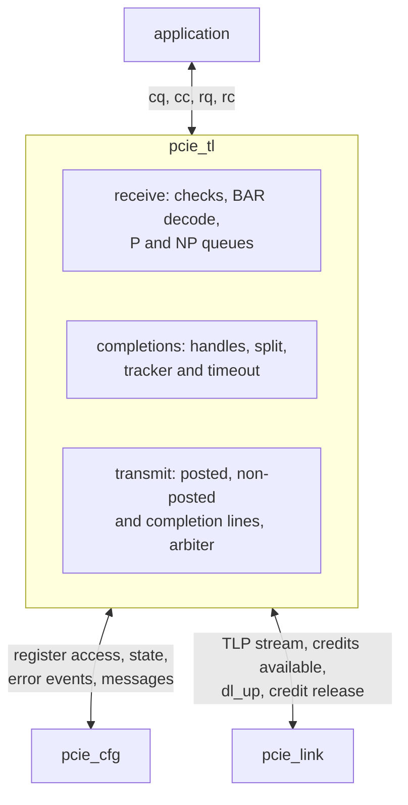

# pcie_tl HAS

`pcie_tl` is the transaction layer of the PCI Express Endpoint
[`pcie_core`](../core/HAS.md): it parses every TLP the
[`link`](../link/HAS.md) delivers, routes it to the application, to
[`pcie_cfg`](../core/TL_CFG.md) or to Unsupported Request, forms and splits
completions, tracks the application's reads by tag with a completion
timeout, sends the interrupt writes and error messages `cfg` asks for,
keeps PCI Express ordering, and reports error events to `cfg`
(decision record [0004](../../decisions/0004-m3-grill.md#decisions), Q1
to Q3, F1, F2, F4, F6). It holds no configuration register, no MSI or
MSI-X state and no error-reporting enable: those are `cfg`'s.

This page owns the ports, reset, errors and the targets. Its sub-pages
own the [TLP formats](TLP.md), the [receive routing](ROUTING.md), the
[completions](COMPLETIONS.md), and the [queues, ordering and
credits](ORDERING.md). The
`core` pages it implements exactly are the
[application interface](../core/APP.md) (the `cq`, `cc`, `rq` and `rc`
streams) and the [tl-cfg interface](../core/TL_CFG.md). How it is built is
in the [MAS](../../rtl/tl/MAS.md); how it is verified, in the
[DV plan](../../dv/tl/DV_PLAN.md). Rules from the PCIe Base Spec rev 3.0
are paraphrased and cited, never copied
([wiki BKM](../../../bkm/wiki.md#citations),
[`pcie-base`](../../references.md#pcie-base)).

## Position

One IP, one testbench, no sub-IPs; its blocks are RTL files of `tl`
described in the [MAS](../../rtl/tl/MAS.md).

## Interfaces

All ports are synchronous to `clk_i`. Port names follow the
[RTL BKM](../../../bkm/rtl.md#naming).

| Group | Ports | Contract |
| --- | --- | --- |
| Clock and reset | `clk_i`, `rst_i` | [Reset](#reset). |
| Upper TLP stream | `tlp_tx_valid_o`, `tlp_tx_ready_i`, `tlp_tx_data_o` (32), `tlp_tx_sop_o`, `tlp_tx_eop_o`; `tlp_rx_valid_i`, `tlp_rx_ready_o`, `tlp_rx_data_i` (32), `tlp_rx_sop_i`, `tlp_rx_eop_i` | The `link` ports of the same names with `_i` and `_o` swapped ([`dll` upper TLP stream](../dll/HAS.md#upper-tlp-stream)). `tlp_rx_ready_o` is 1 in every cycle `dl_up_i` is 1 and `rst_i` is 0 (the [upper-layer obligation](../dll/HAS.md#receive)). |
| Credits available | `fc_ph_avail_i` (8), `fc_pd_avail_i` (12), `fc_nph_avail_i` (8), `fc_npd_avail_i` (12), `fc_cplh_avail_i` (8), `fc_cpld_avail_i` (12) | The `link` `fc_*_avail_o` ([`dll` credits available](../dll/HAS.md#credits-available)); [transmit credits](ORDERING.md#credits). |
| Data link status | `dl_up_i` | The `link` `dl_up_o`; 0 holds `tl` in [reset](#reset). |
| Credit release | `fc_rel_p_o`, `fc_rel_pd_o` (4), `fc_rel_np_o`, `fc_rel_npd_o` (4) | [Below](#credit-release); to the `link` [credit-release](../dll/HAS.md#credit-release) inputs, with `FC_RELEASE` 1. |
| Register access | `reg_req_valid_o`, `reg_req_ready_i`, `reg_req_bar2_o`, `reg_req_write_o`, `reg_req_addr_o` (10), `reg_req_be_o` (4), `reg_req_data_o` (32), `reg_req_bus_o` (8), `reg_req_dev_o` (5), `reg_cpl_valid_i`, `reg_cpl_data_i` (32) | [tl-cfg register access](../core/TL_CFG.md#register-access). |
| Register state | `bus_num_i` (8), `dev_num_i` (5), `mem_space_en_i`, `bus_master_en_i`, `d_state_i` (2), `bar0_base_i` (32), `bar2_base_i` (32), `cpl_timeout_dis_i` | [tl-cfg register state](../core/TL_CFG.md#register-state); `cpl_timeout_dis_i` (Completion Timeout Disable): [completion timeout](COMPLETIONS.md#completion-timeout). |
| Error events, pending | `tl_err_o` (9), `tl_np_pending_o` | [tl-cfg error events](../core/TL_CFG.md#error-events); [which checks raise each bit](#errors). `tl_np_pending_o`: [non-posted pending](COMPLETIONS.md#non-posted-pending). |
| Messages | `msg_valid_i`, `msg_ready_o`, `msg_kind_i` (2), `msg_addr_i` (64), `msg_data_i` (32) | [tl-cfg messages](../core/TL_CFG.md#messages), formats on the [TLP page](TLP.md); [taking a message](ORDERING.md#messages-from-cfg). |
| Application streams | `cq_*`, `cc_*`, `rq_*`, `rc_*` | The `core` ports of the same names, width and direction ([application interface](../core/APP.md)); `cq_addr_o` is `BAR0_ADDR_W` bits. |

Each tl-cfg net `<x>` is `<x>_o` or `<x>_i` here as the
[tl-cfg page](../core/TL_CFG.md#signals) gives its direction.
`tl_np_pending` is in its [requester state](../core/TL_CFG.md#requester-state)
group, `cpl_timeout_dis` in its register state, and the message-offer
[withdrawal](../core/TL_CFG.md#withdrawal) rule under its messages.

### Credit release

One posted and one non-posted release per cycle at most, each a pulse
with its data credits. The header count is 1 per pulse. A release comes
in the cycle after its request leaves; non-posted requests that leave
together are released in successive cycles, the data credits owed merged
into the pulses, at most 8 each ([release](ORDERING.md#credits)), as the
[`dll` credit release](../dll/HAS.md#credit-release) allows.

| Port | Dir | Width | Clock | Description |
| --- | --- | --- | --- | --- |
| `fc_rel_p_o` | out | 1 | `clk_i` | One-cycle pulse: one posted request left `tl`; release 1 posted header credit. |
| `fc_rel_pd_o` | out | 4 | `clk_i` | With `fc_rel_p_o`: the posted request's data credits, 0 to 8. |
| `fc_rel_np_o` | out | 1 | `clk_i` | One-cycle pulse: release 1 non-posted header credit of a request that left `tl`. |
| `fc_rel_npd_o` | out | 4 | `clk_i` | With `fc_rel_np_o`: non-posted data credits to release, 0 to 8. |

The credits are those the `dll` counted for the TLP: its class from Fmt
and Type, 1 header credit, and Length divided by 4 rounded up as data
credits when Fmt says it has data, else 0
([`dll` classes](../dll/FLOW_CONTROL.md#classes-and-credits)). The `dll`
delivers no payload above 128 bytes, so at most 8.

## Parameters

| Name | Type | Default | Range | Effect |
| --- | --- | --- | --- | --- |
| `FC_PH`, `FC_PD`, `FC_NPH`, `FC_NPD` | `int unsigned` | 8, 32, 8, 8 | 1 to 127, 8 to 2047, 1 to 127, 2 to 2047 | The credits `link` advertises (the same values, passed by `core`): they size the [receive queues](ORDERING.md#receive-queues). |
| `CPL_TIMEOUT_DIV` | `int unsigned` | 1 | 1 to 1024 | Divides the [completion timeout](COMPLETIONS.md#completion-timeout). FPGA and ASIC builds use 1. |
| `BAR0_ADDR_W` | `int unsigned` | 12 | 12 to 28 | BAR0 is 2^`BAR0_ADDR_W` bytes; the [BAR decode](ROUTING.md#bar-decode) and the width of `cq_addr_o`. |

Fixed (F2): maximum payload and maximum read request 128 bytes, tags 0 to
7, read handles 0 to 7, a 64-byte read completion boundary, VC0 only, no
ECRC, BAR2 4 KiB.

## Behavior

### Reset

`tl` is in reset in every cycle `rst_i` is 1 (synchronous, active high)
or `dl_up_i` is 0 ([`core` reset](../core/HAS.md#reset), decision record
[0004](../../decisions/0004-m3-grill.md#updates), Q10). In reset it drops
every queued request, read handle, outstanding tag and timer and every
packet partly taken or offered on any stream; no completion, release,
error event or timeout is sent for them. `tlp_tx_valid_o`,
`tlp_rx_ready_o`, `fc_rel_p_o`, `fc_rel_np_o`, `reg_req_valid_o`,
`tl_err_o`, `tl_np_pending_o`, `msg_ready_o`, `cq_valid_o`, `cc_ready_o`, `rq_ready_o` and
`rc_valid_o` are 0; data outputs are don't care. The `dll` has already
abandoned every TLP it held when `dl_up_i` falls
([`core` link down](../core/HAS.md#link-down)), so the credits `tl` would
have released need no release.

### Queues, ordering and credits

The receive queues, the ordering rules, the transmit arbiter, taking
messages from `cfg` and the credit rules (receive, [release](#credit-release),
transmit) are on the [ordering page](ORDERING.md).

### Outside D0

While `d_state_i` is not D0
([tl-cfg outside D0](../core/TL_CFG.md#outside-d0), Q11): every memory
request is an Unsupported Request ([BAR decode](ROUTING.md#bar-decode)),
configuration requests are served, `rq` takes no request (`rq_ready_o` 0
on a `sop` beat, as while `bus_master_en_i` is 0), and `cfg` offers no
message. `tl` still sends every completion and answers PME_Turn_Off.

### Errors

`tl_err_o` bits as the [tl-cfg page](../core/TL_CFG.md#error-events)
defines them, one pulse per kind per cycle:

| Bit | Raised by |
| --- | --- |
| 0 | An Unsupported Request that is posted, an unsupported message included ([routing](ROUTING.md#routing)). |
| 1 | An Unsupported Request that is non-posted ([routing](ROUTING.md#routing)). |
| 2 | A failed [receive check](ROUTING.md#checks) or [completion check](COMPLETIONS.md#checks). |
| 3 | A poisoned request or message that is not an Unsupported Request ([checks](ROUTING.md#checks), step 8). |
| 4 | A poisoned completion for an outstanding read. |
| 5 | An [unexpected completion](COMPLETIONS.md#matching). |
| 6 | A [completion timeout](COMPLETIONS.md#completion-timeout). |
| 7, 8 | A completion with status Unsupported Request (or reserved), Completer Abort. |

## Decisions

Firstmate decisions as the captain's delegate, which the captain may
override; Q-rows are the captain's.

| Choice | Rationale | Rejected |
| --- | --- | --- |
| Release port: a pulse per class with a 4-bit data count, header count 1 per pulse, registered in the cycle after the request leaves (Q9; release timing, firstmate decision on [#290](https://github.com/amichai-bd/pcie-factory/issues/290#issuecomment-6249200269)) | One posted request leaves per cycle; up to three non-posted requests can leave at one edge on handshakes `tl` does not control (a `cq` read, a cfg-line request, a malformed TLP), so their releases are owed and go one per cycle, their data credits merged up to 8 per pulse, as the [`dll` credit release](../dll/HAS.md#credit-release) allows (exact totals, never before the requests left). #303 owns the `link` side. | A count per field per cycle (wider, no user); holding a handshake back so only one request leaves per cycle (`cfg` would wait on the application). |
| Dropped posted requests leave the posted queue in order | One in-order posted queue; a non-posted request counts the posted ones before it with no exceptions. | Releasing them at once (a second path past the queue). |
| Transmit: separate posted and non-posted lines (firstmate decision) | Posted requests must be able to pass non-posted ones that wait for credits, or a host that holds non-posted credits until it sees a posted write deadlocks [cite: PCIe Base Spec, rev 3.0, §2.4.1]; each line keeps its own order. | One queue in the order taken (an `rq` write blocked behind a credit-blocked read). |
| Two non-posted lines | Configuration and BAR2 never wait on the application (`core` HAS); BAR0 reads keep their own order. | One line with a bypass (more state to order). |
| Fewest completions per read | A read whose rest fits in 128 bytes goes in one completion; a split falls only where one is needed, at the highest 64-byte boundary within 128 bytes. Splitting at every boundary would double the headers. | A split at every 64 bytes. |
| Completion timeout 2^21 cycles, 16 prescaler steps | 16.8 to 17.8 ms: in the 50 µs to 50 ms default range and above the 10 ms recommendation; one shared prescaler, a 5-bit count per tag. | A per-tag 21-bit counter; a programmable range (no M3 user). |
| Besides the required checks (message TC among them), the checks the spec may leave optional are made: byte-enable rules, configuration and I/O TC, Attr, Length | A malformed request never reaches `cq` or `cfg`. | Ignoring them. |
| Unsupported Request is checked before poisoned: a poisoned request that is otherwise an Unsupported Request reports only the Unsupported Request (firstmate decision) | One error per TLP, the higher-ranked one, as the spec recommends [cite: PCIe Base Spec, rev 3.0, §6.2.3.2.3]. | Poisoned first (a poisoned write to no BAR would report bit 3). |
| `tl` answers PME_Turn_Off itself with PME_TO_Ack, in any D-state | The host waits for the acknowledgment before removing power; `cfg` has nothing to decide. | Through the `cfg` message channel (a `msg_kind` with no `cfg` rule); not answering. |
| Set_Slot_Power_Limit dropped | The tl-cfg interface has no net for its value. | A new net (a `core` interface change, [open questions](#open-questions), [#309](https://github.com/amichai-bd/pcie-factory/issues/309)). |
| A poisoned completion keeps its tag until the read's last byte or its timeout, then fails once | Later completions of the read are not unexpected; the application sees one status. | Failing at once and freeing the tag (later completions would match a reused tag). |
| A completion that disagrees with its read is malformed and dropped; the read waits | One rule for byte count, lower address and boundary errors; the timeout bounds the wait. | Ending the read at once (a corrupt completion would finish a read). |
| Requests already taken are sent after bus mastering or D0 ends | Holding them would hold every later completion, the one that restores D0 included. | Discarding them (data the application issued is lost). |
| Disabled bytes in completion data sent as 0 | APP says only enabled bytes are sent. | Passing the application's bytes (APP forbids). |

## Targets

Measured by the [architecture model](#architecture-model) with `tl` over a
`link` back to back with a host's, error-free, default credits, the
application and host always ready unless stated. `tl` adds no bytes on
the line, so throughput targets restate the `core` ones, with the same two
bounds ([`core` targets](../core/HAS.md#targets)): the payload rate is at
least 0.98 of the `link` payload rate (`fraction_of_link`, against the
`link` closed form), and at least 0.98 of the `link` payload target as a
fraction of the line (`payload_line_fraction`). Writes use the one-way
`link` figures (closed form 0.857, target 0.85, so ≥ 0.833); reads use
the both-ways ones (0.775 and 0.76, so ≥ 0.745), since the completion
direction also carries the Ack and UpdateFC of every read
([`link` throughput](../link/HAS.md#throughput)).

| Item | Target | Scenario |
| --- | --- | --- |
| Host writes in | 128-byte writes to BAR0: ≥ 0.98 of the link rate, ≥ 0.833 of the line. | `completer_write` |
| Host reads | 128-byte reads from BAR0, the application answering in 16 cycles: ≥ 0.98, ≥ 0.745. | `completer_read` |
| Application writes out | 128-byte writes on `rq`: ≥ 0.98, ≥ 0.833. | `requester_write` |
| Application reads | 128-byte reads on `rq`, host latency 100 cycles: ≥ 0.98, ≥ 0.745. | `requester_read` |
| Splitting | 512 bytes at offset 4: 5 completions; 4 KiB aligned: 32; every field checked by the host stand-in (a self-consistency check; the independent one is [#288](https://github.com/amichai-bd/pcie-factory/issues/288)'s). | `split_completions`, `split_4k` |
| Tags | Host latency 2000 cycles: all 8 tags in use, `rq` waits, nothing lost, ≥ 0.4 bytes per cycle (8 reads per round trip). | `tag_exhaustion` |
| Timeout | `CPL_TIMEOUT_DIV` 1024: every lost read times out once, 2048 to 2176 cycles after it was sent. | `completion_timeout` |
| Queues | The application stalling `cq`: posted credits held never above the advertised 8 and 32; nothing lost. | `credit_stall` |
| FPGA, ASIC clock | The `core` targets: 50 MHz on the DE2-115, the 100 MHz sky130hd checkpoint. | `core` flows |

## Architecture model

[`pcie_tl_arch.py`](../../../../src/arch/tl/pcie_tl_arch.py) runs these
pages at TLP level, one step per cycle and one beat per stream per
cycle: header formats, the receive checks and routing, the queues and
ordering, release, completion forming and splitting, the tracker and the
timeout, and the transmit arbiter. Its TLPs are the `dll` model's, and
`perf` runs `tl` over the `link` model's `LinkPair` against a host and an
application stand-in, both loaded unchanged from
[`src/arch/dll/`](../../../../src/arch/dll/pcie_dll_arch.py) and
[`src/arch/link/`](../../../../src/arch/link/pcie_link_arch.py). The host
stand-in still counts the release rule's credits itself, its credit return
reaching it 32 cycles after a release, instead of using the `dll` model's
release port ([#337](https://github.com/amichai-bd/pcie-factory/issues/337)). The
[self-tests](../../../../src/arch/tl/test_pcie_tl_arch.py) check every
page's examples; `./build arch --ip tl` writes `workdir/tl/arch/perf.json`.
It is written from these pages and is not the DV oracle: the independent
host model is [#288](https://github.com/amichai-bd/pcie-factory/issues/288)'s.

| Scenario | Workload |
| --- | --- |
| [`completer_write`](../../../../src/arch/tl/perf/completer_write.yaml), [`completer_read`](../../../../src/arch/tl/perf/completer_read.yaml) | 2000 host writes, 1000 host reads of 128 bytes through BAR0. |
| [`split_completions`](../../../../src/arch/tl/perf/split_completions.yaml), [`split_4k`](../../../../src/arch/tl/perf/split_4k.yaml) | 300 reads of 512 bytes at offset 4; 40 reads of 4 KiB. |
| [`credit_stall`](../../../../src/arch/tl/perf/credit_stall.yaml) | 1000 host writes, the application stalling `cq`. |
| [`requester_write`](../../../../src/arch/tl/perf/requester_write.yaml), [`requester_read`](../../../../src/arch/tl/perf/requester_read.yaml) | 2000 writes, 1000 reads of 128 bytes on `rq`. |
| [`tag_exhaustion`](../../../../src/arch/tl/perf/tag_exhaustion.yaml) | 200 reads against a 2000-cycle host. |
| [`completion_timeout`](../../../../src/arch/tl/perf/completion_timeout.yaml) | 100 reads, every fifth losing its last completion. |

## Open questions

The Base Spec is not in the local cache (`./build specs list`:
`local-not-provided`); every rule on this page and its sub-pages is this
design's reading.

| Item | Owner |
| --- | --- |
| Every cited section, checked against rev 3.0; in particular which receive checks the spec requires and which it only permits (byte enables, configuration and I/O TC and Attr), the message codes that require TC 0, the message outcomes (Ignored messages dropped; OBFF, LTR and INTx received as Unsupported Request; PM_Active_State_Nak dropped), CRS and a successful completion without data as malformed, the locked completion for a refused locked read, Byte Count 4 for Unsupported Request completions of atomic operations, and AT not 0 as Unsupported Request. | Captain, with a local copy; [#282](https://github.com/amichai-bd/pcie-factory/issues/282) |
| Set_Slot_Power_Limit: an upstream port captures its value into the Device Capabilities slot power fields; the tl-cfg interface has no net for it, so `cfg` reads them as 0. | [#309](https://github.com/amichai-bd/pcie-factory/issues/309) |
