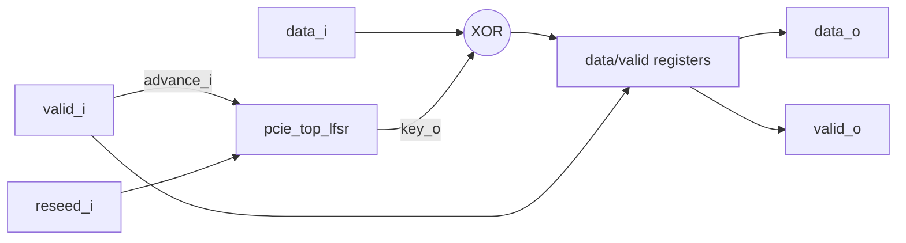

# pcie_top HAS

`pcie_top` is the top IP of the PCI Express controller. For now it is a
seed datapath: a byte-stream scrambler that XORs each valid data byte with
the Gen1/Gen2 scrambler key from its sub-IP
[`pcie_top_lfsr`](../../rtl/top_lfsr/MAS.md). It gives the factory a real two-level
IP (a parent that includes a sub-IP through `-F` and has its own end-to-end
tests) before the controller's architecture is defined.

It is not a physical layer: no 8b/10b coding, no K-code bypass, no SKP
handling and no lanes. `reseed_i` plays the role of a COM only in part:
like a COM, the next byte uses the seed key; unlike a COM (a K code, which is
never scrambled), the byte in the re-seed cycle is scrambled with the
current key.

How it is built is in the [MAS](../../rtl/top/MAS.md); how it is verified in the
[DV plan](../../dv/top/DV_PLAN.md); its implementation targets in the
[FPGA](../../fpga/top/FPGA.md) and [ASIC](../../asic/top/ASIC.md) pages. Its
[architecture model](#architecture-model) states this page's behavior and
targets as executable Python.
The official sources it relies on (the board manual for FPGA, the PDK and
flow documentation for ASIC) are on the [references page](../../references.md).

## Position

Sub-IPs: [`top_lfsr`](../../rtl/top_lfsr/MAS.md) (it is a sub-IP because `top.rtl.f` reaches `top_lfsr.rtl.f` through `-F`).

## Interfaces

One clock, `clk_i`; every input is sampled and every register updates on
its rising edge.

| Port | Dir | Width | Clock | Description |
| --- | --- | --- | --- | --- |
| `clk_i` | in | 1 | - | Clock. |
| `rst_i` | in | 1 | `clk_i` | Synchronous, active-high reset. |
| `valid_i` | in | 1 | `clk_i` | `data_i` holds a byte to scramble this cycle. |
| `data_i` | in | 8 (`t_byte`) | `clk_i` | Input byte. |
| `reseed_i` | in | 1 | `clk_i` | Re-seed the key from the next byte; a byte in this cycle uses the current key. |
| `valid_o` | out | 1 | `clk_i` | `data_o` holds a scrambled byte. |
| `data_o` | out | 8 (`t_byte`) | `clk_i` | Scrambled byte; don't-care while `valid_o` is 0. |

`t_byte` is `pcie_top_lfsr_pkg::t_byte` (`logic [7:0]`).

## Parameters

None.

## Behavior

Let `K` be the key byte of the [LFSR](../../rtl/top_lfsr/MAS.md#behavior) in the
current cycle. At each rising edge:

| Condition | `valid_o` next | `data_o` next | LFSR |
| --- | --- | --- | --- |
| `rst_i` | 0 | don't care | seed |
| `valid_i` (no reset) | 1 | `data_i ^ K` | re-seed if `reseed_i`, else advance |
| not `valid_i` (no reset) | 0 | don't care | re-seed if `reseed_i`, else hold |

So a byte in the same cycle as `reseed_i` is scrambled with the current
key, and the next valid byte uses the seed key `8'hFF`. After reset or a
re-seed, a stream of `00h` bytes comes out as `FF 17 C0 14 ...`.
Scrambling is its own inverse: feeding the output back after a re-seed
restores the data.

Reset values: `valid_o` is 0 and the LFSR holds the seed. `data_o` is not
reset and is don't-care while `valid_o` is 0.

## Decisions

| Choice | Rationale | Rejected |
| --- | --- | --- |
| The LFSR advances only on valid bytes | Bubbles do not consume key, as a cycle with no symbol would not. | Free-running LFSR. |
| Re-seed applies from the next byte | The byte in the re-seed cycle uses the current key and the next byte the seed key, so `reseed_i` needs no data bypass. | Re-seed before the byte; a K-code bypass (out of scope for this seed). |

## Targets

| Item | Target |
| --- | --- |
| Throughput | One byte per clock, back to back. |
| Latency | One cycle from `valid_i` to `valid_o`. |
| Clock | 100 MHz, the study clock of the [ASIC](../../asic/top/ASIC.md) flow; the board runs at its own clock ([FPGA](../../fpga/top/FPGA.md)). |
| Area | The LFSR plus 9 flops and 8 XORs. |

## Architecture model

[`pcie_top_arch.py`](../../../../src/arch/top/pcie_top_arch.py) models the
[behavior](#behavior) and the one-cycle latency, for definition and
performance analysis ([arch BKM](../../../bkm/arch.md)). Its perf scenarios
in [`src/arch/top/perf/`](../../../../src/arch/top/perf/back_to_back.yaml)
check the throughput and latency targets; `./build arch --ip top` writes
`workdir/top/arch/perf.json`.

| Scenario | Workload | Targets checked |
| --- | --- | --- |
| `back_to_back` | 4096 random bytes, no bubbles or re-seeds | `throughput_bytes_per_cycle` >= 1, `latency_cycles_min` >= 1, `latency_cycles_max` <= 1 |
| `bubbles_reseed` | 4096 random bytes offered in half the cycles, a re-seed every 128 bytes | `throughput_ratio` (output over offered rate) >= 1, `latency_cycles_min` >= 1, `latency_cycles_max` <= 1 |
