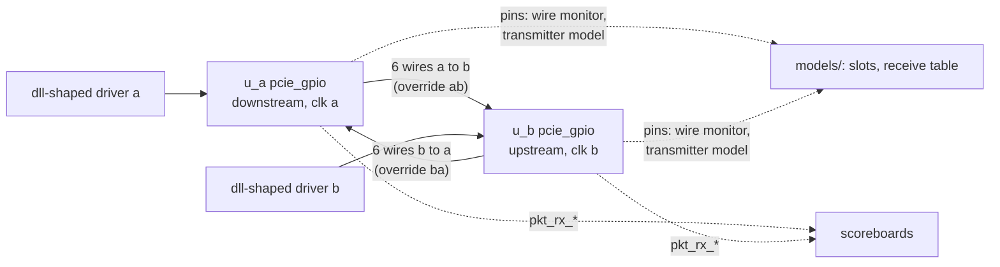

# pcie_gpio DV plan

How `pcie_gpio` is verified: two adapters back to back carrying
`dll`-shaped traffic, checked against a reference model written from the
[HAS](../../arch/gpio/HAS.md) and the [link-up rules](../../arch/gpio/LINK_UP.md)
([#378](https://github.com/amichai-bd/pcie-factory/issues/378)). The `dll`
over the adapter, and `link` at `LOWER` 1, are verified by the
[`link` e2e over the GPIO lower layer](../link/DV_PLAN.md#gpio-lower-layer);
the board-build pair of `rc` and `core` by the
[`rc` DV plan](../rc/DV_PLAN.md) (`board_enum`, `board_mmio`).

## Strategy

- **Top:** [`pcie_gpio_tb.sv`](../../../../src/dv/gpio/tb/pcie_gpio_tb.sv)
  holds two `pcie_gpio`, a (`port_role_i` 0) and b (1), each on its own
  clock, each one's receive pins the other's transmit pins, the forwarded
  clock included (zero-delay wires: the receiver captures mid-transfer).
  `RATIO` sets b's clock to 1/2, 1 (250 ppm off) or 2 times a's, the
  [clock contract](../../arch/gpio/HAS.md#clocks-and-resets)'s range;
  `CLK_DIV` passes to both. A per-direction override replaces the control
  and data wires the receiver sees, to damage or forge transfers. A pin
  checker ([`pcie_gpio_pin_check.sv`](../../../../src/dv/gpio/tb/pcie_gpio_pin_check.sv))
  stops the run if a control or data pin changes at an edge where the
  forwarded clock does not fall, or if any pin is not 0 after a reset edge
  ([pins and transfers](../../arch/gpio/HAS.md#pins-and-transfers)).
- **Environment:** [`gpio_env.py`](../../../../src/dv/gpio/tb/gpio_env.py).
  Per end, at each falling edge of its clock:
  - a **driver** of the `dll` stream: 3-beat DLLPs and 9- to 75-beat TLPs,
    valid held from sop to eop unless a test drops it, a sop offered
    while up;
  - a **sink** that rebuilds packets from `pkt_rx_*` and checks the stream
    contract: every sop has one eop, nothing delivered while down but the
    closing error eop, `pkt_rx_nullify_o` 0;
  - a **wire monitor** of its own transmit pins and a **transmitter
    model** from the HAS: the transfer schedule (one transfer every
    `CLK_DIV` cycles from the first edge after reset, the forwarded clock
    low at each start and high mid-transfer), and at every slot start the
    slot the HAS requires: the buffered beats in order, IDLE while up,
    HOT_RESET in a downstream Hot Reset, TRAIN with bit 8 exactly when
    aligned and at least 16 bit-8-clear words since the last quiet-run
    start, ABORT first when the link left up inside a packet on the pins;
    the ready rule (between packets 1 exactly when up and every buffered
    beat has left, inside a packet always 1); at least 32 HOT_RESET words
    per downstream Hot Reset; up only after the end's quiet run; the
    first alignment only after 8 marker slots from the partner;
  - a **wire injector** that replaces a chosen slot or flips its transfers,
    logging every slot as the receiver sees it.
- **Reference model:** [`pcie_gpio_model.py`](../../../../src/dv/gpio/models/pcie_gpio_model.py),
  pure Python with its [unit tests](../../../../src/dv/gpio/models/test_pcie_gpio_model.py):
  slot encoding, the idle words and the [receive table](../../arch/gpio/HAS.md#receive).
  The error tests run the table over the slots the receiver saw and
  compare its pulses and beats with the RTL's.
- **Scoreboards:** one per direction: every packet taken whole while up
  is delivered once, in order and beat for beat with no error; tests that
  take the link down allow packets in flight to be lost or cut.
- **Status:** only the four `ltssm_state_o` codes, `link_up_o` exactly at
  `0x20`, every output at its reset value in reset.
- **Targets:** the [HAS targets](../../arch/gpio/HAS.md#targets), from the
  [architecture model](../../../../src/arch/gpio/pcie_gpio_arch.py): every
  link-up from reset within 44 slots of the slower end after the later
  release; `L_tx` 2 cycles plus a slot-phase wait; `L_rx` within the
  model's bound for the clock ratio.
- **RTL assertions:** the receive crossing never overflows; the transmit
  buffer never overflows; a beat is buffered whenever a packet is open on
  the pins; up only when aligned with the quiet run over.
- **Functional coverage:** `gpio_config` (ratio, `CLK_DIV`), `gpio_slot`
  (every slot kind sent), `gpio_rx_table` (every receive-table case), and
  `gpio_link` (each link event, crossed with the ratio).

## Plan

All entries run on `pcie_gpio_tb`, `CLK_DIV` 2 and `RATIO` 1 unless stated.

| Feature | Entry `name` | Level | Seeds / note |
| --- | --- | --- | --- |
| [Reset values](../../arch/gpio/HAS.md#reset-values), [link-up](../../arch/gpio/LINK_UP.md#rules) within the target, [slots](../../arch/gpio/HAS.md#slots) and [idle words](../../arch/gpio/HAS.md#idle-words) (the transmitter model), 20 packets each way lossless | `smoke` | 0 | 1 |
| [Transmit](../../arch/gpio/HAS.md#transmit) and [receive](../../arch/gpio/HAS.md#receive) under sustained load both ways (120 back-to-back packets, then 40 with gaps); rate matching: the ready rule holds the `dll` off between packets, the receive crossing never overflows; `L_tx` and `L_rx` within the targets | `traffic` | 1 | 1 |
| The same at ratios 1/2 and 2 and at `CLK_DIV` 4 | `traffic_half`, `traffic_double`, `traffic_div4` | 2 | 1 each; `RATIO` 0, 2; `CLK_DIV` 4 `RATIO` 2 |
| Link-up and traffic at `CLK_DIV` 64, b half speed | `smoke_div64` | 2 | 1 |
| Every [receive](../../arch/gpio/HAS.md#receive) error case each way, against the model's table: with no packet open a damaged marker, an unknown word, MID (with EOP and ABORT then dropped silently), EOP, ABORT; ONE_TLP and ONE_DLLP delivered; inside a packet an IDLE, a SOP, a ONE, an ABORT (no pulse) and a damaged marker, each an error eop; valid falling inside a packet at the sender (ABORT on the pins, an error eop, no pulse); no case takes the link down | `errors` | 1 | 1 |
| The same at ratios 1/2 and 2 | `errors_half`, `errors_double` | 2 | 1 each |
| Reset and restart under traffic: b reset briefly, a past the watchdog, both; each end down once and back up; traffic resumes in order | `restart` | 1 | 1 |
| The same at ratio 2 | `restart_double` | 2 | 1 |
| [Hot Reset](../../arch/gpio/LINK_UP.md#hot-reset) with a packet in flight each way, held 1 and 3000 cycles: at least 32 HOT_RESET words, ABORT at link-down, the error eop, both ends `0x19` and down once, back up; the upstream end ignores `hot_reset_req_i` | `hot_reset` | 1 | 1 |
| The same at ratios 1/2 and 2 | `hot_reset_half`, `hot_reset_double` | 2 | 1 each |
| [Convergence](../../arch/gpio/LINK_UP.md#convergence) at ratio 2: one damaged slot each way, two 9 apart and one after an EOP (a marker pattern at another phase): no change; two within 8 (the last of the window): both down once, through the expected state at each end; a partner reset at the same phase (short: cause 2; past the watchdog: alignment loss) and at a new phase; Hot Reset entry and exit; forged runs of 4 bit-8-clear TRAIN, 4 HOT_RESET and 64 bit-8-set TRAIN words (down) and of 3, 3 and 63 (no change) | `converge_double` | 1 | 1; `RATIO` 2 |
| The same at ratios 1 and 1/2, and at `CLK_DIV` 4 with ratio 1/2 | `converge_equal`, `converge_half`, `converge_div4` | 2 | 1 each |
| The rules out of states other than up: a downstream Hot Reset requested while training; alignment loss while training; an upstream end entering Hot Reset from training; alignment loss of an upstream end in Hot Reset (it trains and re-enters) | `train_cases` | 1 | 1 |
| The same at ratios 1/2 and 2 | `train_cases_half`, `train_cases_double` | 2 | 1 each |

**Level placement.** The entries take about 1 to 3 s of CPU each, so
level 1 keeps one of each feature at the equal clocks and the convergence
cases at the worst ratio (b twice as fast), 8.4 s in all
([#389](https://github.com/amichai-bd/pcie-factory/issues/389) budget);
level 2 sweeps the ratios and `CLK_DIV`.

**Coverage:** the floors and every point they leave are in
[coverage holes](#coverage-holes).

## Mutants

The campaign of [#378](https://github.com/amichai-bd/pcie-factory/issues/378) on the final
RTL: one deliberate bug at a time, the entries run in order (`smoke`,
then level 1, then for the `link` mutants `gpio_smoke`, `gpio_damage`
and level 2) at their first seed until one fails.

| Mutant | First failing entry | Result |
| --- | --- | --- |
| M1 transmit: ready between packets ignores the room rule | `smoke` | Ready 1 between packets with 3 beats buffered. |
| M2 transmit: valid low inside a packet writes EOP, not ABORT | `errors` | The transmitter model: EOP sent where ABORT is expected. |
| M3 transmit: no ABORT when the link leaves up inside a packet on the pins | `restart` | TRAIN sent where ABORT is expected. |
| M4 transmit: data nibbles high first | `smoke` | The first slot reads `0xA500`, not TRAIN. |
| M5 transmit: TRAIN bit 8 set as soon as aligned (quiet run ignored) | `smoke` | TRAIN_OK sent inside the quiet run. |
| M6 transmit: a downstream Hot Reset sends TRAIN | `hot_reset` | TRAIN_OK sent where HOT_RESET is expected. |
| M7 transmit: buffer not flushed when the link leaves up | `restart` | Ready 0 between packets with nothing buffered. |
| M8 receive front end: no phase hunting | `smoke` | Never aligned: no link-up. |
| M9 receive front end: the phase moves while aligned | `errors` | A damaged marker gives 3 pulses, the model 1. |
| M10 damage window of 7 slots | `converge_double` | Two damaged slots 8 apart: no link-down. |
| M11 down on 5 bit-8-clear TRAIN words, not 4 | `converge_double` | A forged run of 4: no link-down. |
| M12 backstop run of 63 TRAIN words | `converge_double` | A forged run of 63 takes the link down. |
| M13 up without the quiet run over | `hot_reset` | RTL assertion `a_up_aligned`. |
| M14 an unknown idle word does not pulse | `errors` | 0 pulses, the model 1. |
| M15 ABORT inside a packet pulses | `errors` | 1 pulse at a valid drop, the model 0. |
| M16 no discard after a pulse | `errors` | MID with EOP and ABORT after it: 2 pulses, the model 1. |
| M17 watchdog never fires | `converge_double` | A long partner reset: the partner leaves up through `0x04`, not `0x00`. |
| M18 Hot Reset dwell of 8 HOT_RESET words | `hot_reset` | Left Hot Reset after 8 words, at least 32 required. |
| M19 the upstream end ignores HOT_RESET runs | `hot_reset` | b never enters Hot Reset. |
| M20 no error eop for an open packet at link-down | `restart` | A sop inside an open packet at the receiver. |
| M21 the quiet run never restarts after a down | `restart` | TRAIN_OK sent right after a down. |
| M22 alignment after 4 marker slots, not 8 | `smoke` | b aligned after 5 marker slots from a. |

The `link` and `replay_timeout` mutants are in the
[`link` DV plan](../link/DV_PLAN.md#gpio-lower-layer).

## Gaps

| Feature | Owning issue |
| --- | --- |
| A real cable: wire delay and skew, the transfer rate it sustains | The two-board milestone ([HAS open items](../../arch/gpio/HAS.md#open-items)) |

## Coverage holes

Line and toggle floors use the
[by-source union](../../../tools/regress/SPEC.md#coverage): each source point
counts once and is covered if any instance covers it. Functional coverage
is unchanged. The source remeasurement for
[#228](https://github.com/amichai-bd/pcie-factory/issues/228) uses
[nightly 39384846565](https://github.com/amichai-bd/pcie-factory/actions/runs/39384846565).
Separately measured low-level runs supply their own floors.

| Selected levels | Source line | Source toggle | Line / toggle floors |
| --- | --- | --- | --- |
| L0+L1+L2 | 260/262 (99.24%) | 2186/2260 (96.73%) | 98.7 / 96.2 |

### Per-instance diagnostic baseline

The counts and prior floor values below describe the original per-instance
view at the revisions cited. Current code floors use the source table above.
A point hit in another parameter set or instance is covered in the source
union; the other reviewed causes remain diagnostic explanations, without
adding a waiver.

Floors in [`level2.yaml`](../../../../src/dv/gpio/regress/level2.yaml),
checked by every `--coverage` run that selects level 2 (the nightly runs
levels 0 to 2): line 91.0, toggle 91.7, functional 100. Merged over levels
0 to 2 ([#380](https://github.com/amichai-bd/pcie-factory/issues/380)):
line 91.53% (595 of 650 points), toggle 92.23% (4302 of 4664), functional
100% (99 of 99 bins in `gpio_config`, `gpio_slot`, `gpio_rx_table` and
`gpio_link`). The code floors are the merged values less 0.5 points,
rounded down to a tenth ([floor margin](../../../bkm/dv.md#coverage)).
Verilator keeps one copy of each block per `CLK_DIV` (2, 4 and 64; the
ratio only moves b's clock), and the copies at 4 and 64 run only
`converge_div4`, `traffic_div4` and `smoke_div64`.

The 55 line points not hit, by cause:

| Cause | Points | Where |
| --- | ---: | --- |
| Hit in another `CLK_DIV` copy | 53 | `pcie_gpio_link.sv` 46 and `pcie_gpio_tx.sv` 7, nearly all in the `CLK_DIV` 64 copy, which runs only the smoke: the error, Hot Reset and restart branches the level 1 entries take at `CLK_DIV` 2. |
| Elaboration only | 1 | `pcie_gpio_pkg.sv`: `replay_timeout`, called only for the `link`'s `localparam`. |
| Unreachable by construction | 1 | The lane-disable branch of the transmit buffer's `common_sdp_ram` (`LANES` 1). |

The 362 toggle points not hit, by cause:

| Cause | Points | Signals |
| --- | ---: | --- |
| Hit in another `CLK_DIV` copy | 212 | `pcie_gpio_link.sv` 139, `pcie_gpio_tx.sv` 50, `pcie_gpio.sv` 23: the same signal bit and direction toggles at another `CLK_DIV`. |
| Constant by construction | 90 | The top bit of each run counter (`run_good`, `run_clear`, `run_any`, `run_hr`, `run_exit` in `s_d` and `s_q`, 60): a run that reaches its count changes the state, which clears every run in the same cycle; `ltssm_state_o` bit 1 in `pcie_gpio` and the link block (12: none of `0x00`, `0x04`, `0x19`, `0x20` sets it); `pkt_rx_nullify_o` (6, tied to 0); `sop_code` bit 1 and `code_bits` bit 0 (6: every start code has bit 1 set; the marker is always 1); the window's `new_phase` (4, set only on the slot written into the crossing); the reset synchronizer's first-stage input (2). |
| Never dropped | 10 | `port_role_i` 1 to 0 (6: static per end), the receive crossing's ready (`src_ready_o`, `dst_ready_i`, `push_ready`: it never fills, `a_rx_no_overflow`), the RAM's lane enable (`LANES` 1). |
| Transmit buffer never past one packet | 30 | `buf_full`, `occ` bits 7 and 8, `ram_used` and the FIFO's `full_o`, `in_ram` and `ram_used_o` top bits: `pkt_tx_ready_o` rises between packets only on an empty buffer, so it holds at most one maximum packet (75 of its 129 entries; [MAS](../../rtl/gpio/MAS.md), `a_buf_room`). |
| Receive crossing never past one slot | 8 | `fill` bits 1 and 2 and the FIFO's `dst_fill_o`: one slot per 4 forwarded-clock edges against a read every `clk_i` cycle; the MAS bound of 2 needs the hunting phase jump to land within the reader's 3-edge delay, which no entry produces. Cost: a directed entry that slips the line's phase while hunting so that the jump lands in that window; it would re-check only the margin of a 4-slot FIFO against a bound of 2, which `a_rx_no_overflow` already guards in every entry. |
| Watchdog top bits at `CLK_DIV` 64 | 12 | `wd_q` and `wd_d` bits 10 to 12, a silence of 1024 cycles or more: the watchdog fires in `restart` and `converge_*` at `CLK_DIV` 2 and 4, where these bits do not exist; the `CLK_DIV` 64 copy runs only the smoke, so a further entry there would add 12 points and re-check what `converge_div4` covers (its scaling with `CLK_DIV`). |

How the points were sorted, so a re-measurement reproduces the counts: a
line point is keyed by file, line, column and kind, a toggle point by
file, signal bit and direction (any copy). A point not hit is "another
copy" when its key is hit anywhere in the run; the rest go by file and
signal name as the rows list them.
