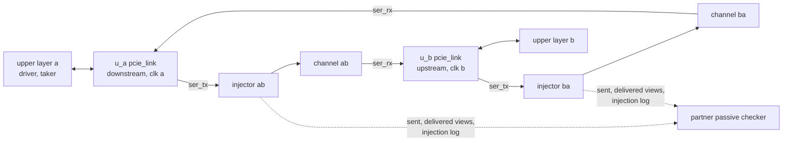

# pcie_link DV plan

How `pcie_link` is verified: the back-to-back end-to-end bench of the
[HAS end-to-end plan](../../arch/link/HAS.md#end-to-end-plan), with the
independent partner's [passive mode](../dll/PASSIVE.md) as the
second opinion. Each stacked IP keeps its own unit DV
([`dll`](../dll/DV_PLAN.md), [`phy`](../phy/DV_PLAN.md)); this bench
verifies the stack wiring and the stack-level targets through the `link`
ports.

## Strategy

- **Top:** [`pcie_link_e2e_tb.sv`](../../../../src/dv/link/tb/pcie_link_e2e_tb.sv)
  holds two `pcie_link` instances, a (downstream) and b (upstream), each
  on its own clock; each one's `ser_rx_clk_i` is the far clock. Every
  `link` port is a top port prefixed `a_` or `b_`. The parameter `CREDITS`
  picks the [credit configuration](../../arch/link/HAS.md#credit-configurations)
  (0 default, 1 finite minimum, 2 finite default sizes, 3 all infinite,
  4 asymmetric: a minimum, b default, 5 release: default credits with
  `FC_RELEASE` 1 at both ends), echoed per end on `<e>_cfg_fc_o`. Outside
  configuration 5 the environment holds `<e>_fc_rel_*_i` at 0; in it each
  end's releaser holds every delivered posted and non-posted TLP and
  releases it on `fc_rel_*_i`, and fails if the end's upper layer ever
  holds more finite credits than that end advertises
  ([`dll` credit release](../../arch/dll/HAS.md#credit-release)).
  `TIMEOUT_DIV` is 1024 (link-up in about 10000 cycles) and
  `ERR_TIMEOUT_DIV` 1, as the HAS bench sets. The top taps the
  packet-stream nets between each instance's `dll` and `phy`, which the
  [MAS](../../rtl/link/MAS.md#microarchitecture) names, onto its own
  `<e>_mon_*_o` ports for the environment's boundary Ack check.
- **Environment:** [`link_e2e_env.py`](../../../../src/dv/link/tb/link_e2e_env.py).
  One coroutine per clock, at each falling edge: the end samples its
  outputs and drives its inputs, then its serial word crosses its
  direction's injector and channel to the far end's `ser_rx_*`. b's clock
  is `ppm` off a's. While an end is in reset its receive lines are random.
- **Upper layers:** a transmit driver per end offers queued TLPs on
  `tlp_tx_*` (valid drops inside a TLP with probability 0.1) and reads
  `tlp_tx_ready_o` after driving the beat, which may depend on it. The
  traffic is the HAS mix: memory writes and completions with data of 4 to
  128 bytes, memory reads, configuration writes, each a quarter. A receive
  taker per end holds `tlp_rx_ready_i` at 1 when any of its classes is
  infinite (the [upper-layer obligation](../../arch/dll/HAS.md#receive),
  which the RTL asserts); otherwise it takes a set share of beats and
  stalls on request.
- **Injector:** [`pcie_link_injector_model.py`](../../../../src/dv/link/models/pcie_link_injector_model.py),
  at each transmitter's `ser_tx_data_o`. It decodes 8b/10b with the
  transmitter's running disparity and descrambles with its own LFSR (COM
  resets it, SKP holds it), so it follows the scrambler across SKP
  ordered sets. It holds 4 words, enough to see a TLP's sequence number or
  a DLLP's type before the packet leaves, applies one
  [class](../../arch/link/HAS.md#error-injection) per packet (on request,
  at a per-packet rate, or by the level switches that drop every Ack or
  every TLP), and re-encodes with its own running disparity, so nothing
  else changes on the line. It records the sent and delivered views and
  the injection log, timed at the `link` ports (sent at the transmitter's
  output, delivered plus the channel delay to the receiver's input).
- **Channel:** the `phy` e2e's
  [`pcie_phy_channel_model.py`](../../../../src/dv/phy/models/pcie_phy_channel_model.py),
  4 words of delay, for the line impairments (bit flips, slips, electrical
  idle).
- **Checks** ([HAS checks](../../arch/link/HAS.md#checks)), at every edge
  or at the end of the test:
  - one scoreboard per direction: each TLP accepted on one end's upper
    stream is the next delivered on the other, byte for byte; drained at
    the end. A requested link-down drops what was not delivered;
  - `dl_err_o` DL protocol error, Receiver overflow and Malformed TLP
    never pulse;
  - `link_up_o` 1 and `dl_state_o` DL_Active from the first DL_Active on
    (unless a test requests a link-down); in L0 `ltssm_state_o` is exactly
    `0x20`, never an L0s sub-state ([power states](../../arch/link/HAS.md#power-states));
  - each `fc_*_avail_o` in DL_Active at most the far end's advertisement,
    all ones for an infinite field, and back at the advertisement once
    drained;
  - liveness: 20000 cycles with nothing delivered while a TLP is
    outstanding fails;
  - reset values while `rst_i` is high, and the `dll` outputs at theirs
    while `link_up_o` is 0 ([reset values](../../arch/link/HAS.md#reset-values));
  - Ack latency at each end's `dll`-to-`phy` boundary, on the tapped nets:
    every TLP the `dll` gets good and in order is covered by an Ack or Nak
    whose `sop` the `phy` takes within 118 cycles of its `eop`, outside
    the times the LTSSM is out of L0;
  - the partner's passive checker on both views: credits, sequence, Ack
    and Nak, and Ack timing at the 140-cycle line bound (duplicates
    included). The environment passes it each end's out-of-L0 ranges,
    rollover pulses and link-downs and the line impairments, which tie
    its exemptions and allowances to their triggers ([`link` HAS, passive
    checker](../../arch/link/HAS.md#passive-checker)): a replay short by
    its newest TLP only at a rollover pulse while its last TLP goes out
    (or as the last of the sender's epoch, before its link-down), a cut
    TLP only at its exit from L0. The link-control tests require Acks
    timed after the relink. Every accepted TLP must have been judged
    once as a first transmission;
  - in the error-free entries (`e2e_smoke`, every `e2e_credits_*` and
    `e2e_throughput_*`): no Bad TLP, Bad DLLP, replay timeout or rollover
    pulse, no `rcv_err_o`, and neither end leaves L0. Credit starvation and stalls are no error:
    nothing is lost or replayed.
- **Throughput** ([HAS throughput](../../arch/link/HAS.md#throughput)):
  error-free, 0 ppm, default credits, 128-byte memory writes back to back
  one way (a to b) or each way, the transmit drivers offering every beat
  (no valid drop) and the takers never stalling (Cpl is infinite). The
  check is the HAS one: payload bytes delivered over the cycles from the
  first TLP accepted to the last delivered, inclusive, at least 0.85 of
  the line rate one way and 0.76 in each direction both ways, with no
  tolerance. The injector's line tally and the sent view
  ([`pcie_link_throughput_model.py`](../../../../src/dv/link/models/pcie_link_throughput_model.py))
  attribute every symbol of each line, from the first TLP's STP to the
  last TLP's END, as the HAS derives it: payload, TLP header, TLP framing
  (STP, sequence number, LCRC, END), Ack, Nak, UpdateFC per class, SKP,
  logical idle, replays and the rest. The attribution must close on the
  window (every symbol counted once), and it is logged with the HAS
  closed form of the [architecture model](../../arch/link/HAS.md#architecture-model)
  (`derived_fractions`) and quoted in a failure message, so a miss names
  its cause. Each run is also error-free and lossless, as the other
  error-free entries.
- **Directed classes:** the tests inject one class at a time with traffic
  both ways and check its pulses from the HAS: Bad TLP (and `rcv_err_o`
  for an invalid symbol) and a Nak for an LCRC error or a corrupted TLP;
  a dropped TLP gives Bad TLP and a Nak when a TLP follows, the sender's
  replay timeout when it was the last; Bad DLLP for a corrupted DLLP and
  no pulse for a dropped one; one Nak and at least two replay timeouts
  when the Nak is lost and the Nak'd TLP's replay corrupted; no pulse at
  the receiver of a duplicate; exactly 4 replay timeouts, 1 rollover, a
  retrain of both ends and no Bad TLP for the rollover.
- **Functional coverage:** `link_e2e_config` (credit configuration, ppm),
  `link_e2e_inject` (every class, each way, crossed), `link_e2e_recovery`
  (Bad TLP, Bad DLLP, replay timeout, rollover, retrain, `rcv_err_o`, a
  Nak sent, a duplicate acknowledged), `link_e2e_traffic` (each TLP kind
  each way, payload sizes), `link_e2e_credit` (each class starved on
  credits; the 4000- and 10000-cycle stalls; an upper layer holding all of
  a class's header credits unreleased) and `link_e2e_control` (Hot
  Reset, Disabled, Loopback).
- **Model unit tests:** [`test_pcie_link_injector_model.py`](../../../../src/dv/link/models/test_pcie_link_injector_model.py)
  checks the injector against a reference transmitter and a strict
  decoder (pass-through bit exact, each class, running disparity and the
  scrambler kept);
  [`test_pcie_link_throughput_model.py`](../../../../src/dv/link/models/test_pcie_link_throughput_model.py)
  checks the line tally and the attribution on a stream of known content
  (every symbol attributed, windows and straddling packets); the partner's passive mode has its own
  ([passive mode unit tests](../dll/PASSIVE.md#unit-tests)).

## Plan

All entries run on `pcie_link_e2e_tb`; credits are the default
(`CREDITS` 0) unless stated.

| Feature | Entry `name` | Level | Seeds / note |
| --- | --- | --- | --- |
| [Stack wiring](../../arch/link/HAS.md#stack-wiring) and [reset values](../../arch/link/HAS.md#reset-values): reset, link-up to DL_Active at both ends, 60 TLPs of the mix each way, every check, error-free | `e2e_smoke` | 0 | 1 |
| [Error injection](../../arch/link/HAS.md#error-injection): LCRC error, corrupted TLP, dropped TLP (with a TLP behind it, and as the last), each way, with their pulses | `e2e_tlp_errors` | 1 | 1 |
| Corrupted and dropped DLLP, the Nak class and the duplicate class, each way, with their pulses | `e2e_dllp_errors` | 1 | 1 |
| [REPLAY_NUM rollover](../../arch/link/HAS.md#error-injection), each way: 4 timeouts, 1 rollover, the retrain through the `retrain_req` OR, traffic resumes | `e2e_rollover` | 1 | 1 |
| Line impairments each way: flips, a slip, an electrical-idle dropout of 200 to 1000 cycles | `e2e_line` | 2 | 1 |
| Every per-packet class at random both ways, ±600 ppm; Bad TLP and Bad DLLP at least the corruptions | `e2e_mixed` | 2 | 1 |
| Hot Reset passed through ([stack wiring](../../arch/link/HAS.md#stack-wiring)): link down at both ends, `dll` outputs at reset values, link-up again, lossless after | `e2e_hot_reset` | 2 | 1 |
| [Credits](../../arch/link/HAS.md#credit-configurations): starvation (30% of beats taken, stalls of 4000 and 10000 cycles) and recovery, no overflow, credits back when drained, error-free; both ends starve (b only, into a's minimum, when asymmetric) | `e2e_credits_minimum` (level 1), `e2e_credits_finite`, `e2e_credits_asymmetric` (level 2) | 1, 2 | 1 each; `CREDITS` 1, 2, 4 |
| The same with every class infinite (no stall) | `e2e_credits_infinite` | 2 | 1; `CREDITS` 3 |
| [Credit release](../../arch/dll/HAS.md#credit-release) through `link`: default credits, `FC_RELEASE` 1, each end taking every beat but releasing in 30% of cycles and none for 4000 and 10000 cycles; no overflow, never more held than advertised, all of a class held and the far end starved, credits back when drained. Then, drained, each end stops releasing while the far end sends 12 one-DW memory writes: the end holds every posted header credit with posted data credits left, and the far end's writes wait on headers alone until releases resume | `e2e_credits_release` | 1 | 1; `CREDITS` 5 |
| Hot Reset in the release configuration ([`dll` credit release](../../arch/dll/HAS.md#credit-release), link down): both upper layers stop releasing, so each end goes down holding credits; the upper layer drops them, and after the relink every credit is back at the advertisement | `e2e_hot_reset_release` | 2 | 1; `CREDITS` 5 |
| Disabled and Loopback passed through | `e2e_disable`, `e2e_loopback` | 2 | 1 each |
| Soak: random classes, line flips and credit stalls together, 1000 TLPs each way, ppm from the seed, in every credit configuration; in the release configuration the stalls are release stalls (half the cycles release, none in the stall windows) | `e2e_soak_default`, `e2e_soak_minimum`, `e2e_soak_finite`, `e2e_soak_infinite`, `e2e_soak_asymmetric`, `e2e_soak_release` | 2 | 3, 2, 3, 1, 2, 1; `CREDITS` 0 to 5; coverage on the first 2, 2, 1, 1, 2, 1 ([seeds](#seeds-and-coverage-runs)) |
| [Throughput](../../arch/link/HAS.md#throughput), one way, screen: 400 128-byte memory writes a to b against the 0.85 target (more start and drain in the window than 2000 TLPs, so stricter), every line symbol attributed | `e2e_throughput_short` | 1 | 1 |
| [Throughput targets](../../arch/link/HAS.md#targets): 2000 128-byte memory writes one way (0.85) and each way (0.76 per direction), every line symbol attributed; each seed draws the start against the SKP schedule (within one SKP interval) and, both ways, b's start against a's (within one TLP time) | `e2e_throughput_oneway`, `e2e_throughput_bidir` | 2 | 1 and 2 |
| Seed sweeps of the directed and mixed tests | `e2e_tlp_errors_sweep`, `e2e_dllp_errors_sweep`, `e2e_rollover_sweep`, `e2e_line_sweep`, `e2e_mixed_sweep` | 2 | 2, 2, 2, 3, 4; coverage on the first 1, 1, 2, 2, 1 |

**Level placement** ([#272](https://github.com/amichai-bd/pcie-factory/issues/272)).
Level 1 is what `ci-gate` runs for every change that reaches `link`
(`dll`, `phy`, `mac`, `pcs` and some shared blocks), so it keeps the
fastest entries that discriminate the stack wiring: the TLP and DLLP
error classes, the rollover and its retrain, the minimum credits (the
configuration that starves both ends hardest) and the throughput screen.
`e2e_line`, `e2e_mixed`, `e2e_hot_reset` and the other three credit
configurations moved to level 2: each re-checks a path that a unit DV
already covers at its own level 1 (line impairments and control requests
in [`phy`](../phy/DV_PLAN.md), random error classes and credit
configurations in [`dll`](../dll/DV_PLAN.md)), and their entries and
seeds are unchanged, so the merged level 0 to 2 coverage and the floors
are the same. `e2e_throughput_oneway` runs one seed: the three seeds of
[#299](https://github.com/amichai-bd/pcie-factory/pull/299) all measured
0.85645 (the start against the SKP schedule moved nothing measurable);
both ways keeps two seeds, which also move b's start against a's
([seeds](#seeds-and-coverage-runs)).

`e2e_soak_release` and `e2e_hot_reset_release` run in level 2
([#360](https://github.com/amichai-bd/pcie-factory/issues/360)): they run
the soak and the Hot Reset on the `FC_RELEASE` 1 build (`CREDITS` 5), for
the toggle points of its own `pcie_link`, `pcie_dll` and `pcie_dll_fc`
specializations (417 and 118 points no other entry reaches), and re-check
paths that `e2e_credits_release` (level 1) and the `dll` unit DV already
check: the release port through `link`, and the upper layer dropping what
it holds at a link-down. No recorded mutant is first caught by them, so
level 1 keeps only `e2e_credits_release`.

### Seeds and coverage runs

[#327](https://github.com/amichai-bd/pcie-factory/issues/327) cut the
seeds that reach nothing the others do not, measured on the merged level 0
to 2 coverage of `005836f` (every line, branch and toggle point and every
functional bin each run hit); the link has no mutation table, so no
recorded kill depends on them:

- `e2e_throughput_bidir`, 3 to 2 seeds. Its seeds fall into two patterns:
  776403264 coalesces ACKs (one per two TLPs, efficiency 0.7938 each way),
  1497483734 and 1078499436 send one ACK per TLP and measured 0.77449 and
  0.77465, the same case within 0.0002. The derived seeds 0 and 1 keep
  one of each, the worst case (0.77449 against the 0.76 target) included;
  the cut seed hit no point or bin the others miss.
- `e2e_soak_minimum` 3 to 2, `e2e_soak_finite` and `e2e_soak_infinite` 2
  to 1: each cut seed hit no point or bin that the rest of the levels miss.

`e2e_soak_finite` lists its seeds: derived seed 0 (2116043723, the
coverage run), then 219244450 and 74, pinned by
[#359](https://github.com/amichai-bd/pcie-factory/issues/359). That rotated
nightly seed drew four receive stalls at end a, each scheduled before the
previous one ended, so they chained into one 22148-cycle stall (cycles
13023 to 35171) while the `dll` offered a TLP every cycle; the liveness
check fired on the bench, not the RTL. Each receive stall is now one
window of 4000 or 10000 cycles ([credit configurations](../../arch/link/HAS.md#credit-configurations)),
and a new stall starts no less than 500 cycles after the previous one
ends, whether that one is still pending or already over, none cut short,
so the upper layer takes beats between stalls and no stall reaches the
liveness bound. The bench checks the gap as applied: a stall that starts
under 500 cycles after the previous one ended fails the test. Seed 74
schedules a stall 320 cycles after the previous one ended, so a bench that
forgets the end of a stall already over fails it on that check.

`--coverage` instruments only the first seeds named in the plan rows (the
entries' `coverage_seeds`); every seed still runs and must pass. Where a
later seed reaches points the first does not (`e2e_soak_default`,
`e2e_soak_minimum`, `e2e_soak_asymmetric`, `e2e_rollover_sweep`,
`e2e_line_sweep`: 32, 8, 35, 8 and 2 points that no other run reaches,
85 in all, measured for
[#360](https://github.com/amichai-bd/pcie-factory/issues/360)), that
entry keeps coverage on its first two seeds, so the merged coverage is the
same point for point. A coverage build runs the link's soaks about 2.5 times slower than a plain
one (`e2e_soak_default`: 24.4 s against 9.7 s of CPU), so most seeds run
plain.

**Release mutants** ([#303](https://github.com/amichai-bd/pcie-factory/issues/303)):
the `link` pass-through of the credit release, run serially on the final
RTL, level 0 then level 1, one entry at a time at its first seed; every
level-0 entry passes each of them.

| Mutant in `pcie_link` | First failing entry | Result |
| --- | --- | --- |
| `fc_rel_p_i` and `fc_rel_np_i` swapped into the `dll` | `e2e_credits_release` (L1) | Stops on `a_free_within_space` in the `dll`. |
| `fc_rel_pd_i` not connected (data 0) | `e2e_credits_release` (L1) | Data credits never return: the drain does not end within 200000 cycles. |
| `FC_RELEASE` not passed to the `dll` (0) | `e2e_credits_release` (L1) | Stops on `a_rel_tied` in the `dll`: a release with `FC_RELEASE` 0. |

The release-hold phase of `e2e_credits_release`
([#360](https://github.com/amichai-bd/pcie-factory/issues/360)) has its
own kill, with the same method: in `pcie_dll_fc`, a delivered posted TLP
returns its header credit at delivery, and the release returns only its
data credits. The credits return in full, so every drain still ends, and
before the hold phase posted headers are never what runs out. The phase
fails it: the far end's writes are not held back by headers, and end a's
upper layer holds 9 to 12 posted header credits, above the 8 advertised
(cycle 30350, seed 1376215603). Every other level 0 and 1 entry, and
`e2e_soak_release` and `e2e_hot_reset_release` at their pinned seeds,
pass it.

## Gaps

| Feature | Owning issue |
| --- | --- |
| The `link` wiring of `pkt_rx_err`: a packet the `phy` flags with its bytes intact (a running-disparity-only error) is undetected by the current injector, so a tie-off of `pkt_rx_err` in `pcie_link` survives every entry (it is caught inside the `dll` by `crc16_kat`) | [#302](https://github.com/amichai-bd/pcie-factory/issues/302) |
| The `ltssm_state_o` to `pkt_tx_valid` path on the FPGA and ASIC timing reports ([MAS timing](../../rtl/link/MAS.md#timing)) | [#218](https://github.com/amichai-bd/pcie-factory/issues/218), [#219](https://github.com/amichai-bd/pcie-factory/issues/219) |

## Coverage holes

Floors in [`level2.yaml`](../../../../src/dv/link/regress/level2.yaml),
checked by every `--coverage` run that selects level 2 (the nightly runs
levels 0 to 2): line 90.2, toggle 76.6, functional 100. Merged over levels
0 to 2 ([#360](https://github.com/amichai-bd/pcie-factory/issues/360)),
over the whole stack that `link.rtl.f` reaches: line 91.27% (1485 of 1627
points), toggle 77.11% (28961 of 37556), functional 100% (85 of 85 bins in
the six covergroups the level file names). The line floor is the merged
value of [#217](https://github.com/amichai-bd/pcie-factory/issues/217)
(90.72%, with the [#216](https://github.com/amichai-bd/pcie-factory/issues/216)
throughput entries) less 0.5 points, kept; the toggle floor is the merged
value less 0.5 points, rounded down to a tenth
([floor margin](../../../bkm/dv.md#coverage)). The remaining gaps add no
simulation stimulus that could lower them: #302 adds an injector class,
and #218 and #219 are timing reports. A future entry with a new parameter
set (a new `CREDITS` value) re-measures the floors in the same PR.

**Toggle floor lowered from 79.8 to 76.6**
([captain decision on #360](https://github.com/amichai-bd/pcie-factory/issues/360#issuecomment-6266063487),
the rule of the [`dll`](../dll/DV_PLAN.md#coverage-holes) on #354). The
79.8 floor of #217 was set on 80.35% (24724 of 30770). The credit release
of [#335](https://github.com/amichai-bd/pcie-factory/issues/335) and its
`release` configuration then added 6786 toggle points, and the merged
value fell to 75.59% (28390 of 37556) on `d684928`, with the functional
bin `link_e2e_credit` `held_all` `P` missed. No point hit before was lost:
all 3120 new misses are new points, and the causes are structural:

- `FC_RELEASE` is a parameter, so its build is three more parameter-set
  copies: `pcie_link` and `pcie_dll` with `FC_RELEASE` 1 and `pcie_dll_fc`
  with `RELEASE` 1, 5124 toggle points between them (2070 missed on
  `d684928`, 1546 now). They repeat the whole `dll` transmit side and
  the credit counters, which the release entries share with every other
  copy but stress less: 374 of their misses toggle in another copy.
- With `FC_RELEASE` 0 the release ports are tied to 0 (`a_rel_tied` in
  the `dll` asserts it), so the `fc_rel_*` ports of `pcie_link` and
  `pcie_dll` and the release events built from them never toggle in the
  copies without release: 974 points.
- The build adds names for CDC specializations that other builds already
  have (the `phy`'s synchronizers, pulse and FIFO under a second
  parameter name): 408 points that repeat their other copy.

[#360](https://github.com/amichai-bd/pcie-factory/issues/360) added the
tests of value for this configuration: the release-hold phase of
`e2e_credits_release`, which hits `held_all` `P` and catches a mutant no
other entry catches ([release mutants](#seeds-and-coverage-runs)), and
`e2e_soak_release` and `e2e_hot_reset_release` in level 2. The +571
points to 77.11%, each counted where only that addition reaches it:
`e2e_soak_release` 417, `e2e_hot_reset_release` 118, both of them 1, and
35 from the hold phase and the stall schedule of
[#359](https://github.com/amichai-bd/pcie-factory/issues/359) (15 of
them). Reaching 79.8 would take 1009 more points. The tied-off ports
(974) and the release events' constant bits (260) below cannot toggle;
the release copies' other misses are mostly points that toggle in another
copy, so more runs on the release build would only toggle duplicate
copies, which was rejected as low test value.

Points each entry reaches that no other entry does (line and toggle,
merged over the entry's coverage seeds): `e2e_soak_release` 417,
`e2e_soak_minimum` 130, `e2e_loopback` 131, `e2e_soak_asymmetric` 127,
`e2e_hot_reset_release` 118, `e2e_disable` 94, `e2e_soak_finite` 50,
`e2e_soak_infinite` 39, `e2e_soak_default` 32, `e2e_line_sweep` 8,
`e2e_rollover_sweep` 8, `e2e_credits_finite` 2, `e2e_hot_reset` 2; every
other entry reaches nothing alone (it re-checks behaviour, or carries
functional bins and mutant kills). The entries with `coverage_seeds` 2
are justified in [seeds and coverage runs](#seeds-and-coverage-runs).

Verilator merges the two ends into one copy of each block when they share
parameters (`u_*`), and keeps a copy per parameter set otherwise: the
`link`, the `dll` and its receive buffer once per credit configuration,
the asymmetric configuration's two ends apart. The 142 line points not
hit, by cause:

| Cause | Points | Where |
| --- | ---: | --- |
| Tied off by `link` ([power states](../../arch/link/HAS.md#power-states)) | 40 | The `mac` L0s sub-states (receive and transmit), the L1 and L2 states and the `pm_state` request arc, the FTS ordered sets they send (`pcie_mac_ltssm.sv` 35, `pcie_mac_os.sv` 2, the transmit-mode table in `pcie_mac_pkg.sv` 3). |
| Not reached by two compliant ends | 63 | Behaviour that two conforming stacks over this channel never produce, each covered by the [`mac`](../mac/DV_PLAN.md), [`pcs`](../pcs/DV_PLAN.md) or [`dll`](../dll/DV_PLAN.md) unit DV ([granularity](../../../bkm/rtl.md#granularity)): Polling.Compliance and the compliance pattern, receiver detection with no receiver, the Polling and Configuration timeouts and their fallbacks, the Configuration and Recovery error exits (PAD and renumbering runs, mismatching TS, the `idle_to_rlock` count), Disable Scrambling, the LTSSM timer's saturation, framing errors from a K symbol inside a packet, the elastic buffer's overflow and underflow (outside ±600 ppm), the encoder's unsupported K and run-length check, the aligner's tail case; in the `dll`, a DLLP of the wrong length or an unknown type, a packet beyond the beat counter and the InitFC group resend (`mac` 44, `pcs` 14, `dll` 5). |
| Elaboration only or tool artefact | 29 | `pcie_mac_pkg.sv`: `err_timeout`, called only for `localparam` values; the early `return` branches of `run_next` ([`mac` plan](../mac/DV_PLAN.md#coverage-holes)); the 23 arms of `arc_target`, called only with the constant indices of unrolled loops (`step_end_arc`, `arc_target_listed`), which Verilator folds at elaboration. |
| Unreachable by construction | 10 | The RAM lane-disable branch of each `common_sdp_ram` copy (5: `LANES` is 1), the `dll` receive buffer's full branch (`noroom`, [`dll` plan](../dll/DV_PLAN.md#coverage-holes)), the release arm of `taken_ret` in `u_fc` without `RELEASE` (the `RELEASE` 1 copy takes it), and the `default` arms of the LTSSM's state groups, the ordered-set kind and the transmit mode. |

The 8595 toggle points not hit, by cause:

| Cause | Points | Signals |
| --- | ---: | --- |
| Constant by construction: release ports tied off | 974 | With `FC_RELEASE` 0 (the four `pcie_link` and `pcie_dll` copies without release, and `pcie_dll_fc` without `RELEASE`): `fc_rel_*_i` in `pcie_link` (120) and the `dll` top, the release events `rel_p`, `rel_np` in the top (654 in the `dll` top in all), and `rel_p_i`, `rel_np_i`, `rel_p_ret`, `rel_np_ret`, `taken_ret` and `taken_rel` in `u_fc` (200), tied to 0 or a copy of the delivery return (`a_rel_tied`). |
| Hit in another parameter set or at the other end | 1728 | The same bit and direction toggles in another credit configuration's copy, or at the other end of the asymmetric configuration (for example, the limit and infinite-field bits of the finite configurations, the larger receive buffer's address bits, a request input driven at one end only); 374 of them in the `FC_RELEASE` 1 copies, whose transmit side and counters toggle in the copies without release. |
| `dll`: the causes of its [unit plan](../dll/DV_PLAN.md#coverage-holes) | 3315 | Constant per build (credit parameters, InitFC bodies: 979), constant by the DLLP format (Ack, Nak and UpdateFC reserved and type bits: 580), one TLP's credits (1125), large data credits (270), receive buffer full (28), credit counter top bits (310), the transmit block's constant bits (18), RAM lanes (5), counted in each copy. |
| `dll` and `link`: release events constant by construction | 260 | In the `FC_RELEASE` 1 copies, the release events (`rel_p`, `rel_np` in the `dll` top; `rel_p_i`, `rel_np_i`, `rel_p_ret`, `rel_np_ret` and `taken_ret` in `u_fc`): a fixed class, a header field that is always 1, data bits 11:4 (a release carries at most 8 credits, `a_rel_data_max`), and `fc_rel_npd_i` bit 3 in `pcie_link` and the `dll` with its event bits (no non-posted release of 8 credits: the non-posted requests the bench sends carry fewer), as in the [`dll` plan](../dll/DV_PLAN.md#coverage-holes). |
| `dll`: behaviour the stack does not produce | 622 | The bench checks that no DL protocol error, Receiver overflow or Malformed TLP pulses (`err_o`, `rx_overflow`, `malformed_tlp`, `tlp_tx_err`, the error flags of `u_fc`, `u_tlp_rx` and `u_tlp_tx`), the `phy` never delivers a nullified TLP (the `dll` never nullifies), credits available never exceed the advertisement (their upper bits), and sequence numbers do not wrap (at most 2000 new TLPs each way per link-up, in the throughput entries, and at most 1000 in the entries that replay: the top bits of the sequence and replay counters in `u_tlp_tx` and `u_tlp_rx`); the DLLP assembly of a wrong-length DLLP, the InitFC group timer's top bits and the rollover hold counter's top bits. Each is reached in the `dll` unit DV. |
| `link` ports | 238 | `dl_err_o` (never pulses, as checked), the upper bits of `fc_*_avail_o` (at most the advertisement), `pkt_rx_nullify` (never set), and inputs the bench holds constant at an end: `port_role_i`, `retrain_req_i`, `ser_tx_rxdet_i`, and the control requests in the copies that never get them. |
| `mac` and `pcs`: power states tied off | 394 | The L0s, L1 and L2 logic: FTS counts and requests, `pm_state`, PM waits, electrical-idle ordered sets for power entry, power-down and the receive and transmit sub-states. |
| `mac` and `pcs`: not reached by two compliant ends, or constant by design | 1064 | Compliance, polarity inversion (the channel never inverts), link and lane numbers other than 0 and N_FTS other than the default (both ends use them), TS control bits, Disable Scrambling, the Configuration and Recovery error-exit run counters and mismatch counts, the LTSSM timer's top bits, the frame's second receive-queue slot and its nullify path, the elastic buffer's fill extremes (with its CDC FIFO's top fill bits, full state and unused data bit, and the reset synchronizer's first stage) and the decoder's error classes. Each is covered by the [`mac`](../mac/DV_PLAN.md#coverage-holes), [`pcs`](../pcs/DV_PLAN.md#coverage-holes) or [`phy`](../phy/DV_PLAN.md#coverage-holes) plan, or listed there as a hole with its reason. |

How the toggle points were sorted, so a re-measurement reproduces the
counts: first, the release-port signals (`fc_rel_*`, `rel_p*`, `rel_np*`,
`taken_ret`, `taken_rel`) of `dll` files and `pcie_link.sv` in a copy
without release (release ports tied off; the release copies are the
specializations with `FC_RELEASE` or `RELEASE` 1). Then a point is "hit in
another parameter set or at the other end" when the same file, hierarchy
(with `u_a`, `u_b` and `u_*` taken as one), signal bit and direction is
hit in any copy. The rest go by file and signal name: `dll` files by the
rules of the [`dll` plan](../dll/DV_PLAN.md#coverage-holes) (the release
events among them go to the release-events row, with `pcie_link.sv`'s
release ports in the release copy; unmatched `dll` signals form the "does
not produce" row), `pcie_link.sv` to the ports row, the common RAMs'
`wr_lanes_i` to the `dll` row, and `mac` and `pcs` signals whose names
contain `fts`, `pm`, `l0s`, `rx_sub`, `tx_sub`, `power_down`, `pd`,
`in_power`, `pwr_`, `l0_to`, `l0_blocked`, `idle_sent`, `eios`,
`tx_mode`, `l0_exit`, `rx_moved`, `rx_age`, `pend`, `ei_cycles` or
`q_old` to the power row, the others (with the common CDC blocks inside
the `phy`) to the last row.
