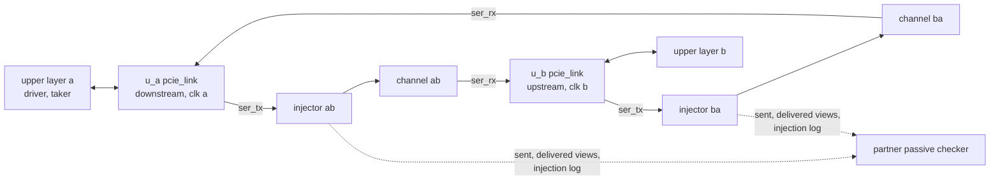

# pcie_link DV plan

How `pcie_link` is verified: the back-to-back end-to-end bench of the
[HAS end-to-end plan](../../arch/link/HAS.md#end-to-end-plan), with the
independent partner's [passive mode](../dll/PASSIVE.md) as the
second opinion. Each stacked IP keeps its own unit DV
([`dll`](../dll/DV_PLAN.md), [`phy`](../phy/DV_PLAN.md)); this bench
verifies the stack wiring and the stack-level targets through the `link`
ports.

## Strategy

- **Top:** [`pcie_link_e2e_tb.sv`](../../../../src/dv/link/tb/pcie_link_e2e_tb.sv)
  holds two `pcie_link` instances, a (downstream) and b (upstream), each
  on its own clock; each one's `ser_rx_clk_i` is the far clock. Every
  `link` port is a top port prefixed `a_` or `b_`. The parameter `CREDITS`
  picks the [credit configuration](../../arch/link/HAS.md#credit-configurations)
  (0 default, 1 finite minimum, 2 finite default sizes, 3 all infinite,
  4 asymmetric: a minimum, b default), echoed per end on `<e>_cfg_fc_o`.
  `TIMEOUT_DIV` is 1024 (link-up in about 10000 cycles) and
  `ERR_TIMEOUT_DIV` 1, as the HAS bench sets. The top taps the
  packet-stream nets between each instance's `dll` and `phy`, which the
  [MAS](../../rtl/link/MAS.md#microarchitecture) names, onto its own
  `<e>_mon_*_o` ports for the environment's boundary Ack check.
- **Environment:** [`link_e2e_env.py`](../../../../src/dv/link/tb/link_e2e_env.py).
  One coroutine per clock, at each falling edge: the end samples its
  outputs and drives its inputs, then its serial word crosses its
  direction's injector and channel to the far end's `ser_rx_*`. b's clock
  is `ppm` off a's. While an end is in reset its receive lines are random.
- **Upper layers:** a transmit driver per end offers queued TLPs on
  `tlp_tx_*` (valid drops inside a TLP with probability 0.1) and reads
  `tlp_tx_ready_o` after driving the beat, which may depend on it. The
  traffic is the HAS mix: memory writes and completions with data of 4 to
  128 bytes, memory reads, configuration writes, each a quarter. A receive
  taker per end holds `tlp_rx_ready_i` at 1 when any of its classes is
  infinite (the [upper-layer obligation](../../arch/dll/HAS.md#receive),
  which the RTL asserts); otherwise it takes a set share of beats and
  stalls on request.
- **Injector:** [`pcie_link_injector_model.py`](../../../../src/dv/link/models/pcie_link_injector_model.py),
  at each transmitter's `ser_tx_data_o`. It decodes 8b/10b with the
  transmitter's running disparity and descrambles with its own LFSR (COM
  resets it, SKP holds it), so it follows the scrambler across SKP
  ordered sets. It holds 4 words, enough to see a TLP's sequence number or
  a DLLP's type before the packet leaves, applies one
  [class](../../arch/link/HAS.md#error-injection) per packet (on request,
  at a per-packet rate, or by the level switches that drop every Ack or
  every TLP), and re-encodes with its own running disparity, so nothing
  else changes on the line. It records the sent and delivered views and
  the injection log, timed at the `link` ports (sent at the transmitter's
  output, delivered plus the channel delay to the receiver's input).
- **Channel:** the `phy` e2e's
  [`pcie_phy_channel_model.py`](../../../../src/dv/phy/models/pcie_phy_channel_model.py),
  4 words of delay, for the line impairments (bit flips, slips, electrical
  idle).
- **Checks** ([HAS checks](../../arch/link/HAS.md#checks)), at every edge
  or at the end of the test:
  - one scoreboard per direction: each TLP accepted on one end's upper
    stream is the next delivered on the other, byte for byte; drained at
    the end. A requested link-down drops what was not delivered;
  - `dl_err_o` DL protocol error, Receiver overflow and Malformed TLP
    never pulse;
  - `link_up_o` 1 and `dl_state_o` DL_Active from the first DL_Active on
    (unless a test requests a link-down); in L0 `ltssm_state_o` is exactly
    `0x20`, never an L0s sub-state ([power states](../../arch/link/HAS.md#power-states));
  - each `fc_*_avail_o` in DL_Active at most the far end's advertisement,
    all ones for an infinite field, and back at the advertisement once
    drained;
  - liveness: 20000 cycles with nothing delivered while a TLP is
    outstanding fails;
  - reset values while `rst_i` is high, and the `dll` outputs at theirs
    while `link_up_o` is 0 ([reset values](../../arch/link/HAS.md#reset-values));
  - Ack latency at each end's `dll`-to-`phy` boundary, on the tapped nets:
    every TLP the `dll` gets good and in order is covered by an Ack or Nak
    whose `sop` the `phy` takes within 118 cycles of its `eop`, outside
    the times the LTSSM is out of L0;
  - the partner's passive checker on both views: credits, sequence, Ack
    and Nak, and Ack timing at the 140-cycle line bound (duplicates
    included). The environment passes it each end's out-of-L0 ranges,
    rollover pulses and link-downs and the line impairments, which tie
    its exemptions and allowances to their triggers ([`link` HAS, passive
    checker](../../arch/link/HAS.md#passive-checker)): a replay short by
    its newest TLP only at a rollover pulse while its last TLP goes out
    (or as the last of the sender's epoch, before its link-down), a cut
    TLP only at its exit from L0. The link-control tests require Acks
    timed after the relink. Every accepted TLP must have been judged
    once as a first transmission;
  - in the error-free entries (`e2e_smoke`, every `e2e_credits_*`): no Bad
    TLP, Bad DLLP, replay timeout or rollover pulse, no `rcv_err_o`, and
    neither end leaves L0. Credit starvation and stalls are no error:
    nothing is lost or replayed.
- **Directed classes:** the tests inject one class at a time with traffic
  both ways and check its pulses from the HAS: Bad TLP (and `rcv_err_o`
  for an invalid symbol) and a Nak for an LCRC error or a corrupted TLP;
  a dropped TLP gives Bad TLP and a Nak when a TLP follows, the sender's
  replay timeout when it was the last; Bad DLLP for a corrupted DLLP and
  no pulse for a dropped one; one Nak and at least two replay timeouts
  when the Nak is lost and the Nak'd TLP's replay corrupted; no pulse at
  the receiver of a duplicate; exactly 4 replay timeouts, 1 rollover, a
  retrain of both ends and no Bad TLP for the rollover.
- **Functional coverage:** `link_e2e_config` (credit configuration, ppm),
  `link_e2e_inject` (every class, each way, crossed), `link_e2e_recovery`
  (Bad TLP, Bad DLLP, replay timeout, rollover, retrain, `rcv_err_o`, a
  Nak sent, a duplicate acknowledged), `link_e2e_traffic` (each TLP kind
  each way, payload sizes), `link_e2e_credit` (each class starved on
  credits; the 4000- and 10000-cycle stalls) and `link_e2e_control` (Hot
  Reset, Disabled, Loopback).
- **Model unit tests:** [`test_pcie_link_injector_model.py`](../../../../src/dv/link/models/test_pcie_link_injector_model.py)
  checks the injector against a reference transmitter and a strict
  decoder (pass-through bit exact, each class, running disparity and the
  scrambler kept); the partner's passive mode has its own
  ([passive mode unit tests](../dll/PASSIVE.md#unit-tests)).

## Plan

All entries run on `pcie_link_e2e_tb`; credits are the default
(`CREDITS` 0) unless stated.

| Feature | Entry `name` | Level | Seeds / note |
| --- | --- | --- | --- |
| [Stack wiring](../../arch/link/HAS.md#stack-wiring) and [reset values](../../arch/link/HAS.md#reset-values): reset, link-up to DL_Active at both ends, 60 TLPs of the mix each way, every check, error-free | `e2e_smoke` | 0 | 1 |
| [Error injection](../../arch/link/HAS.md#error-injection): LCRC error, corrupted TLP, dropped TLP (with a TLP behind it, and as the last), each way, with their pulses | `e2e_tlp_errors` | 1 | 1 |
| Corrupted and dropped DLLP, the Nak class and the duplicate class, each way, with their pulses | `e2e_dllp_errors` | 1 | 1 |
| [REPLAY_NUM rollover](../../arch/link/HAS.md#error-injection), each way: 4 timeouts, 1 rollover, the retrain through the `retrain_req` OR, traffic resumes | `e2e_rollover` | 1 | 1 |
| Line impairments each way: flips, a slip, an electrical-idle dropout of 200 to 1000 cycles | `e2e_line` | 1 | 1 |
| Every per-packet class at random both ways, ±600 ppm; Bad TLP and Bad DLLP at least the corruptions | `e2e_mixed` | 1 | 1 |
| Hot Reset passed through ([stack wiring](../../arch/link/HAS.md#stack-wiring)): link down at both ends, `dll` outputs at reset values, link-up again, lossless after | `e2e_hot_reset` | 1 | 1 |
| [Credits](../../arch/link/HAS.md#credit-configurations): starvation (30% of beats taken, stalls of 4000 and 10000 cycles) and recovery, no overflow, credits back when drained, error-free; both ends starve (b only, into a's minimum, when asymmetric) | `e2e_credits_minimum`, `e2e_credits_finite`, `e2e_credits_asymmetric` | 1 | 1 each; `CREDITS` 1, 2, 4 |
| The same with every class infinite (no stall) | `e2e_credits_infinite` | 1 | 1; `CREDITS` 3 |
| Disabled and Loopback passed through | `e2e_disable`, `e2e_loopback` | 2 | 1 each |
| Soak: random classes, line flips and credit stalls together, 1000 TLPs each way, ppm from the seed, in every credit configuration | `e2e_soak_default`, `e2e_soak_minimum`, `e2e_soak_finite`, `e2e_soak_infinite`, `e2e_soak_asymmetric` | 2 | 3, 3, 2, 2, 2; `CREDITS` 0 to 4 |
| Seed sweeps of the directed and mixed tests | `e2e_tlp_errors_sweep`, `e2e_dllp_errors_sweep`, `e2e_rollover_sweep`, `e2e_line_sweep`, `e2e_mixed_sweep` | 2 | 2, 2, 2, 3, 4 |

## Gaps

| Feature | Owning issue |
| --- | --- |
| [Throughput targets](../../arch/link/HAS.md#throughput) end to end | [#216](https://github.com/amichai-bd/pcie-factory/issues/216) |
| The `ltssm_state_o` to `pkt_tx_valid` path on the FPGA and ASIC timing reports ([MAS timing](../../rtl/link/MAS.md#timing)) | [#218](https://github.com/amichai-bd/pcie-factory/issues/218), [#219](https://github.com/amichai-bd/pcie-factory/issues/219) |

## Coverage holes

The two gaps above add no stimulus to this bench's code coverage (a
throughput measurement and the implementation timing reports), so the
floors apply. Floors in [`level2.yaml`](../../../../src/dv/link/regress/level2.yaml),
checked by every `--coverage` run that selects level 2 (the nightly runs
levels 0 to 2): line 90.2, toggle 79.5, functional 100. Merged over levels
0 to 2 ([#217](https://github.com/amichai-bd/pcie-factory/issues/217)),
over the whole stack that `link.rtl.f` reaches: line 90.72% (1379 of 1520
points), toggle 80.08% (24641 of 30770), functional 100% (82 of 82 bins in
the six covergroups the level file names). The line and toggle floors are
the merged values less 0.5 points, rounded down to a tenth
([floor margin](../../../bkm/dv.md#coverage)).

Verilator merges the two ends into one copy of each block when they share
parameters (`u_*`), and keeps a copy per parameter set otherwise: the
`dll` and its receive buffer once per credit configuration, the
asymmetric configuration's two ends apart. The 141 line points not hit,
by cause:

| Cause | Points | Where |
| --- | ---: | --- |
| Tied off by `link` ([power states](../../arch/link/HAS.md#power-states)) | 40 | The `mac` L0s sub-states (receive and transmit), the L1 and L2 states and the `pm_state` request arc, the FTS ordered sets they send (`pcie_mac_ltssm.sv` 35, `pcie_mac_os.sv` 2, the transmit-mode table in `pcie_mac_pkg.sv` 3). |
| Not reached by two compliant ends | 63 | Behaviour that two conforming stacks over this channel never produce, each covered by the [`mac`](../mac/DV_PLAN.md), [`pcs`](../pcs/DV_PLAN.md) or [`dll`](../dll/DV_PLAN.md) unit DV ([granularity](../../../bkm/rtl.md#granularity)): Polling.Compliance and the compliance pattern, receiver detection with no receiver, the Polling and Configuration timeouts and their fallbacks, the Configuration and Recovery error exits (PAD and renumbering runs, mismatching TS, the `idle_to_rlock` count), Disable Scrambling, the LTSSM timer's saturation, framing errors from a K symbol inside a packet, the elastic buffer's overflow and underflow (outside ±600 ppm), the encoder's unsupported K and run-length check, the aligner's tail case; in the `dll`, a DLLP of the wrong length or an unknown type, a packet beyond the beat counter and the InitFC group resend (`mac` 44, `pcs` 14, `dll` 5). |
| Elaboration only or tool artefact | 29 | `pcie_mac_pkg.sv`: `err_timeout`, called only for `localparam` values; the early `return` branches of `run_next` ([`mac` plan](../mac/DV_PLAN.md#coverage-holes)); the 23 arms of `arc_target`, called only with the constant indices of unrolled loops (`step_end_arc`, `arc_target_listed`), which Verilator folds at elaboration. |
| Unreachable by construction | 9 | The RAM lane-disable branch of each `common_sdp_ram` copy (5: `LANES` is 1), the `dll` receive buffer's full branch (`noroom`, [`dll` plan](../dll/DV_PLAN.md#coverage-holes)), and the `default` arms of the LTSSM's state groups, the ordered-set kind and the transmit mode. |

The 6129 toggle points not hit, by cause:

| Cause | Points | Signals |
| --- | ---: | --- |
| Hit in another parameter set or at the other end | 1270 | The same bit and direction toggles in another credit configuration's copy, or at the other end of the asymmetric configuration (for example, the limit and infinite-field bits of the finite configurations, the larger receive buffer's address bits, a request input driven at one end only). |
| `dll`: the causes of its [unit plan](../dll/DV_PLAN.md#coverage-holes) | 2624 | Constant per build (credit parameters, InitFC bodies: 718), constant by the DLLP format (Ack, Nak and UpdateFC reserved and type bits: 520), one TLP's credits (917), large data credits (238), receive buffer full (34), credit counter top bits (174), the transmit block's constant bits (18), RAM lanes (5), counted in each copy. |
| `dll`: behaviour the stack does not produce | 579 | The bench checks that no DL protocol error, Receiver overflow or Malformed TLP pulses (`err_o`, `rx_overflow`, `malformed_tlp`, `tlp_tx_err`, the error flags of `u_fc`, `u_tlp_rx` and `u_tlp_tx`), the `phy` never delivers a nullified TLP (the `dll` never nullifies), credits available never exceed the advertisement (their upper bits), and sequence numbers stay below 1024 (at most 1000 new TLPs each way per link-up: their top bits in `u_tlp_tx` and `u_tlp_rx`); the DLLP assembly of a wrong-length DLLP, the InitFC group timer's top bits and the rollover hold counter's top bits. Each is reached in the `dll` unit DV. |
| `link` ports | 204 | `dl_err_o` (never pulses, as checked), the upper bits of `fc_*_avail_o` (at most the advertisement), `pkt_rx_nullify` (never set), and inputs the bench holds constant at an end: `port_role_i`, `retrain_req_i`, `ser_tx_rxdet_i`, and the control requests in the copies that never get them. |
| `mac` and `pcs`: power states tied off | 394 | The L0s, L1 and L2 logic: FTS counts and requests, `pm_state`, PM waits, electrical-idle ordered sets for power entry, power-down and the receive and transmit sub-states. |
| `mac` and `pcs`: not reached by two compliant ends, or constant by design | 1058 | Compliance, polarity inversion (the channel never inverts), link and lane numbers other than 0 and N_FTS other than the default (both ends use them), TS control bits, Disable Scrambling, the Configuration and Recovery error-exit run counters and mismatch counts, the LTSSM timer's top bits, the frame's second receive-queue slot and its nullify path, the elastic buffer's fill extremes and the decoder's error classes. Each is covered by the [`mac`](../mac/DV_PLAN.md#coverage-holes), [`pcs`](../pcs/DV_PLAN.md#coverage-holes) or [`phy`](../phy/DV_PLAN.md#coverage-holes) plan, or listed there as a hole with its reason. |
