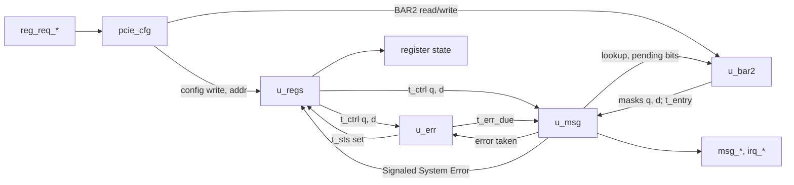

# pcie_cfg MAS

How `pcie_cfg` implements its [HAS](../../arch/cfg/HAS.md): four blocks
of the one `cfg` IP joined by the top, which owns the
[register access](../../arch/core/TL_CFG.md#register-access) handshake
([#289](https://github.com/amichai-bd/pcie-factory/issues/289)). The HAS,
[REGISTERS.md](../../arch/cfg/REGISTERS.md) and
[CAPS.md](../../arch/cfg/CAPS.md) own the rules and the map; this page
owns how the blocks apply them.

## Top

- **Handshake.** `reg_req_ready_o` is a register, 1 out of reset except
  in the cycle after a take. A take at edge E completes with
  `reg_cpl_valid_o` in the cycle after E, a read with
  `reg_cpl_data_o` in that cycle: a configuration read's DW is registered
  at E from `u_regs`; a BAR2 read's DW comes from `u_bar2` (its RAM output
  or its own read register). So `reg_cpl_valid_o` never waits on anything,
  `msg_ready_i` included.
- **Register state.** `mem_space_en_o`, `bus_master_en_o` and `d_state_o`
  come from `u_regs`' `t_ctrl` (register outputs); `bus_num_o`,
  `dev_num_o`, the bases, `cpl_timeout_dis_o`, `max_payload_o` and
  `max_read_req_o` straight from `u_regs`' registers.
- **Edge order.** At one edge: a read sees the state before it; the offer
  shown after it was chosen from the state before it; then the message
  take, the register write, the error events and the application's
  request apply, in that order, and a held offer or a waiting request that
  may no longer go out is withdrawn or turned pending
  ([Decisions](#decisions)). Blocks see a write through `t_ctrl` twice:
  `ctrl_q` (before the edge) and `ctrl_d` (after this edge's write).

## Package

[`pcie_cfg_pkg.sv`](../../../../src/rtl/cfg/pcie_cfg_pkg.sv) holds the DW
indices of the implemented DWs, the read-only DW values, the RW masks and
the RW reset value of Device Control, the D-state, message-kind and
interrupt-status codes, and the types:

| Type | Fields |
| --- | --- |
| `t_ctrl` | The register state the blocks use: Memory Space, Bus Master, Parity Error Response and SERR# enables, PowerState, MSI Enable, address and data, MSI-X Enable and Function Mask, the four Device Control reporting enables. |
| `t_sts` | The RW1C bits set at one edge: the five Status bits and the four Device Status error bits. |
| `t_err_due` | One due flag per error message kind. |
| `t_src`, `t_offer` | What an offer came from (error, the application's request, the MSI pending flag, an MSI-X pending bit) and the offer: kind, address, data, mode and vector. |
| `t_app` | The application's request held from its take to its done: mode and vector. |
| `t_entry` | An MSI-X table entry as one RAM word: data, upper address, address. |

Helpers: `be_mask`, `wr_rw` (an RW write of the enabled bytes), `wr_w1c`
(the RW1C bits written 1) and `hit` (a write to one DW).

## Configuration space

[`pcie_cfg_regs.sv`](../../../../src/rtl/cfg/pcie_cfg_regs.sv) keeps one
32-bit register per DW that has RW bits (Command, Cache Line Size, BAR0,
BAR2, Interrupt Line, PowerState, the four MSI DWs, MSI-X control, Device
Control, Link Control, Device Control 2), each holding only its RW bits
(reset 0, Device Control 0x2810), plus the nine RW1C status bits and the
captured bus and device number.

- **Write.** At a configuration write's take, each register's next value
  is `wr_rw` of its RW mask (BAR0's mask follows `BAR0_ADDR_W`); a
  PowerState write of 1 or 2 uses an empty mask, so the field keeps its
  value. Every configuration write, to any DW, loads `bus_num_o` and
  `dev_num_o`.
- **RW1C.** A status bit's next value is its value cleared by a write of
  1 to it, then set by this edge's events (`t_sts` from `u_err`, and
  Signaled System Error from `u_msg`): an event and a clear at one edge
  leave it set.
- **Read.** A combinational `case` on `reg_req_addr_i` gives the DW: the
  register's RW bits ORed with the DW's read-only value (IDs, Class Code
  and Table Size from the parameters, the status bits, Transactions
  Pending from `tl_np_pending_i`); every other DW of the 1024 is 0. The
  top registers it at the take.
- **Checks.** The parameter ranges are `COMMON_ASSERT_PARAM`s;
  `a_rw_only` (Command, Device Control and BAR0 hold only RW bits) and
  `a_pstate_d0_d3` (PowerState is D0 or D3hot) are assertions.

## Errors

[`pcie_cfg_err.sv`](../../../../src/rtl/cfg/pcie_cfg_err.sv) is the
[error table](../../arch/cfg/HAS.md#errors) as logic on the event pulses:

- **Status.** Detected Parity Error on `tl_err` 3 or 4, Master Data
  Parity Error on `tl_err` 4 under Parity Error Response (from `ctrl_d`),
  Received Master and Target Abort on `tl_err` 7 and 8, Unsupported
  Request Detected on `tl_err` 0 or 1, and the class bits: Correctable
  (`tl_err` 1 and 5, `dl_err` 0 to 3, `rcv_err`), Non-Fatal (`tl_err` 0,
  3, 4 and 6), Fatal (`tl_err` 2, `dl_err` 4 to 6).
- **Decision.** From `ctrl_d`: ERR_COR under Correctable Error Reporting
  Enable, ERR_NONFATAL under Non-Fatal Error Reporting Enable or SERR#,
  ERR_FATAL under Fatal Error Reporting Enable or SERR#; the two UR events
  also need Unsupported Request Reporting Enable.
- **Due flags.** `due_d = ((due_q & ~take) | decided) & D0`, D0 from
  `ctrl_d`: a decided message merges with one still due, a take clears
  its kind, and leaving D0 discards all three. `a_take_due` checks that a
  take clears a due kind.

## BAR2

[`pcie_cfg_bar2.sv`](../../../../src/rtl/cfg/pcie_cfg_bar2.sv) holds the
[MSI-X table](../../arch/cfg/CAPS.md#bar2):

- **RAM.** The three address and data DWs of every entry are one 96-bit
  word of a `common_sdp_ram` (`2^ceil(log2(MSIX_TABLE_SIZE))` words, at
  least 2, 12 byte lanes): a BAR2 write of DW `4n + f` (f 0 to 2) writes
  word n's lanes `4f` to `4f + 3` under the byte enables; the RAM is not
  reset. Its read port reads a BAR2
  read's word at the take, or the word `u_msg` looks up for an MSI-X
  write; `u_msg` never looks up at an edge with a BAR2 access
  (`a_one_reader`). `entry_o` is the RAM output with address bits 1:0
  forced 0 (read-only 0: stored as written, cleared on every read, a word
  never written included).
- **Mask bits.** One flop per vector, reset 1, written by bit 0 of DW
  `4n + 3` under byte enable 0; `u_bar2` gives `u_msg` both the value
  before the edge and after it.
- **Read.** A BAR2 read registers the mask bit, the pending-bit DW
  (`u_msg`'s bits, 0 at and above `MSIX_TABLE_SIZE`) or 0, and which RAM
  lane to show; in the completion cycle `rd_data_o` is the RAM lane for a
  table DW, else the register.

## Messages and interrupts

[`pcie_cfg_msg.sv`](../../../../src/rtl/cfg/pcie_cfg_msg.sv) holds the
application's request (`t_app`), the MSI pending flag, the MSI-X pending
bits, the held offer (`t_offer`) and the lookup state.

- **Candidate.** While no offer is held and the function is in D0 (from
  `ctrl_q`), the candidate by [priority](../../arch/cfg/HAS.md#messages):
  a due error message (fatal, non-fatal, correctable), the application's
  request, the MSI pending write when MSI may go out, the lowest pending
  MSI-X vector that may go out (pending, unmasked, MSI-X on, Function Mask
  clear, Bus Master Enable, D0).
- **Lookup.** An MSI-X candidate needs its table entry: the block reads
  vector v at one edge (not at an edge with a BAR2 access) and loads the
  offer at the next edge if v is still the candidate; any BAR2 access or
  a load drops the looked-up word. An error or MSI candidate loads at
  once; MSI data is `ctrl_q`'s Message Data in `[15:0]`.
- **Load and withdrawal.** The offer loaded at an edge, or held through
  it, stays up only if it may still go out after the edge's write: D0,
  and for an interrupt write Bus Master Enable and its mode's enable
  (MSI-X Enable, or MSI Enable for an MSI write), all from `ctrl_d`. A
  mask does not withdraw. After a take, no offer loads at that edge.
- **Take.** `msg_valid_o` with `msg_ready_i` clears what the offer came
  from: the error kind's due flag (to `u_err`; Signaled System Error to
  `u_regs` when it is non-fatal or fatal and SERR# is 1 in `ctrl_q`), the
  application's request (`irq_done_o`, sent), the MSI pending flag or the
  vector's pending bit.
- **The application's request.** At its take, from `ctrl_d`, the masks
  after the edge and the pending state after this edge's take: under
  MSI-X, pending (its bit set) if its bit is already set or it may not go
  out, else held as the request; under MSI, pending (the flag set) if the
  flag is set or it is not allowed, else held; with neither, dropped. A
  held request that is offered and withdrawn, or waiting and no longer
  sendable, turns pending at that edge (MSI-X: its bit; MSI: the flag
  under MSI Enable, else its vector's bit under MSI-X, else dropped).
- **Outputs.** `irq_done_o` and `irq_status_o` are registers set at the
  edge that resolves the request; `irq_ready_o` is a register, 0 from the
  take to the cycle after `irq_done_o`. The MSI pending flag is ANDed with
  MSI Enable after the edge, so clearing MSI Enable clears it.
- **Checks.** `a_irq_vector` (a request's vector is below
  `MSIX_TABLE_SIZE`), `a_no_offer_outside_d0`, `a_ready_idle`,
  `a_app_sendable` (a request not offered may go out), `a_offer_stable`
  (an offer holds its fields until taken or withdrawn) and `a_msi_pend_en`.

## Decisions

| Choice | Rationale | Rejected |
| --- | --- | --- |
| Edge order: read before the edge; offer chosen before it; take, write, events, request at it | One fixed order that the architecture model can follow in DV (one call per step); a take is of what `tl` saw; a write's enables judge the events and request of its own edge, and an event wins over an RW1C clear. | Events judged by the enables before the write (a second set of enables in `u_err`, and a clear winning over a set). |
| The offer chosen from the state before the edge, withdrawn at once by the edge's write | Keeps the candidate logic on registers (priority, pending vector search) and still applies the [withdrawal](../../arch/core/TL_CFG.md#withdrawal) at the edge of the write that causes it. | Choosing from the next state (the vector search after the write, the take and the request, all in one cycle). |
| MSI-X entry read by a lookup one edge before the offer, re-checked at the load | A RAM read takes an edge; re-checking the candidate at the load keeps the priority exact (an error message decided in between goes first) and the entry is read as it stands when the write is offered. | Holding the address and data of every entry in flops (64 × 96 flops, against F4); the BAR2 access waiting for the lookup (`reg_req_ready_o` would depend on messages). |
| A lookup never shares an edge with a BAR2 access | One read port; a same-edge table write would make the looked-up word stale. The next free edge serves it: `tl` leaves a cycle between accesses. | A second read port, or forwarding the write into the offer. |
| One RAM word per entry, 12 byte lanes, mask bits in flops | One read gives the whole write (address and data); byte enables map to lanes; the mask bits reset to 1, which a RAM cannot. | Three words per entry (three reads per offer). |
| `common_sdp_ram` | The shared simple dual-port RAM the `dll` uses, with its FPGA and ASIC backends; a write and a read at one edge need two ports. | `common_sync_ram` (one port for both). |
| Registers hold only their RW bits; read-only bits added at the read | No reset value to keep for constant bits; the read `case` is the map. | Whole-DW registers with masks on every write. |
| Completion one cycle after the take, reads registered | Every output a register; the HAS allows 1 to 4 cycles. | A combinational read data path to `tl`. |
| The take, the RW1C bits and the status merge each in their own `always_comb` | They feed and read the other blocks; one block per concern keeps Verilator from seeing a false combinational loop. | One `always_comb` per module. |

## Timing

- One clock (`clk_i`, 125 MHz), synchronous active-high reset; no
  crossings. Every output is a register or a function of registers and
  the parameters.
- Register access: taken at edge E, completed in the cycle after E (1
  cycle, within the HAS's 4); `reg_req_ready_o` is 0 in that cycle, so one
  access per 2 cycles. A write's effect on every output is at E.
- Interrupt request: taken at E; a dropped or pending one is done in the
  cycle after E (1 cycle, within 4); `irq_ready_o` returns the cycle after
  the done. A sent one: the edge at which `tl` takes its write sets
  `irq_done_o`, so the done is in the cycle that edge starts.
- Messages: a candidate made at edge E (an error decided, a request
  held, a vector unmasked) loads at E+1 and is offered in the cycle after
  it; an MSI-X write loads one edge later (the lookup at E+1), or more
  while BAR2 accesses take the read port. After a take the next offer
  loads at the following edge.
- Critical path: the 64-vector pending search (`pba & open`, lowest set
  bit) into the candidate, the lookup compare and the offer register; and
  the write path from `reg_req_*` through `wr_rw` and the `ctrl_d`
  enables into the withdrawal, the error decision and the request's
  resolution (a few gate levels after the 10-bit address decode).

## Files

| File | Holds |
| --- | --- |
| [`pcie_cfg_pkg.sv`](../../../../src/rtl/cfg/pcie_cfg_pkg.sv) | [Package](#package): map constants, types, helpers. |
| [`pcie_cfg_regs.sv`](../../../../src/rtl/cfg/pcie_cfg_regs.sv) | [Configuration space](#configuration-space): registers, writes, RW1C bits, bus and device number, read, parameter checks. |
| [`pcie_cfg_err.sv`](../../../../src/rtl/cfg/pcie_cfg_err.sv) | [Errors](#errors): status bits, message decision, due flags. |
| [`pcie_cfg_bar2.sv`](../../../../src/rtl/cfg/pcie_cfg_bar2.sv) | [BAR2](#bar2): the MSI-X table RAM, the mask bits, the BAR2 read. |
| [`pcie_cfg_msg.sv`](../../../../src/rtl/cfg/pcie_cfg_msg.sv) | [Messages and interrupts](#messages-and-interrupts): request resolution, pending state, offer, lookup, withdrawal, take. |
| [`pcie_cfg.sv`](../../../../src/rtl/cfg/pcie_cfg.sv) | [Top](#top): the access handshake and completion, the blocks. |
| [`cfg.rtl.f`](../../../../src/rtl/cfg/cfg.rtl.f) | The shared vocabulary (`common_macros.rtl.f`), the shared RAM (`common_sdp_ram.rtl.f`), the package, the blocks, the top. |
