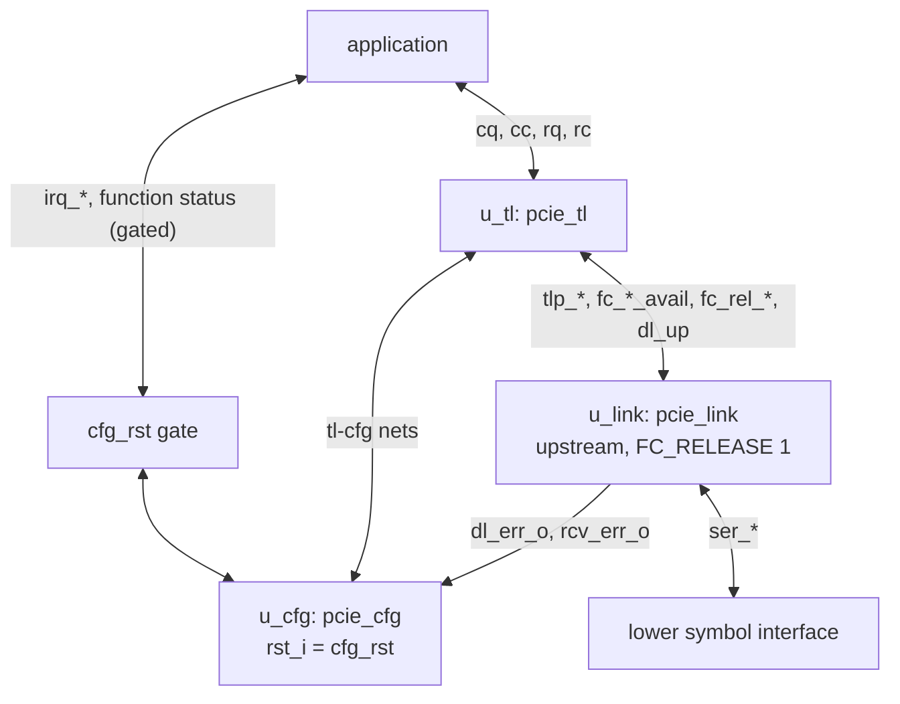

# pcie_core MAS

How `pcie_core` implements its [HAS](../../arch/core/HAS.md): a thin
integration of three top-level IPs, `pcie_link`, `pcie_tl` and `pcie_cfg`,
joined by the [stack wiring](../../arch/core/HAS.md#stack-wiring) and the
[tl-cfg interface](../../arch/core/TL_CFG.md), with no logic of its own but
the `cfg` reset and the gate on the `cfg` outputs to the application.

## Microarchitecture

| Instance | Module | Parameters from `core` | Fixed |
| --- | --- | --- | --- |
| `u_link` | `pcie_link` | `FC_PH`, `FC_PD`, `FC_NPH`, `FC_NPD`, `TIMEOUT_DIV`, `ERR_TIMEOUT_DIV`, `LOWER`, `GPIO_CLK_DIV` | `FC_CPLH` 0 and `FC_CPLD` 0 (infinite), `FC_RELEASE` 1 |
| `u_tl` | `pcie_tl` | `FC_PH`, `FC_PD`, `FC_NPH`, `FC_NPD`, `CPL_TIMEOUT_DIV`, `BAR0_ADDR_W` | |
| `u_cfg` | `pcie_cfg` | `BAR0_ADDR_W`, `MSIX_TABLE_SIZE` and the six ID parameters | |

`tl` and `link` take the same `FC_*` values, so `tl` sizes its receive
queues by the credits `link` advertises ([credits](../../arch/core/HAS.md#credits)).

## Wiring

All nets are flat `logic`, named as the [tl-cfg page](../../arch/core/TL_CFG.md#signals)
names them (`reg_req_*`, `reg_cpl_*`, `bus_num`, `dev_num`, `bar0_base`,
`bar2_base`, `cpl_timeout_dis`, `mem_space_en`, `bus_master_en`, `d_state`,
`tl_np_pending`, `slot_pwr_*`, `tl_err`, `msg_*`), or after the `link`
port they carry without its `_o`/`_i` suffix (`tlp_tx_*`, `tlp_rx_*`,
`fc_*_avail`, `fc_rel_*`). The testbench taps `tl_err` and
`tl_np_pending` ([DV plan](../../dv/core/DV_PLAN.md#strategy)).

| From | To | Nets |
| --- | --- | --- |
| `u_link` | `u_tl` | Upper TLP stream both ways, the six `fc_*_avail`, `dl_up_o` as `dl_up_i`. |
| `u_tl` | `u_link` | `fc_rel_p`, `fc_rel_pd`, `fc_rel_np`, `fc_rel_npd`: the [credit release](../../arch/dll/HAS.md#credit-release). |
| `u_link` | `u_cfg` and `core` ports | `dl_err_o`, `rcv_err_o` ([link to cfg](../../arch/core/TL_CFG.md#link-to-cfg)). |
| `u_tl` ↔ `u_cfg` | | The tl-cfg interface, port for port. |
| `core` ports | `u_tl` | `clk_i`, `rst_i`, the four application streams. |
| `core` ports | `u_cfg` | `clk_i`, the interrupt port inputs. |
| `u_cfg` | `core` ports | Through the gate below: `irq_done_o`, `bus_master_en_o`, `mem_space_en_o`, `d_state_o`, `max_payload_o`, `max_read_req_o`; `irq_ready_o` and `irq_status_o` direct. |
| `core` ports | `u_link` | `clk_i`, `rst_i`, the lower symbol interface and the GPIO pins; `port_role_i` 1, `retrain_req_i`, `hot_reset_req_i`, `disable_req_i` and `loopback_req_i` 0. |

## Reset

| Net | Is | Reaches |
| --- | --- | --- |
| `rst_i` | The `core` reset | `u_link` and `u_tl`; `tl` adds `dl_up_i` 0 itself ([`tl` MAS](../tl/MAS.md#top)). |
| `cfg_rst` | `rst_i \| ~dl_up_o` | `u_cfg` `rst_i`, and the output gate. |

`cfg` resets synchronously: its registered outputs reach their reset
values only the cycle after the first edge at which its `rst_i` is
sampled 1, and in the first cycle of `cfg_rst` still show their old values
([`cfg` reset](../../arch/cfg/HAS.md#reset)). The HAS reset values hold in every
cycle where `rst_i` is 1 or `dl_up_o` is 0
([reset](../../arch/core/HAS.md#reset)), so `core` forces each gated
output to its reset value while `cfg_rst` is 1: `irq_done_o`,
`bus_master_en_o` and `mem_space_en_o` to 0, `d_state_o` to
D0, `max_payload_o` to 0 and `max_read_req_o` to 2. `irq_ready_o` needs
no gate: `cfg` already drives it 0 from its reset input, combinationally
([`cfg` MAS](../cfg/MAS.md)). The tl-cfg nets need
no gate: `tl` is in reset in those cycles and ignores them. `tl` gates its
own outputs the same way.

## Decisions

| Choice | Rationale | Rejected |
| --- | --- | --- |
| Gate the `cfg` outputs to the application with `cfg_rst` in `core` | The core HAS requires the reset values in every cycle where `rst_i` is 1 or `dl_up_o` is 0, and `dl_up_o` falls with no warning, so a synchronous reset alone leaves one stale cycle; one AND per output closes it from the first cycle without changing `cfg`. The `cfg` HAS settles that lag as its contract: registered outputs at their reset values from the cycle after the first edge at which `rst_i` is sampled 1, the two readys 0 in every cycle `rst_i` is 1 ([`cfg` reset](../../arch/cfg/HAS.md#reset), [#348](https://github.com/amichai-bd/pcie-factory/issues/348)), so `core`, the one consumer that needs the values a cycle earlier, gates them. | Gating inside `cfg` (logic on every output for a need only `core` has; the `cfg` HAS rejects it); letting the outputs lag a cycle (breaks the core HAS reset rule; the link-down e2e caught it). |
| `cfg_rst` built in `core`, `dl_up_o` into `tl` | The `tl` port set takes `dl_up_i`; the `cfg` ports take one reset, which its HAS defines as `rst_i` or data link down inside `core`. | A shared reset block (one OR). |
| Same `FC_*` into `link` and `tl` | `tl` queues are sized by what `link` advertises; one parameter set cannot disagree. | Separate parameters. |
| The `rst_i` lint waiver for `core` | The `link` stack takes `rst_i` both into the pcs receive reset synchronizer and synchronously, as the `link` top does ([lint waivers](../../../../src/lint_waivers.yaml)). | Re-synchronizing `rst_i` in `core` (a crossing the `link` HAS does not call for). |

## Timing

- **Clocks:** `clk_i` for everything but the `link` receive front end on
  `ser_rx_clk_i` (on `gpio_rx_clk_i` at `LOWER` 1); `core` adds no
  crossing. Both clock inputs carry a `cdc-domain` annotation naming
  themselves, and the top declares `// cdc-params: LOWER=1`, so the CDC
  check analyzes both builds ([`link` MAS](../link/MAS.md#timing)).
- **Latency added by `core`:** none; the gate and `cfg_rst` are one level
  of logic each, after the `cfg` registers and `dl_up_o`.
- **Measured end to end** ([DV plan](../../dv/core/DV_PLAN.md#measured)):
  link-up to DL_Up about 10300 cycles with `TIMEOUT_DIV` 1024; the host
  model's enumeration (IDs, capability walk, BAR sizing) about 3000 cycles;
  the throughput targets met, at least 0.998 of the `link` rate.
- **Critical path:** inside `tl`, `cfg` and `link`; `core` adds the
  output gates. On the DE2-115 at 50 MHz the worst path is inside `tl`'s
  transmit side, with +1.065 ns of slack
  ([FPGA results](../../fpga/core/FPGA.md#results)); `tl`'s registered
  transmit output stage keeps every path into the `link` starting at a
  flop. ASIC inputs: [#296](https://github.com/amichai-bd/pcie-factory/issues/296); routed ASIC timing: [#363](https://github.com/amichai-bd/pcie-factory/issues/363).

## Files

| File | Holds |
| --- | --- |
| [`pcie_core.sv`](../../../../src/rtl/core/pcie_core.sv) | The integration: the three instances, `cfg_rst` and the output gate. |
| [`core.rtl.f`](../../../../src/rtl/core/core.rtl.f) | `link.rtl.f`, `tl.rtl.f` and `cfg.rtl.f` through `-F`, then `pcie_core.sv`. |
