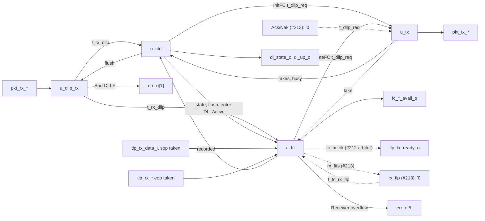

# pcie_dll MAS

How `pcie_dll` implements its [HAS](../../arch/dll/HAS.md): four blocks
of the one `dll` IP (decision record [0003](../../decisions/0003-m2-grill.md#decisions),
Q4) joined by the top. Today they carry the DLLP path, the data link
control states and the flow-control initialisation
([#211](https://github.com/amichai-bd/pcie-factory/issues/211)), and the
credit accounting on both sides with the transmit credit gate and UpdateFC
on returned credits ([#214](https://github.com/amichai-bd/pcie-factory/issues/214)).
The transmit replay path ([#212](https://github.com/amichai-bd/pcie-factory/issues/212))
and the receive check and Ack/Nak path
([#213](https://github.com/amichai-bd/pcie-factory/issues/213)) join as
blocks of their own at the slots named [below](#slots-for-the-tlp-paths),
and connect to flow control through the [credit interface](#credit-interface).
The HAS and its sub-pages ([DLLPs](../../arch/dll/DLLP.md),
[retry](../../arch/dll/RETRY.md), [flow control](../../arch/dll/FLOW_CONTROL.md))
own the rules; this page owns how the blocks apply them.

## Top

**Ports.** The top ports are the HAS ports, flat: they mirror the `phy`
packet stream and the HAS's single-meaning signals (M1 Q25 exception).
Inside, the receive beat (`t_pkt_rx`), the transmit beat (`t_pkt_tx`), a
received DLLP (`t_rx_dllp`), a DLLP request (`t_dllp_req`) and the
per-class credit values (`t_fc_vals`) are packed structs from the
[package](#package). The credit parameters keep the HAS checks
(`COMMON_ASSERT_PARAM`, one per parameter) and form the constant `ADV`,
this side's advertisement, which `u_ctrl` puts in InitFC and `u_fc` in
UpdateFC.

**Flush.** `u_ctrl`'s `flush_o` is 1 in DL_Inactive and in any cycle with
`link_up_i` 0, so every block takes its DL_Inactive values at the same
edge as the state does: a DLLP being collected is dropped, a DLLP
offered but not yet taken by the `phy` is withdrawn, limits, flags and
timers clear. A DLLP whose `sop` the `phy` has taken is finished up to its
`eop` ([transmit](#transmit)).

### Slots for the TLP paths

Until the TLP paths exist, the top ties the outputs and inputs they own:

| Signal | Tied to | Owner |
| --- | --- | --- |
| `tlp_tx_ready_o`, `retrain_req_o`, `err_o` bits 2 to 4 | 0 | #212: sequence numbers, LCRC, replay buffer and timer, REPLAY_NUM, Ack/Nak received |
| `tlp_rx_valid_o`, `tlp_rx_sop_o`, `tlp_rx_eop_o`, `tlp_rx_data_o`, `err_o` bits 0 and 6 | 0 | #213: TLP receive checks, receive buffer |
| `acknak_req` into `u_tx` (priorities 1 and 2) | `'0` | #213: Ack and Nak scheduling |
| `rx_tlp_good` into `u_ctrl` (a good TLP ends FC_INIT2) | 0 | #213 |
| `rx_tlp` into `u_fc`, the receive decision, and `rx_fits` from it ([credit interface](#credit-interface)) | `'0`; `rx_fits` read by no block | #213 |
| `fc_tx_ok` from `u_fc`, the credit gate ([credit interface](#credit-interface)) | read by no block (`tlp_tx_ready_o` is 0) | #212 (ANDs it into `tlp_tx_ready_o` on a `sop` beat) |
| The assertion that the upper layer never stalls `tlp_rx_ready_i` while `dl_up_o` is 1 and any `FC_*` is 0 ([HAS, Receive](../../arch/dll/HAS.md#receive)) | not yet written | #213 (the receive stream it guards) |
| `tlp_tx_eop_i`, `ltssm_state_i` inputs (the other upper-stream inputs reach only flow control) | read by no block (`COMMON_UNUSED_BITS`) | #212, #213 |

Each later block attaches where its tie is: a TLP source as priorities 5
and 6 of [`u_tx`](#transmit), the TLP receive path on the same `t_pkt_rx`
beat as `u_dllp_rx`, Ack and Nak on `acknak_req`, Ack/Nak received on
`t_rx_dllp` (`seq` already decoded), the gate and the receive decision
through the credit interface.

### Credit interface

How the TLP paths use flow control ([transmit](../../arch/dll/FLOW_CONTROL.md#transmit-accounting)
and [receive accounting](../../arch/dll/FLOW_CONTROL.md#receive-accounting)).
Consumption and returns come from the top ports, so the TLP blocks drive
only the gate's use and the receive decision.

| Signal (top) | Type | From, to | Contract |
| --- | --- | --- | --- |
| `fc_tx_ok` | `logic` | `u_fc` to #212 | 1 when in DL_Active the partner's credits cover the TLP whose first DW is on `tlp_tx_data_i` (class and credits by `tlp_cost`), by the gate rule for both its fields. Combinational from `tlp_tx_data_i` and registers. #212 makes `tlp_tx_ready_o` on a `sop` beat the AND of this and its own two conditions ([HAS, transmit](../../arch/dll/HAS.md#transmit)). |
| `tx_sop_take` | `logic` | top to `u_fc` | `tlp_tx_valid_i && tlp_tx_ready_o && tlp_tx_sop_i`: CREDITS_CONSUMED adds that TLP's credits at this edge. `a_consume_without_credit` stops a take the gate did not cover. |
| `rx_tlp` | `t_fc_rx_tlp` | #213 to `u_fc` | One cycle per good-LCRC TLP with the expected sequence number, in FC_INIT2 or DL_Active (`a_rx_tlp_outside_dl_up`): `malformed`, `no_hdr` (malformed and under 4 bytes) and the header's `dw0`. |
| `rx_fits` | `logic` | `u_fc` to #213 | Combinational from `rx_tlp.dw0` and registers: the TLP's credits are covered ([overflow check](../../arch/dll/FLOW_CONTROL.md#receive-buffer)). With `valid` and not `malformed`: 1, #213 stores the TLP and `u_fc` adds it to CREDITS_RECEIVED; 0, #213 discards it with no Ack or Nak and `u_fc` pulses Receiver overflow. |
| `rx_beat` | `t_tlp_beat` | top to `u_fc` | The upper receive stream: take (`tlp_rx_valid_o && tlp_rx_ready_i`), `sop`, `eop`, data. The `sop` beat gives the TLP's credits, the taken `eop` returns them. |

The receive buffer #213 builds holds, per class and field, the advertised
credits of a finite field and the reserve (`RX_RESERVE_HDR`, 8 headers;
`RX_RESERVE_DATA`, 24 data credits) of an infinite one; `rx_fits` never
admits more ([receive buffer](../../arch/dll/FLOW_CONTROL.md#receive-buffer)).

## Package

[`pcie_dll_pkg`](../../../../src/rtl/dll/pcie_dll_pkg.sv) holds the
control states (`t_dl_state`, coded as `dl_state_o`), the classes
(`t_fc_class`, P 0, NP 1, Cpl 2: group order, round-robin order and the
class nibble of an FC DLLP type), the DLLP type codes, the structs above
and each block's state struct, and the pure helpers:

| Helper | Does |
| --- | --- |
| `crc16` | The [CRC-16](../../arch/dll/DLLP.md#crc-16) bytes 4 and 5 of a 4-byte body: 32 bit-serial steps, unrolled into an XOR network. |
| `fc_body` | The body of an InitFC1, InitFC2 or UpdateFC for a class and value. |
| `dllp_decode` | Byte 0 to a kind; HdrFC, DataFC and AckNak_Seq_Num from their bits; reserved bits are not read. An FC type needs bit 3 and VC 0 and a class code other than 3, else the kind is "other". |
| `fc_record`, `fc_show`, `refresh_count`, `fc_get`, `fc_next` | The flow-control rules of [`u_fc`](#flow-control). |
| `tlp_cost` | A TLP's class and credits from Fmt bit 6, Type and Length ([classes](../../arch/dll/FLOW_CONTROL.md#classes-and-credits)); callers slice them from header DW0. |
| `fc_charge`, `fc_gate`, `fc_fits`, `fc_rx_base`, `fc_upd_vals`, `fc_free_ok` | Add a cost to its class; the transmit gate; the overflow check; CREDITS_ALLOCATED in DL_Inactive; an UpdateFC's values; the receive-space invariant. |

## DLLP receive

[`pcie_dll_dllp_rx`](../../../../src/rtl/dll/pcie_dll_dllp_rx.sv) watches
every valid beat of a DLLP-tagged packet (`t_rx_asm`): the `sop` beat
starts a count of beats and captures bytes 0 and 1, the second beat bytes
2 and 3. At the `eop` beat the packet is good when `pkt_rx_err_i` is 0, the
beat is the third (6 bytes), and its two bytes equal `crc16` of the four
captured; then `rx_dllp_o` carries the decoded DLLP for one cycle, else
`bad_dllp_o` pulses once ([receiving DLLPs](../../arch/dll/DLLP.md#receiving-dllps)).
Both are registered. Gaps inside the packet are waited out; a beat
without a `sop` outside a packet is ignored; TLP-tagged packets are left
to the TLP path. Under `flush_i` nothing is collected or reported, so a
DLLP in DL_Inactive is discarded without Bad DLLP. `nullify` is not read
(a DLLP is never nullified).

## Control

[`pcie_dll_ctrl`](../../../../src/rtl/dll/pcie_dll_ctrl.sv) holds
`t_ctrl_state`: the state, `grp_left` (InitFC DLLPs of the group not yet
taken: 3, 2, 1 send P, NP, Cpl), `grp_timer` (cycles since the group
started, saturating at 127) and `done` (FC_INIT2 may end)
([control states](../../arch/dll/HAS.md#data-link-control-states),
[initialisation](../../arch/dll/FLOW_CONTROL.md#initialisation)).

| From | Condition | To |
| --- | --- | --- |
| any | `link_up_i` 0 | DL_Inactive, everything cleared |
| DL_Inactive | `link_up_i` 1 | FC_INIT1, a group at once |
| FC_INIT1 | all three classes recorded (`u_fc`), no InitFC left to take, nothing on the stream | FC_INIT2, a group at once, `done` 0 |
| FC_INIT2 | `done`, no InitFC left to take, nothing on the stream | DL_Active |
| FC_INIT1, FC_INIT2 | no InitFC left to take and `grp_timer` at 127 | the same state, a new group |

`done` is set in FC_INIT2 by a received InitFC2 or UpdateFC of any class,
or a good TLP (#213); an InitFC1, and anything received before FC_INIT2,
leaves it 0. The InitFC request carries InitFC1 or InitFC2 by the state,
the class of `grp_left` and that class's `ADV` value; each take by
`u_tx` lowers `grp_left`. `enter_active_o` is 1 for the edge that enters
DL_Active. `dl_up_o` is 1 in FC_INIT2 and DL_Active.

## Flow control

[`pcie_dll_fc`](../../../../src/rtl/dll/pcie_dll_fc.sv) keeps, per class,
a `t_fc_limit` (recorded flag, infinite flags, CREDIT_LIMIT for headers
and data) ([transmit accounting](../../arch/dll/FLOW_CONTROL.md#transmit-accounting)):

- In FC_INIT1 the first InitFC1 or InitFC2 of a class records its HdrFC
  and DataFC (0 sets the infinite flag); later ones are ignored.
  `recorded_o` is 1 with all three recorded.
- In FC_INIT2 and DL_Active an UpdateFC sets the limit of each finite
  field; an infinite field keeps its flag and shows all ones.
- **Transmit.** `used_q` (`t_fc_vals`) is CREDITS_CONSUMED, adding the
  taken TLP's `tlp_cost` at `tx_sop_take`. `tx_ok_o` is the gate on the
  offered first DW, 0 outside DL_Active. `avail_o` is 0 outside DL_Active;
  in it, all ones for an infinite field, else limit less `used_q`.
- **Receive.** `alloc_q` and `rcvd_q` are CREDITS_ALLOCATED and
  CREDITS_RECEIVED for every field. DL_Inactive loads `alloc_q` with the
  advertisement, or the reserve for an infinite field, and `rcvd_q` with
  0, so one rule, `fc_fits`, is the overflow check for both kinds. A
  stored TLP adds to `rcvd_q`; a malformed one to both (nothing under 4
  bytes); the `eop` taken on the receive stream adds the cost captured
  from its `sop` beat (`up_cost_q`) to `alloc_q`. A decision that does
  not fit registers `ovf_q`, `err_o` bit 5, for one cycle.

UpdateFC transmit ([UpdateFC](../../arch/dll/FLOW_CONTROL.md#updatefc-scheduling)):
`upd` is what each class's UpdateFC carries, `alloc_q` with infinite
fields as 0 (`fc_upd_vals`); `sent_q` holds the values last taken
(DL_Inactive: `ADV`). A class is due when entering DL_Active set its
`due_q` bit, when `upd` differs from `sent_q` (credits returned), or when
its 11-bit count of cycles since its last UpdateFC was taken has
saturated at 2047 (the refresh). The request is the first due class from
the round-robin pointer, with its `upd` value; a take clears that class's
`due_q` bit and count, records `upd` in `sent_q` and moves the pointer past
it. Returns while an UpdateFC waits coalesce into it; one made after the
take makes the class due again.

Assertions: `a_take_without_due`; `a_consume_without_credit` (a taken
`sop` the gate did not cover); `a_rx_tlp_outside_dl_up`; and
`a_free_within_space`, the free credits of each class never above its
receive space (a return without a store).

## Transmit

[`pcie_dll_tx`](../../../../src/rtl/dll/pcie_dll_tx.sv) holds one packet
(`t_tx_state`: busy, the next beat, 6 bytes). It is free when idle or as
the stream takes the `eop` beat; then it takes the first valid request in
[transmit priority](../../arch/dll/RETRY.md#transmit-priority) (Ack/Nak,
InitFC, UpdateFC), loads the body with its `crc16`, and offers it from the
next cycle. `pkt_tx_valid_o` is 1 from load to the accepted `eop`, so a
request is never dropped while the `phy` holds ready low between packets,
and a packet once started is finished. `flush_i` withdraws only a packet
whose `sop` the `phy` has not taken; once taken (`started`: at an
earlier edge, or at this one, including the edge that samples `link_up_i`
0), the remaining beats, at most 2, go out up to `eop` with valid held, link down
or not, and no request loads under `flush_i`, so DL_Inactive then offers
nothing ([HAS, reset values](../../arch/dll/HAS.md#reset-values)). The tag
is always DLLP; a TLP source (#212) adds the tag and priorities 5 and 6.
Assertions: `a_ready_inside_packet` states the `phy` contract that ready
stays 1 from an accepted `sop` to its `eop`; `open_q` tracks a packet open
at the `phy` as the MAC does (set by an accepted `sop`, cleared only by an
accepted `eop` or reset), and `a_sop_inside_packet` and
`a_eop_follows_sop` check that no `sop` comes and valid never drops while
it is open, across a link-down too.

## Decisions

| Choice | Rationale | Rejected |
| --- | --- | --- |
| Four blocks now, each later issue a block of its own at a tie | The TLP paths attach without reworking the control or the DLLP path. | One control block with everything (each later issue would rewrite it). |
| A group is complete when its last DLLP's `eop` has been taken by `phy` | The plain reading of "the group being sent is complete" ([HAS](../../arch/dll/HAS.md#data-link-control-states)). | When the last DLLP is chosen (the state could change with an InitFC still on the stream). |
| A DLLP started before the link goes down is finished; one only offered is withdrawn | The [HAS decision](../../arch/dll/HAS.md#decisions): the MAC keeps a packet open until its `eop` whatever the link does, and a new `sop` before it breaks the contract. An offered `sop` the `phy` has not taken opened nothing. | Cutting at link-down (the next link-up's first DLLP would land inside the open packet); finishing an offered packet too (it would start in DL_Inactive). |
| Received DLLPs act one cycle after their `eop` (registered decode) | Keeps the CRC-16 network off the control paths. | Acting in the `eop` cycle. |
| The refresh count starts when the arbiter takes the class's UpdateFC | One count per class, cleared by its own take; the interval is 2048 cycles plus at most a packet's wait. | Counting from the `phy`'s acceptance. |
| Group timer and refresh counts saturate | No wrap can send an early group or UpdateFC. | Free-running counters. |
| Consumption and returns read from the upper-stream handshakes at the top | The HAS events are exactly a taken transmit `sop` and a taken receive `eop`; #212 and #213 need no extra wiring for them and cannot get them out of step with the ports. | A consume pulse from #212 and a return event from #213 (two more contracts to verify). |
| The gate takes `tlp_tx_data_i` alone, separate from the take | `tlp_tx_ready_o` depends on the gate; a struct carrying both the data and the take would make a false combinational loop. | One upper-beat struct for both. |
| An infinite field's receive counters start from the reserve | The reserve's free space is then `alloc_q − rcvd_q` like a finite field's, so one overflow rule and one return path serve both; the UpdateFC masks those fields to 0. | A separate occupancy counter per infinite field. |
| Receiver overflow registered | Every output from a register; the pulse follows the decision by one cycle. | A combinational pulse from #213's decision. |

## Timing

- One clock (`clk_i`, 125 MHz), synchronous active-high reset; no
  crossings. Every output is a register or a function of registers and
  the parameters.
- A received DLLP's effect: decoded at the edge after its `eop` beat;
  credits recorded and `done` set at the next edge; a state change at the
  edge after that.
- Transmit: the first DLLP of a group is offered one cycle after the state
  that wants it; back-to-back DLLPs follow with no gap of their own (the
  `phy` adds its framing cycle). DL_Inactive to FC_INIT1 to the first
  InitFC1 offered: two edges after `link_up_i` rises.
- Credits: `avail_o` changes in the cycle after a taken `sop` or a
  received UpdateFC's record; Receiver overflow pulses the cycle after
  the decision; a returned credit makes its class's UpdateFC due in the
  cycle after the `eop` is taken, so with a free stream it is offered one
  cycle later.
- Critical path: the 32-step CRC-16 XOR network from the receive byte
  register to the CRC compare, and from a request body to the transmit
  packet register. Each CRC bit is the parity of at most 32 input bits,
  about five levels of two-input XOR. The gate is an 8-bit and a 12-bit
  add, subtract and compare from `tlp_tx_data_i`, which #212
  puts in front of `tlp_tx_ready_o`.

## Files

| File | Holds |
| --- | --- |
| [`pcie_dll_pkg.sv`](../../../../src/rtl/dll/pcie_dll_pkg.sv) | [Package](#package): types, constants, CRC-16 and flow-control helpers. |
| [`pcie_dll_dllp_rx.sv`](../../../../src/rtl/dll/pcie_dll_dllp_rx.sv) | [DLLP receive](#dllp-receive). |
| [`pcie_dll_ctrl.sv`](../../../../src/rtl/dll/pcie_dll_ctrl.sv) | [Control](#control): the control states and the InitFC groups. |
| [`pcie_dll_fc.sv`](../../../../src/rtl/dll/pcie_dll_fc.sv) | [Flow control](#flow-control): limits, credit accounting and gate, credits available, overflow check, UpdateFC. |
| [`pcie_dll_tx.sv`](../../../../src/rtl/dll/pcie_dll_tx.sv) | [Transmit](#transmit): arbiter and DLLP sender. |
| [`pcie_dll.sv`](../../../../src/rtl/dll/pcie_dll.sv) | [Top](#top): parameter checks, the blocks, the ties. |
| [`dll.rtl.f`](../../../../src/rtl/dll/dll.rtl.f) | The shared vocabulary (`common_macros.rtl.f`), the package, the blocks, the top. |
