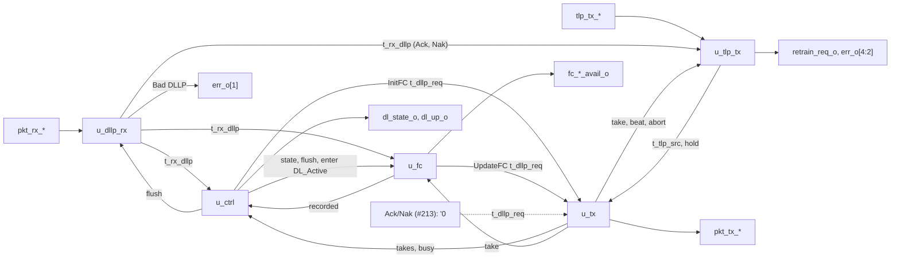

# pcie_dll MAS

How `pcie_dll` implements its [HAS](../../arch/dll/HAS.md): five blocks
of the one `dll` IP (decision record [0003](../../decisions/0003-m2-grill.md#decisions),
Q4) joined by the top. They carry the DLLP path, the data link control
states and the flow-control initialisation
([#211](https://github.com/amichai-bd/pcie-factory/issues/211)) and the
TLP transmit path: sequence numbers, LCRC, the replay buffer and timer,
REPLAY_NUM and received Ack and Nak
([#212](https://github.com/amichai-bd/pcie-factory/issues/212)). The
receive check and Ack/Nak path
([#213](https://github.com/amichai-bd/pcie-factory/issues/213)) and credit
accounting ([#214](https://github.com/amichai-bd/pcie-factory/issues/214))
join as blocks of their own at the slots named [below](#slots-for-the-tlp-paths).
The HAS and its sub-pages ([DLLPs](../../arch/dll/DLLP.md),
[retry](../../arch/dll/RETRY.md), [flow control](../../arch/dll/FLOW_CONTROL.md))
own the rules; this page owns how the blocks apply them.

## Top

**Ports.** The top ports are the HAS ports, flat: they mirror the `phy`
packet stream and the HAS's single-meaning signals (M1 Q25 exception).
Inside, the receive beat (`t_pkt_rx`), the transmit beat (`t_pkt_tx`), a
received DLLP (`t_rx_dllp`), a DLLP request (`t_dllp_req`), the
per-class credit values (`t_fc_vals`), the upper transmit beat
(`t_tlp_beat`) and the TLP source of the arbiter (`t_tlp_src`) are packed
structs from the [package](#package). The credit parameters keep the HAS checks
(`COMMON_ASSERT_PARAM`, one per parameter) and form the constant `ADV`,
this side's advertisement, which `u_ctrl` puts in InitFC and `u_fc` in
UpdateFC.

**Flush.** `u_ctrl`'s `flush_o` is 1 in DL_Inactive and in any cycle with
`link_up_i` 0, so every block takes its DL_Inactive values at the same
edge as the state does: a DLLP being collected is dropped, a DLLP
offered but not yet taken by the `phy` is withdrawn, limits, flags and
timers clear. A DLLP whose `sop` the `phy` has taken is finished up to its
`eop` ([transmit](#transmit)).

### Slots for the TLP paths

Until the remaining TLP paths exist, the top ties the outputs and inputs
they own. The transmit path (#212) is [`u_tlp_tx`](#tlp-transmit).

| Signal | Tied to | Owner |
| --- | --- | --- |
| `tx_credit_ok` into `u_tlp_tx` (the credit gate, rule 1 of the [HAS transmit rule](../../arch/dll/HAS.md#transmit)) | 1 | #214: computed from the sop beat's first DW (`tlp_tx_data_i`, as `tlp_bytes` reads it); a TLP is consumed at the edge where `tlp_tx_valid_i`, `tlp_tx_ready_o` and `tlp_tx_sop_i` are all 1 |
| `tlp_rx_valid_o`, `tlp_rx_sop_o`, `tlp_rx_eop_o`, `tlp_rx_data_o`, `err_o` bits 0 and 6 | 0 | #213: TLP receive checks, receive buffer |
| `acknak_req` into `u_tx` (priorities 1 and 2) | `'0` | #213: Ack and Nak scheduling |
| `rx_tlp_good` into `u_ctrl` (a good TLP ends FC_INIT2) | 0 | #213 |
| `err_o` bit 5, credit consumption and returns in `u_fc` | 0, none | #214 |
| The assertion that the upper layer never stalls `tlp_rx_ready_i` while `dl_up_o` is 1 and any `FC_*` is 0 ([HAS, Receive](../../arch/dll/HAS.md#receive)) | not yet written | #213 (the receive stream it guards) |
| `tlp_rx_ready_i` input | read by no block (`COMMON_UNUSED_BITS`) | #213 |

Each later block attaches where its tie is: the TLP receive path on the
same `t_pkt_rx` beat as `u_dllp_rx`, Ack and Nak on `acknak_req`,
consumption and returned credits in `u_fc` beside the limits, the credit
gate on `tx_credit_ok`.

## Package

[`pcie_dll_pkg`](../../../../src/rtl/dll/pcie_dll_pkg.sv) holds the
control states (`t_dl_state`, coded as `dl_state_o`), the classes
(`t_fc_class`, P 0, NP 1, Cpl 2: group order, round-robin order and the
class nibble of an FC DLLP type), the DLLP type codes, the structs above
and each block's state struct, and the pure helpers:

| Helper | Does |
| --- | --- |
| `crc16` | The [CRC-16](../../arch/dll/DLLP.md#crc-16) bytes 4 and 5 of a 4-byte body: 32 bit-serial steps, unrolled into an XOR network. |
| `fc_body` | The body of an InitFC1, InitFC2 or UpdateFC for a class and value. |
| `dllp_decode` | Byte 0 to a kind; HdrFC, DataFC and AckNak_Seq_Num from their bits; reserved bits are not read. An FC type needs bit 3 and VC 0 and a class code other than 3, else the kind is "other". |
| `fc_record`, `fc_show`, `refresh_count`, `fc_get`, `fc_next` | The flow-control rules of [`u_fc`](#flow-control). |
| `lcrc_seq`, `lcrc_dw` | The [LCRC](../../arch/dll/RETRY.md#lcrc) register in its reflected form (polynomial `EDB88320`h, seeded all ones): after a TLP's two sequence-number bytes, and after one more DW; 16 and 32 bit-serial steps unrolled into XOR networks. The complemented register is the LCRC, byte 0 in `[7:0]`. |
| `tlp_bytes` | A TLP's size from the Fmt bits 1:0 and Length of its first DW, for the replay-buffer room check. |

## DLLP receive

[`pcie_dll_dllp_rx`](../../../../src/rtl/dll/pcie_dll_dllp_rx.sv) watches
every valid beat of a DLLP-tagged packet (`t_rx_asm`): the `sop` beat
starts a count of beats and captures bytes 0 and 1, the second beat bytes
2 and 3. At the `eop` beat the packet is good when `pkt_rx_err_i` is 0, the
beat is the third (6 bytes), and its two bytes equal `crc16` of the four
captured; then `rx_dllp_o` carries the decoded DLLP for one cycle, else
`bad_dllp_o` pulses once ([receiving DLLPs](../../arch/dll/DLLP.md#receiving-dllps)).
Both are registered. Gaps inside the packet are waited out; a beat
without a `sop` outside a packet is ignored; TLP-tagged packets are left
to the TLP path. Under `flush_i` nothing is collected or reported, so a
DLLP in DL_Inactive is discarded without Bad DLLP. `nullify` is not read
(a DLLP is never nullified).

## Control

[`pcie_dll_ctrl`](../../../../src/rtl/dll/pcie_dll_ctrl.sv) holds
`t_ctrl_state`: the state, `grp_left` (InitFC DLLPs of the group not yet
taken: 3, 2, 1 send P, NP, Cpl), `grp_timer` (cycles since the group
started, saturating at 127) and `done` (FC_INIT2 may end)
([control states](../../arch/dll/HAS.md#data-link-control-states),
[initialisation](../../arch/dll/FLOW_CONTROL.md#initialisation)).

| From | Condition | To |
| --- | --- | --- |
| any | `link_up_i` 0 | DL_Inactive, everything cleared |
| DL_Inactive | `link_up_i` 1 | FC_INIT1, a group at once |
| FC_INIT1 | all three classes recorded (`u_fc`), no InitFC left to take, nothing on the stream | FC_INIT2, a group at once, `done` 0 |
| FC_INIT2 | `done`, no InitFC left to take, nothing on the stream | DL_Active |
| FC_INIT1, FC_INIT2 | no InitFC left to take and `grp_timer` at 127 | the same state, a new group |

`done` is set in FC_INIT2 by a received InitFC2 or UpdateFC of any class,
or a good TLP (#213); an InitFC1, and anything received before FC_INIT2,
leaves it 0. The InitFC request carries InitFC1 or InitFC2 by the state,
the class of `grp_left` and that class's `ADV` value; each take by
`u_tx` lowers `grp_left`. `enter_active_o` is 1 for the edge that enters
DL_Active. `dl_up_o` is 1 in FC_INIT2 and DL_Active.

## Flow control

[`pcie_dll_fc`](../../../../src/rtl/dll/pcie_dll_fc.sv) keeps, per class,
a `t_fc_limit` (recorded flag, infinite flags, CREDIT_LIMIT for headers
and data) ([transmit accounting](../../arch/dll/FLOW_CONTROL.md#transmit-accounting)):

- In FC_INIT1 the first InitFC1 or InitFC2 of a class records its HdrFC
  and DataFC (0 sets the infinite flag); later ones are ignored.
  `recorded_o` is 1 with all three recorded.
- In FC_INIT2 and DL_Active an UpdateFC sets the limit of each finite
  field; an infinite field keeps its flag and shows all ones.
- `avail_o` is 0 outside DL_Active; in it, all ones for an infinite field,
  else the limit (CREDITS_CONSUMED is 0 until #214 accepts TLPs).

UpdateFC transmit ([UpdateFC](../../arch/dll/FLOW_CONTROL.md#updatefc-scheduling)):
entering DL_Active makes all three due; per class an 11-bit count of
cycles since that class's last UpdateFC was taken saturates at 2047,
which makes it due again (the refresh). The request is the first due
class from the round-robin pointer, with its `ADV` value
(CREDITS_ALLOCATED before any credit returns; an infinite field is 0);
a take clears that class's due flag and count and moves the pointer past
it. Until #214 returns credits, classes fall due in turn, so the pointer
always names the due class.

## Transmit

[`pcie_dll_tx`](../../../../src/rtl/dll/pcie_dll_tx.sv) holds one packet
(`t_tx_state`: busy, TLP or DLLP, the next beat, 6 bytes). It is free when
idle or as the stream takes the `eop` beat; then it takes the first valid
request in [transmit priority](../../arch/dll/RETRY.md#transmit-priority)
(Ack/Nak, InitFC, UpdateFC, then the TLP source of
[`u_tlp_tx`](#tlp-transmit), which puts a replay before a new TLP). A
DLLP is loaded with its `crc16` and offered from the next cycle; a TLP's
beats, its `eop` and the TLP tag come from the source (`t_tlp_src`), and
`beat` only marks its `sop` taken. `pkt_tx_valid_o` is 1 from load to the
accepted `eop`, so a request is never dropped while the `phy` holds ready
low between packets, and a packet once started is finished. Two things
withdraw a packet whose `sop` the `phy` has not taken: `flush_i`, and,
for a TLP, the rollover hold (`tlp_hold_i`), under which its `sop` is no
longer offered (valid falls) and the source drops it (`tlp_abort_o`);
the rollover replay resends it ([REPLAY_NUM](../../arch/dll/RETRY.md#replay_num)).
Once the `sop` is taken (`started`: at an earlier edge, or at this one,
including the edge that samples `link_up_i` 0), the remaining beats, at
most 2 of a DLLP or 74 of a TLP, go out up to `eop` with valid held, link
down or not, and no request loads under `flush_i`, so DL_Inactive then
offers nothing ([HAS, reset values](../../arch/dll/HAS.md#reset-values)).
Assertions: `a_ready_inside_packet` states the `phy` contract that ready
stays 1 from an accepted `sop` to its `eop`; `open_q` tracks a packet open
at the `phy` as the MAC does (set by an accepted `sop`, cleared only by an
accepted `eop` or reset), and `a_sop_inside_packet` and
`a_eop_follows_sop` check that no `sop` comes and valid never drops while
it is open, across a link-down too.

## TLP transmit

[`pcie_dll_tlp_tx`](../../../../src/rtl/dll/pcie_dll_tlp_tx.sv) applies
the [retry page](../../arch/dll/RETRY.md) on the transmit side. Its state
is `t_retry_state` (sequence numbers, buffer pointers, replay, timer,
hold), `t_tlp_stream` (the TLP on the `phy` stream) and an end-address
table; all of it but the stream takes its DL_Inactive value under
`flush_i`.

**Replay buffer.** A [`common_sdp_ram`](../common/ram/common_sdp_ram.md)
of 256 words of 32 bits (1024 bytes, Q6). A TLP is stored as its DWs, in
upper-stream order, then its LCRC word; its sequence number is not stored
(the stream sends it from `seq`). So a TLP of n bytes takes n + 4 bytes of
words, always word aligned, and TLPs follow each other in the circular
word space from `wr_addr`. `end_q`, a 64-entry flop table indexed by the
sequence number's low 6 bits, holds the word after each stored TLP: at
most 56 TLPs fit (`a_held_limit`), so slots never collide. `base` is the
first word of the oldest TLP held, and `nts_addr` and `rp_addr` the first
words of the next new and the next replayed TLP.

**Room.** Space in use counts each held TLP as n + 6 bytes, as the HAS
does: `4 * (wr_addr - base) + 2 * held`, with `held` the TLPs holding a
sequence number and not acknowledged. When the TLP on the stream has been
acknowledged (`lock`), it and every TLP after it count instead, from its
first word, until its `eop` is taken ([replay buffer](../../arch/dll/RETRY.md#replay-buffer)):
the next words written would otherwise reach the words it still reads.
`tlp_tx_ready_o` is 1 on a `sop` beat in DL_Active when no TLP is being
taken, the LCRC word of the last one is not being written, the space in
use plus `tlp_bytes` of the beat plus 6 is at most 1024, and
`credit_ok_i` (#214) is 1; then every cycle up to `eop`. The 2047-TLP rule
of the HAS always holds (`a_held_limit`).

**Writing.** Each beat taken is written at `wr_addr` and folded into the
`crc` register (`lcrc_seq` of `seq_alloc` at the `sop`, then `lcrc_dw` per
beat); the `sop` assigns `seq_alloc`. At the edge after the `eop` the
complemented register is written as the LCRC word, `end_q` takes the word
after it and `seq_done` advances: the TLP is complete and may be sent.

**Source.** `src_o.valid` in DL_Active, outside the rollover hold, when a
replay runs or a new TLP is complete (`nts` behind `seq_done`). At the
arbiter's take the stream loads the TLP (`seq`, its first word, its word
count from `end_q`), reads its first word, and either the replay advances
(`rp_seq`, `rp_addr`; the last TLP of the replay ends it) or `nts` moves
past it (NEXT_TRANSMIT_SEQ moves when a TLP is first taken).

**Stream.** The `sop` beat is the sequence number; then each word, low
half first, from the RAM's output register. A word is read at the take
(the first) and as the high half of the one before it is taken, so the
`phy` gets a beat every cycle with one RAM read every two. The `eop` is
the high half of the LCRC word. A started TLP goes on to its `eop` under
`flush_i` from its own registers; `abort_i` (a withdrawal) clears it.

**Ack and Nak.** A received Ack or Nak (`t_rx_dllp`, one cycle after its
`eop`) acts in DL_Active, in that cycle: the range check (DL protocol error
on `err_o` bit 4), then forward progress (`ackd`, `base` from `end_q`,
REPLAY_NUM 0, the timer restarted or stopped, a running replay moved past
what it removed), then a Nak's replay request. A take in the same cycle
uses the state before it: a TLP taken then is in the replay a Nak starts.

**Replay.** A request (Nak or timer) while a replay runs sets
`rp_pending`, which starts one replay when it ends (its last TLP taken).
A replay starts only with sent TLPs unacknowledged: `rp_seq` from
ACKD_SEQ + 1 at `base`, `rp_end` the NEXT_TRANSMIT_SEQ after this edge's
take, the timer stopped, REPLAY_NUM (after this edge's Ack or Nak) plus 1,
or, from 3, the rollover: 0, `err_o` bit 3 and `retrain_req_o` in the same
cycle, and the hold.

**Timer and hold.** `rt` counts in L0 (`ltssm_state_i` bits 5:4 `10`) while
running; at the edge where it would reach 356 it stops, pulses `err_o`
bit 2 and requests a replay; it starts at a TLP's `eop` taken when
stopped. The hold counts cycles from the rollover; it ends at the first
L0 code after a non-L0 one, or at 1024 cycles if the LTSSM never left L0.

## Decisions

| Choice | Rationale | Rejected |
| --- | --- | --- |
| A block per issue, each attached at a tie | The TLP paths attach without reworking the control or the DLLP path. | One control block with everything (each later issue would rewrite it). |
| A group is complete when its last DLLP's `eop` has been taken by `phy` | The plain reading of "the group being sent is complete" ([HAS](../../arch/dll/HAS.md#data-link-control-states)). | When the last DLLP is chosen (the state could change with an InitFC still on the stream). |
| A DLLP started before the link goes down is finished; one only offered is withdrawn | The [HAS decision](../../arch/dll/HAS.md#decisions): the MAC keeps a packet open until its `eop` whatever the link does, and a new `sop` before it breaks the contract. An offered `sop` the `phy` has not taken opened nothing. | Cutting at link-down (the next link-up's first DLLP would land inside the open packet); finishing an offered packet too (it would start in DL_Inactive). |
| Received DLLPs act one cycle after their `eop` (registered decode) | Keeps the CRC-16 network off the control paths. | Acting in the `eop` cycle. |
| The refresh count starts when the arbiter takes the class's UpdateFC | One count per class, cleared by its own take; the interval is 2048 cycles plus at most a packet's wait. | Counting from the `phy`'s acceptance. |
| Group timer and refresh counts saturate | No wrap can send an early group or UpdateFC. | Free-running counters. |
| Replay buffer of whole TLP and LCRC words, sequence number from a register | 32-bit words take a 32-bit upper beat per cycle and give two `phy` beats per read; every TLP stays word aligned, so 1024 bytes of words hold the HAS's 1024 framed bytes. | Storing the framed packet (2 bytes off a word, a carry register and a wasted half word per TLP); 16-bit words (two writes per upper beat). |
| End-address table in flops, indexed by sequence number | One lookup frees any number of TLPs on an Ack and gives a TLP's length at its take; 64 entries of 8 bits. | Per-TLP lengths summed over an Ack (one per cycle); a RAM (a read cycle on the Ack and take paths). |
| One-cycle gap after an upper `eop` (the LCRC word) | The RAM has one write port; the upper stream at 4 bytes a cycle is far faster than the line. | A second write port or LCRC side storage. |
| Space of an acknowledged TLP on the stream returns at its `eop` | Its words are still being read; the HAS states the rule. | A larger RAM (the same 1024 bytes of room plus a maximum TLP). |
| A rollover withdraws an offered TLP whose `sop` the `phy` has not taken | Otherwise it starts ahead of the rollover replay after the retrain and the partner sees a TLP ahead (Bad TLP, Nak), as the rollover target forbids. | Letting it go out (an extra Nak and replay on every rollover). |
| A replay ends when its last TLP is taken; a pending one starts then | The same as the architecture model; the replay pointer is free at once. | At its `eop` (the partner's reading, a HAS open item). |

## Timing

- One clock (`clk_i`, 125 MHz), synchronous active-high reset; no
  crossings. Every output is a register or a function of registers and
  the parameters.
- A received DLLP's effect: decoded at the edge after its `eop` beat;
  credits recorded and `done` set at the next edge; a state change at the
  edge after that.
- Transmit: the first DLLP of a group is offered one cycle after the state
  that wants it; back-to-back DLLPs follow with no gap of their own (the
  `phy` adds its framing cycle). DL_Inactive to FC_INIT1 to the first
  InitFC1 offered: two edges after `link_up_i` rises.
- TLP transmit: a TLP's `eop` taken at edge E; its LCRC word written and
  the TLP complete at E+1; taken by the arbiter at E+2 when nothing is
  ahead; its `sop` offered from then, taken by a ready `phy` at E+3: 3
  cycles, within the HAS's 4 ([Targets](../../arch/dll/HAS.md#targets)). A
  received Ack or Nak acts at the edge after its decode, so two edges
  after its `eop`. The replay timer reaches 356 exactly 356 cycles after
  the `eop` that started it.
- `tlp_tx_ready_o` is the one output that depends on inputs: on a `sop`
  beat it reads `tlp_tx_sop_i` and the first DW of `tlp_tx_data_i`
  ([HAS, transmit](../../arch/dll/HAS.md#transmit)). Every other output is
  a register or a function of registers and the parameters.
- Critical path: the 32-step CRC-16 XOR network from the receive byte
  register to the CRC compare, and from a request body to the transmit
  packet register; the LCRC network from `tlp_tx_data_i` (and, at a
  `sop`, the sequence number) into the `crc` register, each bit the
  parity of at most 64 input bits; the room check from `tlp_tx_data_i` to
  `tlp_tx_ready_o` (a 13-bit size, a 14-bit add and compare).

## Files

| File | Holds |
| --- | --- |
| [`pcie_dll_pkg.sv`](../../../../src/rtl/dll/pcie_dll_pkg.sv) | [Package](#package): types, constants, CRC-16 and flow-control helpers. |
| [`pcie_dll_dllp_rx.sv`](../../../../src/rtl/dll/pcie_dll_dllp_rx.sv) | [DLLP receive](#dllp-receive). |
| [`pcie_dll_ctrl.sv`](../../../../src/rtl/dll/pcie_dll_ctrl.sv) | [Control](#control): the control states and the InitFC groups. |
| [`pcie_dll_fc.sv`](../../../../src/rtl/dll/pcie_dll_fc.sv) | [Flow control](#flow-control): limits, credits available, UpdateFC. |
| [`pcie_dll_tlp_tx.sv`](../../../../src/rtl/dll/pcie_dll_tlp_tx.sv) | [TLP transmit](#tlp-transmit): sequence numbers, LCRC, replay buffer, replay timer, REPLAY_NUM, received Ack and Nak. |
| [`pcie_dll_tx.sv`](../../../../src/rtl/dll/pcie_dll_tx.sv) | [Transmit](#transmit): arbiter, DLLP sender, TLP pass-through. |
| [`pcie_dll.sv`](../../../../src/rtl/dll/pcie_dll.sv) | [Top](#top): parameter checks, the blocks, the ties. |
| [`dll.rtl.f`](../../../../src/rtl/dll/dll.rtl.f) | The shared vocabulary (`common_macros.rtl.f`), the RAM cell (`common_sdp_ram.rtl.f`), the package, the blocks, the top. |
