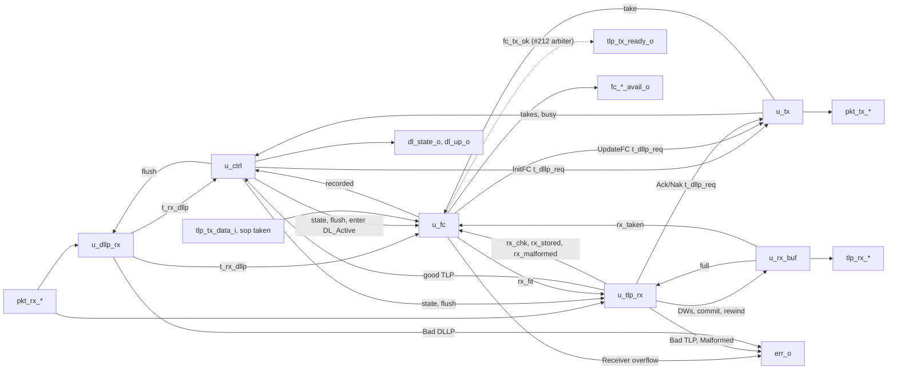

# pcie_dll MAS

How `pcie_dll` implements its [HAS](../../arch/dll/HAS.md): six blocks
of the one `dll` IP (decision record [0003](../../decisions/0003-m2-grill.md#decisions),
Q4) joined by the top. Today they carry the DLLP path, the data link
control states and the flow-control initialisation
([#211](https://github.com/amichai-bd/pcie-factory/issues/211)), and the
TLP receive path: the receive checks, the receive buffer and Ack/Nak
scheduling ([#213](https://github.com/amichai-bd/pcie-factory/issues/213)),
and credit accounting on both sides with the transmit credit gate, the
receive overflow check and UpdateFC on returned credits
([#214](https://github.com/amichai-bd/pcie-factory/issues/214)). The
transmit replay path ([#212](https://github.com/amichai-bd/pcie-factory/issues/212))
joins as a block of its own at the slots named [below](#slots-for-the-tlp-paths)
and uses the credit gate through the [credit interface](#credit-interface).
The HAS and its sub-pages ([DLLPs](../../arch/dll/DLLP.md),
[retry](../../arch/dll/RETRY.md), [flow control](../../arch/dll/FLOW_CONTROL.md))
own the rules; this page owns how the blocks apply them.

## Top

**Ports.** The top ports are the HAS ports, flat: they mirror the `phy`
packet stream and the HAS's single-meaning signals (M1 Q25 exception).
Inside, the receive beat (`t_pkt_rx`), the transmit beat (`t_pkt_tx`), a
received DLLP (`t_rx_dllp`), a DLLP request (`t_dllp_req`) and the
per-class credit values (`t_fc_vals`), a receive-buffer word
(`t_rx_word`) and a TLP's class and credits (`t_rx_credit`) are packed
structs from the [package](#package). The credit parameters keep the HAS checks
(`COMMON_ASSERT_PARAM`, one per parameter) and form the constant `ADV`,
this side's advertisement, which `u_ctrl` puts in InitFC and `u_fc` in
UpdateFC.

**Flush.** `u_ctrl`'s `flush_o` is 1 in DL_Inactive and in any cycle with
`link_up_i` 0, so every block takes its DL_Inactive values at the same
edge as the state does: a DLLP being collected is dropped, a DLLP
offered but not yet taken by the `phy` is withdrawn, limits, flags and
timers clear. A DLLP whose `sop` the `phy` has taken is finished up to its
`eop` ([transmit](#transmit)).

### Slots for the TLP paths

Until the remaining TLP paths exist, the top ties the outputs and inputs
they own:

| Signal | Tied to | Owner |
| --- | --- | --- |
| `tlp_tx_ready_o`, `retrain_req_o`, `err_o` bits 2 to 4 | 0 | #212: sequence numbers, LCRC, replay buffer and timer, REPLAY_NUM, Ack/Nak received |
| `fc_tx_ok` from `u_fc`, the credit gate ([credit interface](#credit-interface)) | read by no block (`tlp_tx_ready_o` is 0) | #212 (ANDs it into `tlp_tx_ready_o` on a `sop` beat) |
| `tlp_tx_eop_i`, `ltssm_state_i` inputs (the other transmit upper-stream inputs reach only flow control) | read by no block (`COMMON_UNUSED_BITS`) | #212 |

Credit accounting (#214) is wired: `err_o` bit 5, the overflow decision
on `rx_fit` and the receive accounting on the
[events](#receive-events-for-credit-accounting), and consumption from the
transmit upper-stream handshake. The receive path (#213) is wired: `tlp_rx_*`, `err_o` bits 0 and 6, the
Ack/Nak request into `u_tx` (priorities 1 and 2), the good TLP into
`u_ctrl`, and the assertion `a_rx_never_stall` (the upper layer holds
`tlp_rx_ready_i` at 1 while `dl_up_o` is 1 when any `FC_*` is 0,
[HAS, Receive](../../arch/dll/HAS.md#receive)). Each later block attaches
where its tie is: a TLP source as priorities 5 and 6 of
[`u_tx`](#transmit), Ack/Nak received on `t_rx_dllp` (`seq` already
decoded), the credit gate on `fc_tx_ok`.

### Credit interface

How the TLP transmit path uses flow control
([transmit accounting](../../arch/dll/FLOW_CONTROL.md#transmit-accounting));
the receive side is the [events](#receive-events-for-credit-accounting).

| Signal (top) | Type | From, to | Contract |
| --- | --- | --- | --- |
| `fc_tx_ok` | `logic` | `u_fc` to #212 | 1 when in DL_Active the partner's credits cover the TLP whose first DW is on `tlp_tx_data_i` (class and credits by `tlp_credit`), by the gate rule for both its fields. Combinational from `tlp_tx_data_i` and registers. #212 makes `tlp_tx_ready_o` on a `sop` beat the AND of this and its own two conditions ([HAS, transmit](../../arch/dll/HAS.md#transmit)). |
| `tx_sop_take` | `logic` | top to `u_fc` | `tlp_tx_valid_i && tlp_tx_ready_o && tlp_tx_sop_i`: CREDITS_CONSUMED adds that TLP's credits at this edge. `a_consume_without_credit` stops a take the gate did not cover. |

## Package

[`pcie_dll_pkg`](../../../../src/rtl/dll/pcie_dll_pkg.sv) holds the
control states (`t_dl_state`, coded as `dl_state_o`), the classes
(`t_fc_class`, P 0, NP 1, Cpl 2: group order, round-robin order and the
class nibble of an FC DLLP type), the DLLP type codes, the structs above
and each block's state struct, and the pure helpers:

| Helper | Does |
| --- | --- |
| `crc16` | The [CRC-16](../../arch/dll/DLLP.md#crc-16) bytes 4 and 5 of a 4-byte body: 32 bit-serial steps, unrolled into an XOR network. |
| `fc_body` | The body of an InitFC1, InitFC2 or UpdateFC for a class and value. |
| `dllp_decode` | Byte 0 to a kind; HdrFC, DataFC and AckNak_Seq_Num from their bits; reserved bits are not read. An FC type needs bit 3 and VC 0 and a class code other than 3, else the kind is "other". |
| `fc_record`, `fc_show`, `refresh_count`, `fc_get`, `fc_next` | The flow-control rules of [`u_fc`](#flow-control). |
| `lcrc_step`, `lcrc_bytes` | The [LCRC](../../arch/dll/RETRY.md#lcrc): one 16-bit beat into the register (16 bit-serial steps, unrolled), and the 4 bytes the register gives (complemented, bit-reversed: byte 0 in `[7:0]`). |
| `tlp_hdr`, `tlp_payload_dw`, `tlp_credit`, `tlp_malformed` | The header fields of DW 0 (`t_tlp_hdr`: Fmt bits 5 and 6, Type, Length); the payload DWs, class and credits they state ([classes](../../arch/dll/FLOW_CONTROL.md#classes-and-credits)); the malformed rule from the beat count and those fields. |
| `fc_charge`, `fc_gate`, `fc_fits`, `fc_rx_base`, `fc_upd_vals`, `fc_free_ok` | Add credits to their class; the transmit gate; the overflow check; CREDITS_ALLOCATED in DL_Inactive; an UpdateFC's values; the receive-space invariant. |

## DLLP receive

[`pcie_dll_dllp_rx`](../../../../src/rtl/dll/pcie_dll_dllp_rx.sv) watches
every valid beat of a DLLP-tagged packet (`t_rx_asm`): the `sop` beat
starts a count of beats and captures bytes 0 and 1, the second beat bytes
2 and 3. At the `eop` beat the packet is good when `pkt_rx_err_i` is 0, the
beat is the third (6 bytes), and its two bytes equal `crc16` of the four
captured; then `rx_dllp_o` carries the decoded DLLP for one cycle, else
`bad_dllp_o` pulses once ([receiving DLLPs](../../arch/dll/DLLP.md#receiving-dllps)).
Both are registered. Gaps inside the packet are waited out; a beat
without a `sop` outside a packet is ignored; TLP-tagged packets are left
to the TLP path. Under `flush_i` nothing is collected or reported, so a
DLLP in DL_Inactive is discarded without Bad DLLP. `nullify` is not read
(a DLLP is never nullified).

## Control

[`pcie_dll_ctrl`](../../../../src/rtl/dll/pcie_dll_ctrl.sv) holds
`t_ctrl_state`: the state, `grp_left` (InitFC DLLPs of the group not yet
taken: 3, 2, 1 send P, NP, Cpl), `grp_timer` (cycles since the group
started, saturating at 127) and `done` (FC_INIT2 may end)
([control states](../../arch/dll/HAS.md#data-link-control-states),
[initialisation](../../arch/dll/FLOW_CONTROL.md#initialisation)).

| From | Condition | To |
| --- | --- | --- |
| any | `link_up_i` 0 | DL_Inactive, everything cleared |
| DL_Inactive | `link_up_i` 1 | FC_INIT1, a group at once |
| FC_INIT1 | all three classes recorded (`u_fc`), no InitFC left to take, nothing on the stream | FC_INIT2, a group at once, `done` 0 |
| FC_INIT2 | `done`, no InitFC left to take, nothing on the stream | DL_Active |
| FC_INIT1, FC_INIT2 | no InitFC left to take and `grp_timer` at 127 | the same state, a new group |

`done` is set in FC_INIT2 by a received InitFC2 or UpdateFC of any class,
or a good TLP (#213); an InitFC1, and anything received before FC_INIT2,
leaves it 0. The InitFC request carries InitFC1 or InitFC2 by the state,
the class of `grp_left` and that class's `ADV` value; each take by
`u_tx` lowers `grp_left`. `enter_active_o` is 1 for the edge that enters
DL_Active. `dl_up_o` is 1 in FC_INIT2 and DL_Active.

## Flow control

[`pcie_dll_fc`](../../../../src/rtl/dll/pcie_dll_fc.sv) keeps, per class,
a `t_fc_limit` (recorded flag, infinite flags, CREDIT_LIMIT for headers
and data) ([transmit accounting](../../arch/dll/FLOW_CONTROL.md#transmit-accounting)):

- In FC_INIT1 the first InitFC1 or InitFC2 of a class records its HdrFC
  and DataFC (0 sets the infinite flag); later ones are ignored.
  `recorded_o` is 1 with all three recorded.
- In FC_INIT2 and DL_Active an UpdateFC sets the limit of each finite
  field; an infinite field keeps its flag and shows all ones.
- **Transmit.** `used_q` (`t_fc_vals`) is CREDITS_CONSUMED, adding the
  taken TLP's `tlp_credit` at `tx_sop_take`. `tx_ok_o` is the gate on the
  offered first DW, 0 outside DL_Active. `avail_o` is 0 outside DL_Active;
  in it, all ones for an infinite field, else limit less `used_q`.
- **Receive** ([events](#receive-events-for-credit-accounting)). `alloc_q`
  and `rcvd_q` are CREDITS_ALLOCATED and CREDITS_RECEIVED for every field.
  DL_Inactive loads `alloc_q` with the advertisement, or the reserve
  (`RX_INF_HDR`, `RX_INF_DATA`) for an infinite field, and `rcvd_q` with
  0, so one rule, `fc_fits`, is the overflow check for both kinds:
  `rx_fit_o` answers `rx_chk` combinationally. `rx_stored` adds to
  `rcvd_q`; `rx_malformed` with credits to both; `rx_taken` to `alloc_q`.
  An `rx_chk` that does not fit registers `ovf_q`, `err_o` bit 5, for one
  cycle. An `rx_malformed` with credits 0 counts nothing and its class is
  not read.

UpdateFC transmit ([UpdateFC](../../arch/dll/FLOW_CONTROL.md#updatefc-scheduling)):
`upd` is what each class's UpdateFC carries, `alloc_q` with infinite
fields as 0 (`fc_upd_vals`); `sent_q` holds the values last taken
(DL_Inactive: `ADV`). A class is due when entering DL_Active set its
`due_q` bit, when `upd` differs from `sent_q` (credits returned), or when
its 11-bit count of cycles since its last UpdateFC was taken has
saturated at 2047 (the refresh). The request is the first due class from
the round-robin pointer, with its `upd` value; a take clears that class's
`due_q` bit and count, records `upd` in `sent_q` and moves the pointer past
it. Returns while an UpdateFC waits coalesce into it; one made after the
take makes the class due again.

Assertions: `a_take_without_due`; `a_consume_without_credit` (a taken
`sop` the gate did not cover); `a_rx_chk_outside_dl_up`;
`a_stored_without_fit`; and `a_free_within_space`, the free credits of
each class never above its receive space (a return without a store).

## Transmit

[`pcie_dll_tx`](../../../../src/rtl/dll/pcie_dll_tx.sv) holds one packet
(`t_tx_state`: busy, the next beat, 6 bytes). It is free when idle or as
the stream takes the `eop` beat; then it takes the first valid request in
[transmit priority](../../arch/dll/RETRY.md#transmit-priority) (Ack/Nak,
InitFC, UpdateFC), loads the body with its `crc16`, and offers it from the
next cycle. `pkt_tx_valid_o` is 1 from load to the accepted `eop`, so a
request is never dropped while the `phy` holds ready low between packets,
and a packet once started is finished. `flush_i` withdraws only a packet
whose `sop` the `phy` has not taken; once taken (`started`: at an
earlier edge, or at this one, including the edge that samples `link_up_i`
0), the remaining beats, at most 2, go out up to `eop` with valid held, link down
or not, and no request loads under `flush_i`, so DL_Inactive then offers
nothing ([HAS, reset values](../../arch/dll/HAS.md#reset-values)). The tag
is always DLLP; a TLP source (#212) adds the tag and priorities 5 and 6.
Assertions: `a_ready_inside_packet` states the `phy` contract that ready
stays 1 from an accepted `sop` to its `eop`; `open_q` tracks a packet open
at the `phy` as the MAC does (set by an accepted `sop`, cleared only by an
accepted `eop` or reset), and `a_sop_inside_packet` and
`a_eop_follows_sop` check that no `sop` comes and valid never drops while
it is open, across a link-down too.

## TLP receive

[`pcie_dll_tlp_rx`](../../../../src/rtl/dll/pcie_dll_tlp_rx.sv) watches
every valid beat of a TLP-tagged packet (`t_tlp_asm`). The `sop` beat
captures the sequence number and seeds the LCRC register; every later
beat enters a two-beat delay line (`b1`, `b2`), and the beat that leaves
it (two behind) is summed into the LCRC and, from the first TLP beat on,
paired into a DW (`lo`, then the beat that completes it). So at the `eop`
the two beats still in the line are the received LCRC, and nothing of it
was summed or stored. Each completed DW is written into the
[receive buffer](#receive-buffer) at once, marked `sop` if it is DW 0 and
`eop` if it completes in the `eop` cycle, up to 36 DWs per packet (a
longer packet is malformed anyway); DW 0's header fields are kept for the
checks. A DW that finds the buffer full is not written, nor is any later
DW of that packet (`noroom`), so a TLP is stored whole or not at all.

At the `eop` the packet is registered as `t_tlp_chk` (beat count,
sequence number, header fields, `err`, `nullify`, the LCRC equal to the
computed one or to its inverse), and judged in the next cycle by the rules
of [receiving TLPs](../../arch/dll/RETRY.md#receiving-tlps), in their
order, in FC_INIT2 and DL_Active only (else discarded silently):

| Verdict | Condition | Effect |
| --- | --- | --- |
| Bad | flagged; below 3 beats; ended by EDB without the inverted LCRC; LCRC mismatch; good LCRC with D = 1 to 2047 (ahead) | Bad TLP pulse; schedule a Nak |
| Nullified | ended by EDB, LCRC inverted | nothing |
| Duplicate | good LCRC, D = 2048 to 4095 | Ack due at once |
| Malformed | good LCRC, D = 0, `tlp_malformed` | Malformed TLP pulse; accept |
| Store | good LCRC, D = 0, well formed, `fit_i` 1 and no `noroom` | commit; accept |
| Overflow | good LCRC, D = 0, well formed, `fit_i` 0 | nothing (`u_fc` pulses Receiver overflow) |

D is the sequence number minus NEXT_RCV_SEQ, modulo 4096. Every packet
not stored is rewound out of the buffer. Any good-LCRC TLP drives
`good_o`, which ends FC_INIT2 in `u_ctrl`. The Bad TLP and Malformed TLP
pulses are registered (one cycle after the verdict); flush gates them, so
none comes in DL_Inactive.

**Receiver state** (`t_acknak_state`): NEXT_RCV_SEQ, NAK_SCHEDULED, a Nak
due, an Ack due at once, and the Ack timer. To accept is to add 1 to
NEXT_RCV_SEQ, clear NAK_SCHEDULED and start the timer at 0 if it is
stopped. Scheduling a Nak sets NAK_SCHEDULED and a Nak due only when
NAK_SCHEDULED is 0. The timer counts cycles and saturates at 32, when an
Ack is due. The request to [`u_tx`](#transmit) is valid in DL_Active only,
with a due Nak, an Ack due at once, or the timer at 32; its body is a Nak
if one is due, else an Ack, with NEXT_RCV_SEQ − 1
([scheduling](../../arch/dll/RETRY.md#ack-and-nak-scheduling)). The
arbiter's take clears both due flags and stops the timer; an accept at the
same edge starts it again (that TLP is not covered). Flush clears it all,
NEXT_RCV_SEQ to 0.

### Receive events for credit accounting

The receive side owns no credit counter: it reports each TLP, with its
class and the credits DW 0 states (`t_rx_credit`, from `tlp_credit`), for
`u_fc`'s accounting ([receive accounting](../../arch/dll/FLOW_CONTROL.md#receive-accounting)),
each valid for one cycle:

| Event | Valid when | `u_fc` does |
| --- | --- | --- |
| `chk_o` | in the verdict cycle, for an expected, good-LCRC, well-formed TLP | answers `fit_i` in the same cycle: 1 when its class's free credits (or an infinite field's reserve) cover it |
| `stored_o` | the same TLP is stored (`fit_i` 1) | CREDITS_RECEIVED (or the reserve in use) adds its credits |
| `malformed_o` | a malformed TLP is accepted; credits 0 below 5 beats (no whole DW 0), and then its `cls` is stale: never read `cls` when the credits are 0 | CREDITS_RECEIVED and CREDITS_ALLOCATED both add them; nothing with credits 0 |
| `taken_o` (from `u_rx_buf`) | the upper layer takes a TLP's `eop` beat | CREDITS_ALLOCATED adds them (or the reserve frees them); an UpdateFC falls due |

`fit_i` 0 makes the verdict Overflow: the TLP is rewound, not accepted,
and neither Ack nor Nak is scheduled; `u_fc` pulses Receiver overflow.
`chk_o` is driven by a process of its own: `fit_i` answers it
combinationally and `stored_o` depends on `fit_i`.

## Receive buffer

[`pcie_dll_rx_buf`](../../../../src/rtl/dll/pcie_dll_rx_buf.sv) holds the
stored TLPs in arrival order, one DW per word of a
[`common_sdp_ram`](../common/ram/common_sdp_ram.md) 34 bits wide (DW,
`sop`, `eop`), 2^`ADDR_W` words, with three pointers one bit wider than
the address: write (the next free word), commit (the end of the stored
TLPs) and read. A write takes the word at the write pointer; a commit
moves the commit pointer to the write pointer; a rewind moves the write
pointer back to it. The buffer is full when write minus read is
2^`ADDR_W`. Only committed words are read, so the upper stream never sees
a TLP before its verdict. The RAM's registered read port is the stream's
output register: a word is read when one is committed and the output is
empty or being taken, and `tlp_rx_valid_o` is 1 while the output holds a
word not yet taken; `tlp_rx_sop_o` and `tlp_rx_eop_o` are its marks, gated
by valid. Stored TLPs are whole, so valid stays 1 inside a TLP while
words are committed: it drops only when the upper layer stalls the
stream, never by itself. The class and credits of the TLP on the stream
are taken from its `sop` word, for `taken_o` at its `eop`. Flush empties
the buffer and the output register, abandoning a TLP mid-delivery.

**Sizing** ([receive buffer](../../arch/dll/FLOW_CONTROL.md#receive-buffer)):
the top computes `RX_BUF_DW`, the sum over the three classes of 4 DWs per
header credit and 4 per data credit advertised (8 headers and 24 data
credits for an infinite field), plus 36 DWs for the TLP being collected,
and rounds up to a power of two: 512 words (2 KiB plus marks) with the
default credits. A header credit is at most a 4-DW header and a data
credit 4 payload DWs, so the stored TLPs that the credits cover never
exceed the sum, and the packet being collected has its 36 words on top;
the buffer is never full for a TLP the overflow check accepts. Should it
be full anyway, the TLP is dropped like an overflowed one (no Ack or
Nak), never stored with a hole.

## Decisions

| Choice | Rationale | Rejected |
| --- | --- | --- |
| Six blocks now (the DLLP path, control, flow control, transmit, TLP receive, receive buffer), the TLP transmit path a block of its own at a tie | The TLP paths attach without reworking the control or the DLLP path. | One control block with everything (each later issue would rewrite it). |
| A group is complete when its last DLLP's `eop` has been taken by `phy` | The plain reading of "the group being sent is complete" ([HAS](../../arch/dll/HAS.md#data-link-control-states)). | When the last DLLP is chosen (the state could change with an InitFC still on the stream). |
| A DLLP started before the link goes down is finished; one only offered is withdrawn | The [HAS decision](../../arch/dll/HAS.md#decisions): the MAC keeps a packet open until its `eop` whatever the link does, and a new `sop` before it breaks the contract. An offered `sop` the `phy` has not taken opened nothing. | Cutting at link-down (the next link-up's first DLLP would land inside the open packet); finishing an offered packet too (it would start in DL_Inactive). |
| Received DLLPs act one cycle after their `eop` (registered decode) | Keeps the CRC-16 network off the control paths. | Acting in the `eop` cycle. |
| The refresh count starts when the arbiter takes the class's UpdateFC | One count per class, cleared by its own take; the interval is 2048 cycles plus at most a packet's wait. | Counting from the `phy`'s acceptance. |
| Group timer and refresh counts saturate | No wrap can send an early group or UpdateFC. | Free-running counters. |
| Received TLP DWs written to the buffer as they arrive, then committed or rewound at the verdict | One copy of the data and no TLP-sized staging register; only committed TLPs are read. | A staging buffer per TLP, copied after the check (a second 144-byte store and a copy delay). |
| A two-beat delay line before the LCRC and the DW packing | The LCRC is the last two beats, known only at the `eop`; the delay keeps it out of the sum and the buffer without knowing the length. | Summing everything and comparing against the CRC residue (needs a second constant for the nullified check, and stores the LCRC). |
| One shared buffer sized by the sum of the per-class capacities, plus one TLP | Each class gets its space ([HAS decision](../../arch/dll/HAS.md#decisions)); the extra TLP covers the speculative writes. | Per-class memories (the arrival order is one stream). |
| The RAM read register is the stream's output register | One beat per cycle with no skid buffer: a read issues whenever the output is empty or taken. | A separate output stage (a cycle more latency). |
| Consumption read from the transmit upper-stream handshake at the top | The HAS event is exactly a taken `sop`; #212 needs no extra wiring and cannot get it out of step with the ports. | A consume pulse from #212. |
| The gate takes `tlp_tx_data_i` alone, separate from the take | `tlp_tx_ready_o` depends on the gate; a struct carrying both the data and the take would make a false combinational loop. | One upper-beat struct for both. |
| An infinite field's receive counters start from the reserve | The reserve's free space is then `alloc_q − rcvd_q` like a finite field's, so one overflow rule and one return path serve both; the UpdateFC masks those fields to 0. | A separate occupancy counter per infinite field. |
| Receiver overflow registered | Every output from a register; the pulse follows the verdict by one cycle. | A combinational pulse. |
| The verdict a cycle after the `eop` | The 16-step LCRC network and the 32-bit compare end in a register, not in the commit and receiver-state logic. | Judging in the `eop` cycle. |

## Timing

- One clock (`clk_i`, 125 MHz), synchronous active-high reset; no
  crossings. Every output is a register or a function of registers and
  the parameters.
- A received DLLP's effect: decoded at the edge after its `eop` beat;
  credits recorded and `done` set at the next edge; a state change at the
  edge after that.
- Transmit: the first DLLP of a group is offered one cycle after the state
  that wants it; back-to-back DLLPs follow with no gap of their own (the
  `phy` adds its framing cycle). DL_Inactive to FC_INIT1 to the first
  InitFC1 offered: two edges after `link_up_i` rises.
- Received TLP, from its `eop` beat from `phy` (cycle c): checked and
  registered at the edge ending c, judged in c+1 (Bad TLP and Malformed
  TLP pulse in c+2), committed at the edge ending c+1, read at the edge
  ending c+2, and offered with `sop` in c+3 when the buffer is empty and
  the upper layer is ready: 3 cycles, within the HAS's 4.
- Ack: the receiver state accepts at the edge ending c+1, the timer
  reaches 32 in c+34, the arbiter takes the request at the edge ending
  c+34 and the Ack's `sop` is offered in c+35: 35 cycles after the `eop`
  on an idle stream. A due Nak, or the Ack after a duplicate, is offered
  in c+3. Either waits behind at most one started packet (a DLLP today, a
  TLP of up to 76 cycles once #212 adds them), so an Ack starts within
  35 + 76 + 1 = 112 cycles, inside the HAS's 118.
- Credits: `avail_o` changes in the cycle after a taken `sop` or a
  received UpdateFC's record; Receiver overflow pulses in c+2 like Bad
  TLP; a returned credit makes its class's UpdateFC due in the cycle
  after the `eop` is taken, so with a free stream it is offered one cycle
  later.
- Critical path: the 32-step CRC-16 XOR network from the receive byte
  register to the CRC compare, and from a request body to the transmit
  packet register; the 16-step LCRC network from the delay line and the
  LCRC register to the compare against the received LCRC. Each CRC bit is
  the parity of at most 32 (CRC-16) or 48 (LCRC) input bits, five or six
  levels of two-input XOR. The gate is an 8-bit and a 12-bit add, subtract
  and compare from `tlp_tx_data_i`, which #212 puts in front of
  `tlp_tx_ready_o`; the overflow check a subtract and compare from
  `u_tlp_rx`'s verdict register into its commit logic.

## Files

| File | Holds |
| --- | --- |
| [`pcie_dll_pkg.sv`](../../../../src/rtl/dll/pcie_dll_pkg.sv) | [Package](#package): types, constants, CRC-16 and flow-control helpers. |
| [`pcie_dll_dllp_rx.sv`](../../../../src/rtl/dll/pcie_dll_dllp_rx.sv) | [DLLP receive](#dllp-receive). |
| [`pcie_dll_ctrl.sv`](../../../../src/rtl/dll/pcie_dll_ctrl.sv) | [Control](#control): the control states and the InitFC groups. |
| [`pcie_dll_fc.sv`](../../../../src/rtl/dll/pcie_dll_fc.sv) | [Flow control](#flow-control): limits, credit accounting and gate, credits available, overflow check, UpdateFC. |
| [`pcie_dll_tx.sv`](../../../../src/rtl/dll/pcie_dll_tx.sv) | [Transmit](#transmit): arbiter and DLLP sender. |
| [`pcie_dll_tlp_rx.sv`](../../../../src/rtl/dll/pcie_dll_tlp_rx.sv) | [TLP receive](#tlp-receive): collection, LCRC, checks, receiver state, Ack/Nak requests. |
| [`pcie_dll_rx_buf.sv`](../../../../src/rtl/dll/pcie_dll_rx_buf.sv) | [Receive buffer](#receive-buffer) and the upper receive stream. |
| [`pcie_dll.sv`](../../../../src/rtl/dll/pcie_dll.sv) | [Top](#top): parameter checks, the blocks, the ties. |
| [`dll.rtl.f`](../../../../src/rtl/dll/dll.rtl.f) | The shared vocabulary (`common_macros.rtl.f`), the shared RAM (`common_sdp_ram.rtl.f`), the package, the blocks, the top. |
