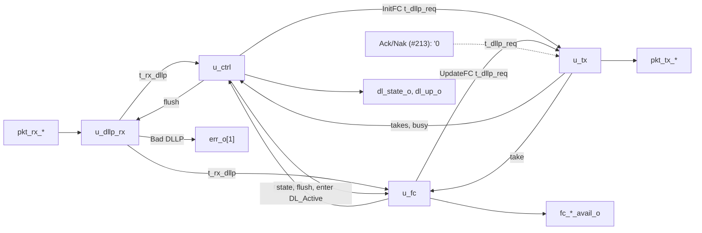

# pcie_dll MAS

How `pcie_dll` implements its [HAS](../../arch/dll/HAS.md): four blocks
of the one `dll` IP (decision record [0003](../../decisions/0003-m2-grill.md#decisions),
Q4) joined by the top. Today they carry the DLLP path, the data link
control states and the flow-control initialisation
([#211](https://github.com/amichai-bd/pcie-factory/issues/211)). The
transmit replay path ([#212](https://github.com/amichai-bd/pcie-factory/issues/212)),
the receive check and Ack/Nak path
([#213](https://github.com/amichai-bd/pcie-factory/issues/213)) and credit
accounting ([#214](https://github.com/amichai-bd/pcie-factory/issues/214))
join as blocks of their own at the slots named [below](#slots-for-the-tlp-paths).
The HAS and its sub-pages ([DLLPs](../../arch/dll/DLLP.md),
[retry](../../arch/dll/RETRY.md), [flow control](../../arch/dll/FLOW_CONTROL.md))
own the rules; this page owns how the blocks apply them.

## Top

**Ports.** The top ports are the HAS ports, flat: they mirror the `phy`
packet stream and the HAS's single-meaning signals (M1 Q25 exception).
Inside, the receive beat (`t_pkt_rx`), the transmit beat (`t_pkt_tx`), a
received DLLP (`t_rx_dllp`), a DLLP request (`t_dllp_req`) and the
per-class credit values (`t_fc_vals`) are packed structs from the
[package](#package). The credit parameters keep the HAS checks
(`COMMON_ASSERT_PARAM`, one per parameter) and form the constant `ADV`,
this side's advertisement, which `u_ctrl` puts in InitFC and `u_fc` in
UpdateFC.

**Flush.** `u_ctrl`'s `flush_o` is 1 in DL_Inactive and in any cycle with
`link_up_i` 0, so every block takes its DL_Inactive values at the same
edge as the state does: a DLLP being collected is dropped, a DLLP being
sent is cut (`pkt_tx_valid_o` falls), limits, flags and timers clear.

### Slots for the TLP paths

Until the TLP paths exist, the top ties the outputs and inputs they own:

| Signal | Tied to | Owner |
| --- | --- | --- |
| `tlp_tx_ready_o`, `retrain_req_o`, `err_o` bits 2 to 4 | 0 | #212: sequence numbers, LCRC, replay buffer and timer, REPLAY_NUM, Ack/Nak received |
| `tlp_rx_valid_o`, `tlp_rx_sop_o`, `tlp_rx_eop_o`, `tlp_rx_data_o`, `err_o` bits 0 and 6 | 0 | #213: TLP receive checks, receive buffer |
| `acknak_req` into `u_tx` (priorities 1 and 2) | `'0` | #213: Ack and Nak scheduling |
| `rx_tlp_good` into `u_ctrl` (a good TLP ends FC_INIT2) | 0 | #213 |
| `err_o` bit 5, credit consumption and returns in `u_fc` | 0, none | #214 |
| `tlp_tx_*`, `tlp_rx_ready_i`, `ltssm_state_i` inputs | read by no block (`COMMON_UNUSED_BITS`) | #212, #213 |

Each later block attaches where its tie is: a TLP source as priorities 5
and 6 of [`u_tx`](#transmit), the TLP receive path on the same `t_pkt_rx`
beat as `u_dllp_rx`, Ack and Nak on `acknak_req`, Ack/Nak received on
`t_rx_dllp` (`seq` already decoded), consumption and returned credits in
`u_fc` beside the limits.

## Package

[`pcie_dll_pkg`](../../../../src/rtl/dll/pcie_dll_pkg.sv) holds the
control states (`t_dl_state`, coded as `dl_state_o`), the classes
(`t_fc_class`, P 0, NP 1, Cpl 2: group order, round-robin order and the
class nibble of an FC DLLP type), the DLLP type codes, the structs above
and each block's state struct, and the pure helpers:

| Helper | Does |
| --- | --- |
| `crc16` | The [CRC-16](../../arch/dll/DLLP.md#crc-16) bytes 4 and 5 of a 4-byte body: 32 bit-serial steps, unrolled into an XOR network. |
| `fc_body` | The body of an InitFC1, InitFC2 or UpdateFC for a class and value. |
| `dllp_decode` | Byte 0 to a kind; HdrFC, DataFC and AckNak_Seq_Num from their bits; reserved bits are not read. An FC type needs bit 3 and VC 0 and a class code other than 3, else the kind is "other". |
| `fc_record`, `fc_show`, `refresh_count`, `fc_get`, `fc_next` | The flow-control rules of [`u_fc`](#flow-control). |

## DLLP receive

[`pcie_dll_dllp_rx`](../../../../src/rtl/dll/pcie_dll_dllp_rx.sv) watches
every valid beat of a DLLP-tagged packet (`t_rx_asm`): the `sop` beat
starts a count of beats and captures bytes 0 and 1, the second beat bytes
2 and 3. At the `eop` beat the packet is good when `pkt_rx_err_i` is 0, the
beat is the third (6 bytes), and its two bytes equal `crc16` of the four
captured; then `rx_dllp_o` carries the decoded DLLP for one cycle, else
`bad_dllp_o` pulses once ([receiving DLLPs](../../arch/dll/DLLP.md#receiving-dllps)).
Both are registered. Gaps inside the packet are waited out; a beat
without a `sop` outside a packet is ignored; TLP-tagged packets are left
to the TLP path. Under `flush_i` nothing is collected or reported, so a
DLLP in DL_Inactive is discarded without Bad DLLP. `nullify` is not read
(a DLLP is never nullified).

## Control

[`pcie_dll_ctrl`](../../../../src/rtl/dll/pcie_dll_ctrl.sv) holds
`t_ctrl_state`: the state, `grp_left` (InitFC DLLPs of the group not yet
taken: 3, 2, 1 send P, NP, Cpl), `grp_timer` (cycles since the group
started, saturating at 127) and `done` (FC_INIT2 may end)
([control states](../../arch/dll/HAS.md#data-link-control-states),
[initialisation](../../arch/dll/FLOW_CONTROL.md#initialisation)).

| From | Condition | To |
| --- | --- | --- |
| any | `link_up_i` 0 | DL_Inactive, everything cleared |
| DL_Inactive | `link_up_i` 1 | FC_INIT1, a group at once |
| FC_INIT1 | all three classes recorded (`u_fc`), no InitFC left to take, nothing on the stream | FC_INIT2, a group at once, `done` 0 |
| FC_INIT2 | `done`, no InitFC left to take, nothing on the stream | DL_Active |
| FC_INIT1, FC_INIT2 | no InitFC left to take and `grp_timer` at 127 | the same state, a new group |

`done` is set in FC_INIT2 by a received InitFC2 or UpdateFC of any class,
or a good TLP (#213); an InitFC1, and anything received before FC_INIT2,
leaves it 0. The InitFC request carries InitFC1 or InitFC2 by the state,
the class of `grp_left` and that class's `ADV` value; each take by
`u_tx` lowers `grp_left`. `enter_active_o` is 1 for the edge that enters
DL_Active. `dl_up_o` is 1 in FC_INIT2 and DL_Active.

## Flow control

[`pcie_dll_fc`](../../../../src/rtl/dll/pcie_dll_fc.sv) keeps, per class,
a `t_fc_limit` (recorded flag, infinite flags, CREDIT_LIMIT for headers
and data) ([transmit accounting](../../arch/dll/FLOW_CONTROL.md#transmit-accounting)):

- In FC_INIT1 the first InitFC1 or InitFC2 of a class records its HdrFC
  and DataFC (0 sets the infinite flag); later ones are ignored.
  `recorded_o` is 1 with all three recorded.
- In FC_INIT2 and DL_Active an UpdateFC sets the limit of each finite
  field; an infinite field keeps its flag and shows all ones.
- `avail_o` is 0 outside DL_Active; in it, all ones for an infinite field,
  else the limit (CREDITS_CONSUMED is 0 until #214 accepts TLPs).

UpdateFC transmit ([UpdateFC](../../arch/dll/FLOW_CONTROL.md#updatefc-scheduling)):
entering DL_Active makes all three due; per class an 11-bit count of
cycles since that class's last UpdateFC was taken saturates at 2047,
which makes it due again (the refresh). The request is the first due
class from the round-robin pointer, with its `ADV` value
(CREDITS_ALLOCATED before any credit returns; an infinite field is 0);
a take clears that class's due flag and count and moves the pointer past
it. Until #214 returns credits, classes fall due in turn, so the pointer
always names the due class.

## Transmit

[`pcie_dll_tx`](../../../../src/rtl/dll/pcie_dll_tx.sv) holds one packet
(`t_tx_state`: busy, the next beat, 6 bytes). It is free when idle or as
the stream takes the `eop` beat; then it takes the first valid request in
[transmit priority](../../arch/dll/RETRY.md#transmit-priority) (Ack/Nak,
InitFC, UpdateFC), loads the body with its `crc16`, and offers it from the
next cycle. `pkt_tx_valid_o` is 1 from load to the accepted `eop`, so a
request is never dropped while the `phy` holds ready low between packets,
and a packet once started is finished, except that `flush_i` cuts it
([decisions](#decisions)). The tag is always DLLP; a TLP source (#212)
adds the tag and priorities 5 and 6. The assertion `a_ready_inside_packet`
states the `phy` contract that ready stays 1 from an accepted `sop` to the
`eop`.

## Decisions

| Choice | Rationale | Rejected |
| --- | --- | --- |
| Four blocks now, each later issue a block of its own at a tie | The TLP paths attach without reworking the control or the DLLP path. | One control block with everything (each later issue would rewrite it). |
| A group is complete when its last DLLP's `eop` has been taken by `phy` | The plain reading of "the group being sent is complete" ([HAS](../../arch/dll/HAS.md#data-link-control-states)). | When the last DLLP is chosen (the state could change with an InitFC still on the stream). |
| The link going down cuts a DLLP being sent | The HAS requires `pkt_tx_valid_o` 0 in DL_Inactive; the `phy` ends the cut packet with EDB, and its link is down anyway. Recorded as a [HAS open item](../../arch/dll/HAS.md#open-items) against "a packet once started is always finished". | Finishing the packet into a link that is down. |
| Received DLLPs act one cycle after their `eop` (registered decode) | Keeps the CRC-16 network off the control paths. | Acting in the `eop` cycle. |
| The refresh count starts when the arbiter takes the class's UpdateFC | One count per class, cleared by its own take; the interval is 2048 cycles plus at most a packet's wait. | Counting from the `phy`'s acceptance. |
| Group timer and refresh counts saturate | No wrap can send an early group or UpdateFC. | Free-running counters. |

## Timing

- One clock (`clk_i`, 125 MHz), synchronous active-high reset; no
  crossings. Every output is a register or a function of registers and
  the parameters.
- A received DLLP's effect: decoded at the edge after its `eop` beat;
  credits recorded and `done` set at the next edge; a state change at the
  edge after that.
- Transmit: the first DLLP of a group is offered one cycle after the state
  that wants it; back-to-back DLLPs follow with no gap of their own (the
  `phy` adds its framing cycle). DL_Inactive to FC_INIT1 to the first
  InitFC1 offered: two edges after `link_up_i` rises.
- Critical path: the 32-step CRC-16 XOR network from the receive byte
  register to the CRC compare, and from a request body to the transmit
  packet register. Each CRC bit is the parity of at most 32 input bits,
  about five levels of two-input XOR.

## Files

| File | Holds |
| --- | --- |
| [`pcie_dll_pkg.sv`](../../../../src/rtl/dll/pcie_dll_pkg.sv) | [Package](#package): types, constants, CRC-16 and flow-control helpers. |
| [`pcie_dll_dllp_rx.sv`](../../../../src/rtl/dll/pcie_dll_dllp_rx.sv) | [DLLP receive](#dllp-receive). |
| [`pcie_dll_ctrl.sv`](../../../../src/rtl/dll/pcie_dll_ctrl.sv) | [Control](#control): the control states and the InitFC groups. |
| [`pcie_dll_fc.sv`](../../../../src/rtl/dll/pcie_dll_fc.sv) | [Flow control](#flow-control): limits, credits available, UpdateFC. |
| [`pcie_dll_tx.sv`](../../../../src/rtl/dll/pcie_dll_tx.sv) | [Transmit](#transmit): arbiter and DLLP sender. |
| [`pcie_dll.sv`](../../../../src/rtl/dll/pcie_dll.sv) | [Top](#top): parameter checks, the blocks, the ties. |
| [`dll.rtl.f`](../../../../src/rtl/dll/dll.rtl.f) | The shared vocabulary (`common_macros.rtl.f`), the package, the blocks, the top. |
