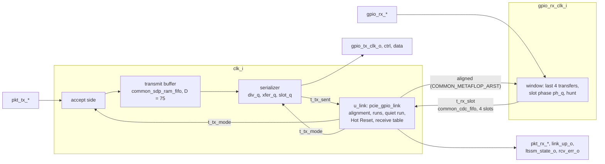

# pcie_gpio MAS

How `pcie_gpio` implements its [HAS](../../arch/gpio/HAS.md) and the
[link-up rules](../../arch/gpio/LINK_UP.md). It is one IP with three
blocks, each a module file in `src/rtl/gpio/` under one `gpio.rtl.f`: the
[transmit path](#transmit-path) and the [link state](#link-state) on
`clk_i`, and the [receive front end](#receive-front-end) on
`gpio_rx_clk_i`, which carries slots into `clk_i` through one
[`common_cdc_fifo`](../common/cdc/common_cdc_fifo.md). The blocks exchange
packed structs of [`pcie_gpio_pkg`](#package); the `pcie_gpio` ports stay
flat, with the `phy` stream names of the HAS
([#378](https://github.com/amichai-bd/pcie-factory/issues/378)).

## Package

`pcie_gpio_pkg` ([`pcie_gpio_pkg.sv`](../../../../src/rtl/gpio/pcie_gpio_pkg.sv))
is the IP's one package. RTL names every item `pkg::item`, with no import.

| Item | Holds |
| --- | --- |
| `t_code` | The eight slot codes of the [HAS](../../arch/gpio/HAS.md#slots). |
| `WORD_TRAIN`, `WORD_TRAIN_OK`, `WORD_IDLE`, `WORD_HOT_RESET` | The idle words `0x005A`, `0x015A`, `0x00C3`, `0x0096`. |
| `LTSSM_RESET`, `LTSSM_TRAINING`, `LTSSM_HOT_RESET`, `LTSSM_UP` | The four `ltssm_state_o` codes. |
| `ALIGN_SLOTS`, `DAMAGE_WINDOW`, `UP_RUN`, `DOWN_CLEAR_RUN`, `DOWN_ANY_RUN`, `HR_ENTER_RUN`, `HR_EXIT_RUN`, `QUIET_WORDS`, `HR_WORDS`, `WATCHDOG_XFERS` | The runs and counts of the [link-up rules](../../arch/gpio/LINK_UP.md#rules): 8, 8, 8, 4, 64, 4, 4, 16, 32 and 64. |
| `MAX_PKT_BEATS`, `TX_DEPTH`, `TX_ADDR_W` | A maximum packet (75 beats), the transmit buffer depth D (75) and its RAM's address width (7). |
| `RX_ADDR_W` | The receive crossing FIFO's address width (2: 4 slots). |
| `t_slot` | A code and a 16-bit beat: a transmit buffer entry and the slot on the pins. |
| `t_rx_slot` | Four received transfers in slot layout (control bit `t` and data nibble `t` for transfer `t`) and the front end's `new_phase` flag: the crossing's entry. |
| `t_state`, `t_link`, `LINK_RESET` | The link state (`ST_TRAIN`, `ST_UP`, `ST_HOT_RESET`) and the link block's state register: alignment, counters, runs and the receive framing. |
| `t_tx_mode`, `t_tx_sent` | Link state to transmitter (up, send HOT_RESET, bit 8) and transmitter to link state (a bit-8-clear TRAIN word or a HOT_RESET word went out). |
| `t_rx_beat` | One receive stream beat. |
| `replay_timeout`, `REPLAY_TIMEOUT_MAX` | The `dll` replay timeout of the GPIO build for a `CLK_DIV`, which `link` applies at `LOWER` 1 ([`link` HAS](../../arch/link/HAS.md#replay-timeout-at-lower-1)). |

## Top

`pcie_gpio` ([`pcie_gpio.sv`](../../../../src/rtl/gpio/pcie_gpio.sv))
instantiates `u_tx`, `u_rx_front` and `u_link` and maps the link block's
`t_rx_beat` onto the flat `pkt_rx_*` ports; `pkt_rx_nullify_o` is tied
to 0. A parameter check rejects a `CLK_DIV` outside the HAS range. Every
input other than the two clocks carries its `cdc-domain` annotation.

## Transmit path

`pcie_gpio_tx` ([`pcie_gpio_tx.sv`](../../../../src/rtl/gpio/pcie_gpio_tx.sv)),
all on `clk_i`.

- **Accept side.** Two flags, `in_pkt_q` (a sop was taken, its eop not
  yet) and `drop_q` (the rest of this packet is taken and discarded).
  `pkt_tx_ready_o` is `in_pkt_q | (up & room)`, with `room` the buffered
  beats (RAM entries plus the head) at most `TX_DEPTH` − `MAX_PKT_BEATS`,
  that is 0: between packets ready rises only on an empty buffer, and
  inside a packet it is 1 whatever the link does
  ([HAS, transmit](../../arch/gpio/HAS.md#transmit)). Ready depends on
  flops only, never on `pkt_tx_valid_i`. Each beat taken while up and not
  dropping is written with its code: ONE or SOP (with the `dllp` bit) for
  a sop, EOP for an eop, else MID. Valid low inside a packet writes one
  ABORT entry and sets `drop_q`; leaving up inside a packet sets
  `drop_q`; the eop clears both.
- **Transmit buffer.** A [`common_sdp_ram_fifo`](../common/ram/common_sdp_ram_fifo.md)
  of 19-bit `t_slot` entries, 128 in the RAM plus the head. Its depth in
  use is D = 75 beats: the ready rule admits a packet only into an empty
  buffer, and a packet is at most 75 entries (74 beats and an ABORT, or 75
  beats), which the assertion `a_buf_room` checks. The RAM is larger only
  because RAM sizes are powers of two. Its reset is `rst_i | ~up`: leaving
  up discards every buffered beat (HAS, link-up).
- **Serializer.** `div_q` counts the `CLK_DIV` cycles of a transfer and
  `xfer_q` the transfer in the slot. A transfer starts at the edge where
  `div_q` is 0: `gpio_tx_ctrl_o` and `gpio_tx_data_o` load their next
  value and `gpio_tx_clk_o` falls; it rises at the edge where `div_q` is
  `CLK_DIV`/2. All three are flops with no logic after them; reset holds
  them at 0, so the forwarded clock stops. The first edge out of reset
  starts transfer 0 of a slot. At a slot start the next slot is chosen
  in this order: an ABORT when the link is not up and a packet is open on
  the pins (`pins_open_q`: a SOP went out, its EOP, ABORT or ONE not yet);
  the buffer's head while up (popped); an IDLE word while up; HOT_RESET in
  a downstream Hot Reset; else TRAIN, with bit 8 from `t_tx_mode.bit8`. A
  TRAIN word with bit 8 clear or a HOT_RESET word pulses `t_tx_sent` for
  the link block's counts. The slot is held in `slot_q`; transfer `t`
  drives control bit `t` of `{code, 1}` and data bits `[4t+3:4t]`.
- **Cut-through.** The head can leave two edges after the beat is
  written, and the `dll` writes a beat per cycle inside a packet against
  one leaving per slot (at least 8 cycles), so inside a packet on the
  pins a beat is always buffered (assertion `a_beat_ready`). The next sop
  is taken the cycle after the buffer empties and is ready to leave before
  the next slot start, so back-to-back packets leave no idle slot between
  them ([targets](../../arch/gpio/HAS.md#targets)).

## Receive front end

`pcie_gpio_rx_front` ([`pcie_gpio_rx_front.sv`](../../../../src/rtl/gpio/pcie_gpio_rx_front.sv)),
on `gpio_rx_clk_i`, the partner's forwarded clock.

- **Reset.** `COMMON_RESET_SYNC` makes the domain's reset from `rst_i`:
  it asserts at once, with no clock edge (the partner's clock may be
  stopped), and releases on the second `gpio_rx_clk_i` edge after `rst_i`
  falls. Every flop of the domain, the FIFO's write side and the lock
  synchronizer take it asynchronously.
- **Window.** On each rising edge the control and data pins shift into
  `win_q`, a `t_rx_slot` whose transfer 0 is the oldest; `ph_q` is the
  newest transfer's position in its slot. The window is a slot when
  `ph_q` is 3, and it is then written into the crossing FIFO.
- **Hunting.** While the link block is not aligned (its alignment flop,
  synchronized by `COMMON_METAFLOP_ARST` as `rx_lock`), a window that
  reads the marker pattern 1, 0, 0, 0 at another phase is a slot too:
  it is written with `new_phase` set and the phase restarts there. Only
  an IDLE-coded slot shows that pattern, and only at the true phase,
  since every slot's transfer 0 is a 1. Once aligned, the phase never
  moves.
- **Crossing.** A `common_cdc_fifo` of 4 `t_rx_slot` entries, write side
  on `gpio_rx_clk_i` with an asynchronous reset, read side on `clk_i`,
  read every cycle a slot is visible. At most one slot is written per 4
  forwarded-clock edges once a phase holds (the one jump while hunting
  can bring two closer, once), against one read per `clk_i` cycle; the
  forwarded clock is at most `clk_i` (a ratio of 2 at `CLK_DIV` 2), and a
  slot's write is visible to the reader within 3 `clk_i` edges and its
  read to the writer within 3 forwarded-clock edges, so at most 2 slots are
  in the FIFO and it never fills (assertion `a_rx_no_overflow`;
  [HAS clock contract](../../arch/gpio/HAS.md#clocks-and-resets)).

## Link state

`pcie_gpio_link` ([`pcie_gpio_link.sv`](../../../../src/rtl/gpio/pcie_gpio_link.sv)),
on `clk_i`: one `t_link` register, one received slot handled per cycle.
`ltssm_state_o` and `link_up_o` decode the state: `0x20` up, `0x19` Hot
Reset, `0x04` training (aligned), `0x00` not aligned and in reset. The
receive stream beat and `rcv_err_o` are registered.

- **Alignment.** Not aligned, it counts slots in a row whose control
  transfers read 1, 0, 0, 0 (a slot with `new_phase` counts as the first);
  8 align it. Aligned, a damaged slot opens a window of 8 slots, and a
  second damaged slot inside it is an alignment loss; so is the watchdog,
  64 × `CLK_DIV` `clk_i` cycles with no slot. A damaged slot is one whose
  transfer 0 reads 0, one that pulses `rcv_err_o`, or one with
  `new_phase` while aligned (the front end cannot jump phase then unless
  the slot was already damaged in flight). In a downstream Hot Reset only
  the marker and the phase count, since received words are ignored.
- **Receive table.** While aligned (and not in a downstream Hot Reset) every
  slot goes through the [HAS receive table](../../arch/gpio/HAS.md#receive),
  with three framing flags: a packet is open (and its `dllp` bit), its sop
  was delivered (`deliv`), and the discard after a pulse. Slots are
  framed whatever the state; beats are delivered only while up, so a
  packet open when the link comes up is not delivered. An IDLE slot that
  closes an open packet is damaged, so its word feeds no run
  ([terms](../../arch/gpio/LINK_UP.md#terms)). Not aligned, the framing
  is cleared.
- **Runs.** One counter per kind: good slots (training, after the quiet run
  ended), bit-8-clear TRAIN and any TRAIN (up), HOT_RESET (upstream, not in
  Hot Reset) and TRAIN (upstream in Hot Reset). A slot outside the kind,
  damaged, discarded or ignored clears the counter, and every state change
  clears them all, so the down runs count only slots received while up.
- **Transitions.** Up: a downstream `hot_reset_req_i` enters Hot Reset
  (its quiet run waits for the dwell), alignment loss and the two down
  runs go to training, 4 HOT_RESET words enter an upstream Hot Reset.
  Training: the same requests and runs, and 8 good slots go up. A
  downstream Hot Reset ends when the request is low and 32 HOT_RESET words
  went out; an upstream one ends on alignment loss or 4 TRAIN words.
- **Quiet run.** `quiet_cnt` counts the bit-8-clear TRAIN words the
  transmitter reports, up to 16; reset and every start of the rules clear
  it (a word sent at the same edge is not counted: the run only grows
  longer). `t_tx_mode.bit8` is aligned and the run over.
- **At link-down.** The cycle the state leaves up, a delivered open packet
  is closed with an error `eop` (in place of the slot's own beat) and
  `deliv` clears; the transmitter sees `up` fall, which flushes its buffer
  and sends ABORT if a packet is open on its pins.

## Timing

`S` = 4 × `CLK_DIV` `clk_i` cycles is one slot.

| Path | Latency | Notes |
| --- | --- | --- |
| `L_tx`: a beat taken to its first transfer | 2 cycles, plus the wait for the next slot start (at most `S` − 1) | The buffer head is valid two edges after the write; the pins load at the slot start. |
| `L_rx`: a slot's last transfer to its beat on the stream | Half a transfer (`CLK_DIV`/2 sender cycles), then at most 4 receiver `clk_i` cycles | The window is written at the forwarded-clock edge after the last capture; the crossing's two synchronizer edges and its read, then the beat register. |
| `W`: a slot's first transfer to its handling, counting `L_tx` | At most 1.75 slots of the slower end at `CLK_DIV` 2 (ratios 1/2, 1, 2), less at larger `CLK_DIV` | Within the 4 slots the [link-up rules](../../arch/gpio/LINK_UP.md#terms) require. The slot-phase wait is not in it: `W` starts from a beat taken at a slot start, as an idle word (which the link-up rules count) always is; a packet beat waits up to `S` − 1 more before its slot starts, which the `link` replay round trip counts separately. |
| Line use | One beat per slot each way; no idle slot between back-to-back packets | The next sop refills the buffer within 3 cycles of the last pop. |

The [architecture model](../../../../src/arch/gpio/pcie_gpio_arch.py)
states these figures and the unit DV measures them
([targets](../../arch/gpio/HAS.md#targets)): `L_tx` 2 to 9 cycles at
`CLK_DIV` 2, `L_rx` at most 4.83 receiver cycles, link-up 22 to 25 slots
of the slower end. With `L` = `L_tx` + `L_rx` at most 3 × `S` the `link`
HAS's replay round trip holds ([replay timeout at LOWER 1](../../arch/link/HAS.md#replay-timeout-at-lower-1)).

The only crossings are the receive FIFO (Gray pointers through
`common_cdc_sync2`), the receive reset synchronizer and the alignment
flag's level synchronizer. The forwarded clock is a flop output and
clocks nothing inside the sender.

## Files

| File | Holds |
| --- | --- |
| [`pcie_gpio_pkg.sv`](../../../../src/rtl/gpio/pcie_gpio_pkg.sv) | The package. |
| [`pcie_gpio_tx.sv`](../../../../src/rtl/gpio/pcie_gpio_tx.sv) | The transmit path: accept side, buffer, serializer. |
| [`pcie_gpio_rx_front.sv`](../../../../src/rtl/gpio/pcie_gpio_rx_front.sv) | The receive front end and the crossing. |
| [`pcie_gpio_link.sv`](../../../../src/rtl/gpio/pcie_gpio_link.sv) | The link state and the receive table. |
| [`pcie_gpio.sv`](../../../../src/rtl/gpio/pcie_gpio.sv) | The top. |
| [`gpio.rtl.f`](../../../../src/rtl/gpio/gpio.rtl.f) | The vocabulary, the crossing cells and the RAM queue, the package, the blocks, the top. |
