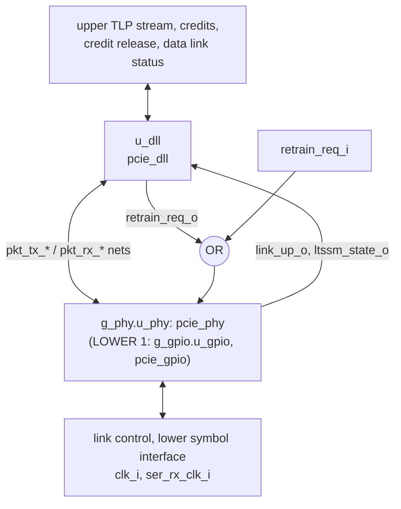

# pcie_link MAS

How `pcie_link` implements its [HAS](../../arch/link/HAS.md): the `pcie_dll`
and `pcie_phy` instances joined by the packet stream, by the
[stack wiring](../../arch/link/HAS.md#stack-wiring), with one OR gate and
two tie-offs of its own; at `LOWER` 1 `pcie_gpio` takes the place of
`pcie_phy` ([lower layer](#lower-layer)).

## Microarchitecture

- **`u_dll` (`pcie_dll`)** takes `clk_i`, `rst_i`, the upper TLP stream
  and the credit release (`fc_rel_*_i`), and drives the credits available
  and the data link status; its `err_o` is the `link` port `dl_err_o`.
  `FC_PH` to `FC_CPLD` and `FC_RELEASE` pass through, and so does
  `REPLAY_TIMEOUT` at `LOWER` 0 ([lower layer](#lower-layer)).
- **`g_phy.u_phy` (`pcie_phy`)**, at `LOWER` 0, takes `clk_i`, `rst_i`, `port_role_i`, the
  link control requests and the whole lower symbol interface, including
  `ser_rx_clk_i`, and drives the link status. `TIMEOUT_DIV` and
  `ERR_TIMEOUT_DIV` pass through.
- **Packet-stream nets.** One `logic` net per port of the stream, named
  after it without the direction suffix: `pkt_tx_valid`, `pkt_tx_ready`,
  `pkt_tx_data` (16), `pkt_tx_sop`, `pkt_tx_eop`, `pkt_tx_dllp`;
  `pkt_rx_valid`, `pkt_rx_data` (16), `pkt_rx_sop`, `pkt_rx_eop`,
  `pkt_rx_dllp`, `pkt_rx_err`, `pkt_rx_nullify`. Each is `<x>_o` of one
  IP and `<x>_i` of the other. They stay flat: both IPs' HAS name these
  ports one by one ([structs](../../../bkm/rtl.md#structs-at-interfaces)).
  The e2e testbench taps them for the Ack-latency check at the `dll`
  boundary ([DV plan](../../dv/link/DV_PLAN.md#strategy)).
- **Link status.** The `phy` `link_up_o` and `ltssm_state_o` drive both
  the `link` ports and the `dll` `link_up_i` and `ltssm_state_i`.
- **Retrain.** `phy_retrain_req = retrain_req_i | dll_retrain_req`: either
  one-cycle pulse retrains, so a REPLAY_NUM rollover retrains with no
  help from the upper layer.
- **Tie-offs.** The `phy` `pkt_tx_nullify_i` is 0 (the `dll` never
  nullifies) and `pm_state_req_i` is 0 (L0 only:
  [power states](../../arch/link/HAS.md#power-states)). Hot Reset,
  Disabled and Loopback go straight to the `phy`.
- **Reset.** `rst_i` goes to both IPs. The PCS derives its RX-domain reset
  itself (`pcs` HAS, Clocks and reset).

## Lower layer

A generate on `LOWER` picks the IP under the `dll`
([HAS, lower layer](../../arch/link/HAS.md#lower-layer)); the `dll`, the
packet-stream nets and the retrain OR are the same in both.

- **`g_phy` (`LOWER` 0)** holds `u_phy` as above and drives the GPIO pins
  to 0; the GPIO inputs are unused (`COMMON_UNUSED_BITS`).
- **`g_gpio` (`LOWER` 1)** holds `u_gpio` (`pcie_gpio`, `CLK_DIV` from
  `GPIO_CLK_DIV`) on the packet-stream nets, `link_up_o`,
  `ltssm_state_o`, `rcv_err_o`, `port_role_i`, `hot_reset_req_i` and the
  GPIO pins. `ser_tx_data_o` is 0 and `ser_tx_elec_idle_o` 1; the retrain
  OR, `disable_req_i`, `loopback_req_i` and the `ser_*` inputs are unused.
- **Replay timeout.** The localparam `DLL_REPLAY` is `REPLAY_TIMEOUT`, or at
  `LOWER` 1 the larger of it and `pcie_gpio_pkg::replay_timeout(GPIO_CLK_DIV)`,
  and goes to the `dll`.
- **Hierarchy.** The `phy` is `g_phy.u_phy` (it was `u_phy` before
  [#378](https://github.com/amichai-bd/pcie-factory/issues/378)); `u_dll`
  and the packet-stream nets that the e2e taps keep their names.
- **`gpio_rx_clk_i`** is the adapter's receive clock at `LOWER` 1. The
  checks elaborate the default, `LOWER` 0, where it reaches nothing, so it
  carries a `clk_i` annotation like the other unused inputs; the adapter's
  crossings are checked on the `gpio` top itself.

## Timing

`pcie_link` adds no register; its only logic is the retrain OR. The stack
latency is the sum of the two IPs' ([HAS targets](../../arch/link/HAS.md#targets)).

- **Combinational paths across the IPs.** Two `dll` outputs depend on
  inputs ([`dll` MAS, timing](../dll/MAS.md#timing)). `tlp_tx_ready_o`
  reads only the upper stream. `pkt_tx_valid_o` reads `ltssm_state_i` in a
  REPLAY_NUM rollover cycle, and the `phy` `ltssm_state_o` is a decode of
  the `mac` LTSSM state register (`pcie_mac_ltssm.sv`, the `in_l0` decode
  of `r_q.state`), which no `phy` input reaches in the same cycle. So
  `ltssm_state_o` → `pkt_tx_valid` → `phy` is a path that ends at the
  `mac`'s registers, and no loop exists: `./build check` (Verilator
  `--lint-only -Wall`, which reports a circular path as `UNOPTFLAT`)
  passes on `link` with no waiver for it. On silicon it is an ordinary
  `clk_i` path with no exception, so it meets timing whenever `clk_i`
  does. On the FPGA its slack is bounded by the clock's worst setup
  slack ([`link` FPGA, Results](../../fpga/link/FPGA.md#results)), which
  the firstmate accepted in place of a per-path report
  ([#218 decision](https://github.com/amichai-bd/pcie-factory/issues/218#issuecomment-6243168833)).
  The ASIC flow gives the same coverage at its clock gate
  ([#219](https://github.com/amichai-bd/pcie-factory/issues/219)).
- **Ack latency.** The largest values the e2e measured over every L0 to
  L2 run ([DV plan](../../dv/link/DV_PLAN.md#strategy)), against the
  [HAS targets](../../arch/link/HAS.md#targets):

  | Where | Error-free (`e2e_smoke`) | Any test | Bound |
  | --- | --- | --- | --- |
  | `dll`-to-`phy` boundary: a good TLP's `eop` from the `phy` to the covering Ack's or Nak's `sop` taken | 111 cycles | 111 cycles | 118 |
  | On the line: the TLP's last symbol at `ser_rx_data_i` to the DLLP's first at `ser_tx_data_o` (the passive checker) | 125.4 cycles | 126.4 cycles | 140 |

  The worst case is the 32-cycle Ack timer plus a maximum TLP already
  going out ahead of the Ack ([`dll` RETRY page, timers](../../arch/dll/RETRY.md#timers)).
- **Clocks and crossings.** `dll` runs on `clk_i` only; the only crossings
  are inside `pcie_pcs` (inside `pcie_gpio` at `LOWER` 1). Every `link`
  input carries a `cdc-domain` annotation: `ser_rx_data_i` and
  `ser_rx_elec_idle_i` are on `ser_rx_clk_i`, `gpio_rx_ctrl_i` and
  `gpio_rx_data_i` on `gpio_rx_clk_i`, every other input on `clk_i`. The `rst_i` net has a
  `SYNCASYNCNET` lint waiver seen from the `link` top
  (`src/lint_waivers.yaml`), as the `phy` and `pcs` tops do: it is the
  synchronous reset of both IPs and the asynchronous input of the PCS RX
  reset synchronizer.

## Files

| File | Holds |
| --- | --- |
| [`pcie_link.sv`](../../../../src/rtl/link/pcie_link.sv) | The stack top: `u_dll`, `g_phy.u_phy` or `g_gpio.u_gpio`, the packet-stream nets, the retrain OR and the tie-offs. |
| [`link.rtl.f`](../../../../src/rtl/link/link.rtl.f) | `-F ../common/common_macros.rtl.f` (the top calls the vocabulary), `-F ../dll/dll.rtl.f`, `-F ../phy/phy.rtl.f`, `-F ../gpio/gpio.rtl.f`, then `pcie_link.sv`. The shared vocabulary is flattened once. |
