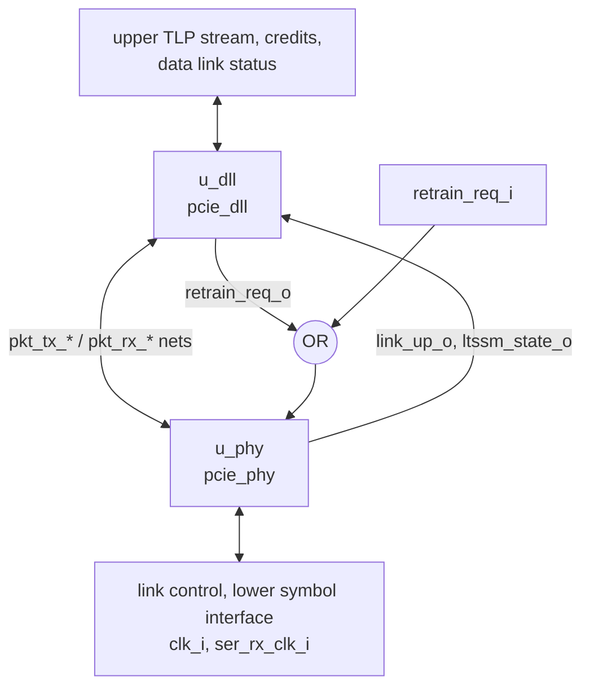

# pcie_link MAS

How `pcie_link` implements its [HAS](../../arch/link/HAS.md): the `pcie_dll`
and `pcie_phy` instances joined by the packet stream, by the
[stack wiring](../../arch/link/HAS.md#stack-wiring), with one OR gate and
two tie-offs of its own.

## Microarchitecture

- **`u_dll` (`pcie_dll`)** takes `clk_i`, `rst_i`, the upper TLP stream,
  and drives the credits available and the data link status; its `err_o`
  is the `link` port `dl_err_o`. `FC_PH` to `FC_CPLD` pass through.
- **`u_phy` (`pcie_phy`)** takes `clk_i`, `rst_i`, `port_role_i`, the
  link control requests and the whole lower symbol interface, including
  `ser_rx_clk_i`, and drives the link status. `TIMEOUT_DIV` and
  `ERR_TIMEOUT_DIV` pass through.
- **Packet-stream nets.** One `logic` net per port of the stream, named
  after it without the direction suffix: `pkt_tx_valid`, `pkt_tx_ready`,
  `pkt_tx_data` (16), `pkt_tx_sop`, `pkt_tx_eop`, `pkt_tx_dllp`;
  `pkt_rx_valid`, `pkt_rx_data` (16), `pkt_rx_sop`, `pkt_rx_eop`,
  `pkt_rx_dllp`, `pkt_rx_err`, `pkt_rx_nullify`. Each is `<x>_o` of one
  IP and `<x>_i` of the other. They stay flat: both IPs' HAS name these
  ports one by one ([structs](../../../bkm/rtl.md#structs-at-interfaces)).
  The e2e testbench taps them for the Ack-latency check at the `dll`
  boundary ([DV plan](../../dv/link/DV_PLAN.md#strategy)).
- **Link status.** The `phy` `link_up_o` and `ltssm_state_o` drive both
  the `link` ports and the `dll` `link_up_i` and `ltssm_state_i`.
- **Retrain.** `phy_retrain_req = retrain_req_i | dll_retrain_req`: either
  one-cycle pulse retrains, so a REPLAY_NUM rollover retrains with no
  help from the upper layer.
- **Tie-offs.** The `phy` `pkt_tx_nullify_i` is 0 (the `dll` never
  nullifies) and `pm_state_req_i` is 0 (L0 only:
  [power states](../../arch/link/HAS.md#power-states)). Hot Reset,
  Disabled and Loopback go straight to the `phy`.
- **Reset.** `rst_i` goes to both IPs. The PCS derives its RX-domain reset
  itself (`pcs` HAS, Clocks and reset).

## Timing

`pcie_link` adds no register; its only logic is the retrain OR. The stack
latency is the sum of the two IPs' ([HAS targets](../../arch/link/HAS.md#targets)).

- **Combinational paths across the IPs.** Two `dll` outputs depend on
  inputs ([`dll` MAS, timing](../dll/MAS.md#timing)). `tlp_tx_ready_o`
  reads only the upper stream. `pkt_tx_valid_o` reads `ltssm_state_i` in a
  REPLAY_NUM rollover cycle, and the `phy` `ltssm_state_o` is a decode of
  the `mac` LTSSM state register (`pcie_mac_ltssm.sv`, the `in_l0` decode
  of `r_q.state`), which no `phy` input reaches in the same cycle. So
  `ltssm_state_o` → `pkt_tx_valid` → `phy` is a path that ends at the
  `mac`'s registers, and no loop exists: `./build check` (Verilator
  `--lint-only -Wall`, which reports a circular path as `UNOPTFLAT`)
  passes on `link` with no waiver for it. Its length on silicon is the
  FPGA and ASIC flows' to report
  ([#218](https://github.com/amichai-bd/pcie-factory/issues/218),
  [#219](https://github.com/amichai-bd/pcie-factory/issues/219)).
- **Ack latency.** Measured by the e2e ([DV plan](../../dv/link/DV_PLAN.md#strategy)):
  MEASURED.
- **Clocks and crossings.** `dll` runs on `clk_i` only; the only crossings
  are inside `pcie_pcs`. Every `link` input carries a `cdc-domain`
  annotation: `ser_rx_data_i` and `ser_rx_elec_idle_i` are on
  `ser_rx_clk_i`, every other input on `clk_i`. The `rst_i` net has a
  `SYNCASYNCNET` lint waiver seen from the `link` top
  (`src/lint_waivers.yaml`), as the `phy` and `pcs` tops do: it is the
  synchronous reset of both IPs and the asynchronous input of the PCS RX
  reset synchronizer.

## Files

| File | Holds |
| --- | --- |
| [`pcie_link.sv`](../../../../src/rtl/link/pcie_link.sv) | The stack top: `u_dll`, `u_phy`, the packet-stream nets, the retrain OR and the tie-offs. |
| [`link.rtl.f`](../../../../src/rtl/link/link.rtl.f) | `-F ../dll/dll.rtl.f`, then `-F ../phy/phy.rtl.f`, then `pcie_link.sv`. The shared vocabulary comes in through those filelists, flattened once. |
