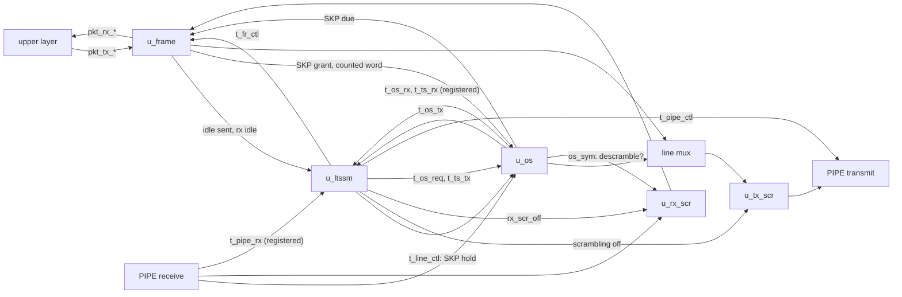

# pcie_mac MAS

How `pcie_mac` implements its [HAS](../../arch/mac/HAS.md): four blocks,
the scrambler (one per direction), the ordered sets, the frame and the
LTSSM, files of the one `mac` IP (decision Q24), joined by the top with a
line mux and one register stage on each side of PIPE. The HAS and its
sub-pages ([LTSSM](../../arch/mac/LTSSM.md), [arcs](../../arch/mac/ARCS.md),
[symbols](../../arch/mac/SYMBOLS.md)) own the rules; this page owns the
blocks' interfaces to each other, how each applies the rules, and the
structure. Every block is step for step the
[architecture model](../../arch/mac/MODEL.md), and so is the whole mac
after its fixed [pipeline offsets](#pipeline-and-the-model).

## Top

**Ports.** The top ports are the HAS ports, flat, one to one: they mirror
the PIPE signal names and the `phy` packet stream, so they stay `logic`
(Q25 exception). Inside, every block-to-block bundle is a packed struct
from [`pcie_mac_pkg`](#package) or [`common_pkg`](../common/common_pkg.md)
(Q25), named below; the top packs and unpacks them at its ports.

**Line mux.** The frame's word while its `tx_act_o` is 1, else the
ordered-set block's; the two never drive at once (assertion
`a_one_line_source`), and nothing drives while the LTSSM holds the
transmitter in electrical idle (`a_no_line_in_ei`).

- A **requested** set (`t_os_req`) reaches `u_os` only while the frame does
  not act, so a set waits for the frame's abort word to finish.
- A **scheduled SKP** may start (`u_os.tx_skp_ok_i`) on the frame's grant
  (`skp_gnt_o`), or at a set boundary while the LTSSM asks for TS or the
  loopback pattern; never in electrical idle, in the compliance pattern or
  as a loopback slave.
- **Loopback slave.** While the LTSSM's `line_o.skp_hold` is 1, `u_os`
  counts no word and schedules no SKP (`tx_skp_hold_i`), and the frame's
  `skp_req_i` drops the SKP-due term (a set still finishing keeps it), so
  the frame sends idle symbols with the count held.
- The frame's `skp_req_i` is `u_os`'s SKP-due output OR a set in progress
  (`os_cont_q`: the last word was not the last of its set), so the frame
  yields the line from the moment a SKP is due to the last word of any
  set, including a TS2 still finishing when the LTSSM enters
  Configuration.Idle or Recovery.Idle.
- Every frame word on the line is counted for the SKP schedule
  (`u_os.tx_count_i` is `fr_tx_act`), and the LTSSM's idle-sent count sees
  a frame word without a packet symbol.

**Scramblers.** `u_tx_scr` takes every line word, scrambling the frame's
data symbols (packet and idle) and passing ordered-set symbols and the
loopback pattern (`scr_i` = `{2{fr_tx_act && !line_o.tx_scr_off}}`).
`u_rx_scr` takes every parsed receive word (RxValid 1, RxElecIdle 0) and
descrambles the data symbols outside an ordered set: its `scr_i` is the
inverse of `u_os`'s `os_sym` marks of the same raw word, all 0 while
`rx_scr_off` is 1. On both sides a word that is not parsed or sent holds the
LFSR (the scrambler's `valid_i`, [#140](https://github.com/amichai-bd/pcie-factory/issues/140)).
Disable Scrambling ([symbols page](../../arch/mac/SYMBOLS.md#scrambling)):
`tx_scr_off` is the LTSSM's registered flag, which goes with the word the
state sends; `rx_scr_off` is its next value, because the raw word is
descrambled one cycle before the LTSSM step that takes it, and the model
descrambles a word with the flag of the step before.

**Receive stage.** `u_os` parses the raw PIPE word; its events and TS
fields (`os_rx_q`, `os_ts_q`) and the word's PIPE status (`rx_st_q`) are
registered once, as `u_rx_scr` registers the descrambled word. So in the
next cycle the LTSSM sees the events, the status and the frame's idle
marks (`rx_idle_o`, combinational) of the same word, and the frame
parses it with the LTSSM's `rx_l0` of the step before, exactly as the
model's step does.

**Transmit stage.** The LTSSM's PIPE controls (`t_pipe_ctl`) and `u_os`'s
TxCompliance are registered once (`pipe_q`, `compliance_q`), so they leave
with the word the scrambler registers. `pipe_reset_no` comes straight from
the LTSSM, so it rises in the first cycle after reset (HAS).

**Receiver errors.** `rcv_err_o` is the frame's registered framing error
OR an RxStatus error of the same word (`status_err_q`), so one pulse per
word.

### Pipeline and the model

With *X(k)* the PIPE word the mac samples at rising edge *k*: the LTSSM's
step at edge *k*+1 is the model's step on *X(k)*, so `ltssm_state_o`,
`link_up_o` and `pipe_reset_no` after edge *k*+1 are the model's after
that step; the PIPE transmit word and controls after edge *k*+2 are what
the model's step returns. The DV compares with these offsets every cycle
([DV plan](../../dv/mac/DV_PLAN.md#strategy)).

| Path | Cycles |
| --- | --- |
| Accepted transmit beat to its first symbol on `pipe_tx_data_o` | 1 (the scrambler register; HAS budget 3) |
| Received STP or SDP to the `sop` beat | 3, plus 1 when it is in `[15:8]` (descrambler 1, frame 2; HAS budget 3 + 1); 1 more for a one-beat packet ended by EDB in `[15:8]` |
| A received word to the LTSSM step that takes it | 1 edge after the word is sampled (the receive stage) |

## Package

[`pcie_mac_pkg`](../../../../src/rtl/mac/pcie_mac_pkg.sv) holds what only
the mac uses; the codes it shares with other IPs (symbols, LTSSM states,
L0s sub-states, PowerDown) and the PIPE bundles `t_word` (data, datak),
`t_pipe_rx` (PhyStatus, RxValid, RxElecIdle, RxStatus) and `t_pipe_ctl`
are in [`common_pkg`](../common/common_pkg.md). Everything is named
`pkg::item`, never imported.

| Struct | Between | Fields |
| --- | --- | --- |
| `t_pkt_tx`, `t_pkt_rx` | ports, frame | The packet beat; valid and ready stay single wires on transmit. |
| `t_os_req` | LTSSM, top, os | One request each: ts, skp, eios, fts, compliance, pattern (the loopback master's). |
| `t_ts_tx` | LTSSM, os | TS fields sent: ts2, link and lane (PAD flag, byte), control bits 2:0. |
| `t_os_tx` | os, LTSSM, top | The line word's events: valid, ack (a requested set starts), last, compliance. |
| `t_os_rx` | os, top, LTSSM | Receive events: `os_sym[1:0]`, ts, ts_bad, skp, eios, fts. |
| `t_ts_rx` | os, top, LTSSM | Received TS fields: ts2, ts_inv, link and lane (byte, PAD, number), N_FTS, control bits 4:0. |
| `t_fr_ctl` | LTSSM, frame | tx_l0, tx_stop, rx_l0. |
| `t_line_ctl` | LTSSM, top, os | skp_hold (loopback slave), tx_scr_off (Disable Scrambling, transmit). |
| `t_fr_tx_stat` | frame, LTSSM | The frame's status of this cycle's line word: it is the frame's two idle symbols (idle), it carries a packet symbol (pkt), packet symbols remain after it (open), the upper layer offers a beat (offer, `pkt_tx_valid_i`). |
| `t_link_req` | ports, LTSSM | retrain, hot_reset, disable_link, loopback, pm_state. |

Internal state structs: `t_rx_state` (the ordered-set parser); the
frame's `t_fr_tx_ctl` and `t_fr_tx_data` (transmit), `t_fr_rx_ctl` and
`t_fr_rx_data` (parser, with the idle tail's waiting beat) and `t_fr_rxq` (the receive queue of `t_rx_beat`),
split into reset and unreset registers; `t_regs` (every LTSSM register),
with the power states' registers in its `t_pm_regs` field `pm`. The end of
an LTSSM step is the pure function `step_end(go, nxt, ctx)`: from the
step's context `t_end_ctx` and the state it ends in, the PIPE control,
transmit mode, Disable Scrambling and TS fields of `t_step_end`;
`arc_target(i)` lists the `N_ARC_TARGETS` states it is evaluated at
([Timing](#timing)).

## Scrambler

`pcie_mac_scrambler` applies the [scrambling rules](../../arch/mac/SYMBOLS.md#scrambling)
to a word of two symbols per cycle: `valid_i`, `word_i` (`t_word`),
`scr_i[1:0]` in; `valid_o`, `word_o` one cycle later. Adapted from the seed
`pcie_top_lfsr` (same repository, Apache-2.0, last present at commit
`07a9d2a`; retired in #91; Q2).

In a cycle with `valid_i` 1, symbol 0 then symbol 1, each seeing the LFSR
the previous one left:

| Symbol | Output byte | LFSR after it |
| --- | --- | --- |
| K, BCh (COM) | unchanged | FFFFh |
| K, 1Ch (SKP) | unchanged | unchanged |
| Any other K | unchanged | advanced |
| Data, `scr_i` 1 | XOR the key of the value before it | advanced |
| Data, `scr_i` 0 | unchanged | advanced |

A data byte equal to BCh or 1Ch is data. `valid_i` 0 holds the LFSR: the
top drives it with a line word on transmit and a parsed word on receive,
the [hold rule](../../arch/mac/SYMBOLS.md#scrambling);
`rst_i` sets it to FFFFh and `valid_o` to 0. One shift moves the LFSR
left, the bit out of bit 15 is the key bit and, when 1, XORs 0039h in; a
key byte is eight key bits, the first in bit 0 (package functions
`lfsr_key`, `lfsr_advance`). Descrambling is the same block on the
received stream.

Structure: `state_q` (16 bits), the two lanes chained combinationally
(`lane_state`), an output register (`valid_q`, `data_q`, `datak_q`; 35
flops). Assertions: the all-zero state is unreachable (`a_lfsr_nonzero`),
a COM in symbol 1 reseeds (`a_com_reseeds`), a word of two SKP holds
(`a_skp_holds`), and per lane (`g_lane_check`, either symbol) a COM
loads the seed (`a_com_reseeds_lane`), a SKP holds (`a_skp_holds_lane`)
and any other symbol advances (`a_other_advances_lane`); only symbols with
`scr_i` set change (`a_unscrambled_pass`). The per-lane assertions reuse
the package's `lfsr_advance`, so a wrong `lfsr_advance` or `lfsr_key` is
caught by the shadow model's symbol comparison, not by them.

| Decision | Rationale | Rejected |
| --- | --- | --- |
| Per-symbol `scr_i`; K symbols never changed | The user knows which data symbols are TS or pattern symbols; one port serves TS, compliance, loopback and Disable Scrambling. | A global disable port; classifying TS inside the block. |
| COM and SKP decoded inside | The LFSR rules hold for every user and both directions. | Reseed and advance controls from the user. |
| Registered output | PIPE transmit leaves from a flop. | Combinational output. |

## Ordered sets

`pcie_mac_os` sends TS1, TS2, SKP, EIOS, FTS, the compliance pattern and
the loopback master's data pattern, keeps the
[SKP schedule](../../arch/mac/SYMBOLS.md#skp-schedule), and
recognises received ordered sets, decoding the TS fields. It makes no
LTSSM decision (no run counting, no comparison with `N`).

| Port | Dir | Type | Description |
| --- | --- | --- | --- |
| `tx_req_i` | in | `t_os_req` | Level requests, at most one high (assertion); taken when the set starts. A held request sends sets back to back. |
| `tx_ts_i` | in | `t_ts_tx` | The TS fields, taken at the start of a TS. |
| `tx_skp_due_o` | out | 1 | At least 1180 counted symbols since the last SKP; a register, compared on the count's next value (`a_skp_due_matches`). |
| `tx_skp_ok_i` | in | 1 | A scheduled SKP may start this cycle. |
| `tx_count_i` | in | 1 | The data source put a counted word on the line; never with `tx_o.valid`. |
| `tx_skp_hold_i` | in | 1 | Loopback slave: no word is counted and no scheduled SKP starts. |
| `tx_o` | out | `t_os_tx` | valid (this block owns the word), ack (a requested set starts), last, compliance (`[7:0]` is the first COM of a pattern unit). |
| `tx_word_o` | out | `t_word` | The word; 0 when not valid. |
| `rx_word_i`, `rx_i` | in | `t_word`, `t_pipe_rx` | The raw PIPE word and its RxValid and RxElecIdle. |
| `rx_ev_o` | out | `t_os_rx` | Events of this word, combinational. |
| `rx_fields_o` | out | `t_ts_rx` | Fields of the TS ending with `rx_ev_o.ts`, from registers. |

**Transmit.** Every set starts in `[7:0]`: TS (COM, link), (lane, N_FTS),
(02h, control), then five words of the identifier (4Ah TS1, 45h TS2; link
and lane PAD when flagged); SKP (COM, SKP), (SKP, SKP); EIOS with IDL; FTS
with FTS; compliance (COM, D21.5) with `tx_o.compliance`, then (COM,
D10.2); the pattern is one word of two data symbols, a byte count and
the count plus 1 (`pat_q`, mod 256, from 0 at reset, +2 per pattern word).
With no set in progress it starts, first, a scheduled SKP when
due, `tx_skp_ok_i` and not `tx_skp_hold_i`, else the requested set (`tx_o.ack`); the first word
goes out in the start cycle and a set always completes. The TS fields are
registered at the start of every set (a SKP start loads them too; only a
TS reads them, [#149](https://github.com/amichai-bd/pcie-factory/issues/149)).
The SKP count adds 2 per counted word (every word of this block but the
compliance pattern, and every `tx_count_i`; none while `tx_skp_hold_i`),
a scheduled SKP subtracts 1180, a requested SKP restarts it at 0, and it
saturates (an assertion fails first).

**Receive.** Parsed symbols (RxValid 1, RxElecIdle 0), `[7:0]` first, move
a five-phase parser (`t_rx_state`, function `rx_step`): a COM starts a set
in every phase (and cuts a TS short: `ts_bad`); after COM, SKP gives `skp`,
IDL `eios`, FTS `fts`, and any other symbol (data, PAD, another K) is TS
symbol 1; a TS takes 15 symbols, then decodes: the ten identifier symbols
must be one data symbol, 4Ah, 45h or their inverses B5h, BAh (`ts`,
`ts2`, `ts_inv`), else `ts_bad`. A SKP body runs while SKP, an EIOS or
FTS body while IDL or FTS. `os_sym` marks every symbol from a COM to the
one that ends the set. Fields report PAD, a number or another K symbol;
N_FTS and control are bytes. A TS continues across a receive gap, as in
the model. At most one of `ts` and `ts_bad`, and one of `skp`, `eios` and
`fts`, per word (assertions).

| Decision | Rationale | Rejected |
| --- | --- | --- |
| One event per received set; runs counted in the LTSSM | What a TS must match depends on the state. | Counting identical TS here. |
| SKP schedule here, boundary from the frame | The count covers both blocks' words; only the frame knows its packet boundaries. | A second counter in the frame. |
| Combinational events and first word | The model reacts in the symbol's cycle; the top's single receive stage keeps the LTSSM aligned. | Registered events inside the block. |

## Frame

`pcie_mac_frame` frames the upper packet stream into L0 symbols and parses
received symbols back into realigned beats, applying the HAS
[Transmit](../../arch/mac/HAS.md#transmit) and
[Receive](../../arch/mac/HAS.md#receive) rules and the symbols page
[framing](../../arch/mac/SYMBOLS.md#framing). It neither scrambles nor
counts the SKP interval.

| Port | Dir | Type | Description |
| --- | --- | --- | --- |
| `pkt_tx_valid_i`, `pkt_tx_ready_o`, `pkt_tx_i` | in, out, in | 1, 1, `t_pkt_tx` | Upper transmit; ready is combinational from registers, `ctl_i`, `skp_req_i` and `rst_i`, never from valid. |
| `pkt_rx_o` | out | `t_pkt_rx` | Upper receive beat; no ready. |
| `ctl_i` | in | `t_fr_ctl` | From the LTSSM. `tx_l0`: the line is the frame's; 1 in L0 and also in Configuration.Idle and Recovery.Idle, where the frame is the only source of idle symbols, and as a loopback slave, with `tx_stop` 1 so no packet starts. `tx_stop`: start no packet. `rx_l0`: main state L0 with `Rx_L0`. |
| `skp_req_i`, `skp_gnt_o` | in, out | 1, 1 | SKP due or a set in progress; the line is the ordered-set block's this cycle. |
| `tx_act_o`, `tx_word_o` | out | 1, `t_word` | The frame drives the line with this unscrambled word. |
| `tx_stat_o` | out | `t_fr_tx_stat` | The word's status for the LTSSM: idle (driven, no packet symbol), pkt (a packet symbol), open (line-open after it: the L1 and L2 entry wait), offer (`pkt_tx_valid_i`). |
| `rx_word_i`, `rx_i` | in | `t_word`, `t_pipe_rx` | The descrambled word and its PIPE status. |
| `rx_frame_err_o` | out | 1 | One cycle after a word with a framing error. |
| `rx_idle_o` | out | 2 | Same cycle: bit *i*, symbol *i* is idle data (00h after descrambling, outside a packet, an ordered set and a resync). |

**Transmit.** A packet is *upper-open* from its accepted `sop` to its
accepted `eop`, *line-open* from its STP or SDP word to its END or EDB
word. Ready is 1 while upper-open, otherwise `tx_l0` and not `tx_stop`,
not `skp_req_i` and not line-open. The grant is `tx_l0`, `skp_req_i` and
not line-open; `tx_act_o` is (`tx_l0` or line-open) and not the grant.
Words, first matching row:

| Case | Word `[7:0]`, `[15:8]` |
| --- | --- |
| Line-open and (`tx_l0` 0, or upper-open with valid 0): abort | EDB, idle. No longer line-open; remaining beats are taken and discarded. |
| Line-open, upper-open | The carried byte, the beat's `[7:0]`; `[15:8]` is carried. |
| Line-open only: end word | The carried byte, then END, or EDB for a nullified TLP. |
| An accepted `sop` beat | STP or SDP, the beat's `[7:0]`; `[15:8]` is carried. |
| Otherwise | Idle, idle (only while `tx_l0`). |

A packet of *n* bytes takes *n*/2 + 1 words and ready is 0 for one cycle
after each `eop`. `pkt_tx_nullify_i` is ignored for a DLLP. The upper
layer's sop rules are asserted.

**Receive.** Per word: the previous word's EDB in `[15:8]` is decided
(idle tail, below); an open packet ends bad when `rx_l0` is 0, RxValid
is 0 or RxElecIdle is 1 (a cut; the last two with `rx_l0` 1 are a framing
error without resync), and an RxStatus error marks it bad; then
symbols are parsed, `[7:0]` first. Ordered sets are skipped in every state
(COM and 15 TS symbols, or a run of SKP, IDL or FTS); a COM inside a
packet ends it bad. Packets start only while `rx_l0` is 1, and framing
errors count only then. A framing error sets resync, which discards
symbols without further errors up to the next STP, SDP, END or EDB, and
ends whenever `rx_l0` is 0 (an L0 exit or receive L0s), as the model's
leaving `Rx_L0` does. A packet ends bad when cut, ended by a framing
error, marked by RxStatus, odd in length, a DLLP not 6 bytes, or a DLLP
ended by EDB; else a TLP ended by EDB is nullified.

- **Empty packets.** STP or SDP followed at once by its end has no beat:
  it is dropped. Ended by END or EDB, or cut by RxValid or electrical idle,
  in `Rx_L0`, it is a framing error; like any cut in `Rx_L0`, it sets no
  resync; cut by leaving `Rx_L0` it is dropped silently
  ([#153](https://github.com/amichai-bd/pcie-factory/issues/153);
  [HAS](../../arch/mac/HAS.md#receive)).
- **Idle tail** ([HAS](../../arch/mac/HAS.md#receive)). A packet ended by
  EDB in `[15:8]` closes, but its `eop` beat waits in `rxd.tail`
  (`tail_v`); an EDB in `[15:8]` outside a packet that would be a framing
  error sets `tail_ferr` instead. Step 0 of the next word decides. If that
  word is received (RxValid 1, RxElecIdle 0), the beat goes out as formed,
  and `tail_ferr` raises the framing error, with resync while `rx_l0`.
  If not, the beat goes out with `err` and without `nullify`, a framing
  error while `rx_l0`, and `tail_ferr` is dropped. The waiting beat is the
  cycle's first push: the next word holds at most an STP and one byte of a
  new packet, so it pushes nothing else (`a_rx_tail_closed`,
  `a_rx_pend_push_first`). An empty packet ended so has no beat and is a
  framing error either way, raised at once.
- **Realignment.** Bytes pair into beats with the first byte in `[7:0]` of
  `sop`; a complete beat waits (pending) until the next symbol shows
  whether it is the last; an odd packet ends with 00h in `[15:8]`.
- **Queue.** Two registered `t_rx_beat` entries, the head presented and
  popped every cycle it is valid; two pushes in a cycle only after a
  pending beat, so it never overflows (`a_rx_queue_overflow`,
  `a_rx_pend_push_first`); err and nullify only with eop.

| Decision | Rationale | Rejected |
| --- | --- | --- |
| Combinational transmit word | Zero latency inside the TX budget. | A registered word. |
| The frame parses ordered-set lengths itself | It needs packet and idle positions independently of `u_os`'s fields. | A per-symbol input from `u_os`. |
| Hold the last complete beat for the next symbol | eop and flags ride on the last beat. | An empty eop beat. |
| An EDB in `[15:8]` decided by the next word through a registered beat (`tail`) | Only the next word tells the PCS's idle tail from a received EDB; the register keeps the PIPE inputs registered and the model step for step. | Reading `pipe_rx_*` before the receive stage (an unregistered input path into the frame). |
| Combinational `rx_idle_o`, registered `rx_frame_err_o` | The LTSSM counts idle symbols of the word whose ordered-set events it sees in the same cycle (model alignment); `rcv_err_o` is a registered output anyway. | A registered idle mark (one cycle behind the events). |

## LTSSM

`pcie_mac_ltssm` is the main machine, its timers, the PIPE power, receiver
detection, polarity, loopback and scrambling control, and the transmit
control of `u_os` and `u_frame`: the [LTSSM page](../../arch/mac/LTSSM.md)
and the [arcs page](../../arch/mac/ARCS.md) for the **core states**
(Detect, Polling, Configuration x1 in both roles, L0, Recovery), the
[power states](#power-states) (the L0s sub-machines with the FTS exit, L1,
L2) and the [control states](#control-states) (Disabled, Hot Reset,
Loopback master and slave). Parameters `TIMEOUT_DIV`, `ERR_TIMEOUT_DIV`,
`N_FTS` (the `Rx_L0s.FTS` timeout) and `L0S_IDLE_CYCLES` as in the HAS.

| Port | Dir | Type | Description |
| --- | --- | --- | --- |
| `port_role_i`, `link_up_o`, `ltssm_state_o` | in, out, out | 1, 1, 6 | As the HAS ports. |
| `req_i` | in | `t_link_req` | Link control: retrain, the downstream Hot Reset and Disabled requests, loopback, and `pm_state`, the power request (L0s allowed, L1, L2). |
| `pipe_o`, `pipe_rx_i` | out, in | `t_pipe_ctl`, `t_pipe_rx` | PIPE control and status. |
| `os_req_o`, `ts_o`, `os_tx_i` | out, out, in | `t_os_req`, `t_ts_tx`, `t_os_tx` | Requests (TS, compliance, EIOS, loopback pattern, FTS, the SKP that ends an FTS sequence), TS fields with the control bits, the line word's events. |
| `os_rx_i`, `os_ts_i` | in | `t_os_rx`, `t_ts_rx` | Receive events and fields of the word. |
| `fr_o` | out | `t_fr_ctl` | The frame's controls. |
| `line_o` | out | `t_line_ctl` | SKP hold (loopback slave) and transmit scrambling off. |
| `rx_scr_off_o` | out | 1 | Receive scrambling off, for the word the next step takes: the next value of the flag, the one output that is not a register ([Top](#top)). |
| `partner_n_fts_o` | out | 8 | The partner's N_FTS from the TS2 that advance Configuration.Complete or Recovery.RcvrCfg; 255 until learned. `Tx_L0s.FTS` sends that many FTS. |
| `fr_tx_i`, `fr_rx_idle_i` | in | `t_fr_tx_stat`, 2 | The frame's status of the line word (idle, packet, open, offer); the received word's idle marks. |

Every output but `rx_scr_off_o` is a register. One step per cycle, in the model's order:

1. **PIPE status.** The first low PhyStatus after reset marks the PCS
   ready; after that a high cycle completes receiver detection (while
   detecting; RxStatus 3 is a receiver) or the pending PowerDown change.
2. **Events.** A TS updates the runs of the state's conditions (`go`,
   `pad`, `renum`, `mism`; a bad or inverted TS restarts all, and an
   inverted one in Polling sets polarity); idle symbols update the idle
   run (a parsed symbol neither idle nor in an ordered set restarts it, a
   TS ending in the word first); electrical idle, EIOS and a retrain in L0
   are noted; TS (`os_tx_i.ack` with a TS request) and idle words sent in
   the previous cycle are counted. Upstream, `N` is learned from a TS1
   whose link field is a data symbol in Configuration.Linkwidth.Start. The
   control runs (`run_hr`, `run_dis`, `run_lb`: TS1 with the bit;
   `run_dscr`: Configuration.Complete's go TS2 with Disable Scrambling)
   count in the states whose arcs read them. In L0, an EIOS in `Rx_L0`
   moves the receive sub-machine to `Rx_L0s.Entry` (or, with L1 or L2
   requested, is noted for their entry) and a SKP in `Rx_L0s.FTS` returns
   it to `Rx_L0`.
3. **The arc**, in the arcs page's row order; on entry the timer and every
   per-state count restart. In L0 (below) the sub-machines step first.
4. **PIPE control and transmit mode** of the state the step ends in: the
   transmitter is active when the state sends something, a set is
   unfinished (`os_tx_i.valid` and not `last`) or an EIOS is queued, in P0
   with no change pending; otherwise it is in electrical idle and only then
   may PowerDown move, one change at a time, and between two low-power
   states through P0 (P2 to P1). Detect.Active raises TxDetectRx in P1.
   `fr_o.tx_l0` is 1 in Configuration.Idle, Recovery.Idle, L0 and as a
   loopback slave while active, with `tx_stop` 1 outside L0 and while a
   Recovery exit waits in L0.

| Transmit mode (`t_tx_mode`) | States | Line |
| --- | --- | --- |
| `TX_NONE` | Detect; after an EIOS; `Tx_L0s.Entry`, `.Idle`, the upstream wait, L1, L2 | Electrical idle. |
| `TX_TS` | Polling, Configuration, RcvrLock, RcvrCfg; Disabled (16 TS1), Hot Reset, Loopback.Entry master | `u_os` TS with `ts_o`; the control bits follow the state. |
| `TX_IDLE`, `TX_L0` | Configuration.Idle, Recovery.Idle, L0 with a Recovery exit waiting; L0 | The frame. |
| `TX_COMPLIANCE` | Polling.Compliance | `u_os` compliance pattern. |
| `TX_EIOS` | Disabled after its 16 TS1, Loopback.Exit; the queued EIOS of transmit L0s, L1, L2 and the upstream wait | One `u_os` EIOS (`eios_done` once taken; `eios_q` while queued), only from a transmitter that is sending. |
| `TX_PATTERN` | Loopback.Active master | `u_os` pattern words. |
| `TX_LOOP` | Loopback.Entry and .Active slave | The frame's idle, TxDetectRx high, `line_o.skp_hold`. |
| `TX_FTS` | `Tx_L0s.FTS` | `u_os` FTS, the partner's N_FTS of them, then the SKP. |

`link_up_o` is set on every entry to L0 and cleared on entry to
Detect.Quiet, Polling.Active, Disabled, Hot Reset and Loopback.Entry. Polling.Active advances on the live run of
8 matching TS together with 1024 TS1 sent, as the model does (the
[LTSSM page](../../arch/mac/LTSSM.md#common-rules) states this exception to
the latched runs).

### Power states

The L0 step, in the model's order:

- **Receive sub-machine, timed arcs.** `Rx_L0s.Entry` to `.Idle` 3 cycles
  after entry; `.Idle` to `.FTS` on EI exit (electrical idle since
  `.Entry`, then not); in `.FTS` the timeout, the smaller of 2 x `N_FTS` +
  32 and 4 x `N_FTS` + 12 cycles, is latched (`rx_cnt`, `rx_fts_to`).
- **Main exit conditions.** Recovery: the FTS timeout, a TS or electrical
  idle without an EIOS in `Rx_L0`, the directed requests, a retrain, or the
  upstream wait withdrawn with the transmitter idle 3 cycles. L1 or L2:
  `pm_state_req_i` 2 or 3 and an EIOS received (`ev_eios_pm`, or the
  receiver in `.Entry` or `.Idle`), downstream or after the upstream wait.
  Otherwise an upstream port asked for L1 or L2, in `Tx_L0` with no
  packet on the line (`fr_tx_i.open` 0), starts its wait: one EIOS, then
  electrical idle in P0 (`pm_wait`). A Recovery exit is latched
  (`l0_exit`).
- **Transmit sub-machine.** `Tx_L0` to `.Entry` with no exit pending,
  `pm_state_req_i` 1 and `L0S_IDLE_CYCLES` words without traffic
  (`idle_cnt`: a word sent in `Tx_L0` with no packet symbol and no beat
  offered); `.Entry` to `.Idle` after the EIOS, 3 cycles of electrical idle
  (the shared `ei_cycles`) and the P0s acknowledge; `.Idle` to `.FTS` on a pending exit,
  a beat offered (`fr_tx_i.offer`, `pkt_tx_valid_i` as sampled) or a
  request other than 1; `.FTS` to `Tx_L0` once P0 is acknowledged and the
  partner's N_FTS FTS (`fts_sent`) and the closing SKP (`fts_skp`) are
  sent.
- **Main exit**, only with the transmitter in `Tx_L0`, the receiver not in
  `.Entry` nor in `.FTS` before its timeout, and for L1 or L2 no packet on
  the line. While a Recovery exit waits the frame sends idle (`TX_IDLE`).

Transmit modes: `TX_EIOS` requests one EIOS, queued (`eios_q`) on entry
to `Tx_L0s.Entry`, L1.Entry and L2.Idle and at the start of the upstream
wait, when the transmitter is not already idle, and held until `u_os`
takes it; `TX_FTS` requests FTS while fewer than the partner's N_FTS have
started, then the SKP (`u_os` restarts its SKP count). L1.Entry goes to
L1.Idle after the EIOS, 3 cycles of idle and the P1 acknowledge; L1.Idle
to Recovery.RcvrLock on a request of 0 or 1 or EI exit; L2.Idle to
Detect.Quiet once P2 is acknowledged and the request is not 3 or EI exit.
PowerDown: P0s in `.Entry` and `.Idle`, P1 in L1, P2 in L2.Idle, each
entered from P0 after the transmitter is idle.

### Control states

One `always_comb` proposes the control states' arcs
([arcs page](../../arch/mac/ARCS.md#control-states)); the arcs into them
sit first in Configuration.Linkwidth.Start's and Recovery.Idle's blocks.

- **Directed or master** (`directed`) is the request at entry: Disabled
  and Hot Reset downstream only, Loopback.Entry in either role;
  Loopback.Active keeps Loopback.Entry's. In Recovery.Idle a directed
  request wins over every received control bit (`ri_directed`), Hot Reset
  before Disabled before Loopback; in Linkwidth.Start Loopback (requested
  or received) comes before Disabled.
- **Disabled** sends TS1 until `dis_ts` counts 16 started, then requests
  one EIOS, then electrical idle with PowerDown P1. Directed, it leaves
  once in electrical idle with the request low. Following, it leaves on
  an EIOS received and then EI exit (`ei_after_eios`: electrical idle in a
  word after the one with the EIOS), or on the 2 ms timeout with no EIOS.
- **Hot Reset** sends TS1 with the bit. Its timer is the dwell (2 ms,
  divided by `TIMEOUT_DIV`): directed, from entry, and it waits for the
  request to fall; following, the timer restarts on each TS1 that keeps a
  run of 2 with the bit (`hr_restart`), and the step that restarts it
  never leaves.
- **Loopback.Entry**: the master sends TS1 with Loopback and leaves on 2
  received back, or on the 2 ms timeout to Loopback.Exit; the slave leaves
  in its first step. **Loopback.Active**: the master sends the pattern and
  leaves when its request falls; the slave loops and leaves on an EIOS.
  **Loopback.Exit** sends one EIOS and leaves after 3 cycles of electrical
  idle (`ei_cycles`).
- **TS fields.** Disabled and Loopback.Entry keep the link and lane of the
  state they came from: Linkwidth.Start's, else link `N` and lane 0.
- **Disable Scrambling.** `dscr` latches 2 consecutive matching TS2 with
  the bit in Configuration.Complete; the arc to Configuration.Idle then
  sets `scr_off`, and entry to Detect.Quiet clears it.

### Structure

Every arc of the [arcs page](../../arch/mac/ARCS.md) is implemented; none
is stubbed. Structure: every register is a field of `t_regs`, one
`COMMON_DFF_RST_VAL` with `REGS_RESET`; the power states' registers are
its `t_pm_regs` field. One match decode of the received fields; one
`always_comb` per state group proposes the arc (L0 with its
sub-machines; a group's target is used only when its arc is taken); one
builds the next registers. The end of the step (`pcie_mac_pkg::step_end`:
transmit mode, PowerDown, electrical idle, the EIOS queue, receiver
detection, Disable Scrambling, the TS fields) is evaluated for the step
that stays and, at every target state in parallel, for the step that
takes its arc; the arc's target picks one of the latter and `go` picks
between the two ([Timing](#timing)). The state timeout is a register
(`timeout_q`, `a_timeout_matches`). Assertions cover the legal
state, one group, nothing sent in Detect, the transmitter only in P0, one
PowerDown change at a time in electrical idle and only to or from P0,
detection only in Detect.Active, polarity only in Polling, the link down in
Detect, Polling and the control states, the loopback modes only in
Loopback and the pattern only from the master, one EIOS per state outside
L0, scrambling on in Detect and Polling, counters in range, timeouts
always taken, P0s only in transmit L0s, L1.Idle in P1 and electrical idle,
`Tx_L0s.Idle` in electrical idle, an EIOS only while sending, and the L0
exit only from `Tx_L0`.

| Decision | Rationale | Rejected |
| --- | --- | --- |
| Step for step the model's `Mac` | The DV compares every cycle (Q4). | A looser arc-sequence comparison. |
| A started set keeps the transmitter active | The model finishes an ordered set before electrical idle. | Cutting a TS at a state change. |
| The frame reports the line word (`t_fr_tx_stat`) | The L0s idle count and the L1/L2 wait need the word just built, as the model's queue. | Rebuilding packet boundaries in the LTSSM. |
| `TX_FTS` covers the FTS and the closing SKP | One mode, decoded with the FTS count. | A separate SKP mode. |
| The loopback pattern and the EIOS from `u_os`, the slave's idle from the frame | One source per symbol kind; the line mux and the SKP schedule stay as they are. | A pattern generator in the LTSSM; a third line source. |
| Receive scrambling off from the next-state flag | The model descrambles a word with the flag of the step before the one that takes it; the receive stage puts the descrambler one cycle earlier. | The registered flag (one word late: the first idle word in Configuration.Idle would be descrambled). |

## Timing

One clock, `clk_i`, one synchronous reset, no crossing. The longest paths
are one LTSSM step: a received word (the descrambled word through the
frame's idle marks and the run counters) or a transmit event (the LTSSM's
mode through the frame's line grant and the ordered-set block's start,
`os_tx_i`), through the state group's arc into the next registers, the
PIPE control register and `rx_scr_off_o`. The `phy` ASIC flow
([#235](https://github.com/amichai-bd/pcie-factory/issues/235)) cuts them
without moving a cycle; each change keeps every register's next value, as
an equivalence check of the module before and after proved:

- **Step end in parallel.** `step_end` runs for the step that stays and at
  every one of the `N_ARC_TARGETS` targets (each a constant, so each copy
  is small; `a_arc_target_listed` checks that every arc's target is
  listed); the target selects with an AND-OR and `go` selects last, so
  neither the arc nor its target is in series with the transmit mode,
  PowerDown and EIOS logic. `active` is written without the new EIOS (a
  new EIOS needs mode `TX_NONE`).
- **Registered compares.** The state timeout (`timeout_q`: next step's
  timeout is the timer at `limit - 2` now, unless the timer restarts) and
  the SKP due flag (`tx_skp_due_o`) are registers; their assertions check
  them against the compares they replace every cycle.
- **Compares before the increment.** The TS count's `MIN_TS1` and the FTS
  count's `N_FTS` checks compare the registered count and the count plus 1
  in parallel and let the transmit event select.
- **L0 target without its gate.** The L0 arc's target (Recovery.RcvrLock,
  or L1 or L2 entry) no longer waits for the arc's gate; it is read only
  when the arc is taken.

## Files

| File | Holds |
| --- | --- |
| [`pcie_mac_pkg.sv`](../../../../src/rtl/mac/pcie_mac_pkg.sv) | The [package](#package). |
| [`pcie_mac_scrambler.sv`](../../../../src/rtl/mac/pcie_mac_scrambler.sv) | The [scrambler](#scrambler). |
| [`pcie_mac_os.sv`](../../../../src/rtl/mac/pcie_mac_os.sv) | The [ordered sets](#ordered-sets). |
| [`pcie_mac_frame.sv`](../../../../src/rtl/mac/pcie_mac_frame.sv) | The [frame](#frame). |
| [`pcie_mac_ltssm.sv`](../../../../src/rtl/mac/pcie_mac_ltssm.sv) | The [LTSSM](#ltssm). |
| [`pcie_mac.sv`](../../../../src/rtl/mac/pcie_mac.sv) | The [top](#top). |
| [`mac.rtl.f`](../../../../src/rtl/mac/mac.rtl.f) | `-F` of `common_macros.rtl.f` and `common_pkg.rtl.f`, then the package, the blocks and the top. |
