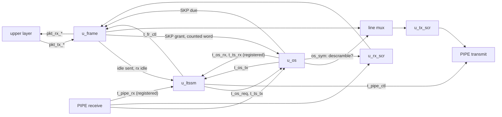

# pcie_mac MAS

How `pcie_mac` implements its [HAS](../../arch/mac/HAS.md): four blocks,
the scrambler (one per direction), the ordered sets, the frame and the
LTSSM, files of the one `mac` IP (decision Q24), joined by the top with a
line mux and one register stage on each side of PIPE. The HAS and its
sub-pages ([LTSSM](../../arch/mac/LTSSM.md), [arcs](../../arch/mac/ARCS.md),
[symbols](../../arch/mac/SYMBOLS.md)) own the rules; this page owns the
blocks' interfaces to each other, how each applies the rules, and the
structure. Every block is step for step the
[architecture model](../../arch/mac/MODEL.md), and so is the whole mac
after its fixed [pipeline offsets](#pipeline-and-the-model).

## Top

**Ports.** The top ports are the HAS ports, flat, one to one: they mirror
the PIPE signal names and the `phy` packet stream, so they stay `logic`
(Q25 exception). Inside, every block-to-block bundle is a packed struct
from [`pcie_mac_pkg`](#package) or [`common_pkg`](../common/common_pkg.md)
(Q25), named below; the top packs and unpacks them at its ports.

**Line mux.** The frame's word while its `tx_act_o` is 1, else the
ordered-set block's; the two never drive at once (assertion
`a_one_line_source`), and nothing drives while the LTSSM holds the
transmitter in electrical idle (`a_no_line_in_ei`).

- A **requested** set (`t_os_req`) reaches `u_os` only while the frame does
  not act, so a set waits for the frame's abort word to finish.
- A **scheduled SKP** may start (`u_os.tx_skp_ok_i`) on the frame's grant
  (`skp_gnt_o`), or at a set boundary while the LTSSM asks for TS; never in
  electrical idle or in the compliance pattern.
- The frame's `skp_req_i` is `u_os`'s SKP-due output OR a set in progress
  (`os_cont_q`: the last word was not the last of its set), so the frame
  yields the line from the moment a SKP is due to the last word of any
  set, including a TS2 still finishing when the LTSSM enters
  Configuration.Idle or Recovery.Idle.
- Every frame word on the line is counted for the SKP schedule
  (`u_os.tx_count_i` is `fr_tx_act`), and the LTSSM's idle-sent count sees
  a frame word without a packet symbol.

**Scramblers.** `u_tx_scr` takes every line word, scrambling the frame's
data symbols (packet and idle) and passing ordered-set symbols
(`scr_i` = `{2{fr_tx_act}}`). `u_rx_scr` takes every parsed receive word
(RxValid 1, RxElecIdle 0) and descrambles the data symbols outside an
ordered set: its `scr_i` is the inverse of `u_os`'s `os_sym` marks of the
same raw word. On both sides a word that is not parsed or sent holds the
LFSR (the scrambler's `valid_i`, [#140](https://github.com/amichai-bd/pcie-factory/issues/140)).

**Receive stage.** `u_os` parses the raw PIPE word; its events and TS
fields (`os_rx_q`, `os_ts_q`) and the word's PIPE status (`rx_st_q`) are
registered once, as `u_rx_scr` registers the descrambled word. So in the
next cycle the LTSSM sees the events, the status and the frame's idle
marks (`rx_idle_o`, combinational) of the same word, and the frame
parses it with the LTSSM's `rx_l0` of the step before, exactly as the
model's step does.

**Transmit stage.** The LTSSM's PIPE controls (`t_pipe_ctl`) and `u_os`'s
TxCompliance are registered once (`pipe_q`, `compliance_q`), so they leave
with the word the scrambler registers. `pipe_reset_no` comes straight from
the LTSSM, so it rises in the first cycle after reset (HAS).

**Receiver errors.** `rcv_err_o` is the frame's registered framing error
OR an RxStatus error of the same word (`status_err_q`), so one pulse per
word.

### Pipeline and the model

With *X(k)* the PIPE word the mac samples at rising edge *k*: the LTSSM's
step at edge *k*+1 is the model's step on *X(k)*, so `ltssm_state_o`,
`link_up_o` and `pipe_reset_no` after edge *k*+1 are the model's after
that step; the PIPE transmit word and controls after edge *k*+2 are what
the model's step returns. The DV compares with these offsets every cycle
([DV plan](../../dv/mac/DV_PLAN.md#strategy)).

| Path | Cycles |
| --- | --- |
| Accepted transmit beat to its first symbol on `pipe_tx_data_o` | 1 (the scrambler register; HAS budget 3) |
| Received STP or SDP to the `sop` beat | 3, plus 1 when it is in `[15:8]` (descrambler 1, frame 2; HAS budget 3 + 1) |
| A received word to the LTSSM step that takes it | 1 edge after the word is sampled (the receive stage) |

## Package

[`pcie_mac_pkg`](../../../../src/rtl/mac/pcie_mac_pkg.sv) holds what only
the mac uses; the codes it shares with other IPs (symbols, LTSSM states,
L0s sub-states, PowerDown) and the PIPE bundles `t_word` (data, datak),
`t_pipe_rx` (PhyStatus, RxValid, RxElecIdle, RxStatus) and `t_pipe_ctl`
are in [`common_pkg`](../common/common_pkg.md). Everything is named
`pkg::item`, never imported.

| Struct | Between | Fields |
| --- | --- | --- |
| `t_pkt_tx`, `t_pkt_rx` | ports, frame | The packet beat; valid and ready stay single wires on transmit. |
| `t_os_req` | LTSSM, top, os | One request each: ts, skp, eios, fts, compliance. |
| `t_ts_tx` | LTSSM, os | TS fields sent: ts2, link and lane (PAD flag, byte), control bits 2:0. |
| `t_os_tx` | os, LTSSM, top | The line word's events: valid, ack (a requested set starts), last, compliance. |
| `t_os_rx` | os, top, LTSSM | Receive events: `os_sym[1:0]`, ts, ts_bad, skp, eios, fts. |
| `t_ts_rx` | os, top, LTSSM | Received TS fields: ts2, ts_inv, link and lane (byte, PAD, number), N_FTS, control bits 4:0. |
| `t_fr_ctl` | LTSSM, frame | tx_l0, tx_stop, rx_l0. |
| `t_link_req` | ports, LTSSM | retrain, hot_reset, disable_link, loopback, pm_state. |

Internal state structs: `t_rx_state` (the ordered-set parser); the
frame's `t_fr_tx_ctl` and `t_fr_tx_data` (transmit), `t_fr_rx_ctl` and
`t_fr_rx_data` (parser) and `t_fr_rxq` (the receive queue of `t_rx_beat`),
split into reset and unreset registers; `t_regs` (every LTSSM register).

## Scrambler

`pcie_mac_scrambler` applies the [scrambling rules](../../arch/mac/SYMBOLS.md#scrambling)
to a word of two symbols per cycle: `valid_i`, `word_i` (`t_word`),
`scr_i[1:0]` in; `valid_o`, `word_o` one cycle later. Adapted from the seed
`pcie_top_lfsr` (same repository, Apache-2.0; Q2).

In a cycle with `valid_i` 1, symbol 0 then symbol 1, each seeing the LFSR
the previous one left:

| Symbol | Output byte | LFSR after it |
| --- | --- | --- |
| K, BCh (COM) | unchanged | FFFFh |
| K, 1Ch (SKP) | unchanged | unchanged |
| Any other K | unchanged | advanced |
| Data, `scr_i` 1 | XOR the key of the value before it | advanced |
| Data, `scr_i` 0 | unchanged | advanced |

A data byte equal to BCh or 1Ch is data. `valid_i` 0 holds the LFSR;
`rst_i` sets it to FFFFh and `valid_o` to 0. One shift moves the LFSR
left, the bit out of bit 15 is the key bit and, when 1, XORs 0039h in; a
key byte is eight key bits, the first in bit 0 (package functions
`lfsr_key`, `lfsr_advance`). Descrambling is the same block on the
received stream.

Structure: `state_q` (16 bits), the two lanes chained combinationally
(`lane_state`), an output register (`valid_q`, `data_q`, `datak_q`; 35
flops). Assertions: the all-zero state is unreachable (`a_lfsr_nonzero`),
a COM in symbol 1 reseeds (`a_com_reseeds`), a word of two SKP holds
(`a_skp_holds`), only symbols with `scr_i` set change
(`a_unscrambled_pass`).

| Decision | Rationale | Rejected |
| --- | --- | --- |
| Per-symbol `scr_i`; K symbols never changed | The user knows which data symbols are TS or pattern symbols; one port serves TS, compliance, loopback and a future disable. | A global disable port; classifying TS inside the block. |
| COM and SKP decoded inside | The LFSR rules hold for every user and both directions. | Reseed and advance controls from the user. |
| Registered output | PIPE transmit leaves from a flop. | Combinational output. |

## Ordered sets

`pcie_mac_os` sends TS1, TS2, SKP, EIOS, FTS and the compliance pattern,
keeps the [SKP schedule](../../arch/mac/SYMBOLS.md#skp-schedule), and
recognises received ordered sets, decoding the TS fields. It makes no
LTSSM decision (no run counting, no comparison with `N`).

| Port | Dir | Type | Description |
| --- | --- | --- | --- |
| `tx_req_i` | in | `t_os_req` | Level requests, at most one high (assertion); taken when the set starts. A held request sends sets back to back. |
| `tx_ts_i` | in | `t_ts_tx` | The TS fields, taken at the start of a TS. |
| `tx_skp_due_o` | out | 1 | At least 1180 counted symbols since the last SKP. |
| `tx_skp_ok_i` | in | 1 | A scheduled SKP may start this cycle. |
| `tx_count_i` | in | 1 | The data source put a counted word on the line; never with `tx_o.valid`. |
| `tx_o` | out | `t_os_tx` | valid (this block owns the word), ack (a requested set starts), last, compliance (`[7:0]` is the first COM of a pattern unit). |
| `tx_word_o` | out | `t_word` | The word; 0 when not valid. |
| `rx_word_i`, `rx_i` | in | `t_word`, `t_pipe_rx` | The raw PIPE word and its RxValid and RxElecIdle. |
| `rx_ev_o` | out | `t_os_rx` | Events of this word, combinational. |
| `rx_fields_o` | out | `t_ts_rx` | Fields of the TS ending with `rx_ev_o.ts`, from registers. |

**Transmit.** Every set starts in `[7:0]`: TS (COM, link), (lane, N_FTS),
(02h, control), then five words of the identifier (4Ah TS1, 45h TS2; link
and lane PAD when flagged); SKP (COM, SKP), (SKP, SKP); EIOS with IDL; FTS
with FTS; compliance (COM, D21.5) with `tx_o.compliance`, then (COM,
D10.2). With no set in progress it starts, first, a scheduled SKP when
due and `tx_skp_ok_i`, else the requested set (`tx_o.ack`); the first word
goes out in the start cycle and a set always completes. The TS fields are
registered at the start of every set (a SKP start loads them too; only a
TS reads them, [#149](https://github.com/amichai-bd/pcie-factory/issues/149)).
The SKP count adds 2 per counted word (every word of this block but the
compliance pattern, and every `tx_count_i`), a scheduled SKP subtracts
1180, a requested SKP restarts it at 0, and it saturates (an assertion
fails first).

**Receive.** Parsed symbols (RxValid 1, RxElecIdle 0), `[7:0]` first, move
a five-phase parser (`t_rx_state`, function `rx_step`): a COM starts a set
in every phase (and cuts a TS short: `ts_bad`); after COM, SKP gives `skp`,
IDL `eios`, FTS `fts`, and any other symbol (data, PAD, another K) is TS
symbol 1; a TS takes 15 symbols, then decodes: the ten identifier symbols
must be one data symbol, 4Ah, 45h or their inverses B5h, BAh (`ts`,
`ts2`, `ts_inv`), else `ts_bad`. A SKP body runs while SKP, an EIOS or
FTS body while IDL or FTS. `os_sym` marks every symbol from a COM to the
one that ends the set. Fields report PAD, a number or another K symbol;
N_FTS and control are bytes. A TS continues across a receive gap, as in
the model. At most one of `ts` and `ts_bad`, and one of `skp`, `eios` and
`fts`, per word (assertions).

| Decision | Rationale | Rejected |
| --- | --- | --- |
| One event per received set; runs counted in the LTSSM | What a TS must match depends on the state. | Counting identical TS here. |
| SKP schedule here, boundary from the frame | The count covers both blocks' words; only the frame knows its packet boundaries. | A second counter in the frame. |
| Combinational events and first word | The model reacts in the symbol's cycle; the top's single receive stage keeps the LTSSM aligned. | Registered events inside the block. |

## Frame

`pcie_mac_frame` frames the upper packet stream into L0 symbols and parses
received symbols back into realigned beats, applying the HAS
[Transmit](../../arch/mac/HAS.md#transmit) and
[Receive](../../arch/mac/HAS.md#receive) rules and the symbols page
[framing](../../arch/mac/SYMBOLS.md#framing). It neither scrambles nor
counts the SKP interval.

| Port | Dir | Type | Description |
| --- | --- | --- | --- |
| `pkt_tx_valid_i`, `pkt_tx_ready_o`, `pkt_tx_i` | in, out, in | 1, 1, `t_pkt_tx` | Upper transmit; ready is combinational from registers, `ctl_i`, `skp_req_i` and `rst_i`, never from valid. |
| `pkt_rx_o` | out | `t_pkt_rx` | Upper receive beat; no ready. |
| `ctl_i` | in | `t_fr_ctl` | From the LTSSM. `tx_l0`: the line is the frame's; 1 in L0 and also in Configuration.Idle and Recovery.Idle, where the frame is the only source of idle symbols, with `tx_stop` 1 so no packet starts. `tx_stop`: start no packet. `rx_l0`: main state L0 with `Rx_L0`. |
| `skp_req_i`, `skp_gnt_o` | in, out | 1, 1 | SKP due or a set in progress; the line is the ordered-set block's this cycle. |
| `tx_act_o`, `tx_word_o`, `tx_pkt_o` | out | 1, `t_word`, 1 | The frame drives the line with this unscrambled word; it carries a packet symbol. |
| `rx_word_i`, `rx_i` | in | `t_word`, `t_pipe_rx` | The descrambled word and its PIPE status. |
| `rx_frame_err_o` | out | 1 | One cycle after a word with a framing error. |
| `rx_idle_o` | out | 2 | Same cycle: bit *i*, symbol *i* is idle data (00h after descrambling, outside a packet, an ordered set and a resync). |

**Transmit.** A packet is *upper-open* from its accepted `sop` to its
accepted `eop`, *line-open* from its STP or SDP word to its END or EDB
word. Ready is 1 while upper-open, otherwise `tx_l0` and not `tx_stop`,
not `skp_req_i` and not line-open. The grant is `tx_l0`, `skp_req_i` and
not line-open; `tx_act_o` is (`tx_l0` or line-open) and not the grant.
Words, first matching row:

| Case | Word `[7:0]`, `[15:8]` |
| --- | --- |
| Line-open and (`tx_l0` 0, or upper-open with valid 0): abort | EDB, idle. No longer line-open; remaining beats are taken and discarded. |
| Line-open, upper-open | The carried byte, the beat's `[7:0]`; `[15:8]` is carried. |
| Line-open only: end word | The carried byte, then END, or EDB for a nullified TLP. |
| An accepted `sop` beat | STP or SDP, the beat's `[7:0]`; `[15:8]` is carried. |
| Otherwise | Idle, idle (only while `tx_l0`). |

A packet of *n* bytes takes *n*/2 + 1 words and ready is 0 for one cycle
after each `eop`. `pkt_tx_nullify_i` is ignored for a DLLP. The upper
layer's sop rules are asserted.

**Receive.** Per word: an open packet ends bad when `rx_l0` is 0, RxValid
is 0 or RxElecIdle is 1 (a cut), and an RxStatus error marks it bad; then
symbols are parsed, `[7:0]` first. Ordered sets are skipped in every state
(COM and 15 TS symbols, or a run of SKP, IDL or FTS); a COM inside a
packet ends it bad. Packets start only while `rx_l0` is 1, and framing
errors count only then. A framing error sets resync, which discards
symbols without further errors up to the next STP, SDP, END or EDB, and
ends whenever `rx_l0` is 0 (an L0 exit or receive L0s), as the model's
leaving `Rx_L0` does. A packet ends bad when cut, ended by a framing
error, marked by RxStatus, odd in length, a DLLP not 6 bytes, or a DLLP
ended by EDB; else a TLP ended by EDB is nullified.

- **Empty packets.** STP or SDP followed at once by its end has no beat:
  it is dropped. Ended by END or EDB, or cut by RxValid or electrical idle,
  in `Rx_L0`, it is a framing error, the one framing error that sets no
  resync; cut by leaving `Rx_L0` it is dropped silently
  ([#153](https://github.com/amichai-bd/pcie-factory/issues/153);
  [HAS](../../arch/mac/HAS.md#receive)).
- **Realignment.** Bytes pair into beats with the first byte in `[7:0]` of
  `sop`; a complete beat waits (pending) until the next symbol shows
  whether it is the last; an odd packet ends with 00h in `[15:8]`.
- **Queue.** Two registered `t_rx_beat` entries, the head presented and
  popped every cycle it is valid; two pushes in a cycle only after a
  pending beat, so it never overflows (`a_rx_queue_overflow`,
  `a_rx_pend_push_first`); err and nullify only with eop.

| Decision | Rationale | Rejected |
| --- | --- | --- |
| Combinational transmit word | Zero latency inside the TX budget. | A registered word. |
| The frame parses ordered-set lengths itself | It needs packet and idle positions independently of `u_os`'s fields. | A per-symbol input from `u_os`. |
| Hold the last complete beat for the next symbol | eop and flags ride on the last beat. | An empty eop beat. |
| Combinational `rx_idle_o`, registered `rx_frame_err_o` | The LTSSM counts idle symbols of the word whose ordered-set events it sees in the same cycle (model alignment); `rcv_err_o` is a registered output anyway. | A registered idle mark (one cycle behind the events). |

## LTSSM

`pcie_mac_ltssm` is the main machine, its timers, the PIPE power, receiver
detection and polarity control, and the transmit control of `u_os` and
`u_frame`: the [LTSSM page](../../arch/mac/LTSSM.md) and the
[arcs page](../../arch/mac/ARCS.md) for the **core states** (Detect,
Polling, Configuration x1 in both roles, L0, Recovery). The power states
([#79](https://github.com/amichai-bd/pcie-factory/issues/79)) and the
control states ([#80](https://github.com/amichai-bd/pcie-factory/issues/80))
have empty blocks, and the arcs into them are [stubbed](#stubbed-arcs).
Parameters `TIMEOUT_DIV` and `ERR_TIMEOUT_DIV` as in the HAS.

| Port | Dir | Type | Description |
| --- | --- | --- | --- |
| `port_role_i`, `link_up_o`, `ltssm_state_o` | in, out, out | 1, 1, 6 | As the HAS ports. |
| `req_i` | in | `t_link_req` | Link control; hot reset, disable and loopback only take L0 to Recovery today. |
| `pipe_o`, `pipe_rx_i` | out, in | `t_pipe_ctl`, `t_pipe_rx` | PIPE control and status. |
| `os_req_o`, `ts_o`, `os_tx_i` | out, out, in | `t_os_req`, `t_ts_tx`, `t_os_tx` | Requests (TS or compliance only), TS fields, the line word's events. |
| `os_rx_i`, `os_ts_i` | in | `t_os_rx`, `t_ts_rx` | Receive events and fields of the word. |
| `fr_o` | out | `t_fr_ctl` | The frame's controls. |
| `partner_n_fts_o` | out | 8 | The partner's N_FTS from the TS2 that advance Configuration.Complete or Recovery.RcvrCfg; 255 until learned (for `Tx_L0s.FTS`, #79). |
| `fr_tx_idle_i`, `fr_rx_idle_i` | in | 1, 2 | The line word is the frame's two idle symbols; the received word's idle marks. |

Every output is a register. One step per cycle, in the model's order:

1. **PIPE status.** The first low PhyStatus after reset marks the PCS
   ready; after that a high cycle completes receiver detection (while
   detecting; RxStatus 3 is a receiver) or the pending PowerDown change.
2. **Events.** A TS updates the runs of the state's conditions (`go`,
   `pad`, `renum`, `mism`; a bad or inverted TS restarts all, and an
   inverted one in Polling sets polarity); idle symbols update the idle
   run (a parsed symbol neither idle nor in an ordered set restarts it, a
   TS ending in the word first); electrical idle, EIOS and a retrain in L0
   are noted; TS (`os_tx_i.ack` with a TS request) and idle words sent in
   the previous cycle are counted. Upstream, `N` is learned from a TS1
   whose link field is a data symbol in Configuration.Linkwidth.Start.
3. **The arc**, in the arcs page's row order; on entry the timer and every
   per-state count restart.
4. **PIPE control and transmit mode** of the state the step ends in: the
   transmitter is active when the state sends something or a set is
   unfinished (`os_tx_i.valid` and not `last`), in P0 with no change
   pending; otherwise it is in electrical idle and only then may PowerDown
   move, one change at a time. Detect.Active raises TxDetectRx in P1.
   `fr_o.tx_l0` is 1 in Configuration.Idle, Recovery.Idle and L0 while
   active, with `tx_stop` 1 outside L0.

`link_up_o` is set on every entry to L0 and cleared on entry to
Detect.Quiet and Polling.Active. Polling.Active advances on the live run of
8 matching TS together with 1024 TS1 sent, as the model does (the
[LTSSM page](../../arch/mac/LTSSM.md#common-rules) states this exception to
the latched runs).

### Stubbed arcs

Each sits in its state's priority order with a constant-0 condition:
`cfg_linkwidth_start__loopback_entry`, `cfg_linkwidth_start__disabled`,
`recovery_idle__hot_reset`, `recovery_idle__disabled`,
`recovery_idle__loopback_entry` (#80); `l0__l1_entry`, `l0__l2_idle`
(#79). The sub-machines stay in `Tx_L0` and `Rx_L0` in L0, and an EIOS
received in L0 is only noted (`a_l0s_core_only`, `a_no_stub_state`).

Structure: every register is a field of `t_regs`, one
`COMMON_DFF_RST_VAL` with `REGS_RESET`; one match decode of the received
fields; one `always_comb` per state group proposes the arc; one builds the
next registers. Assertions cover the legal state, one group, nothing sent
in Detect, the transmitter only in P0, one PowerDown change at a time in
electrical idle, detection only in Detect.Active, polarity only in
Polling, the link down in Detect and Polling, counters in range and
timeouts always taken.

| Decision | Rationale | Rejected |
| --- | --- | --- |
| Step for step the model's `Mac` | The DV compares every cycle (Q4). | A looser arc-sequence comparison. |
| A started set keeps the transmitter active | The model finishes an ordered set before electrical idle. | Cutting a TS at a state change. |
| Stubs as constant-0 conditions in place | #79 and #80 add states without moving arcs. | Leaving the arcs out. |

## Timing

One clock, `clk_i`, one synchronous reset, no crossing. The longest paths
are the frame's two receive symbol steps into its queue, the descrambled
word through the frame's idle marks into the LTSSM's run counters, and
the line mux through the transmit scrambler's two lanes; each a few
levels of logic at 125 MHz.

## Files

| File | Holds |
| --- | --- |
| [`pcie_mac_pkg.sv`](../../../../src/rtl/mac/pcie_mac_pkg.sv) | The [package](#package). |
| [`pcie_mac_scrambler.sv`](../../../../src/rtl/mac/pcie_mac_scrambler.sv) | The [scrambler](#scrambler). |
| [`pcie_mac_os.sv`](../../../../src/rtl/mac/pcie_mac_os.sv) | The [ordered sets](#ordered-sets). |
| [`pcie_mac_frame.sv`](../../../../src/rtl/mac/pcie_mac_frame.sv) | The [frame](#frame). |
| [`pcie_mac_ltssm.sv`](../../../../src/rtl/mac/pcie_mac_ltssm.sv) | The [LTSSM](#ltssm). |
| [`pcie_mac.sv`](../../../../src/rtl/mac/pcie_mac.sv) | The [top](#top). |
| [`mac.rtl.f`](../../../../src/rtl/mac/mac.rtl.f) | `-F` of `common_macros.rtl.f` and `common_pkg.rtl.f`, then the package, the blocks and the top. |
