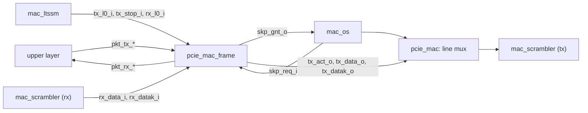

# pcie_mac_frame MAS

`pcie_mac_frame` is the packet datapath of [`pcie_mac`](../../arch/mac/HAS.md):
it frames the upper packet stream into L0 symbols (STP or SDP, the bytes,
END or EDB, logical idle between packets) under the HAS ready rules, yields
the line to the ordered-set transmitter when a SKP ordered set is due, and
parses received symbols back into realigned packet beats with `err` and
`nullify`, reporting framing errors. As a sub-IP it has no HAS: the rules
it implements are the mac HAS ([Transmit](../../arch/mac/HAS.md#transmit),
[Receive](../../arch/mac/HAS.md#receive)) and the symbols page
([Framing](../../arch/mac/SYMBOLS.md#framing)); this page owns its ports,
how it applies those rules, and its structure.

It does not scramble (symbols cross its boundary unscrambled), does not
count the SKP interval (the ordered-set transmitter, `mac_os`, owns the
[SKP schedule](../../arch/mac/SYMBOLS.md#skp-schedule) and asks for the
line), decides no LTSSM state, and decodes no ordered set beyond skipping
its symbols.

## Position

`pcie_mac` ([#78](https://github.com/amichai-bd/pcie-factory/issues/78))
selects the transmit word: the frame's when `tx_act_o` is 1, else the
ordered-set transmitter's. Until then the `pcie_mac` shell instantiates the
frame with the LTSSM controls tied off (no L0), which keeps it inert.

## Interfaces

One clock, `clk_i`; synchronous, active-high `rst_i`. The sibling ports are
plain `logic`; the package [`pcie_mac_frame_pkg`](#files) holds only this
sub-IP's own types and constants.

| Port | Dir | Width | Description |
| --- | --- | --- | --- |
| `clk_i`, `rst_i` | in | 1, 1 | Clock; synchronous active-high reset. |
| `pkt_tx_valid_i`, `pkt_tx_ready_o` | in, out | 1, 1 | Upper transmit handshake ([HAS](../../arch/mac/HAS.md#transmit)). `pkt_tx_ready_o` is combinational from the state and `tx_l0_i`, `tx_stop_i`, `skp_req_i`, `rst_i`, never from `pkt_tx_valid_i`. |
| `pkt_tx_data_i` | in | 16 | Two bytes, `[7:0]` first. |
| `pkt_tx_sop_i`, `pkt_tx_eop_i` | in | 1, 1 | First and last beat. |
| `pkt_tx_dllp_i` | in | 1 | 0 TLP, 1 DLLP; read on the `sop` beat. |
| `pkt_tx_nullify_i` | in | 1 | On a TLP's `eop` beat: end it with EDB. Ignored for a DLLP. |
| `pkt_rx_valid_o` | out | 1 | A received beat; no ready. |
| `pkt_rx_data_o` | out | 16 | Two bytes, `[7:0]` first. |
| `pkt_rx_sop_o`, `pkt_rx_eop_o` | out | 1, 1 | First and last beat. |
| `pkt_rx_dllp_o` | out | 1 | 0 TLP (STP), 1 DLLP (SDP), on every beat. |
| `pkt_rx_err_o`, `pkt_rx_nullify_o` | out | 1, 1 | With `eop` only: ended bad, or nullified; never both. |
| `tx_l0_i` | in | 1 | From the LTSSM: main state L0, transmit sub-machine `Tx_L0` and the transmitter active. While 1 the line is the frame's. |
| `tx_stop_i` | in | 1 | From the LTSSM: start no packet (an exit from L0 is pending, or the upstream port waits for L1 or L2 entry). |
| `rx_l0_i` | in | 1 | From the LTSSM: main state L0 and receive sub-machine `Rx_L0`. |
| `skp_req_i` | in | 1 | From the ordered-set transmitter: a SKP ordered set is due; held from the moment it falls due until the last word of the last due SKP ordered set. |
| `skp_gnt_o` | out | 1 | The ordered-set transmitter sends its SKP word this cycle. |
| `tx_act_o` | out | 1 | The frame drives the line this cycle with `tx_data_o`, `tx_datak_o`. |
| `tx_data_o`, `tx_datak_o` | out | 16, 2 | The word, unscrambled, `[7:0]` first; bit *i* of `datak` marks byte *i* as K. Every data symbol it sends is to be scrambled. |
| `tx_pkt_o` | out | 1 | The word carries a packet symbol (for the LTSSM's L0s idle count and L1/L2 entry). |
| `rx_data_i`, `rx_datak_i` | in | 16, 2 | Received word after the descrambler, `[7:0]` first. The frame reads data bytes only outside ordered sets, where the descrambler has removed the key. |
| `rx_valid_i`, `rx_elec_idle_i`, `rx_status_i` | in | 1, 1, 3 | PIPE RxValid, RxElecIdle and RxStatus of the same word. |
| `rx_frame_err_o` | out | 1 | One cycle after a word with at least one framing error. `pcie_mac` ORs it with RxStatus 4 to 7 into `rcv_err_o`. |
| `rx_idle_o` | out | 2 | One cycle after the word: bit *i* is 1 when symbol *i* was an idle data symbol (00h after descrambling, outside a packet, an ordered set and a resync), for the LTSSM's idle counts. |

## Parameters

None.

## Behavior

### Reset

While `rst_i` is 1, `pkt_tx_ready_o`, `pkt_rx_valid_o`, `pkt_rx_sop_o`,
`pkt_rx_eop_o`, `pkt_rx_err_o`, `pkt_rx_nullify_o`, `skp_gnt_o`,
`tx_act_o`, `tx_pkt_o`, `rx_frame_err_o` and `rx_idle_o` are 0 in that same
cycle, whatever the state (reset wins over the sop-to-eop ready rule,
[HAS](../../arch/mac/HAS.md#reset-values)). The registered state clears at
the edge: no packet is open in either direction, the receive queue is
empty, and the parser is outside any ordered set.

### Transmit

A packet is *upper-open* from its accepted `sop` beat to its accepted `eop`
beat, and *line-open* from the word carrying its STP or SDP to the word
carrying its END or EDB. Each cycle:

- **Ready.** `pkt_tx_ready_o` is 1 while upper-open. Otherwise it is
  `tx_l0_i` and not `tx_stop_i`, not `skp_req_i` and not line-open (the
  previous packet's end word not yet sent).
- **Grant.** `skp_gnt_o` is `tx_l0_i` and `skp_req_i` and not line-open:
  a SKP due inside a packet waits for its end word, and a SKP due between
  packets goes at once. The ordered-set transmitter keeps `skp_req_i` high
  while more are due, so they go back to back.
- **Line.** `tx_act_o` is (`tx_l0_i` or line-open) and not `skp_gnt_o`.
- **Words**, first matching row:

| Case | Word `[7:0]`, `[15:8]` |
| --- | --- |
| Line-open and (`tx_l0_i` is 0, or upper-open with `pkt_tx_valid_i` 0): **abort** | EDB, idle data. The packet is no longer line-open; if still upper-open, its remaining beats are taken and discarded. |
| Line-open, upper-open (a beat is accepted) | The carried byte, then the beat's `[7:0]`; the beat's `[15:8]` is carried. |
| Line-open only: **end word** | The carried byte, then END, or EDB for a TLP whose `eop` beat had `pkt_tx_nullify_i` 1. |
| An accepted `sop` beat | STP (TLP) or SDP (DLLP), then the beat's `[7:0]`; `[15:8]` is carried. |
| Otherwise | Idle data, idle data (sent only while `tx_l0_i`). |

So a packet of *n* bytes takes *n*/2 + 1 words, starts in `[7:0]` and
leaves the next word in `[7:0]` too, and `pkt_tx_ready_o` is 0 for one cycle
after each `eop` beat. An aborted packet always arrives with an odd byte
count, so the receiver ends it bad. The abort word goes out in the first
cycle with `tx_l0_i` 0, with `tx_act_o` 1, so the ordered-set transmitter
starts one cycle later.

The upper layer's contract is asserted: a beat accepted outside a packet
carries `sop`, and none inside one does.

### Receive

The parser takes the word's symbols in order, `[7:0]` first, and applies
the [symbols page receive rules](../../arch/mac/SYMBOLS.md#receive) with
these readings:

- **Cuts first.** At the start of a word, an open packet ends bad when
  `rx_l0_i` is 0, `rx_valid_i` is 0 or `rx_elec_idle_i` is 1; RxStatus 4 to
  7 marks an open packet bad. Symbols are parsed only when `rx_valid_i` is 1
  and `rx_elec_idle_i` 0.
- **Ordered sets** are skipped in every state: COM, then a TS (COM and 15
  symbols), a SKP ordered set (COM and a run of SKP), or an EIOS or FTS
  ordered set (COM and a run of IDL or FTS). The symbol that ends a run is
  parsed normally. A COM inside a packet ends it bad and is a framing error.
- **Packets** start only while `rx_l0_i` is 1. Framing errors, the
  dropped empty packet included, count only while `rx_l0_i` is 1, and each
  sets the resync state, which discards symbols without further errors up
  to the next STP, SDP, END or EDB (STP and SDP clear it at once, as they
  start a packet). Resync also ends whenever `rx_l0_i` is 0 (an L0 exit or
  receive L0s), as the architecture model clears it on leaving and on
  entering L0, so idle symbols count again in Recovery.
- **Flags.** A packet ends bad (`err`) when it was cut, ended by a framing
  error, had an RxStatus error, has an odd byte count, is a DLLP of other
  than 6 bytes, or is a DLLP ended by EDB. Otherwise a TLP ended by EDB is
  `nullify`.
- **A packet with no data byte** (STP or SDP followed at once by its end)
  has no beat to carry it: it is not delivered, and it counts as a framing
  error (in L0, as above; a packet cut by leaving `Rx_L0` before its first
  byte is dropped without one). No TLP or DLLP is empty, so this is malformed framing (firstmate
  ruling on [#76](https://github.com/amichai-bd/pcie-factory/issues/76); the
  mac HAS gains the rule with
  [#146](https://github.com/amichai-bd/pcie-factory/issues/146)).

Realignment: data bytes pair into beats with the first byte of the packet
in `[7:0]` of the `sop` beat, whichever lane the STP was in. A complete
beat is held (*pending*) until the next symbol shows whether it is the
last, so its `eop` and flags are known; a packet with an odd byte count
ends with the last byte in `[7:0]` and 00h in `[15:8]`.

### Status

`rx_frame_err_o` is 1 one cycle after a word with one or more framing
errors (including a dropped empty packet). `rx_idle_o` marks idle data
symbols as defined in [Interfaces](#interfaces); outside L0 the parser
still marks them, for the Configuration.Idle and Recovery.Idle counts.

## Microarchitecture

- **Transmit.** Registers: upper-open, line-open, the carried byte, the
  packet's DLLP tag and its end symbol (END or EDB, fixed at the `eop`
  beat). Ready, grant and the word are combinational from these and the
  inputs, so an accepted beat is on `tx_data_o` in the same cycle.
- **Receive parser.** One `always_comb` runs three steps per cycle: the
  word-level cut, then symbol 0, then symbol 1. State: the ordered-set skip
  state (`t_os_state`) and TS count, packet open, DLLP tag, status-bad,
  first-beat flag, a saturating 3-bit byte count, resync, the held byte and
  the pending beat. Each step ends at most one packet or adds one byte, so
  it pushes at most one beat.
- **Output queue.** Two registered entries (`t_rx_beat`); the head is the
  upper stream's beat, popped every cycle it is valid. A cycle pushes two
  beats only when a pending beat is followed by one byte and an end; a
  pending beat forms only in a cycle that pushes nothing, and a cut or an
  empty packet pushes nothing, so the queue never holds more than two
  beats (assertions `a_rx_queue_overflow`, `a_rx_pend_push_first`).

## Decisions

| Choice | Rationale | Rejected |
| --- | --- | --- |
| The SKP schedule stays in `mac_os`; the frame only defers it with `skp_req_i`/`skp_gnt_o` | The [HAS split](../../arch/mac/HAS.md#position) gives the schedule to `mac_os`; the count runs in every state, not only in L0. `skp_req_i` is `mac_os`'s `tx_skp_due_o`, and `skp_gnt_o` serves as its `tx_skp_ok_i` (a boundary, given while due); `mac_os`'s `tx_count_i` (a counted word was sent) belongs to the line mux, which the restructure ([#146](https://github.com/amichai-bd/pcie-factory/issues/146)) wires. | A second counter in the frame. |
| Combinational transmit word | Zero added latency inside the 3-cycle TX budget; the scrambler and PIPE registers follow. | A registered word (one more cycle, and the mux would need to look ahead). |
| The frame parses ordered-set lengths itself | It needs to know which data symbols are packet or idle, independently of `mac_os`'s field decoding. | A per-symbol "in ordered set" input from `mac_os` (couples the two sub-IPs' timing). |
| Hold the last complete beat until the next symbol | `eop`, `err` and `nullify` ride on the last beat, with no empty `eop` beat. | An extra empty `eop` beat (adds bytes). |
| Empty packets dropped and counted as framing errors | A packet with no byte has no beat; a flood of them would need two beats a cycle. | Delivering a beat with don't-care data (breaks the byte count and the one-beat-per-cycle stream). |
| Registered `rx_frame_err_o` and `rx_idle_o` | Short paths into the LTSSM and the `rcv_err_o` OR. | Combinational status. |

## Timing

- Transmit: 0 cycles from an accepted beat to its symbols on `tx_data_o`;
  the mac TX budget of 3 cycles is left to the scrambler and PIPE stages.
- Receive: a packet's `sop` beat is on `pkt_rx_*` 2 cycles after the word
  holding its STP or SDP when it starts in `[7:0]`, 3 when in `[15:8]`;
  the `eop` beat at most 3 cycles after the word that ends the packet.
  The descrambler's stage is outside these counts.
- Throughput: one beat per cycle each way; back-to-back packets of *n*
  bytes use *n*/(*n*+2) of the transmit line.
- One clock, no crossing. The longest path is the receive parser's two
  symbol steps into the queue.

## Targets

| Item | Target |
| --- | --- |
| Lossless | Random packet streams with back-pressure delivered with their flags; aborted ones delivered with `err`. |
| SKP | Never inside a packet; granted at the first word after it falls due with no packet open on the line. |
| Latency | As in [Timing](#timing). |

## Open items

| Item | Owner |
| --- | --- |
| The architecture model was aligned with the [symbols page](../../arch/mac/SYMBOLS.md#receive) in this change: a COM inside a packet is a framing error, and symbols discarded during a resync raise no further error. Leaving `Rx_L0` with a packet open is still cut only by the DV adapter, not by the model. | [#78](https://github.com/amichai-bd/pcie-factory/issues/78) |

## Files

| File | Holds |
| --- | --- |
| [`pcie_mac_frame_pkg.sv`](../../../../src/rtl/mac_frame/pcie_mac_frame_pkg.sv) | The symbol bytes of the [symbols table](../../arch/mac/SYMBOLS.md#symbols) (COM, STP, SDP, END, EDB, SKP, FTS, IDL, idle data), `TS_BODY`, `DLLP_BYTES`, `t_os_state`, `t_rx_beat` and the width aliases. |
| [`pcie_mac_frame.sv`](../../../../src/rtl/mac_frame/pcie_mac_frame.sv) | The module. |
| [`mac_frame.rtl.f`](../../../../src/rtl/mac_frame/mac_frame.rtl.f) | `-F ../common/common_macros.rtl.f`, the package, then the module. |
