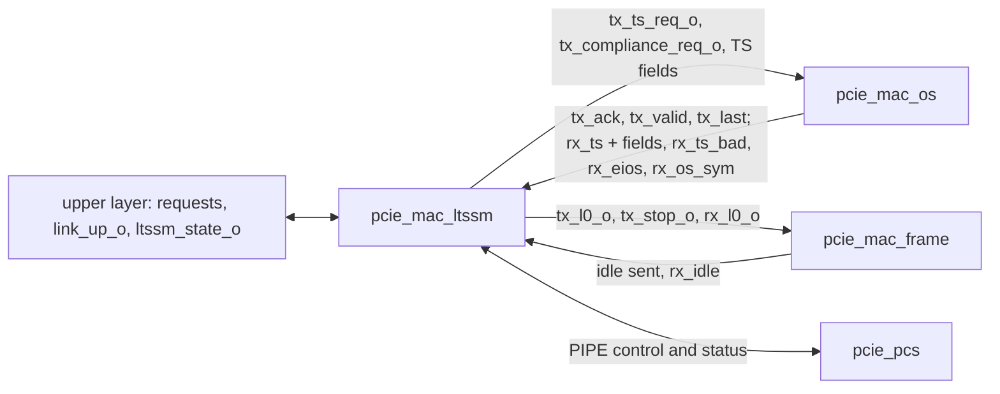

# pcie_mac_ltssm MAS

`pcie_mac_ltssm` is the link training and status state machine of
[`pcie_mac`](../../arch/mac/HAS.md): the main machine, its timers, the PIPE
power, receiver-detection and polarity control, and the transmit control of
the ordered-set and frame blocks. It implements the [LTSSM page](../../arch/mac/LTSSM.md)
and the [arcs page](../../arch/mac/ARCS.md), which stay normative; this page
owns the sub-IP's interface, the boundary to `mac_os` and the structure.

This version holds the **core states**: Detect, Polling (Active,
Configuration, and Compliance with its entry and exit), Configuration (x1,
both port roles), L0 and Recovery
([#77](https://github.com/amichai-bd/pcie-factory/issues/77)). The power
states (L0s sub-machines, L1, L2,
[#79](https://github.com/amichai-bd/pcie-factory/issues/79)) and the control
states (Disabled, Hot Reset, Loopback,
[#80](https://github.com/amichai-bd/pcie-factory/issues/80)) have their own,
still empty, blocks, and the arcs into them are stubbed in place
([Behavior](#stubbed-arcs)). It does not build or parse symbols: the
ordered-set block (`mac_os`) and the frame block (`mac_frame`) send and
decode them, and the LTSSM sees only requests, fields and events.

## Position

A sub-IP of `mac` ([HAS, Position](../../arch/mac/HAS.md#position)), reached
from `mac.rtl.f` with `-F`. No sub-IPs of its own; its package is
`pcie_mac_ltssm_pkg`, and its filelist stands alone.

## Interfaces

One clock, `clk_i`; every input is sampled and every register updates on
its rising edge. Every output is a register.

### Clock, reset, link control

| Port | Dir | Width | Description |
| --- | --- | --- | --- |
| `clk_i` | in | 1 | Core clock and PCLK, 125 MHz. |
| `rst_i` | in | 1 | Synchronous, active high. |
| `port_role_i` | in | 1 | 0 downstream, 1 upstream; changes only in reset. |
| `link_up_o` | out | 1 | [Link up](#link-up). |
| `ltssm_state_o` | out | 6 | The [state encoding](../../arch/mac/LTSSM.md#state-encoding). |
| `retrain_req_i` | in | 1 | Pulse: L0 to Recovery. |
| `hot_reset_req_i`, `disable_req_i` | in | 1, 1 | Levels, downstream role only; here they only take L0 to Recovery. |
| `loopback_req_i` | in | 1 | Level; here it only takes L0 to Recovery. |
| `pm_state_req_i` | in | 2 | Power states; unused until #79. |

### PIPE

The [HAS PIPE ports](../../arch/mac/HAS.md#pipe) the LTSSM owns, same
names; `pcie_mac` connects them one to one.

| Port | Dir | Width | Description |
| --- | --- | --- | --- |
| `pipe_reset_no` | out | 1 | 0 in reset, 1 from the first cycle after. |
| `pipe_tx_elec_idle_o` | out | 1 | The transmitter is in electrical idle. |
| `pipe_tx_detect_rx_o` | out | 1 | Receiver detection, Detect.Active only. |
| `pipe_rx_polarity_o` | out | 1 | Invert received bits. |
| `pipe_power_down_o` | out | 2 | `t_power_down`. |
| `pipe_phy_status_i` | in | 1 | PCS ready (first low), then completion pulses. |
| `pipe_rx_valid_i` | in | 1 | Symbol lock: the received word is parsed (with electrical idle low). |
| `pipe_rx_elec_idle_i` | in | 1 | The line is in electrical idle. |
| `pipe_rx_status_i` | in | 3 | 3 with the detection pulse: a receiver. |

### Sibling interfaces

Plain `logic` ports, matched one to one with the
[`mac_os` MAS](https://github.com/amichai-bd/pcie-factory/issues/75)
(its `tx_*_req_i`, `tx_ack_o`, `tx_valid_o`, `tx_last_o`, `rx_*_o`) and
the [`mac_frame` MAS](https://github.com/amichai-bd/pcie-factory/issues/76)
(`tx_l0_i`, `tx_stop_i`, `rx_l0_i`, `rx_idle_o`); inputs from them carry
the prefix `os_` or `fr_`. Each event describes the word sent or received
in the cycle it is high; the siblings' outputs are combinational from the
LTSSM's registered outputs and their own state, so there is no loop.

| Port | Dir | Width | Description |
| --- | --- | --- | --- |
| `tx_ts_req_o` | out | 1 | Level: send TS, with the fields below. Only while the transmitter is active. |
| `tx_compliance_req_o` | out | 1 | Level: send the compliance pattern (Polling.Compliance). |
| `tx_ts2_o` | out | 1 | TS2, else TS1. |
| `tx_link_pad_o`, `tx_link_o` | out | 1, 8 | Link field: PAD, else the number. |
| `tx_lane_pad_o`, `tx_lane_o` | out | 1, 8 | Lane field: PAD, else the number (always 0). |
| `tx_ctl_o` | out | 3 | Training control bits 2:0; 0 in the core states. |
| `os_tx_ack_i` | in | 1 | A requested set starts in this word; with `tx_ts_req_o` it counts a TS sent. |
| `os_tx_valid_i`, `os_tx_last_i` | in | 1, 1 | The block sends this word, and it is the last word of its set. A set with words left keeps the transmitter active. |
| `os_rx_ts_i` | in | 1 | A TS ended and decoded; the fields below describe it. |
| `os_rx_ts_bad_i` | in | 1 | A TS failed to decode or was cut short by a COM. |
| `os_rx_ts2_i`, `os_rx_ts_inv_i` | in | 1, 1 | With `os_rx_ts_i`: a TS2; inverted identifier. |
| `os_rx_link_i`, `os_rx_link_pad_i`, `os_rx_link_num_i` | in | 8, 1, 1 | Link field byte; PAD; a data symbol (neither: another K symbol, no number). |
| `os_rx_lane_i`, `os_rx_lane_pad_i`, `os_rx_lane_num_i` | in | 8, 1, 1 | Lane field, likewise. |
| `os_rx_n_fts_i` | in | 8 | N_FTS field. |
| `os_rx_ctl_i` | in | 5 | Training control bits 4:0; unused until #80. |
| `os_rx_skp_i`, `os_rx_fts_i` | in | 1, 1 | SKP and FTS ordered sets; unused until #79. |
| `os_rx_eios_i` | in | 1 | An EIOS. |
| `os_rx_os_sym_i` | in | 2 | Bit *i*: symbol *i* belongs to an ordered set. |
| `tx_l0_o` | out | 1 | The frame owns the line: it sends idle symbols, and packets unless `tx_stop_o`. 1 in Configuration.Idle, Recovery.Idle and L0 while the transmitter is active. |
| `tx_stop_o` | out | 1 | Start no packet: 1 except in L0. |
| `rx_l0_o` | out | 1 | Main state L0 with `Rx_L0`: receive packets. |
| `partner_n_fts_o` | out | 8 | The partner's N_FTS, from the TS2 that complete Configuration.Complete and Recovery.RcvrCfg; 255 until learned. For `Tx_L0s.FTS` (#79). |
| `fr_tx_idle_i` | in | 1 | The word on the line this cycle is the frame's two idle symbols. |
| `fr_rx_idle_i` | in | 2 | Bit *i*: symbol *i* of the word received this cycle is an idle symbol. |

What the LTSSM derives:

- **TS sent:** `os_tx_ack_i` while `tx_ts_req_o` is 1. **Idle sent:** two
  symbols per `fr_tx_idle_i`.
- **Unfinished set:** `os_tx_valid_i` and not `os_tx_last_i`. The
  transmitter stays active for it even when the state sends nothing, so a
  set is always finished before electrical idle; no request is made
  meanwhile.
- **Received TS:** `os_rx_ts_i` or `os_rx_ts_bad_i` ends a TS; a bad one,
  or a decoded one with `os_rx_ts_inv_i`, restarts every run.
- **Idle run:** a parsed word (`pipe_rx_valid_i` 1, `pipe_rx_elec_idle_i`
  0) counts symbol *i* as idle on `fr_rx_idle_i[i]`; a parsed symbol that
  is neither idle nor in an ordered set restarts the run; a TS ending in
  the word restarts it first.

## Parameters

| Name | Type | Default | Range | Effect |
| --- | --- | --- | --- | --- |
| `TIMEOUT_DIV` | `int unsigned` | 1 | 1 to 1024 | Divides Detect.Quiet's 12 ms ([HAS](../../arch/mac/HAS.md#parameters)). The Hot Reset dwell arrives with #80. |
| `ERR_TIMEOUT_DIV` | `int unsigned` | 1 | 1 to 1024 | Divides the 2, 24 and 48 ms error-path timeouts, each floored at 16384 cycles. |

`COMMON_ASSERT_PARAM` rejects other values. `N_FTS` and `L0S_IDLE_CYCLES`
join with #79.

## Behavior

The LTSSM is the [LTSSM page](../../arch/mac/LTSSM.md) and
[arcs page](../../arch/mac/ARCS.md) for the core states, step for step the
architecture model's `Mac` (the DV compares the two every cycle). Each
`clk_i` cycle is one step, in this order:

1. **PIPE status.** The first low `pipe_phy_status_i` after reset marks the
   PCS ready; after that a high cycle is a completion pulse: of receiver
   detection while `pipe_tx_detect_rx_o` is 1 (`pipe_rx_status_i` 3 is a
   receiver), else of the pending PowerDown change.
2. **Received events.** Each TS updates the runs of the current state's
   conditions (a TS that fails to decode or arrives inverted restarts
   them all, and an inverted one in Polling sets polarity); idle symbols
   update the idle run; electrical idle, EIOS and `retrain_req_i` (in L0)
   are noted. TS and idle symbols sent in the previous cycle are counted.
3. **The arc.** The state's arcs, in the arcs page's row order, on the
   counts after step 2. On entry, the timer and every per-state count
   restart.
4. **PIPE control and transmit mode** of the state the step ends in: the
   transmitter is active when the state sends something or a unit is
   unfinished, PowerDown is P0 and no change is pending; otherwise it is in
   electrical idle, and only then may PowerDown move to the state's value
   (P1 in Detect, P0 otherwise), one change at a time. Detect.Active raises
   `pipe_tx_detect_rx_o` in P1 with nothing pending until the result. The
   requests to `mac_os` and `mac_frame` are those of the state the step
   ends in, and only while the transmitter is active.

### Reset values

While `rst_i` is high: `ltssm_state_o` 0 (Detect.Quiet), `link_up_o` 0,
`pipe_reset_no` 0, `pipe_tx_elec_idle_o` 1, `pipe_power_down_o` P1,
`pipe_tx_detect_rx_o` and `pipe_rx_polarity_o` 0, no request to
`mac_os` or `mac_frame` (`tx_stop_o` 1, `rx_l0_o` 0), `partner_n_fts_o`
255. The Detect.Quiet timer starts in the first cycle
after reset.

### Link up

Set on every entry to L0, cleared on entry to Detect.Quiet and
Polling.Active, held otherwise. See [HAS ambiguities](#has-ambiguities).

### Stubbed arcs

Each sits in its state's priority order with a constant-0 condition, so
#79 and #80 only replace the constant and fill their group's block:

| Arc | Owner |
| --- | --- |
| `cfg_linkwidth_start__loopback_entry`, `cfg_linkwidth_start__disabled` | #80 |
| `recovery_idle__hot_reset`, `recovery_idle__disabled`, `recovery_idle__loopback_entry` | #80 |
| `l0__l1_entry`, `l0__l2_idle` | #79 |

The sub-machines stay in `Tx_L0` and `Rx_L0` in L0 (code `0x20`), so their
Off/L0 arcs (`tx_off__tx_l0`, `tx_l0__tx_off`, `rx_off__rx_l0`,
`rx_l0__rx_off`) are already taken; an EIOS received in L0 is only noted.
`hot_reset_req_i`, `disable_req_i` and `loopback_req_i` take L0 to
Recovery as the arcs page says, but Recovery.Idle cannot leave for the
control states yet.

## Microarchitecture

- **One register struct.** Every register is a field of
  `pcie_mac_ltssm_pkg::t_regs`, one `COMMON_DFF_RST_VAL` with the reset
  constant `REGS_RESET`: the state and its saturating 23-bit timer, the
  two sub-machine codes, the PIPE control registers, the transmit-control
  outputs, the link status, and the per-state counts (TS sent, runs of
  matching TS saturating at 8, latched 8-runs, TS and idle symbols sent
  after the first matching one received, the idle run).
- **Matching.** One decode of the received TS fields (PAD, a number, N,
  lane 0) and one case on the state give the four run conditions: `go`
  (the advancing arc), `pad` (the PAD exits; Recovery.Idle's lane PAD),
  `renum` and `mism`.
- **One block per state group.** Detect, Polling, Configuration, L0,
  Recovery, power and control each have an `always_comb` that proposes
  an arc (`<group>_go`, `<group>_to`); the group of the current state
  wins. The power and control blocks are empty.
- **Next registers.** One `always_comb` builds `r_d`: counts, then the
  entry clears and entry actions, then PIPE control and the TS fields of
  the state the step ends in.

## Decisions

| Choice | Rationale | Rejected |
| --- | --- | --- |
| Step-for-step the model's `Mac` | The DV can compare the RTL with the model every cycle, the strongest oracle the HAS offers (Q4). | A looser arc-sequence comparison. |
| The `mac_os` and `mac_frame` boundaries as their MAS pages define them: requests and acknowledgements, events per word | One interface per pair of blocks; the LTSSM never needs symbols. | A transmit-mode port of the LTSSM's own (this sub-IP's first draft). |
| A started set keeps the transmitter active | The model finishes an ordered set before electrical idle. | Cutting a TS short at a state change. |
| `tx_l0_o` also in Configuration.Idle and Recovery.Idle, with `tx_stop_o` | The frame is the only source of idle symbols. | Idle symbols from `mac_os`. |
| Stubs as constant-0 conditions in place | #79 and #80 add states without moving arcs or priorities. | Leaving the arcs out. |
| Own package with the full HAS encoding | The firstmate's package ruling: a sub-IP never uses its parent's package. | `pcie_mac_pkg` types. |

## HAS ambiguities

Implemented as stated here; the model agrees except where noted.

- **Link up after Configuration.Idle's timeout.** Configuration.Idle can
  time out to Recovery.RcvrLock before the link was ever up, and Recovery
  can then reach L0. The LTSSM page says `link_up_o` is set on entry to L0
  *from Configuration.Idle* and held otherwise (so it would stay 0 in L0);
  the `phy` HAS says it rises when the LTSSM *first enters L0 from
  Configuration*. The model, and this RTL, set it on every L0 entry.
- **The upstream port's link number.** The arcs page: "`N` is the link
  number of the last TS1 received with one". The RTL takes it only from a
  decoded TS1 whose link field is a data symbol; the model also takes it
  from a TS2 and from a K symbol other than PAD. They differ only on
  stimulus the partner never sends.
- **Partner N_FTS.** The RTL takes it from the matching TS2 of
  Configuration.Complete and Recovery.RcvrCfg; the model from any TS2
  received in those states.
- The HAS open items owned by #77 (Recovery.RcvrLock's timeout target,
  Lanenum.Accept's 2 ms timeout, the x1 reading of the Lanenum substates
  for the upstream role, electrical-idle inference in L0) are implemented
  as the HAS states them; the base specification was not available to
  confirm them.

## Timing

One clock and one synchronous reset; no crossing. Every output is a
register. The received events reach the next-state logic combinationally
through the run counters (a 4-bit increment and compare) and the arc
priority; the longest path is the TS field compare, the run update and
the state's arc mux into the state and PIPE registers, a few levels of
logic at 125 MHz.

## Files

| File | Holds |
| --- | --- |
| [`pcie_mac_ltssm_pkg.sv`](../../../../src/rtl/mac_ltssm/pcie_mac_ltssm_pkg.sv) | `t_ltssm_state` (full HAS encoding), `t_l0s_sub`, `t_power_down`, `t_tx_mode`, timeouts and counts, `err_timeout`, `run_next`, `after_next`, `t_regs` and `REGS_RESET`. |
| [`pcie_mac_ltssm.sv`](../../../../src/rtl/mac_ltssm/pcie_mac_ltssm.sv) | The LTSSM. |
| [`mac_ltssm.rtl.f`](../../../../src/rtl/mac_ltssm/mac_ltssm.rtl.f) | The vocabulary block, the package, the module. |
