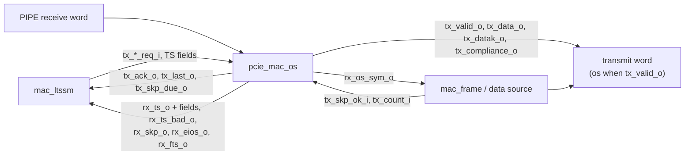

# pcie_mac_os MAS

`pcie_mac_os` is the ordered-set block of [`pcie_mac`](../../arch/mac/HAS.md#position):
it sends TS1, TS2, SKP, EIOS, FTS and the compliance pattern, keeps the
SKP schedule, and recognises the ordered sets it receives, decoding the TS
fields, two symbols per `clk_i` cycle. As a sub-IP it has no HAS of its
own: the parent's [symbols page](../../arch/mac/SYMBOLS.md#ordered-sets)
is the normative rule set, and this page owns its interface, behavior and
structure.

It makes no LTSSM decision: it does not count consecutive TS, compare
link or lane numbers with `N`, latch conditions or choose what a state
sends. Those depend on the state and belong to `mac_ltssm`
([#77](https://github.com/amichai-bd/pcie-factory/issues/77)), which sees
one event per received ordered set, with the decoded fields, and requests
one ordered set at a time. It does not scramble (`mac_scrambler`), frame
packets or send idle symbols (`mac_frame`).

## Position

When `tx_valid_o` is 1 the ordered-set word is the transmit word; otherwise
the data source's (packets, idle symbols, the loopback pattern) or
electrical idle. The selection and its place are the integration's
([#78](https://github.com/amichai-bd/pcie-factory/issues/78)). No sub-IPs.

## Interfaces

One clock, `clk_i`; every input is sampled and every register updates on
its rising edge. All ports are plain `logic` vectors, so the parent and
the sibling sub-IPs connect them without `pcie_mac_os_pkg`. A symbol is a
byte plus a K flag; in every 16-bit word `[7:0]` is the earlier symbol and
bit *i* of a `datak` vector marks byte *i* as K
([symbols page](../../arch/mac/SYMBOLS.md)).

### Clock and reset

| Port | Dir | Width | Clock | Description |
| --- | --- | --- | --- | --- |
| `clk_i` | in | 1 | - | Core clock, 125 MHz. |
| `rst_i` | in | 1 | `clk_i` | Synchronous, active-high reset. |

### Transmit requests (from the LTSSM)

| Port | Dir | Width | Description |
| --- | --- | --- | --- |
| `tx_ts_req_i` | in | 1 | Level: send a TS (TS1 or TS2 per `tx_ts2_i`) with the fields below. |
| `tx_skp_req_i` | in | 1 | Level: send a SKP ordered set on request; the SKP count restarts at 0 (the end of `Tx_L0s.FTS`). |
| `tx_eios_req_i` | in | 1 | Level: send an EIOS. |
| `tx_fts_req_i` | in | 1 | Level: send an FTS ordered set. |
| `tx_compliance_req_i` | in | 1 | Level: send the compliance pattern (one COM D21.5 COM D10.2 unit per request). |
| `tx_ts2_i` | in | 1 | 0 TS1, 1 TS2. |
| `tx_link_pad_i` | in | 1 | Link number field is PAD; `tx_link_i` is then ignored. |
| `tx_link_i` | in | 8 | Link number 0 to 255. |
| `tx_lane_pad_i` | in | 1 | Lane number field is PAD; `tx_lane_i` is then ignored. |
| `tx_lane_i` | in | 8 | Lane number. |
| `tx_ctl_i` | in | 3 | Training control bits 2:0: bit 0 Hot Reset, bit 1 Disable Link, bit 2 Loopback. Bits 7:3 are sent as 0. |
| `tx_ack_o` | out | 1 | A requested ordered set starts this cycle: its first word is on `tx_data_o` and the fields were taken from the inputs this cycle. One pulse per set sent on request. |
| `tx_last_o` | out | 1 | The last word of an ordered set (requested or scheduled) is on `tx_data_o`. |
| `tx_skp_due_o` | out | 1 | At least 1180 counted symbols since the last SKP: a SKP is due at the next boundary. |

At most one `tx_*_req_i` is high in a cycle (an assertion). The request
and its fields may change in any cycle: they are taken only in the
`tx_ack_o` cycle, so a request withdrawn while a set is in progress sends
nothing. A request
held high sends sets back to back, one per `tx_ack_o`; the LTSSM drops it
in the `tx_ack_o` cycle to send exactly one (the EIOS before electrical
idle).

### Transmit schedule (from the data source)

| Port | Dir | Width | Description |
| --- | --- | --- | --- |
| `tx_skp_ok_i` | in | 1 | A scheduled SKP may start this cycle: the line is at an ordered-set or packet boundary in a state that sends TS, idle or packets, and not in `Tx_L0s.FTS`, compliance or electrical idle. |
| `tx_count_i` | in | 1 | The data source put a counted word (two symbols) on the line this cycle: packet, idle or loopback-master symbols; never a loopback slave's. Never high while `tx_valid_o` is 1. |

### Transmit word

| Port | Dir | Width | Description |
| --- | --- | --- | --- |
| `tx_valid_o` | out | 1 | This block owns the transmit word this cycle. |
| `tx_data_o` | out | 16 | Two symbols; 0 when `tx_valid_o` is 0. |
| `tx_datak_o` | out | 2 | K flags; 0 when `tx_valid_o` is 0. |
| `tx_compliance_o` | out | 1 | The word's `[7:0]` is the first COM of a compliance pattern unit (`pipe_tx_compliance_o`). |

Ordered-set symbols are never scrambled; the scrambler resets on COM, holds
on SKP and advances on the rest ([scrambling](../../arch/mac/SYMBOLS.md#scrambling)).

### Receive

| Port | Dir | Width | Description |
| --- | --- | --- | --- |
| `rx_data_i`, `rx_datak_i` | in | 16, 2 | PIPE receive word (`pipe_rx_data_i`, `pipe_rx_datak_i`). |
| `rx_valid_i` | in | 1 | `pipe_rx_valid_i`. |
| `rx_elec_idle_i` | in | 1 | `pipe_rx_elec_idle_i`. |
| `rx_os_sym_o` | out | 2 | Bit *i*: symbol *i* of this word belongs to an ordered set (COM and the symbols this block consumes after it); the frame parser and the descrambler's scramble decision skip it. |
| `rx_ts_o` | out | 1 | A TS completed this cycle and decoded; the fields below describe it. |
| `rx_ts2_o` | out | 1 | With `rx_ts_o`: 1 TS2, 0 TS1. |
| `rx_ts_inv_o` | out | 1 | With `rx_ts_o`: the identifier symbols were the bit-inverse of the TS1 or TS2 identifier (lane polarity inverted). |
| `rx_link_o` | out | 8 | Link number field byte. |
| `rx_link_pad_o` | out | 1 | Link number field is PAD. |
| `rx_link_num_o` | out | 1 | Link number field is a data symbol (a number). Neither flag: another K symbol, which matches no number. |
| `rx_lane_o`, `rx_lane_pad_o`, `rx_lane_num_o` | out | 8, 1, 1 | Lane number field, likewise. |
| `rx_n_fts_o` | out | 8 | N_FTS field byte. |
| `rx_ctl_o` | out | 5 | Training control bits 4:0: Hot Reset, Disable Link, Loopback, Disable Scrambling, Compliance Receive. Bits 7:5 are not decoded. |
| `rx_ts_bad_o` | out | 1 | A TS failed to decode this cycle (identifier rule, or cut short by a COM). |
| `rx_skp_o` | out | 1 | A SKP ordered set was recognised (COM then SKP). |
| `rx_eios_o` | out | 1 | An EIOS was recognised (COM then IDL). |
| `rx_fts_o` | out | 1 | An FTS ordered set was recognised (COM then FTS). |

The field outputs are meaningful only with `rx_ts_o`. The receive events
are combinational from the receive word and the parser state: an event
appears in the cycle of the symbol that completes it.

### What the LTSSM builds from this

The [arc conditions](../../arch/mac/ARCS.md) need, per received TS: TS1 or
TS2 (`rx_ts2_o`), link and lane as PAD, a number or neither (the
`_pad`/`_num` flags and bytes), the partner's N_FTS (`rx_n_fts_o`), the
control bits (`rx_ctl_o`), polarity (`rx_ts_inv_o`), and the TS that break
a run (`rx_ts_bad_o`, and `rx_ts_inv_o`, which never matches). Consecutive
and counted runs are the LTSSM's, since what *matches* depends on the
state ([common rules](../../arch/mac/LTSSM.md#common-rules)); SKP, EIOS and
FTS events neither count nor break a run. On transmit, `tx_ack_o` counts
TS sent (1024 TS1 in Polling.Active, 16 TS2 after receiving one, 16 TS1 in
Disabled) and FTS sent; `tx_last_o` with the EIOS request shows the EIOS
is out.

## Parameters

| Name | Type | Default | Range | Effect |
| --- | --- | --- | --- | --- |
| `N_FTS` | `int unsigned` | 32 | 1 to 255 | Sent in the N_FTS field of every TS; the parent's parameter of the same name ([HAS, Parameters](../../arch/mac/HAS.md#parameters)). |

## Behavior

### Transmit

Each ordered set starts in `[7:0]` and is a whole number of words:

| Set | Words (`[7:0]`, `[15:8]`) |
| --- | --- |
| TS1, TS2 | (COM, link), (lane, N_FTS), (02h, control), then five words of the identifier, 4Ah for TS1 or 45h for TS2. Link and lane are PAD (K23.7) when their `_pad` input is 1, else the data byte. |
| SKP | (COM, SKP), (SKP, SKP). |
| EIOS | (COM, IDL), (IDL, IDL). |
| FTS | (COM, FTS), (FTS, FTS). |
| Compliance | (COM, D21.5 = B5h) with `tx_compliance_o` 1, then (COM, D10.2 = 4Ah). |

In a cycle with no set in progress, the block starts, in priority order:

1. a **scheduled SKP**, when `tx_skp_due_o` and `tx_skp_ok_i` are 1 (no
   `tx_ack_o`);
2. the **requested** set, when a `tx_*_req_i` is 1 (`tx_ack_o` is 1).

The first word goes out in the cycle the set starts (`tx_valid_o` is
combinational from the requests); the next set can start in the cycle after
the last word, so a held request leaves no gap. A set in progress always
completes; requests are not sampled until its last word.

**SKP schedule** ([symbols page](../../arch/mac/SYMBOLS.md#skp-schedule)):
a counter adds 2 for every counted word: each word of this block other
than the compliance pattern, and each `tx_count_i`. `tx_skp_due_o` is 1
while it is at least 1180. A scheduled SKP subtracts 1180 when it starts,
so SKP that fall due while `tx_skp_ok_i` is 0 (inside a packet, in
`Tx_L0s.FTS`) go out back to back at the next boundary; a requested SKP
sets the count to 0 when it starts. Every SKP's own two words are counted.
The counter saturates at its maximum (an assertion fails before that).

### Receive

Symbols are parsed one at a time, `[7:0]` before `[15:8]`, in cycles where
`rx_valid_i` is 1 and `rx_elec_idle_i` is 0; in other cycles the parser
holds its state and reports nothing
([symbols, receive](../../arch/mac/SYMBOLS.md#receive)). The parser is in
one of five phases:

| Phase | Symbol | Effect |
| --- | --- | --- |
| any | COM | Ordered-set symbol. In `TS`, `rx_ts_bad_o` (a TS cut short). Next: `COM`. |
| `COM` | SKP | `rx_skp_o`; next `SKP`. |
| `COM` | IDL | `rx_eios_o`; next `BODY`. |
| `COM` | FTS | `rx_fts_o`; next `BODY`. |
| `COM` | anything else (a data symbol, PAD, another K symbol) | TS symbol 1, the link field; next `TS`. |
| `TS` | any but COM | TS symbol 2 to 15: lane, N_FTS, data rate (ignored), control, then the ten identifier symbols. After symbol 15: decode, next `OUT`. |
| `SKP` | SKP | Ordered-set symbol (the PCS may add or remove SKP). |
| `BODY` | IDL or FTS | Ordered-set symbol. |
| `SKP`, `BODY` | anything else | Not an ordered-set symbol; next `OUT`. |
| `OUT` | anything but COM | Not an ordered-set symbol. |

Every symbol from a COM up to the one that moves the parser to `OUT`
(excluded) sets its `rx_os_sym_o` bit. **Decode** at symbol 15: the ten
identifier symbols must be the same data symbol, and that symbol 4Ah (TS1),
45h (TS2), B5h (TS1, inverted) or BAh (TS2, inverted); then `rx_ts_o`,
else `rx_ts_bad_o`. Nothing else is checked: the link and lane fields
report PAD, a number or another K symbol, and the N_FTS and control fields
are taken as bytes ([TS1 and TS2](../../arch/mac/SYMBOLS.md#ts1-and-ts2))
[cite: PCIe Base Spec, rev 3.0, §4.2.4.1].

A set is recognised at either alignment: its COM may arrive in `[7:0]` or
`[15:8]`, since the PCS may add or remove one SKP symbol. A TS that spans
a gap in `rx_valid_i` continues after the gap: only a COM or the identifier
rule rejects it, as in the [architecture model](../../arch/mac/MODEL.md).

At most one of `rx_ts_o` and `rx_ts_bad_o`, and at most one of `rx_skp_o`,
`rx_eios_o` and `rx_fts_o`, is 1 in a cycle; `rx_ts_bad_o` (a TS cut short
in `[7:0]`) can come with a SKP, EIOS or FTS event from `[15:8]`.

### Reset values

While `rst_i` is high and in the first cycle after: no set in progress,
the SKP count 0, the parser in `OUT`. Outputs then follow from the inputs:
`tx_valid_o` rises with a request in the first cycle after reset.

## Microarchitecture

- **Transmit:** `tx_busy_q`, `tx_kind_q` (`t_tx_kind`) and `tx_idx_q` (word
  index) hold the set in progress; the TS fields are registered at
  `tx_ack_o` (`COMMON_DFF_EN`) and word 0 takes them from the inputs. One
  `always_comb` picks the start, a case on kind and index builds the word.
  `skp_credit_q` (14 bits) is the SKP count.
- **Receive:** one packed state `rx_q` (`t_rx_state`: phase, TS symbol
  index, link and lane symbols, N_FTS, control bits, first identifier
  symbol, identifier-equal flag). The package function `rx_step` advances
  it by one symbol and returns that symbol's events; the module applies it
  to `[7:0]` and then `[15:8]` in one cycle and ORs the events. The field
  outputs come from `rx_q`, whose fields were filled in earlier cycles.
- **Assertions:** one request at a time; `tx_count_i` never with
  `tx_valid_o`; no SKP-count
  saturation; receive event exclusivity; `N_FTS` range
  (`COMMON_ASSERT_PARAM`).

## Decisions

| Choice | Rationale | Rejected |
| --- | --- | --- |
| One event per received set; run counting in the LTSSM | What a TS must match depends on the state; the HAS gives the LTSSM fields and events only ([HAS, Position](../../arch/mac/HAS.md#position)). | Counting identical TS here (state-blind, so it cannot reset a run on a TS that does not *match*). |
| Plain `logic` ports, one request line per set kind | The parent and the sibling `mac_ltssm` connect without a shared package (sub-IP packages point down only, [RTL BKM](../../../bkm/rtl.md#types-and-constants-live-in-packages)). | Enum or struct ports from `pcie_mac_os_pkg`. |
| SKP schedule here, boundary from the data source | The schedule counts both this block's words and the data source's; only the source knows its packet boundaries. | The data source counting ordered-set words. |
| The block drives the word only while `tx_valid_o`; the data source holds otherwise | The selection is a two-way choice the integration places. | A pass-through of the data source's words (couples the frame interface to this block). |
| Combinational receive events and first transmit word | Same cycle as the [architecture model](../../arch/mac/MODEL.md), whose LTSSM reacts in the symbol's cycle. | Registered events (a cycle of latency to account for in every comparison). |
| Disable Scrambling and Compliance Receive decoded into `rx_ctl_o` | The LTSSM ignores them today ([HAS, open items](../../arch/mac/HAS.md#open-items)); honouring them later changes no interface. | Dropping bits 3 and 4. |
| A TS continues across a receive gap | The parent's model parses only qualified symbols and keeps its state; DV compares cycle for cycle with it. | Resetting the parser on a gap. |

## Timing

- `tx_valid_o`, `tx_ack_o` and word 0 are combinational from the requests
  and `tx_skp_ok_i`; the other words come from registers.
- Receive events and `rx_os_sym_o` are combinational from the receive word
  through two chained symbol steps; the fields come from registers.
- No clock-domain crossing.

## Targets

| Item | Target |
| --- | --- |
| Throughput | Two symbols per cycle; back-to-back sets with no gap. |
| Transmit latency | Request to first word: 0 cycles. |
| Receive latency | The event in the cycle of the completing symbol. |
| SKP interval | A SKP starts at the first boundary once 1180 symbols are counted. |

## Files

| File | Holds |
| --- | --- |
| [`pcie_mac_os_pkg.sv`](../../../../src/rtl/mac_os/pcie_mac_os_pkg.sv) | Symbol bytes, identifiers, control bit positions, `SKP_INTERVAL`, `t_tx_kind`, `t_rx_phase`, `t_rx_state`, `t_rx_ev`, `t_rx_step` and `rx_step`. |
| [`pcie_mac_os.sv`](../../../../src/rtl/mac_os/pcie_mac_os.sv) | The module. |
| [`mac_os.rtl.f`](../../../../src/rtl/mac_os/mac_os.rtl.f) | `-F ../common/common_macros.rtl.f`, the package, then the module. |
