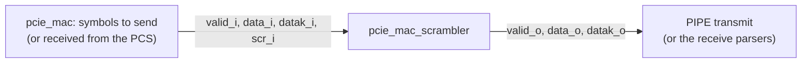

# pcie_mac_scrambler MAS

`pcie_mac_scrambler` applies the [scrambling rules](../../arch/mac/SYMBOLS.md#scrambling)
of [`pcie_mac`](../../arch/mac/HAS.md) to a PIPE word of two symbols per
`clk_i` cycle. The MAC instances it once per direction: on transmit it
scrambles the symbols the framing and ordered-set blocks put on PIPE, on
receive it descrambles the symbols from the PCS (the same operation,
[HAS, Position](../../arch/mac/HAS.md#position)). As a sub-IP it has no HAS:
this page owns its interface, behavior and structure, and the parent's
[symbols page](../../arch/mac/SYMBOLS.md#scrambling) owns the rules it
implements.

It does not decide which data symbols are scrambled: the user marks each
symbol with `scr_i` (packet and idle data 1; TS1, TS2, the compliance
pattern and the loopback master's pattern 0). It knows only the two K
symbols that change the LFSR, COM and SKP, and it does no framing.

It is adapted from the seed [`pcie_top_lfsr`](../top_lfsr/MAS.md) (same
repository, Apache-2.0; decision record
[0002](../../decisions/0002-m1-grill.md), Q2): the same LFSR and
eight-shift unrolling, with the COM, SKP, K and two-symbol rules added
inside the block. The seed is retired separately
([#91](https://github.com/amichai-bd/pcie-factory/issues/91)).

## Position

No sub-IPs.

## Interfaces

One clock, `clk_i`; every input is sampled and every register updates on
its rising edge. Bit *i* of `datak_i` and `scr_i` belongs to byte *i* of
`data_i`; byte 0 (`[7:0]`) is the earlier symbol on the line
([symbols page](../../arch/mac/SYMBOLS.md)).

| Port | Dir | Width | Clock | Description |
| --- | --- | --- | --- | --- |
| `clk_i` | in | 1 | - | Core clock, 125 MHz. |
| `rst_i` | in | 1 | `clk_i` | Synchronous, active-high reset. |
| `valid_i` | in | 1 | `clk_i` | The word is processed; 0 leaves the LFSR unchanged (no symbols). |
| `data_i` | in | 16 | `clk_i` | Two symbols, `[7:0]` first. |
| `datak_i` | in | 2 | `clk_i` | Bit *i*: byte *i* is a K symbol. |
| `scr_i` | in | 2 | `clk_i` | Bit *i*: XOR byte *i* with its key if it is a data symbol. 0 sends it as is (still advancing the LFSR); ignored for a K symbol. |
| `valid_o` | out | 1 | `clk_i` | `valid_i` one cycle later; 0 in reset. |
| `data_o` | out | 16 | `clk_i` | The processed word one cycle later; holds while `valid_o` is 0. |
| `datak_o` | out | 2 | `clk_i` | `datak_i` one cycle later, with `data_o`. |

## Parameters

None. The polynomial, seed and symbol codes are fixed ([Files](#files)).

## Behavior

The LFSR is 16 bits, G(X) = X^16 + X^5 + X^4 + X^3 + 1, seed FFFFh
[cite: PCIe Base Spec, rev 3.0, §4.2.1.3]. One **shift** moves it left by
one; the bit shifted out of bit 15 is the key bit, and when it is 1 the
new value is XORed with 0039h. A symbol's **key byte** is the eight key
bits of eight shifts from the current value, the first in bit 0, and an
**advance** replaces the value with the one after those eight shifts
([symbols page](../../arch/mac/SYMBOLS.md#scrambling)).

In a cycle with `valid_i` 1, symbol 0 and then symbol 1 are taken in
order, each seeing the LFSR value the previous one left:

| Symbol | Output byte | LFSR after it |
| --- | --- | --- |
| K, byte BCh (COM) | unchanged | FFFFh |
| K, byte 1Ch (SKP) | unchanged | unchanged |
| Any other K symbol | unchanged | advanced |
| Data, `scr_i` 1 | XORed with the key byte of the value before it | advanced |
| Data, `scr_i` 0 (disabled) | unchanged | advanced |

A data byte equal to BCh or 1Ch is data, not COM or SKP. With `valid_i` 0
the LFSR holds. `rst_i` sets the LFSR to FFFFh and `valid_o` to 0, and
wins over `valid_i`; reset values of `data_o` and `datak_o` are don't
care.

- **Known answer.** After a reset, a stream of scrambled 00h data symbols
  comes out as FFh, 17h, C0h, 14h, B2h, E7h, 02h, 82h, 72h, 6Eh, 28h, A6h,
  BEh, 6Dh, BFh, 8Dh, two per word ([symbols page](../../arch/mac/SYMBOLS.md#scrambling)).
- **Descrambling** is the same block on the received stream: fed the
  scrambled words with the same `datak_i` and `scr_i` from the same LFSR
  value, it returns the original symbols.
- **Disable.** Scrambling is disabled per symbol with `scr_i` 0. The LFSR
  still follows the stream, so TS1 and TS2 symbols, which the
  [symbols page](../../arch/mac/SYMBOLS.md#scrambling) says are never
  scrambled but advance the scrambler, are sent with `scr_i` 0. The block
  has no separate global disable: the HAS never sets or honours the
  Disable Scrambling bit ([HAS, Decisions](../../arch/mac/HAS.md#decisions));
  a user that wanted it would hold `scr_i` at 0.

## Microarchitecture

- One 16-bit register `state_q`, the LFSR before symbol 0, reset to FFFFh
  and loaded only when `valid_i` is 1.
- An `always_comb` walks the two symbols: `lane_state[i]` is the LFSR before
  symbol *i*, `lane_state[2]` (`state_next`) the value after both. Each lane
  decodes COM and SKP (`sym_com`, `sym_skp`), and `sym_scr` is
  `scr_i & ~datak_i`.
- The key and the advance are the package functions `lfsr_key` and
  `lfsr_advance`, each the eight shifts unrolled.
- An output register (`valid_q` reset to 0, `data_q` and `datak_q` loaded
  when `valid_i` is 1).
- Assertions: `a_lfsr_nonzero` (the all-zero state is unreachable),
  `a_com_reseeds` (a COM in symbol 1 leaves FFFFh), `a_skp_holds` (a word of
  two SKP leaves the LFSR unchanged) and `a_unscrambled_pass` (only symbols
  with `sym_scr` set change).

## Decisions

| Choice | Rationale | Rejected |
| --- | --- | --- |
| Per-symbol `scr_i`, K symbols never changed | The user knows which data symbols are TS or pattern symbols; the block alone enforces the K rule. One port serves TS, compliance, loopback and disable. | A global disable port (no user in M1: the HAS ignores Disable Scrambling); classifying TS symbols inside the block (needs framing state). |
| COM and SKP decoded inside the block | The LFSR rules then hold for every user and both directions. | Reseed and advance controls from the user, as in the seed (each user would restate the rules). |
| Two lanes chained combinationally in one cycle | Two symbols per cycle at 125 MHz; four unrolled eight-shift networks are a few levels of XOR. | A two-cycle pipeline (latency for no timing need). |
| Registered outputs | PIPE transmit leaves from a flop, and the receive parsers see a registered word. | Combinational outputs (a path from the upstream mux through the XOR to PIPE). |
| Seed and symbol codes as module `localparam`s, the type aliases and shift functions in `pcie_mac_scrambler_pkg` | Only this module uses the constants; the sub-IP never uses `pcie_mac_pkg` ([RTL BKM](../../../bkm/rtl.md#types-and-constants-live-in-packages)). | Constants in the package (unused package parameters fail the parent's lint until the parent instances the block, [#78](https://github.com/amichai-bd/pcie-factory/issues/78)). |

## Timing

- Latency one cycle from `valid_i` to `valid_o`, for both directions; that
  cycle is within the [HAS](../../arch/mac/HAS.md#targets) TX and RX latency
  budgets, which the parent integration accounts for.
- Throughput two symbols per cycle, every cycle.
- Critical path: `state_q` through two key or advance networks (lane 0's
  advance, then lane 1's key) and the COM/SKP selects to `data_q` and
  `state_q`. No clock-domain crossing.

## Targets

| Item | Target |
| --- | --- |
| Throughput | Two symbols per `clk_i` cycle. |
| Latency | One cycle. |
| Clock | 125 MHz in the `phy` flows. |
| Area | 35 flops (16 LFSR, 19 output). |

## Files

| File | Holds |
| --- | --- |
| [`pcie_mac_scrambler_pkg.sv`](../../../../src/rtl/mac_scrambler/pcie_mac_scrambler_pkg.sv) | `LFSR_W`, `BYTE_W`, `t_lfsr`, `t_byte`, `LFSR_TAPS` (`16'h0039`), and the functions `lfsr_key` and `lfsr_advance`. |
| [`pcie_mac_scrambler.sv`](../../../../src/rtl/mac_scrambler/pcie_mac_scrambler.sv) | The module, with the seed, COM and SKP constants. |
| [`mac_scrambler.rtl.f`](../../../../src/rtl/mac_scrambler/mac_scrambler.rtl.f) | `-F ../common/common_macros.rtl.f` (the RTL vocabulary), the package, then the module; reached from [`mac.rtl.f`](../../../../src/rtl/mac/mac.rtl.f) with `-F`. |
