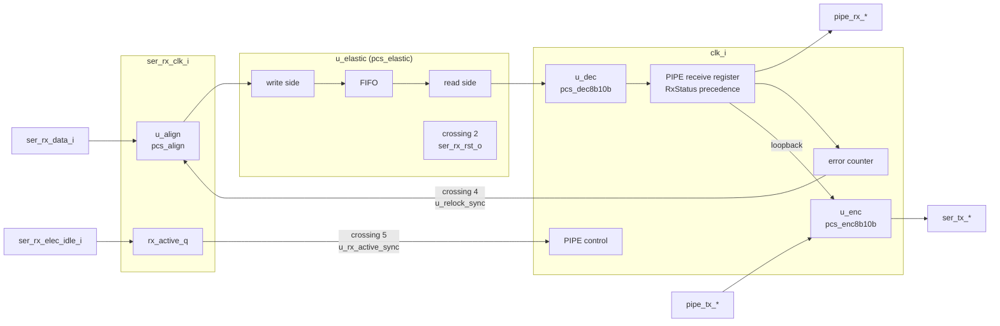

# pcie_pcs MAS

How `pcie_pcs` implements its [HAS](../../arch/pcs/HAS.md): PIPE control,
RxStatus, RxValid, the error counter and loopback in the top; the four
sub-IPs behind it; and the crossings of the
[HAS crossing table](../../arch/pcs/HAS.md#clock-domain-crossings).

## Microarchitecture

### Resets

- `pcs_rst` = `rst_i` or not `pipe_reset_ni`: the synchronous reset of
  every `clk_i` flop of the top, of the encoder and of the decoder's RD
  ([PIPE control](../../arch/pcs/PIPE_CONTROL.md#reset-and-phystatus)). The
  HAS reset values are forced combinationally from it, so they hold in the
  first reset cycle too: `pipe_phy_status_o` 1, `pipe_rx_valid_o` 0,
  `pipe_rx_status_o` 0, `pipe_rx_elec_idle_o` 1, `ser_tx_elec_idle_o` 1.
- `rx_rst`, the RX-domain reset (crossing 2), is
  `u_elastic.ser_rx_rst_o`: the one `COMMON_RESET_SYNC` of the PCS, inside
  the elastic buffer, from `rst_i`. The aligner, the RX side of
  `u_relock_sync` and `rx_active_q` take it synchronously.
- The elastic buffer's read side resets on `rst_i` only, so it keeps
  running through a PIPE reset, as the HAS requires.

### PIPE control

| Register | Width | Reset | Function |
| --- | --- | --- | --- |
| `ready_cnt_q` | 5 | 16 | Counts down after reset; `ready` when 0. PhyStatus is `pcs_rst` or not `ready`: 1 in reset and the 16 cycles after it. |
| `power_q` | 2 | P1 | `pipe_power_down_i` of the previous cycle. Once `ready`, a differing value is `power_change`. The PowerDown state itself is the value seen this cycle. |
| `ack_cnt_q` | 3 | 0 | Loaded with 4 on `power_change`, then counts down to 0; `ack_pulse` is the cycle it holds 1, the fourth after the change was seen. |
| `det_cnt_q`, `det_done_q` | 6, 1 | 0, 0 | Detection cycles seen while `ready`, P1, `pipe_tx_elec_idle_i` and `pipe_tx_detect_rx_i` hold. `det_pulse` is the cycle it holds 63 (detection cycle 64); it then clears and sets `det_done_q`. TxDetectRx seen 0 clears both. |
| `rxdet_q` | 1 | - | `ser_tx_rxdet_i` sampled in detection cycle 63; read only with `det_pulse`. |

- `pipe_phy_status_o` = `pcs_rst` or not `ready` or `ack_pulse` or
  `det_pulse`.
- `pipe_rx_status_o` = 3 (receiver present) or 0 in the `det_pulse`
  cycle, which overrides the receive status; otherwise `rx_status_q`.
- PhyStatus, the detection RxStatus and the counters are Moore outputs: an
  illegal MAC input in the pulse cycle (a second PowerDown change,
  TxDetectRx dropped) does not suppress the pulse (firstmate ruling on #85).

### Transmit path and loopback

`tx_word` = P0 and not `pipe_tx_elec_idle_i` is the encoder's `valid_i`.
`loopback` = `tx_word` and `pipe_tx_detect_rx_i`. The encoder
[`pcs_enc8b10b`](../pcs_enc8b10b/MAS.md) (`u_enc`, reset `pcs_rst`) takes
`pipe_tx_data_i`, `pipe_tx_datak_i` and `pipe_tx_compliance_i`, or in
loopback the PIPE receive register (`rx_data_q`, `rx_k_q`, no compliance):
the received words as they leave on PIPE, so they reach the line two
cycles after they are on `pipe_rx_data_o`. A code error is already EDB as
a K symbol there; while no word arrives the register holds its last word,
a valid code. The encoder holds the whole two-cycle TX latency, so its
outputs drive the line with no further register: `ser_tx_data_o` =
`data_o` and `ser_tx_elec_idle_o` = `pcs_rst` or not `valid_o`. The line
therefore follows TxElecIdle and PowerDown two cycles late, is idle in
P0s, P1 and P2 whatever TxElecIdle says (no beacon), and RD is kept across
electrical idle. A reset drops the two words in flight.

### Receive path

1. **`u_align`** ([`pcs_align`](../pcs_align/MAS.md), `ser_rx_clk_i`,
   reset `rx_rst`) takes `ser_rx_data_i`, `ser_rx_elec_idle_i` and the
   relock pulse `relock_rx`, and sends a word every RX cycle with its lock
   tag and generation.
2. **`u_elastic`** ([`pcs_elastic`](../pcs_elastic/MAS.md)) takes every
   aligned word (`ser_rx_valid_i` 1) and, on `clk_i`, sends two symbols
   with per-symbol lock and generation and the word's SKP-added,
   SKP-removed, overflow and underflow flags. Its outputs are
   combinational; `fill_o` is unused (debug and DV only).
3. **`u_dec`** ([`pcs_dec8b10b`](../pcs_dec8b10b/MAS.md), reset `pcs_rst`)
   decodes the word when it is sent and is not an underflow word, with
   `pipe_rx_polarity_i` of this cycle and the per-symbol lock and
   generation from the elastic buffer, which restart its RD at each locked
   run.
4. **Word forming** (combinational): `word_lock` (the future RxValid) is a
   decoded word with both symbols locked. An underflow word holds two
   all-zero symbols, a code error in both lanes, so the decoder already
   gives EDB, EDB (`pcie_pcs_dec8b10b_pkg::K_EDB`) as K symbols; the top
   adds no multiplexer and asserts it (`a_udf_edb`). RxStatus, first match
   wins: 4 (`word_lock` and a code error), 5 (overflow flag), 6
   (underflow), 7 (`word_lock` and a disparity error), 1 (SKP added), 2
   (SKP removed), 0; 0 in a cycle with no word.
5. **PIPE receive register** (one stage, reset `pcs_rst`): `rx_valid_q`,
   `rx_status_q`, and `rx_data_q`/`rx_k_q` loaded with every word sent.
   `pipe_rx_valid_o` = `rx_valid_q` and not `pcs_rst`.

### Error counter and relock (crossing 4)

It watches the words that leave with RxValid (`rx_valid_q`), with
`rx_errored_q` (a code or disparity error in a locked word) and
`rx_gen_q` (the lock generation of its second symbol):

| Register | Width | Function |
| --- | --- | --- |
| `err_cnt_q` | 2 | Errored words counted, 0 to `ERR_LIMIT` - 1. |
| `clean_cnt_q` | 4 | Clean words in a row, 0 to `ERR_DECAY_WORDS` - 1. |
| `last_gen_q`, `gen_known_q` | 1, 1 | The generation of the last valid word; a different one clears both counts. |
| `wait_q`, `wait_gen_q` | 1, 1 | A request is outstanding; it ends at the first valid word of another generation. |

An errored word adds 1; at `ERR_LIMIT` (3) `relock_req` is 1 for that
cycle, the count clears and `wait_q` sets. `ERR_DECAY_WORDS` (8) clean
words in a row take 1 away. Nothing counts while `wait_q` is set.
`` `COMMON_PULSE_SYNC(u_relock_sync, relock_rx, relock_req, clk_i, rst_i,
ser_rx_clk_i, rx_rst)`` brings the request to the aligner; requests are
far more than two RX cycles apart, since each waits for a new lock.

A single flipped bit marks at most two words, so isolated errors never
relock. **Two close bit errors relock by design** when their errored
symbols fall in three PIPE words within the decay window: lock drops, and
RxValid then stays low until the next comma (in packet traffic up to one
SKP interval plus a packet), from which data resumes (#73 sign-off; the DV
plan's `rx_close_errors`).

### Receive electrical idle (crossing 5)

`rx_active_q` registers not `ser_rx_elec_idle_i` on `ser_rx_clk_i`
(reset 0 on `rx_rst`), and `` `COMMON_METAFLOP(u_rx_active_sync, ...)``
brings it to `clk_i` (reset on `rst_i`). `pipe_rx_elec_idle_o` = `pcs_rst`
or not the synchronized level.

### Assertions

| Label | Invariant |
| --- | --- |
| `a_detected_only_with_pulse` | RxStatus 3 only with the detection PhyStatus pulse. |
| `a_phy_status_one_cycle` | Once ready, a PhyStatus pulse lasts one cycle. |
| `a_err_cnt_range` | The error count never exceeds `ERR_LIMIT` - 1. |
| `a_udf_edb` | An underflow word is EDB, EDB as K symbols. |
| `a_udf_not_valid` | An underflow word never carries RxValid. |
| `a_ack_cnt_range` | The acknowledge countdown never exceeds 4. |

## Decisions

| Choice | Rationale | Rejected |
| --- | --- | --- |
| Reset values forced combinationally from `pcs_rst` | The HAS holds them in every reset cycle, the first included. | Registered outputs (one cycle late into reset). |
| PowerDown state is the value seen, `power_q` only detects changes | The arch model's `PipeControl` does the same, and the transmitter then follows PowerDown with the same two-cycle latency as TxElecIdle. | A registered state (one more cycle of latency on the line). |
| `ser_tx_*` straight from the encoder | The encoder already spends the two-cycle TX latency ([`pcs_enc8b10b`](../pcs_enc8b10b/MAS.md#decisions)). | A line register in the top (three cycles). |
| One PIPE receive register after the decoder | The elastic buffer and the decoder are combinational, so the PIPE outputs, the status and the counter's inputs are registered together in one place. Measured RX latency is at most 10.9 cycles, within the 12 of the [targets](../../arch/pcs/HAS.md#targets). | Registering inside the decoder (the sideband flags would need matching delays). |
| The first locked word starts a word of its own | `pcs_elastic` drops an unlocked symbol held in its packing or leftover register at a lock start ([its MAS](../pcs_elastic/MAS.md#behavior)); without it the first locked word was paired with an unlocked symbol and RxValid started one word late, up to 11 cycles after the comma (#85 review). | Changing the HAS lock target. |
| Loopback from the PIPE receive register | The HAS loops back the words "as they appear on `pipe_rx_data_o`", two cycles later on the line; it reuses the register and the decoder's EDB substitution. | A separate loopback path before the decoder (re-encoding raw symbols would keep the far end's RD and errors). |
| One RX reset synchronizer, in `pcs_elastic` | Firstmate ruling on #85: one crossing 2 for the PCS, exported on `ser_rx_rst_o`. | A second synchronizer in the top. |
| Synchronous use of `rx_rst` in the RX domain | Consistent with the aligner, `common_cdc_pulse` and `common_cdc_fifo`; `common_cdc_rst` holds it for at least 7 RX cycles and `ser_rx_clk_i` always runs (firstmate ruling on #85, BKM wording in #145). | `COMMON_DFF_ARST_VAL` in the top. |

`rst_i` is both the synchronous `clk_i` reset of the top and, through
`u_elastic`, the input of `common_cdc_rst`, as the HAS requires; Verilator
reports that as `SYNCASYNCNET` on `rst_i` of `pcie_pcs.sv`, which
[`src/lint_waivers.yaml`](../../../../src/lint_waivers.yaml) waives for
that one net with that reason.

## Timing

- TX: two cycles, both in the encoder.
- RX: aligner (two RX edges), FIFO write and pointer crossing (two or
  three `clk_i` edges), the visible fill, then the combinational read side
  and decoder into the PIPE register. Measured: at most 10.9 cycles from a
  symbol's last bit on `ser_rx_data_i` to `pipe_rx_data_o` (target 12),
  and at most 9.6 cycles from the comma that gives lock to the first RxValid
  word (target 10): 9.0 after electrical idle over 40 seeds at up to
  ±600 ppm, 9.6 after close-error relocks, 9.0 after slips and error bursts
  (16 seeds each).
- Relock: from the word that makes the request to RxValid low, at most
  20 cycles (crossing 4, the aligner, the buffer and the register).
- RxElecIdle: one RX cycle plus two or three `clk_i` edges.
- PhyStatus: 16 cycles after reset, receiver detection in 64, PowerDown
  acknowledged after 4.
- Critical path (`clk_i`): the FIFO head through the elastic buffer's
  read-side selection, the two chained decode lanes and the RxStatus
  precedence into the PIPE register.

## Files

| File | Holds |
| --- | --- |
| [`pcie_pcs_pkg.sv`](../../../../src/rtl/pcs/pcie_pcs_pkg.sv) | `t_power_down`, `t_rx_status`, the PIPE-control timings, `ERR_LIMIT`, `ERR_DECAY_WORDS` and their counter widths. |
| [`pcie_pcs.sv`](../../../../src/rtl/pcs/pcie_pcs.sv) | The top: resets, PIPE control, the four sub-IP instances, word forming, the PIPE receive register, the error counter, loopback, crossings 4 and 5, assertions. |
| [`pcs.rtl.f`](../../../../src/rtl/pcs/pcs.rtl.f) | The vocabulary, `common_cdc_sync2`, `common_cdc_pulse`, the four sub-IP filelists, the package, then the top. |
