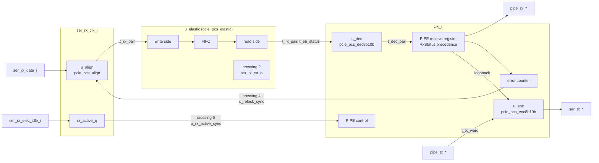

# pcie_pcs MAS

How `pcie_pcs` implements its [HAS](../../arch/pcs/HAS.md). It is one IP
with five blocks, each a module file in `src/rtl/pcs/` under one
`pcs.rtl.f` (decision Q24 on epic
[#65](https://github.com/amichai-bd/pcie-factory/issues/65)): the
[top](#top) (PIPE control, RxStatus, RxValid, the error counter, loopback,
crossings 4 and 5), the [encoder](#encoder), the [decoder](#decoder), the
[aligner](#aligner) and the [elastic buffer](#elastic-buffer). The blocks
exchange packed structs of [`pcie_pcs_pkg`](#package) (decision Q25); the
`pcie_pcs` ports stay flat, with the PIPE names of the HAS.

## Package

`pcie_pcs_pkg` ([`pcie_pcs_pkg.sv`](../../../../src/rtl/pcs/pcie_pcs_pkg.sv))
is the IP's one package; the codes the pcs shares with the mac are in
[`common_pkg`](../common/common_pkg.md): `t_power_down` (`PD_P0` to
`PD_P2`), `t_rx_status` (the eight RxStatus codes, `RX_OK` to
`RX_DISP_ERR`) and `SYM_EDB`. RTL names every item `pkg::item`, with no
import.

| Item | Holds |
| --- | --- |
| `PHY_STATUS_RESET_CYCLES`, `RX_DETECT_CYCLES`, `POWER_ACK_CYCLES`, `ERR_LIMIT`, `ERR_DECAY_WORDS` and their counter widths | 16, 64, 4, 3 and 8 ([PIPE control](../../arch/pcs/PIPE_CONTROL.md), [relock](../../arch/pcs/RECEIVE.md#comma-alignment-and-symbol-lock)). |
| `t_detect`, `t_relock`, `t_rx_word` | The top's receiver-detection state, error-counter state and PIPE receive register. |
| `SYM_W`, `BYTE_W`, `WORD_W`, `WINDOW_W`, `COMMA_W`, `OFFSET_W`; `t_sym10`, `t_byte`, `t_word`, `t_window`, `t_comma`, `t_offset` | Symbol, byte, two-symbol word and aligner widths and types. |
| `t_k_byte` | A byte with its K flag. |
| `t_tx_word` | Two `t_k_byte` and TxCompliance: the encoder's input. |
| `t_rx_sym`, `t_rx_pair` | One raw symbol with its lock tag and generation; two of them. Aligner to elastic buffer to decoder. |
| `t_dec_sym`, `t_dec_pair` | One decoded symbol (`t_k_byte`, code error, disparity error); two of them. Decoder to top. |
| `t_align` | The aligner's lock state: lock, generation, boundary. |
| `t_dec`, `t_dec_state`, `t_match` and the functions `six_minus` to `decode` | The decoder's per-symbol result, RD state and the pure decode functions. |
| `EB_ADDR_W`, `EB_NOMINAL`, `EB_HIGH`, `EB_LOW`, `EB_HOLDOFF`, `EB_FILL_W`, `HOLDOFF_W` | 4, 8, 9, 7, 8, 6 and 4 ([elastic buffer](../../arch/pcs/RECEIVE.md#elastic-buffer)). |
| `COM_RD_MINUS`, `COM_RD_PLUS`, `SKP_RD_MINUS`, `SKP_RD_PLUS`, `is_com`, `is_skp` | The raw COM and SKP codes in both columns, matched without decoding. |
| `t_eb_word`, `t_eb_sym`, `t_eb_status`, `t_eb_wr`, `t_eb_rd` | The 25-bit FIFO word, one read-side symbol with its flags, the read side's word status (SKP added, removed, overflow, underflow), and the write- and read-side state. |

## Top

[`pcie_pcs.sv`](../../../../src/rtl/pcs/pcie_pcs.sv): the HAS ports, the
four block instances, PIPE control, word forming, the PIPE receive
register, the error counter, loopback and crossings 4 and 5.

### Resets

- `pcs_rst` = `rst_i` or not `pipe_reset_ni`: the synchronous reset of
  every `clk_i` flop of the top, of the encoder and of the decoder's RD
  ([PIPE control](../../arch/pcs/PIPE_CONTROL.md#reset-and-phystatus)). The
  HAS reset values are forced combinationally from it, so they hold in the
  first reset cycle too: `pipe_phy_status_o` 1, `pipe_rx_valid_o` 0,
  `pipe_rx_status_o` 0, `pipe_rx_elec_idle_o` 1, `ser_tx_elec_idle_o` 1.
- `rx_rst`, the RX-domain reset (crossing 2), is
  `u_elastic.ser_rx_rst_o`: the one `COMMON_RESET_SYNC` of the PCS, inside
  the elastic buffer, from `rst_i`. The elastic buffer's write side takes
  it asynchronously; the aligner, the crossing cells' RX sides and
  `rx_active_q` take it synchronously ([decisions](#decisions)).
- The elastic buffer's read side resets on `rst_i` only, so it keeps
  running through a PIPE reset, as the HAS requires.

### PIPE control

| Register | Width | Reset | Function |
| --- | --- | --- | --- |
| `ready_cnt_q` | 5 | 16 | Counts down after reset; `ready` when 0. PhyStatus is `pcs_rst` or not `ready`: 1 in reset and the 16 cycles after it. |
| `power_q` | 2 | `PD_P1` | `pipe_power_down_i` of the previous cycle. Once `ready`, a differing value is `power_change`. The PowerDown state itself is the value seen this cycle. |
| `ack_cnt_q` | 3 | 0 | Loaded with 4 on `power_change`, then counts down to 0; `ack_pulse` is the cycle it holds 1, the fourth after the change was seen. |
| `det_q` (`t_detect`: `cnt`, `done`) | 6 + 1 | 0 | Detection cycles seen while `ready`, P1, `pipe_tx_elec_idle_i` and `pipe_tx_detect_rx_i` hold. `det_pulse` is the cycle `cnt` holds 63 (detection cycle 64); it then clears and sets `done`. TxDetectRx seen 0 clears both. |
| `rxdet_q` | 1 | - | `ser_tx_rxdet_i` sampled in detection cycle 63; read only with `det_pulse`. |

- `pipe_phy_status_o` = `pcs_rst` or not `ready` or `ack_pulse` or
  `det_pulse`.
- `pipe_rx_status_o` = 3 (receiver present) or 0 in the `det_pulse`
  cycle, which overrides the receive status; otherwise `rx_q.status`.
- PhyStatus, the detection RxStatus and the counters are Moore outputs: an
  illegal MAC input in the pulse cycle (a second PowerDown change,
  TxDetectRx dropped) does not suppress the pulse (firstmate ruling on #85).

### Transmit path and loopback

`tx_word` = P0 and not `pipe_tx_elec_idle_i` is the encoder's `valid_i`.
`loopback` = `tx_word` and `pipe_tx_detect_rx_i`. The [encoder](#encoder)
(`u_enc`, reset `pcs_rst`) takes the PIPE word as a `t_tx_word`
(`pipe_tx_data_i`, `pipe_tx_datak_i`, `pipe_tx_compliance_i`), or in
loopback the PIPE receive register's two symbols with no compliance: the
received words as they leave on PIPE, so they reach the line two cycles
after they are on `pipe_rx_data_o`. A code error is already EDB as a K
symbol there; while no word arrives the register holds its last word, a
valid code. The encoder holds the whole two-cycle TX latency, so its
outputs drive the line with no further register: `ser_tx_data_o` =
`data_o` and `ser_tx_elec_idle_o` = `pcs_rst` or not `valid_o`. The line
therefore follows TxElecIdle and PowerDown two cycles late, is idle in
P0s, P1 and P2 whatever TxElecIdle says (no beacon), and RD is kept across
electrical idle. A reset drops the two words in flight.

### Receive path

1. **`u_align`** ([aligner](#aligner), `ser_rx_clk_i`, reset `rx_rst`)
   takes `ser_rx_data_i`, `ser_rx_elec_idle_i` and the relock pulse
   `relock_rx`, and sends a `t_rx_pair` every RX cycle, both symbols tagged
   with its lock and generation.
2. **`u_elastic`** ([elastic buffer](#elastic-buffer)) takes every aligned
   word (`ser_rx_valid_i` 1) and, on `clk_i`, sends a `t_rx_pair` with
   per-symbol lock and generation and the word's `t_eb_status`. Its
   outputs are combinational; `fill_o` is unused (debug only).
3. **`u_dec`** ([decoder](#decoder), reset `pcs_rst`) decodes the word
   when it is sent and is not an underflow word, with `pipe_rx_polarity_i`
   of this cycle and the per-symbol lock and generation, which restart its
   RD at each locked run.
4. **Word forming** (combinational): `word_lock` (the next RxValid) is a
   decoded word with both symbols locked. An underflow word holds two
   all-zero symbols, a code error in both lanes, so the decoder already
   gives EDB, EDB (`common_pkg::SYM_EDB`) as K symbols; the top adds no
   multiplexer and asserts it (`a_udf_edb`). RxStatus, first match wins: 4
   (`word_lock` and a code error), 5 (overflow), 6 (underflow), 7
   (`word_lock` and a disparity error), 1 (SKP added), 2 (SKP removed), 0;
   0 in a cycle with no word.
5. **PIPE receive register** `rx_q` (`t_rx_word`, one stage, reset
   `pcs_rst`): `valid`, `status` and `errored` every cycle, the two symbols
   with every word sent, `gen` (the second symbol's lock generation) with
   every locked word. `pipe_rx_valid_o` = `rx_q.valid` and not `pcs_rst`.

### Error counter and relock (crossing 4)

`rl_q` (`t_relock`) watches the words that leave with RxValid
(`rx_q.valid`), with `rx_q.errored` (a code or disparity error in a locked
word) and `rx_q.gen`:

| Field | Width | Function |
| --- | --- | --- |
| `err_cnt` | 2 | Errored words counted, 0 to `ERR_LIMIT` - 1. |
| `clean_cnt` | 4 | Clean words in a row, 0 to `ERR_DECAY_WORDS` - 1. |
| `last_gen`, `gen_known` | 1, 1 | The generation of the last valid word; a different one clears both counts. |
| `wait_relock`, `wait_gen` | 1, 1 | A request is outstanding; it ends at the first valid word of another generation. |

An errored word adds 1; at `ERR_LIMIT` (3) `relock_req` is 1 for that
cycle, the count clears and `wait_relock` sets. `ERR_DECAY_WORDS` (8)
clean words in a row take 1 away. Nothing counts while a request is
outstanding. `` `COMMON_PULSE_SYNC(u_relock_sync, relock_rx, relock_req,
clk_i, rst_i, ser_rx_clk_i, rx_rst)`` brings the request to the aligner;
requests are far more than two RX cycles apart, since each waits for a new
lock.

A single flipped bit marks at most two words, so isolated errors never
relock. **Two close bit errors relock by design** when their errored
symbols fall in three PIPE words within the decay window: lock drops, and
RxValid then stays low until the next comma (in packet traffic up to one
SKP interval plus a packet), from which data resumes (#73 sign-off; the DV
plan's `rx_close_errors`).

### Receive electrical idle (crossing 5)

`rx_active_q` registers not `ser_rx_elec_idle_i` on `ser_rx_clk_i`
(reset 0 on `rx_rst`), and `` `COMMON_METAFLOP(u_rx_active_sync, ...)``
brings it to `clk_i` (reset on `rst_i`). `pipe_rx_elec_idle_o` = `pcs_rst`
or not the synchronized level.

### Assertions

| Label | Invariant |
| --- | --- |
| `a_detected_only_with_pulse` | RxStatus 3 only with the detection PhyStatus pulse. |
| `a_phy_status_one_cycle` | Once ready, a PhyStatus pulse lasts one cycle. |
| `a_err_cnt_range` | The error count never exceeds `ERR_LIMIT` - 1. |
| `a_udf_edb` | An underflow word is EDB, EDB as K symbols. |
| `a_udf_not_valid` | An underflow word never carries RxValid. |
| `a_ack_cnt_range` | The acknowledge countdown never exceeds 4. |

## Encoder

[`pcie_pcs_enc8b10b.sv`](../../../../src/rtl/pcs/pcie_pcs_enc8b10b.sv) and
its per-symbol leaf
[`pcie_pcs_enc8b10b_sym.sv`](../../../../src/rtl/pcs/pcie_pcs_enc8b10b_sym.sv)
encode two bytes with their K flags per `clk_i` cycle into two 10-bit
symbols with the [8b/10b code](../../arch/pcs/8B10B.md), keep the
transmit running disparity, apply TxCompliance and send any unsupported K
byte as EDB. What is sent (loopback), electrical idle on the line and the
PowerDown state are the top's.

| Port | Dir | Type | Description |
| --- | --- | --- | --- |
| `clk_i`, `rst_i` | in | `logic` | `clk_i`; `rst_i` is `pcs_rst`, synchronous: RD negative, nothing in flight. |
| `valid_i` | in | `logic` | A word to send. 0: no word (electrical idle); the RD holds and `word_i` is ignored. |
| `word_i` | in | `t_tx_word` | Two symbols, `sym0` first on the line, and `compliance` (RD negative before `sym0`). |
| `valid_o` | out | `logic` | `valid_i` two cycles later; 0 in and after reset. |
| `data_o` | out | `t_word` | The two codes, `[9:0]` first; bit 0 of each is line bit `a`. |

**Behavior.**

- **Code.** Each byte is encoded by the rules of the
  [8b/10b code](../../arch/pcs/8B10B.md): the 6b sub-block from the RD
  before the symbol, the 4b sub-block from the RD after the 6b sub-block,
  the A7 rule, and the K28 and `Kx.7` forms.
- **Unsupported K.** A K flag on a byte that is not one of the
  [valid K codes](../../arch/pcs/8B10B.md#k-symbols) sends EDB (K30.7,
  `common_pkg::SYM_EDB`), as
  [PIPE control](../../arch/pcs/PIPE_CONTROL.md#transmit-path) says. The
  other valid K codes, K28.7 included, are encoded as given; not sending
  K28.7 is the MAC's part.
- **Running disparity.** `sym0` is encoded at the transmit RD, `sym1` at
  the RD after it, and the transmit RD becomes the RD after `sym1`.
  Compliance sets RD negative before `sym0`. A cycle with `valid_i` 0
  leaves the RD unchanged.
- **Latency.** A word sampled in cycle n is on `data_o` in cycle n + 2:
  the whole TX latency of the PCS.
- **Reset.** An edge that sees `rst_i` sets RD negative and drops the
  words in flight.

**Structure.** Stage 1 registers `in_valid_q` (reset 0) and `in_word_q`
(`t_tx_word`, not reset). Stage 2 chains two instances of the
combinational leaf `pcie_pcs_enc8b10b_sym` (`u_sym0`, `u_sym1`, input
`t_k_byte` and the RD in, code and RD out) through the RD: `u_sym0` takes
`rd_q`, or negative under compliance. `rd_q` (reset negative) loads
`u_sym1`'s RD out on a word; `out_valid_q` follows `in_valid_q`;
`out_data_q` loads both codes on a word. The leaf computes a symbol from
the rules, not from a table: EDB for an unsupported K; the RD- 6b form
(EDCBA with `i` for two ones, the fixed exception forms, `001111` for
K28); the RD- 4b form (FGH with `j` for one one, the fixed forms of `y` =
0, 4 and 7, P7 or A7); a sub-block complemented at RD+ when unbalanced or
`111000` / `1100`; at RD+ a K28 code is the complement of its whole RD-
code. Only an unbalanced sub-block flips the RD.

| Assertion | Invariant |
| --- | --- |
| `a_lane0_disparity`, `a_lane1_disparity` | A code holds five ones and keeps RD, six ones from RD- to RD+, or four from RD+ to RD-. |
| `a_run_length` | No six equal bits in a row across the two codes (`run6`, read only by this assertion). |

## Decoder

[`pcie_pcs_dec8b10b.sv`](../../../../src/rtl/pcs/pcie_pcs_dec8b10b.sv)
applies RxPolarity, then decodes two symbols per `clk_i` cycle with the
running disparity, by the [decoder rules](../../arch/pcs/8B10B.md#decoder-and-error-classes)
and the [decode rules of the receive path](../../arch/pcs/RECEIVE.md#decode-and-rxstatus).
RxValid, RxStatus and the error counter are the top's.

| Port | Dir | Type | Description |
| --- | --- | --- | --- |
| `clk_i`, `rst_i` | in | `logic` | `clk_i`; `rst_i` is `pcs_rst`, synchronous: the RD becomes unknown. |
| `in_valid_i` | in | `logic` | A word is presented; the RD state advances only on a word. |
| `in_i` | in | `t_rx_pair` | Two raw symbols, `sym0` the earlier, each with its lock tag and generation. |
| `polarity_i` | in | `logic` | RxPolarity: invert every bit of this cycle's word. |
| `out_o` | out | `t_dec_pair` | Per symbol: the byte and K flag (EDB as K on a code error), the code-error and disparity-error flags. Combinational. |

**Decode.** Each symbol is decoded at an assumed RD:

| Class | Condition (RD known) | Byte, K | Code error, disparity error |
| --- | --- | --- | --- |
| Valid | The encoder sends this code at the current RD. | the byte, its K flag | 0, 0 |
| Disparity error | Not valid at the current RD, valid at the other. | the byte, its K flag | 0, 1 |
| Code error | Valid at neither RD. | EDB, 1 | 1, 0 |

At an **unknown** RD either column is accepted: a code valid in some
column is valid, never a disparity error. After every symbol the RD
follows its two sub-blocks, each judged from the RD before it; from an
unknown RD the start is RD- if the code is valid at RD- or at neither, RD+
if valid only at RD+ (the architecture model's `decode()`). So a run that
starts with the RD unknown decodes a symbol valid at both RDs as at RD-,
and may report a disparity error at the first symbol that settles the RD.

**When the RD is known.** `sym0` is decoded at the stored RD only when the
stored RD is known, `polarity_i` equals its value in the previous cycle,
`sym0` is locked and its generation equals the stored one. `sym1` is
decoded at the RD `sym0` left only when both are locked with equal
generations. Otherwise the RD is unknown: at the start of each locked run
(after an unlocked symbol, or at a new lock generation, which a same-cycle
relock also gives) and when RxPolarity changes.

**State** `state_q` (`t_dec_state`, reset 0; the RD sign and generation need no reset, as they are read only while `rd_known` is 1, but share the struct register): on a word, `rd_known` =
`sym1`'s lock, `rd_pos` = the RD after `sym1`, `gen` = `sym1`'s generation;
with no word the RD holds, but `rd_known` clears on a polarity change;
`pol` is the previous cycle's `polarity_i`.

**Structure.** Two lanes, each a call of the package's pure `decode()`;
`sym1` starts at `sym0`'s RD out, so the RD carries across the lanes
combinationally. `decode()` matches the code against both columns with
`match_at()` (the K28 forms; the 6b block at the given RD, then the 4b
block at the RD after it; the A7 rule; `Kx.7`), using only the RD- tables
of [8B10B.md](../../arch/pcs/8B10B.md) in line order: a received RD+ block
is looked up unchanged when balanced and not alternating, else
complemented.

| Assertion | Invariant |
| --- | --- |
| `a_one_error_class` | Never both flags on a symbol. |
| `a_code_err_edb` | A code error always carries EDB with K set. |
| `a_disp_err_known_rd` | A disparity error only at a known RD. |
| `a_rd_unknown_after_unlocked` | After a word whose second symbol is unlocked, the RD is unknown. |

## Aligner

[`pcie_pcs_align.sv`](../../../../src/rtl/pcs/pcie_pcs_align.sv), in the
`ser_rx_clk_i` domain, registers the unaligned 20-bit words from the line,
finds a [comma](../../arch/pcs/8B10B.md#comma), takes symbol lock and sends
two aligned symbols per cycle, by the
[comma alignment and symbol lock](../../arch/pcs/RECEIVE.md#comma-alignment-and-symbol-lock)
rules. It drops lock on electrical idle and on a relock request; the error
counter that decides a relock is the top's.

| Port | Dir | Type | Description |
| --- | --- | --- | --- |
| `clk_i`, `rst_i` | in | `logic` | `ser_rx_clk_i` and `rx_rst`, used synchronously. |
| `data_i` | in | `t_word` | `ser_rx_data_i`: twenty received bits, bit 0 earliest. |
| `elec_idle_i` | in | `logic` | `ser_rx_elec_idle_i`. |
| `relock_i` | in | `logic` | One-cycle relock request (crossing 4). |
| `rx_o` | out | `t_rx_pair` | Two symbols at the boundary, `sym0` first, both tagged with the word's lock and generation. |

**Behavior**, each edge, from the 40-bit window of the two registered
words (the previous one in bits 0 to 19):

1. **Loss of lock.** Lock is kept only if `relock_i` is 0 and the current
   word was not received in electrical idle.
2. **Hunt.** If lock is not kept and neither window word was received in
   idle, the window is searched at bit offsets 0 to 19 for a comma
   (`COMMA_MINUS` or `COMMA_PLUS`, module constants). At the lowest one,
   lock is taken at once, the boundary becomes the offset mod 10 and the
   generation flips; a relock that finds a comma in the same window keeps
   lock and only flips the generation.
3. **Output.** The window bits from the next boundary, with the lock and
   generation of steps 1 and 2. While unlocked, the last boundary is kept
   and the words go out unlocked.

Reset: lock, generation and boundary 0 (`state_q`, `t_align`), both idle
flags 1 (no hunt for two words). The data registers are not reset.

**Structure.** `in_q`, `in_prev_q`, `idle_q`, `idle_prev_q`; twenty 7-bit
comparators and a priority scan for the lowest comma; the lock state; a
20-bit barrel select into `sym_q`. Lock is taken in the edge whose window
holds the comma, so the word holding the comma is the first locked one.

| Assertion | Invariant |
| --- | --- |
| `a_offset_in_symbol` | The boundary stays in 0 to 9. |
| `a_no_lock_from_idle` | No lock from a window holding an idle word. |
| `a_relock_drops_lock` | A relock request never keeps lock unless a comma retakes it. |
| `a_gen_flips_only_on_lock` | The generation flips only when lock is taken. |
| `a_lock_word_holds_comma` | The first word of a lock holds a comma at `sym0` or `sym1`. |
| `a_lock_at_lowest_comma` | Lock is taken at the lowest comma offset of the window (an upward scan, independent of the downward priority scan). |

## Elastic buffer

[`pcie_pcs_elastic.sv`](../../../../src/rtl/pcs/pcie_pcs_elastic.sv)
carries the aligned words from `ser_rx_clk_i` into `clk_i`, removing one
SKP from a SKP ordered set on the write side and adding one on the read
side, by the [elastic buffer](../../arch/pcs/RECEIVE.md#elastic-buffer)
rules, and reports per word what changed (RxStatus 1, 2, 5 and 6 on the
[RxStatus table](../../arch/pcs/RECEIVE.md#decode-and-rxstatus)). It
matches COM and SKP on their raw codes in both columns, so it needs no
decode and no polarity. It holds crossings 1 to 3.

| Port | Dir | Type | Clock | Description |
| --- | --- | --- | --- | --- |
| `clk_i` | in | `logic` | - | Read side. |
| `rst_i` | in | `logic` | `clk_i` | The pcs `rst_i`: synchronous reset of the read side and the input of the RX reset synchronizer; not `pipe_reset_ni`, so the read side keeps running through a PIPE reset. |
| `ser_rx_clk_i` | in | `logic` | - | Write side. |
| `ser_rx_valid_i` | in | `logic` | `ser_rx_clk_i` | A word this cycle (the top ties it to 1). |
| `ser_rx_i` | in | `t_rx_pair` | `ser_rx_clk_i` | The aligner's word; its two symbols carry the same tags (`a_word_one_lock`). |
| `rx_valid_o` | out | `logic` | `clk_i` | A word is sent: two symbols, or an underflow word. |
| `rx_o` | out | `t_rx_pair` | `clk_i` | Two raw symbols with per-symbol lock and generation; 0 with no word or an underflow word. |
| `rx_status_o` | out | `t_eb_status` | `clk_i` | `skp_add` (a SKP added after a COM of this word), `skp_rem` (one removed), `ovf` (the first word after a lost one), `udf` (underflow word). |
| `fill_o` | out | 6 | `clk_i` | The visible fill, 0 to 34 symbols; debug only. |
| `ser_rx_rst_o` | out | `logic` | `ser_rx_clk_i` | The RX-domain reset: high asynchronously with `rst_i`, low at the second `ser_rx_clk_i` edge after `rst_i` falls. |

The outputs other than `ser_rx_rst_o` are combinational from `clk_i`
registers and the FIFO's read side. The **visible fill** is twice the
FIFO's read-side occupancy (`dst_fill_o`), plus the leftover symbol, plus
one when a copy is owed.

**Write side** (`ser_rx_clk_i`, state `w_q`, `t_eb_wr`, reset
asynchronously by the RX reset), each cycle with a word:

- **Recentring.** An unlocked word is dropped while fill high is seen, at
  most once per 8 cycles; `w_drop` is high in the cycle of a drop (an
  observation net for DV).
- **SKP removal.** While fill high is seen and the word is locked, a SKP
  that directly follows a COM (possibly in the previous word) is dropped:
  the first SKP of a set, at most one per set; the next kept symbol
  carries the removed flag. A set of one SKP leaves as a bare COM.
- **Packing.** A one-symbol packing register joins the kept symbols into
  FIFO words (`t_eb_word`: two symbols, a removed flag each, one lock tag,
  one generation, an overflow flag). A word packed from symbols that differ
  in lock or generation is tagged unlocked with the newer generation.
- **Lock start.** A locked word that arrives while the packing register
  holds an unlocked symbol drops that symbol and starts a FIFO word of its
  own, so the first locked symbols never share a word with an unlocked one
  (which would hold RxValid back a word against the
  [lock target](../../arch/pcs/HAS.md#targets)).
- **Overflow.** A word offered while the FIFO is full is lost; the next
  word written carries the overflow flag.

**FIFO.** `u_fifo`, [`common_cdc_fifo`](../common/common_cdc_fifo.md),
`WIDTH` 25, `ADDR_W` 4: head word, the word after it and the occupancy.

**Read side** (`clk_i`, state `r_q`, `t_eb_rd`, and `fill_high_q`, reset
by `rst_i`), each cycle:

- **Start.** Nothing is sent until the fill first reaches 8.
- **Fill high.** `fill_high_q` is the fill at 9 or more; it crosses to the
  write side through `u_sync_fill_high` (crossing 3).
- **Recentring.** While the head word is unlocked and the fill is 7 or
  less, nothing is sent, at most once per 8 cycles; `r_recentre` is high
  in the cycle of a hold (an observation net for DV).
- **Underflow.** Below a fill of 2, an underflow word is sent; nothing is
  consumed, so no symbol is lost.
- **Lock start.** A locked head word after an unlocked leftover symbol
  drops the leftover and is sent from its first symbol.
- **Send.** Otherwise two symbols: the leftover first, then the head word;
  a symbol not sent stays in the leftover register.
- **SKP addition.** When a sent symbol is a locked COM, the fill is 7 or
  less and the next symbol (the leftover, the head, or the word after the
  head) is a SKP without the removed flag, one copy of it follows the COM:
  as the second symbol for a COM in the first slot, owed (`dup`) as the
  first symbol of the next word for a COM in the second slot.
- **Status.** `skp_add` and `skp_rem` mark the word holding the COM
  (`rem_ack` masks a removed flag already reported); a removal whose
  following symbol was not visible when the COM left is reported on the
  next symbol's word instead, which needs a visible fill below 4, never
  within the targets. `ovf` marks a word holding the overflow flag.

| Assertion | Invariant |
| --- | --- |
| `a_one_removal`, `a_rem_after_com` | One removal per cycle, none right after a pending removed flag. |
| `a_word_one_lock` | The two symbols of an aligned word carry the same tags. |
| `a_pop_empty`, `a_dup_needs_symbol`, `a_send_needs_symbols` | No pop from an empty FIFO; an owed copy and a send have their symbols. |
| `a_add_only_low`, `a_owed_copy_is_skp` | Additions only at a fill of 7 or less; an owed copy is a SKP. |
| `a_fill_high_at_9`, `a_start_at_8`, `a_add_at_7_or_less`, `a_add_when_due` | The RECEIVE.md thresholds written as the page's numbers, independent of the package constants: fill high (the write side's removal condition) exactly at a visible fill of 9 or more; the start exactly at 8; an addition only at 7 or less, and at 7 or less every possible addition (a locked COM, in either slot, before a visible SKP without the removed flag) is made. |

## Decisions

| Choice | Rationale | Rejected |
| --- | --- | --- |
| One IP, the blocks as files, one package (Q24) | One testbench and one MAS; the blocks are verified through the IP's ports ([DV plan](../../dv/pcs/DV_PLAN.md)). | Sub-IPs with their own filelists, packages and testbenches (the M1 layout before Q24). |
| Structs between blocks, flat top ports (Q25) | A symbol travels with its lock tags and a decoded symbol with its error flags as one port; the top ports keep the PIPE names of the HAS. | Loose vectors side by side (`rx_sym_o`, `rx_lock_o`, `rx_gen_o`). |
| Reset values forced combinationally from `pcs_rst` | The HAS holds them in every reset cycle, the first included. | Registered outputs (one cycle late into reset). |
| PowerDown state is the value seen, `power_q` only detects changes | The arch model's `PipeControl` does the same, and the transmitter then follows PowerDown with the same two-cycle latency as TxElecIdle. | A registered state. |
| Both TX latency cycles in the encoder, `ser_tx_*` straight from it | The RD chain of two symbols sits between two registers; the top needs no line register. | One stage in the encoder and one in the top. |
| Encoder code computed from the rules in a per-symbol leaf | The rules on the [code page](../../arch/pcs/8B10B.md) map line by line onto the RTL; one leaf serves both lanes. | A 512-entry code table. |
| Decoder combinational, one PIPE receive register after it | The elastic buffer and the decoder add no cycle, and the PIPE outputs, the status and the counter's inputs are registered together. Measured RX latency is at most 11.5 cycles, within 12. | A register inside the decoder (the sideband flags would need matching delays). |
| Per-symbol lock and generation from the elastic buffer to the decoder | After SKP addition a word's two symbols can come from different FIFO words; a same-cycle relock shows only as a generation change. | One lock bit per word. |
| Unknown-RD start at RD- unless the code is valid only at RD+ | The architecture model's behavior; a defined RD after every symbol. | Keeping the RD unknown after a balanced first symbol. |
| Lock on the lowest comma offset of a 40-bit window | Valid 8b/10b never has commas at two boundaries in one window; the rule is simple and deterministic. | Several commas before lock (slow). |
| Remove on the write side, add on the read side; `dst_fill_o` and `dst_next_data_o` from `common_cdc_fifo` | Each side needs at most two symbols per cycle; the fill is the FIFO's own synchronized pointer difference, and the look-ahead serves a COM in the second slot (#84). | Both on one side; a second pointer crossing. |
| Drop an unlocked symbol at a lock start, on both sides of the buffer | Without it the first locked word was paired with an unlocked symbol and RxValid started a word late, up to 11 cycles after the comma (#85 review). | Changing the HAS lock target. |
| Loopback from the PIPE receive register | The HAS loops back the words as they appear on `pipe_rx_data_o`; it reuses the register and the EDB substitution. | A loopback path before the decoder. |
| One RX reset synchronizer, in the elastic buffer | Firstmate ruling on #85: one crossing 2, exported on `ser_rx_rst_o`. | A second synchronizer in the top. |
| The RX reset: asynchronous on the elastic buffer's write-side flops, synchronous in the aligner, the crossing cells and `rx_active_q` | The flops as the leaf issues built them; `common_cdc_rst` holds the reset at least 7 RX cycles and `ser_rx_clk_i` always runs (`phy` contract). One style per net is [#170](https://github.com/amichai-bd/pcie-factory/issues/170) (it needs a common-cell change); until then [`src/lint_waivers.yaml`](../../../../src/lint_waivers.yaml) waives `SYNCASYNCNET` on `rst_i` and on the RX reset, each with its reason. | - |

## Timing

- TX: two cycles, both in the encoder.
- RX: aligner (two RX edges), FIFO write and pointer crossing (two or
  three `clk_i` edges), the visible fill, then the combinational read side
  and decoder into the PIPE register. Measured over the L0 to L2
  regression: at most 11.5 cycles from a symbol's last bit on
  `ser_rx_data_i` to `pipe_rx_data_o` (target 12), and at most 9.9 cycles
  from the comma that gives lock to the first RxValid word (target 10).
- At exactly 0 ppm the line-to-PIPE delay is constant (the decode tests
  measure 9 cycles at their clock phase).
- Relock: from the word that makes the request to RxValid low, at most
  20 cycles (crossing 4, the aligner, the buffer and the register).
- RxElecIdle: one RX cycle plus two or three `clk_i` edges.
- PhyStatus: 16 cycles after reset, receiver detection in 64, PowerDown
  acknowledged after 4.
- Critical path (`clk_i`): the FIFO head through the elastic buffer's
  read-side selection, the two chained decode lanes and the RxStatus
  precedence into the PIPE register. On `ser_rx_clk_i`: the aligner's
  comparators, priority scan and barrel select.

## Files

| File | Holds |
| --- | --- |
| [`pcie_pcs_pkg.sv`](../../../../src/rtl/pcs/pcie_pcs_pkg.sv) | The [package](#package). |
| [`pcie_pcs_enc8b10b_sym.sv`](../../../../src/rtl/pcs/pcie_pcs_enc8b10b_sym.sv) | The encoder's combinational per-symbol leaf. |
| [`pcie_pcs_enc8b10b.sv`](../../../../src/rtl/pcs/pcie_pcs_enc8b10b.sv) | The [encoder](#encoder). |
| [`pcie_pcs_dec8b10b.sv`](../../../../src/rtl/pcs/pcie_pcs_dec8b10b.sv) | The [decoder](#decoder). |
| [`pcie_pcs_align.sv`](../../../../src/rtl/pcs/pcie_pcs_align.sv) | The [aligner](#aligner). |
| [`pcie_pcs_elastic.sv`](../../../../src/rtl/pcs/pcie_pcs_elastic.sv) | The [elastic buffer](#elastic-buffer). |
| [`pcie_pcs.sv`](../../../../src/rtl/pcs/pcie_pcs.sv) | The [top](#top). |
| [`pcs.rtl.f`](../../../../src/rtl/pcs/pcs.rtl.f) | The vocabulary, the crossing cells (`common_cdc_rst`, `common_cdc_sync2`, `common_cdc_pulse`, `common_cdc_fifo`), `common_pkg`, the package, the blocks, then the top. |
