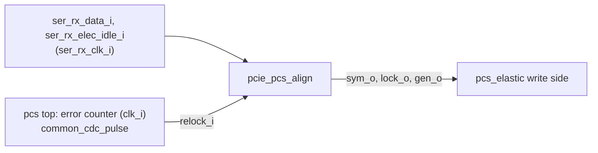

# pcie_pcs_align MAS

`pcie_pcs_align` is the comma aligner of [`pcie_pcs`](../../arch/pcs/HAS.md):
in the `ser_rx_clk_i` domain it registers the unaligned 20-bit words from
the line, finds a [comma](../../arch/pcs/8B10B.md#comma), takes symbol lock
and sends two aligned 10-bit symbols per cycle, tagged with the lock and
the lock-generation bit, to the elastic buffer. It drops lock on electrical
idle and on a relock request. The rules are the
[comma alignment and symbol lock](../../arch/pcs/RECEIVE.md#comma-alignment-and-symbol-lock)
section of the pcs receive path, which is normative; this page owns the
sub-IP's interface and structure.

It does not decode, check disparity or count errors: the error counter
that decides a relock (`ERR_LIMIT` 3, `ERR_DECAY_WORDS` 8) runs on the
`clk_i` side in the [`pcs` top](https://github.com/amichai-bd/pcie-factory/issues/85),
after the elastic buffer and the decoder, and reaches this block as one
`relock_i` pulse through `common_cdc_pulse`
([crossing 4](../../arch/pcs/HAS.md#clock-domain-crossings)). It has no
crossing of its own.

## Position

No sub-IPs.

## Interfaces

One clock: in the pcs, `clk_i` is `ser_rx_clk_i` and `rst_i` is the
RX-domain reset from `common_cdc_rst`
([clocks and reset](../../arch/pcs/HAS.md#clocks-and-reset)). Every input is
sampled on the rising edge. As a single-clock block it carries no
`cdc-domain` annotations. Bit 0 of every word is the earliest on the line.

| Port | Dir | Width | Clock | Description |
| --- | --- | --- | --- | --- |
| `clk_i` | in | 1 | - | RX clock (`ser_rx_clk_i`). |
| `rst_i` | in | 1 | `clk_i` | Active-high RX-domain reset, used synchronously. |
| `data_i` | in | 20 (`t_word`) | `clk_i` | `ser_rx_data_i`: twenty received bits, no alignment. |
| `elec_idle_i` | in | 1 | `clk_i` | `ser_rx_elec_idle_i`: the line is in electrical idle. |
| `relock_i` | in | 1 | `clk_i` | Relock request, one cycle per request (from `common_cdc_pulse`). |
| `sym_o` | out | 20 (`t_word`) | `clk_i` | Two symbols starting at the boundary, `[9:0]` first. |
| `lock_o` | out | 1 | `clk_i` | `sym_o` is under symbol lock: the elastic-buffer word's lock tag. |
| `gen_o` | out | 1 | `clk_i` | Lock generation: flips at every lock taken; travels with the word. |

## Parameters

None.

## Behavior

Each edge, from the 40-bit **window** of the two registered words (the
previous one in bits 0 to 19, the current one in bits 20 to 39):

1. **Loss of lock.** Lock is kept only if `relock_i` is 0 and the current
   word was not received with `elec_idle_i` high, so lock drops in the
   cycle after idle is seen, and in the cycle a relock request arrives.
2. **Hunt.** If lock is not kept and neither window word was received in
   idle, the window is searched at bit offsets `p` 0 to 19 for a comma
   (bits `p` to `p+6` equal to `COMMA_MINUS` or `COMMA_PLUS`). At the
   lowest such `p` lock is taken at once, the boundary becomes `p mod 10`
   and the generation bit flips. A relock that finds a comma in the same
   window therefore keeps `lock_o` at 1 and only flips `gen_o`.
3. **Output.** `sym_o` gets window bits `boundary` to `boundary+19`, with
   `lock_o` and `gen_o` from steps 1 and 2. While unlocked, the last
   boundary is kept and the words go out tagged unlocked.

Reset: lock 0, generation 0, boundary 0, both idle flags 1 (no hunt for
two words after reset). `sym_o` and the data registers are not reset: they
are qualified by `lock_o`.

The lowest offset decides only when a window holds commas at two different
boundaries, which valid 8b/10b never does; noise and slips can.

## Microarchitecture

- Input register `in_q` (current word), `in_prev_q`, and their idle flags
  `idle_q`, `idle_prev_q`.
- Twenty 7-bit comparators on the window give `comma_at[19:0]`; a priority
  scan gives `first_off`, the lowest hit mod 10.
- `keep`, `hunt_ok`, `acquire` and the next lock state, generation and
  boundary (`offset_q`, 4 bits) in `always_comb`.
- A 20-bit barrel select of the window at the next boundary into `sym_q`.

Assertions (`COMMON_ASSERT_NEVER`): the boundary stays in 0 to 9; no lock
is taken from a window with an idle word; a relock never keeps lock unless
a comma retakes it; the generation flips only when lock is taken; the
first word of a lock holds a comma at symbol 0 or symbol 1.

## Decisions

| Choice | Rationale | Rejected |
| --- | --- | --- |
| Synchronous use of the RX reset | `common_cdc_rst` asserts it asynchronously and holds it at least 7 RX cycles, so a synchronous reset of these flops meets the contract; the RTL BKM keeps asynchronous flops for where the spec requires them. | `COMMON_DFF_ARST_VAL` on every flop. |
| Own package `pcie_pcs_align_pkg` for types; comma forms as module constants | Firstmate ruling for wave 2: a sub-IP never uses its parent's package and its filelist stays standalone. The comma forms (the HAS package rows `COMMA_MINUS` and `COMMA_PLUS`) are matched only here, so they are local constants (RTL BKM: a constant used by one module stays local); the DV checks the comma forms against the arch model's code. | Reaching `pcie_pcs_pkg` from the sub-IP filelist; package constants that the parent's lint reports unused. |
| `lock_o`, `gen_o` straight from the state flops | The output word is registered in the same edge as the lock state, so the state is the tag; no extra flops. | Separate tag registers. |
| Relock as a one-cycle input | Crossing 4 is a `common_cdc_pulse`, owned by the pcs top; the aligner sees a plain pulse. | A toggle level compared here (a second copy of the pulse cell's job). |

## Timing

- A word presented on `data_i` at edge `k` is in `in_q` after it; its bits
  leave on `sym_o` after edge `k+1` (the symbols that end in it) or `k+2`
  (one that starts in it and ends in the next word).
- Lock is taken in the edge whose window holds the comma: the word holding
  the comma is the first one with `lock_o` 1. A comma that starts in the
  word sampled at edge `k` is found at edge `k+2`, so `lock_o` rises two
  edges after the one that samples the word ending the comma (one edge
  when the comma starts in the word before): two of the 10 cycles the HAS
  [lock target](../../arch/pcs/HAS.md#targets) allows to PIPE.
- A relock request drops lock in the edge it is seen.
- Critical path: the comparators, the 20-way priority scan and the barrel
  select, in one `ser_rx_clk_i` cycle (125 MHz).

## Targets

| Item | Target |
| --- | --- |
| Throughput | Two symbols per `ser_rx_clk_i` cycle. |
| Lock | From any of the 20 bit offsets, at the first comma, in the edge it is in the window. |
| False lock | None on valid 8b/10b data at any bit offset, none from a window holding an idle word. |
| Bit slip | Every slip detected by the relock rule within 32 cycles; lock regained at the next comma ([HAS targets](../../arch/pcs/HAS.md#targets)). |
| Area | 68 flops. |

## Open items

| Item | Owner |
| --- | --- |
| Whether the Base Spec asks more of symbol lock than the rules above (for example a minimum number of commas). The Base Spec is not cached locally; PIPE rev 3.0 asks only that lock return within the N_FTS time after electrical idle, which lock on the first comma meets. | [#117](https://github.com/amichai-bd/pcie-factory/issues/117) |

## Files

| File | Holds |
| --- | --- |
| [`pcie_pcs_align_pkg.sv`](../../../../src/rtl/pcs_align/pcie_pcs_align_pkg.sv) | `SYM_W`, `WORD_W`, `WINDOW_W`, `COMMA_W`, `OFFSET_W`, `t_sym10`, `t_word`, `t_window`, `t_comma`, `t_offset`. |
| [`pcie_pcs_align.sv`](../../../../src/rtl/pcs_align/pcie_pcs_align.sv) | The module, with its local constants `COMMA_MINUS` (`7'b1111100`), `COMMA_PLUS` (`7'b0000011`) and `OFFSET_MAX` (9). |
| [`pcs_align.rtl.f`](../../../../src/rtl/pcs_align/pcs_align.rtl.f) | `-F ../common/common_macros.rtl.f`, the package, then the module. |
