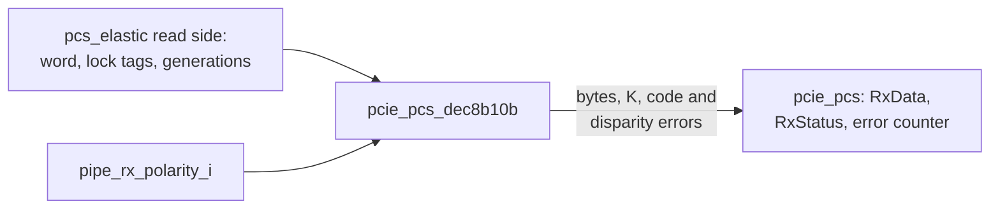

# pcie_pcs_dec8b10b MAS

`pcie_pcs_dec8b10b` is the 8b/10b decoder of the [`pcs`](../../arch/pcs/HAS.md)
receive path. It applies RxPolarity, then decodes two 10-bit symbols per
`clk_i` cycle with the running disparity (RD). For each symbol it gives the
byte, the K flag, a code-error flag and a disparity-error flag, and it
substitutes EDB for a code error. It follows the
[decoder rules](../../arch/pcs/8B10B.md#decoder-and-error-classes) and the
[decode rules of the receive path](../../arch/pcs/RECEIVE.md#decode-and-rxstatus).
It is a sub-IP, so this page owns its interface, behavior and structure;
its role in the system is the HAS's
[sub-IP row](../../arch/pcs/HAS.md#position) ([#82](https://github.com/amichai-bd/pcie-factory/issues/82)).

It does not do the following. It does not align, lock or buffer, and it
sees no SKP or COM rules. It does not form RxValid or RxStatus, and it does
not count errors: the `pcs` top does those
([#85](https://github.com/amichai-bd/pcie-factory/issues/85)), from this
block's flags and the lock tags that travel beside the word.

## Position

No sub-IPs.

## Interfaces

One clock, `clk_i`. The outputs are combinational from the inputs and the
RD register. The RD register updates on the rising edge.

| Port | Dir | Width | Clock | Description |
| --- | --- | --- | --- | --- |
| `clk_i` | in | 1 | - | Core clock. |
| `rst_i` | in | 1 | `clk_i` | Synchronous, active-high reset: the RD becomes unknown. The integrator drives it from every reset that restarts the receive data path. |
| `in_valid_i` | in | 1 | `clk_i` | A word is presented this cycle. The RD state advances only on a valid word. The outputs are computed every cycle and are meaningful only when this is 1. |
| `in_sym_i` | in | 20 | `clk_i` | Two raw received symbols. `[9:0]` is the earlier one, and bit 0 of each field is bit `a`, the first on the line. |
| `in_lock_i` | in | 2 | `clk_i` | Per symbol (bit 0 for `[9:0]`): it was received under symbol lock (the elastic-buffer lock tag). |
| `in_gen_i` | in | 2 | `clk_i` | Per symbol: its lock-generation bit ([lock](../../arch/pcs/RECEIVE.md#comma-alignment-and-symbol-lock)). |
| `polarity_i` | in | 1 | `clk_i` | RxPolarity: invert every bit of this cycle's word before decoding. |
| `out_data_o` | out | 16 | `clk_i` | Decoded bytes, `[7:0]` from `in_sym_i[9:0]`; EDB (`8'hFE`) on a code error. |
| `out_k_o` | out | 2 | `clk_i` | K flag per byte. It is 1 with EDB on a code error. |
| `out_code_err_o` | out | 2 | `clk_i` | Code error per symbol. |
| `out_disp_err_o` | out | 2 | `clk_i` | Disparity error per symbol. |

The ports are plain `logic` vectors, so the parent integrates them without
a shared package.

## Parameters

None.

## Behavior

**Polarity.** Each symbol is inverted (all ten bits) when `polarity_i` is 1
in that cycle.

**Decode.** Each symbol is decoded at an assumed RD by the
[decoder table](../../arch/pcs/8B10B.md#decoder-and-error-classes):

| Class | Condition (RD known) | `data`, `k` | `code_err`, `disp_err` |
| --- | --- | --- | --- |
| Valid | The encoder sends this code at the current RD. | the byte, its K flag | 0, 0 |
| Disparity error | Not valid at the current RD, valid at the other. | the byte, its K flag | 0, 1 |
| Code error | Valid at neither RD. | `8'hFE`, 1 | 1, 0 |

At most one flag is set. When a code is valid at neither RD, it is a code
error and never a disparity error. When the RD is **unknown**, either
column is accepted. A code valid in some column is then valid, and there is
never a disparity error. Code errors are as above.

**RD after a symbol.** After every symbol, valid or not, the RD follows
that symbol's two sub-blocks by the
[running-disparity rule](../../arch/pcs/8B10B.md#running-disparity), each
judged from the RD before it. The starting RD is the current RD when it is
known. When it is unknown, the start is RD- if the code is valid at RD- or
at neither RD, and RD+ if it is valid only at RD+. The 8B10B page leaves
this choice open. It matches the architecture model's `decode()`, and for
a balanced code with balanced sub-blocks the result is RD-.

So after an error the RD resynchronizes to what the received bits imply.
A single flipped bit therefore shows as an error at that symbol or at a
later one, as 8B10B.md states.

**When the RD is known.** Symbol 0 of a word is decoded at the stored RD
only when all of these hold:

- the stored RD is known;
- `polarity_i` equals its value in the previous cycle;
- symbol 0 is locked;
- its generation equals the stored generation.

Symbol 1 is decoded at the RD left by symbol 0 only when both symbols are
locked and their generations are equal. In every other case the symbol's
RD is unknown. This matches the HAS: the RD is unknown at the start of each
locked run (after an unlocked symbol, or at a new lock generation, which a
relock in the same cycle also gives) and when RxPolarity changes.

**State update** at each rising edge:

| Condition | Stored RD | Known | Generation |
| --- | --- | --- | --- |
| `rst_i` | - | 0 | - |
| `in_valid_i` | the RD after symbol 1 | `in_lock_i[1]` | `in_gen_i[1]` |
| otherwise | unchanged | cleared if `polarity_i` changed this cycle | unchanged |

The previous-cycle polarity register resets to 0. Unlocked symbols are
still decoded (unknown RD), so the integrator decides what to report; the
HAS reports codes 4 and 7 only while RxValid is 1.

**Assertions** (`COMMON_ASSERT_NEVER`, outside reset):

- `a_one_error_class`: never both flags on a symbol.
- `a_code_err_edb`: a code error always carries EDB with K set.
- `a_disp_err_known_rd`: a disparity error only at a known RD.

## Microarchitecture

There are two decode lanes, each a call of the package's pure function
`decode()`. Symbol 1's starting RD is symbol 0's result, so the RD carries
across the lanes combinationally. `decode()` matches the code against both
RD columns with `match_at()`. That function covers the K28 forms; the 6b
data block at the given RD, then the 4b block at the RD after it; the A7
rule for `Dx.7`; and `Kx.7` (A7 with x in 23, 27, 29 or 30). The lookups use
only the RD- tables of [8B10B.md](../../arch/pcs/8B10B.md) (32 six-bit and
9 four-bit entries, written in line order). A received RD+ block is looked
up unchanged when it is balanced and not alternating, and complemented
otherwise. The alternating forms `111000` and `1100` are RD- only. An
equivalent table of all 1024 codes was rejected: it is larger to read and
review.

There are four flops: RD known (reset 0), RD sign, the generation, and the
previous `polarity_i` (reset 0). The RD sign and the generation need no
reset, because they are read only while RD known is 1.

## Decisions

| Choice | Rationale | Rejected |
| --- | --- | --- |
| Combinational outputs, the RD register only | The parent registers the PIPE outputs together with its sideband (removed and overflow flags, RxValid). The decoder adds no pipeline stage it would have to match. | A registered output stage (the parent would have to delay the lock, removed and overflow flags to match). |
| Per-symbol lock and generation inputs | After SKP addition, a word's two symbols can come from different buffer words, so lock and generation are per symbol. A relock in the same cycle shows only as a generation change. | One lock bit per word; resetting the RD only on unlocked words (misses a relock in comma-dense traffic). |
| RD unknown on any change of `polarity_i` between cycles, word or not | The HAS rule as written, and simple. | Comparing with the polarity of the last decoded word (keeps the RD across a toggle and back with no word in between, which the HAS does not state). |
| Unknown-RD start: RD-, unless the code is valid only at RD+ | This is the architecture model's behavior, and it gives a defined RD after every symbol. | Keeping the RD unknown after a balanced first symbol (one more state, and it differs from the model). |
| Sub-IP-private package `pcie_pcs_dec8b10b_pkg` | The RTL BKM keeps a sub-IP's filelist standalone: it never uses its parent's package (firstmate ruling). `K_EDB` copies the value in the [pcs HAS package table](../../arch/pcs/HAS.md#package), and DV checks it against the architecture model. [#85](https://github.com/amichai-bd/pcie-factory/issues/85) amends the HAS package text, and [#133](https://github.com/amichai-bd/pcie-factory/issues/133) moves constants shared by sibling sub-IPs to a shared block. | Using `pcie_pcs_pkg` (the parent's filelist is the only one in `rtl/pcs/`, so the sub-IP filelist could not reach it). |

## Timing

- The outputs are combinational from `in_sym_i`, `in_lock_i`, `in_gen_i`,
  `polarity_i` and the RD register. The critical path is the inversion,
  then lane 0's column match and RD, then lane 1's match and RD, into the
  RD register: two chained 10-bit decodes.
- Throughput: two symbols per cycle. Latency: 0 cycles, so the decoded word
  appears in the cycle it is presented.
- No clock-domain crossing.

## Targets

| Item | Target |
| --- | --- |
| Throughput | Two symbols per `clk_i` cycle at 125 MHz. |
| Correctness | All 1024 codes in both lanes, at RD-, RD+ and unknown, give the class, byte, K flag and RD after that the architecture model's `decode()` gives. |
| Area | Four flops, plus two lanes of decode logic. |

## Files

| File | Holds |
| --- | --- |
| [`pcie_pcs_dec8b10b_pkg.sv`](../../../../src/rtl/pcs_dec8b10b/pcie_pcs_dec8b10b_pkg.sv) | `SYM_W`, `BYTE_W`, `K_EDB` (`8'hFE`), `t_sym10`, `t_byte`, `t_match`, `t_dec`. It also holds the pure functions `six_minus`, `four_minus`, `six_plus`, `four_plus`, `rd_after6`, `rd_after4`, `line_order`, `match_at` and `decode`. |
| [`pcie_pcs_dec8b10b.sv`](../../../../src/rtl/pcs_dec8b10b/pcie_pcs_dec8b10b.sv) | The module: polarity, two decode lanes, the RD state and the assertions. |
| [`pcs_dec8b10b.rtl.f`](../../../../src/rtl/pcs_dec8b10b/pcs_dec8b10b.rtl.f) | `-F ../common/common_macros.rtl.f`, the package, then the module. |
