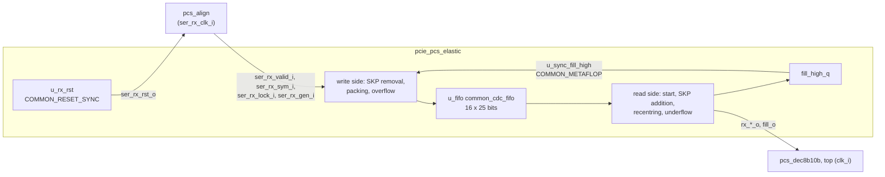

# pcie_pcs_elastic MAS

`pcie_pcs_elastic` is the SKP elastic buffer of [`pcie_pcs`](../../arch/pcs/HAS.md).
It carries the aligned two-symbol words from the recovered clock
`ser_rx_clk_i` into the core clock `clk_i`. It absorbs the clock offset by
removing one SKP from a SKP ordered set on the write side and adding one on
the read side. The rules it implements are the normative
[elastic buffer](../../arch/pcs/RECEIVE.md#elastic-buffer) of the pcs
receive path. It also reports, per word, what changed or went wrong (RxStatus
1, 2, 5 and 6 on the [RxStatus table](../../arch/pcs/RECEIVE.md#decode-and-rxstatus)).
As a sub-IP it has no HAS: this page owns its interface, behavior and
structure.

It does not decode, invert polarity, look for commas or lock, or compute the
final RxStatus code. The aligner ([#83](https://github.com/amichai-bd/pcie-factory/issues/83))
and the decoder ([#82](https://github.com/amichai-bd/pcie-factory/issues/82))
do those, and the top does the code precedence ([#85](https://github.com/amichai-bd/pcie-factory/issues/85)).
COM and SKP are matched on their raw 10-bit codes in both columns, so no
decoding and no polarity is needed ([8b/10b](../../arch/pcs/8B10B.md#comma)).

## Position

No sub-IPs. It instantiates three crossing cells: the reset synchronizer,
the FIFO and the fill-high synchronizer (crossings 2, 1 and 3 of the
[HAS crossing table](../../arch/pcs/HAS.md#clock-domain-crossings)).

## Interfaces

| Port | Dir | Width | Clock | Description |
| --- | --- | --- | --- | --- |
| `clk_i` | in | 1 | - | Core clock: the read side. |
| `rst_i` | in | 1 | `clk_i` | The pcs `rst_i`: synchronous reset of the read side, and the input of the RX-domain reset synchronizer. Not `pipe_reset_ni` (below). |
| `ser_rx_clk_i` | in | 1 | - | Recovered RX clock: the write side. |
| `ser_rx_valid_i` | in | 1 | `ser_rx_clk_i` | The aligner sends a word this cycle. |
| `ser_rx_sym_i` | in | 20 | `ser_rx_clk_i` | Two raw 10-bit symbols at the aligner's boundary, `[9:0]` first, bit 0 first on the line. |
| `ser_rx_lock_i` | in | 1 | `ser_rx_clk_i` | Lock tag of the word: both symbols are under symbol lock. |
| `ser_rx_gen_i` | in | 1 | `ser_rx_clk_i` | Lock-generation bit of the word ([lock](../../arch/pcs/RECEIVE.md#comma-alignment-and-symbol-lock)). |
| `rx_valid_o` | out | 1 | `clk_i` | A word is sent this cycle: two symbols, or an underflow word. |
| `rx_sym_o` | out | 20 | `clk_i` | Two raw symbols, `[9:0]` first. 0 when no word or underflow. |
| `rx_lock_o` | out | 2 | `clk_i` | Lock tag per symbol (bit `i` for symbol `i`). PIPE RxValid is both bits. |
| `rx_gen_o` | out | 2 | `clk_i` | Lock generation per symbol. |
| `rx_skp_add_o` | out | 1 | `clk_i` | One SKP was added in a set whose COM is in this word (RxStatus 1). |
| `rx_skp_rem_o` | out | 1 | `clk_i` | One SKP was removed from a set whose COM is in this word (RxStatus 2); see [Behavior](#behavior) for the one exception. |
| `rx_ovf_o` | out | 1 | `clk_i` | This word holds the first symbol written after a lost FIFO word (RxStatus 5). |
| `rx_udf_o` | out | 1 | `clk_i` | Underflow word: fewer than two symbols were visible. The top sends EDB, EDB with RxStatus 6. |
| `fill_o` | out | 6 | `clk_i` | The visible fill in symbols, 0 to 34. For debug and DV; the receive path does not need it. |
| `ser_rx_rst_o` | out | 1 | `ser_rx_clk_i` | The RX-domain reset (crossing 2): high asynchronously with `rst_i`, low at the second `ser_rx_clk_i` edge after `rst_i` falls. The rest of the RX domain resets on it. |

All outputs except `ser_rx_rst_o` are combinational from `clk_i`
registers and the FIFO's read side. The consumer registers them. Every
input other than the two clocks carries the `cdc-domain` annotation of its
`Clock` column ([crossings](../../../bkm/rtl.md#clock-domain-crossings)).
There is no `pipe_reset_ni` port: per its
[scope](../../arch/pcs/PIPE_CONTROL.md#reset-and-phystatus), the read side
(started flag, leftover symbol, recentring) keeps running through a PIPE
reset. The top gates RxValid and RxStatus.

## Parameters

None. The sizes are fixed by the [elastic buffer](../../arch/pcs/RECEIVE.md#elastic-buffer):
16 FIFO words (`EB_ADDR_W` 4), nominal fill 8, remove at 9 or more, add
at 7 or less, recentring at most once per 8 cycles.

## Behavior

Symbols are counted on the line; "fill" is the **visible fill**: twice
the FIFO's read-side occupancy (`dst_fill_o`, the words whose write pointer
has crossed), plus the leftover symbol, plus one when a copy is owed (below).

**Reset.** `rst_i` resets the read side and, through the synchronizer, the
write side (`ser_rx_rst_o`). Both sides are in reset together while
`rst_i` is high, as the FIFO requires. Each write-side flop takes the RX
reset asynchronously (`COMMON_DFF_ARST_VAL`, [RTL BKM](../../../bkm/rtl.md#reset-and-clocks)).
While it is high, no word is offered to the FIFO.

**Write side (`ser_rx_clk_i`)**, each cycle with `ser_rx_valid_i`:

- **Recentring.** If the word is unlocked, fill high is seen, and no word
  was dropped in the last 7 cycles, the whole word is dropped.
- **SKP removal.** While fill high is seen and the word is locked, a SKP
  that directly follows a COM is dropped (the COM may be in the previous
  word). That is the first SKP of a SKP ordered set, so at most one per set.
  The next kept symbol carries the removed flag. A set that arrived with one
  SKP leaves as a bare COM.
- **Packing.** A one-symbol packing register joins the kept symbols into
  two-symbol words, so a cycle with a removal may write no word.
- **Tags.** A FIFO word ([`t_eb_word`](#files), 25 bits) holds two symbols,
  a removed flag per symbol, one lock tag, one generation bit and an overflow
  flag. A word packed from symbols that differ in lock or generation (only
  at a lock change or a same-cycle relock, with a symbol in the packing
  register) is tagged unlocked, with the newer symbol's generation. PIPE
  then sees that word as not valid, as the arch model does for a word with
  an unlocked symbol.
- **Lock start.** When a locked word arrives while the packing register
  holds an unlocked symbol, that symbol is dropped and the locked word is
  packed on its own. The first locked symbols therefore start a FIFO word
  instead of sharing one with an unlocked symbol, which would tag it
  unlocked and hold RxValid back one word (the pcs
  [lock target](../../arch/pcs/HAS.md#targets)). Losing an unlocked symbol
  is harmless: PIPE never shows it as valid. A held *locked* symbol of the
  old generation is kept (a same-cycle relock), and a word packed from it
  is tagged unlocked as below.
- **Overflow.** A word offered while the FIFO is full (`src_ready_o` low) is
  lost. The next word written carries the overflow flag on its first
  symbol.

**Read side (`clk_i`)**, each cycle:

- **Start.** Nothing is sent until the fill first reaches 8. `rx_valid_o`
  rises in that cycle. Only `rst_i` clears the started flag.
- **Fill high.** `fill_high_q` is 1 while the fill is 9 or more. It
  crosses to the write side through `u_sync_fill_high`.
- **Recentring.** When the head word is unlocked, the fill is 7 or less,
  and no hold happened in the last 7 cycles, nothing is read or sent that
  cycle (`rx_valid_o` 0).
- **Underflow.** When the fill is below 2, an underflow word is sent
  (`rx_valid_o`, `rx_udf_o`, symbols and lock 0). Nothing is consumed, so no
  symbol is lost.
- **Lock start.** When the head word is locked and the leftover symbol is
  unlocked (and no copy or removal report is owed), the leftover symbol is
  dropped and the head word is sent from its first symbol, so the first
  locked word is not paired with an unlocked symbol (the same reason as on
  the write side).
- **Send.** Otherwise two symbols are sent: the leftover symbol first, then
  the head word. A symbol that is not sent stays in the leftover register.
  At most one word is read per cycle.
- **SKP addition.** When a sent symbol is a locked COM and the fill is 7 or
  less, the next symbol is checked. It is the leftover symbol, the head word,
  or for a COM in the second slot with no leftover, the word after the head
  (`dst_next_data_o`). If that symbol is a SKP without the removed flag,
  one copy of it (same raw code, lock and generation) is sent right after the
  COM. For a COM in the first slot, the copy is the second symbol. For a COM
  in the second slot, the copy is owed (`r_dup_q`) and is the first symbol
  of the next word sent. `rx_skp_add_o` marks the COM's word. If the next
  symbol is not visible, nothing is added for that set.
- **Removal status.** `rx_skp_rem_o` marks the word holding the COM when
  the symbol after it carries the removed flag. The flag is then cleared:
  `r_rem_ack_q` masks it when that symbol is still in the FIFO or leftover
  register. If the symbol after the COM was not visible when the COM left,
  the flag is reported on the word holding that symbol instead, as in the
  arch model and the [RxStatus table](../../arch/pcs/RECEIVE.md#decode-and-rxstatus).
  That needs a visible fill below 4 (a COM in the second slot with no
  leftover and at most one visible word), so it never happens within the
  targets.
- **Overflow status.** `rx_ovf_o` marks a word holding a symbol with the
  overflow flag.

If the COMs of two SKP ordered sets share a word, both their changes go on
that word, and the top's precedence picks the code.

## Microarchitecture

- **RX-domain reset:** `u_rx_rst` (`COMMON_RESET_SYNC`, two stages) from
  `rst_i`; its output `rx_rst` is `ser_rx_rst_o`. It drives the write-side
  flops' asynchronous reset, `u_fifo.src_rst_i` and `u_sync_fill_high`'s
  destination reset.
- **Write side:** `w_holdoff_q` (recentring counter), `w_prev_com_q` (the
  last symbol taken was a COM), `w_pend_rem_q` (the next kept symbol follows
  a removed SKP), `w_pend_ovf_q` (the next word written follows a lost one),
  and the packing register `w_hold_valid_q`/`w_hold_q`; `w_flush` drops an
  unlocked held symbol at a lock start. Combinational logic
  matches both symbols against `COM_RD_MINUS`/`COM_RD_PLUS` and
  `SKP_RD_MINUS`/`SKP_RD_PLUS`, then forms the word. At most one of the two
  symbols can be a removed SKP (`a_one_removal`).
- **FIFO:** `u_fifo`, [`common_cdc_fifo`](../common/common_cdc_fifo.md) with
  `WIDTH` 25 and `ADDR_W` 4. Its read side gives the head word, the word
  after it and the occupancy.
- **Read side:** `r_started_q`, the leftover register `r_left_valid_q`/
  `r_left_q` (`r_flush` drops an unlocked leftover at a lock start), `r_dup_q` (a copy is owed), `r_rem_ack_q` (the next symbol's
  removed flag is already reported), `r_holdoff_q` and `fill_high_q`. The
  next three symbols in order (`c0` to `c2`, from the leftover register, the
  head and the word after it) feed one block of combinational logic. That
  logic picks the two symbols sent (`o0`, `o1`), the flags, whether to pop,
  and the next leftover.
- **Assertions:** no pop from an empty FIFO; an owed copy has its symbol
  and is a SKP; a send has its symbols; additions only at fill 7 or less;
  one removal per cycle; no removal right after a pending removed flag.

## Decisions

| Choice | Rationale | Rejected |
| --- | --- | --- |
| Add `dst_fill_o` and `dst_next_data_o` to `common_cdc_fifo` (the HAS open item) | The fill is the FIFO's own synchronized pointer difference, the measure the HAS decision names. The look-ahead for a COM in the second slot needs the word after the head in the same cycle. Without it, about half the SKP sets could not take an addition, which halves the correction rate below the 600 ppm drift. Both outputs are read-side only and keep the existing behavior. | Computing the fill here from a second crossing of the write pointer (the duplicate the HAS rejects); a local prefetch register (more state, the same result). |
| A copy owed across words is one flag (`r_dup_q`), counted in the fill | The leftover register stays one symbol, as the HAS states. The arch model's stage then holds the same symbols. | A two-symbol leftover register. |
| A word with mixed lock or generation is tagged unlocked | The HAS word has one lock tag and one generation bit. The case remains only at a lock end and at a same-cycle relock (the lock start drops the unlocked symbol instead), where the arch model also delivers no valid word. | Per-symbol tags (27 bits, not the HAS's 25). |
| Drop an unlocked symbol at a lock start, on both sides | Without it, the packing or leftover parity left from before an electrical-idle gap pairs the first locked symbols with an unlocked one, and RxValid starts one word late: up to 11 cycles from the comma against the HAS's 10 (#85 review). | Re-aligning the packing phase on every lock (the same drop, more logic); keeping the target off by a word. |
| Underflow consumes nothing | No symbol is lost: the leftover symbol is sent after the EDB word. | Dropping the partial symbol (the arch model's simplification). |
| Outputs are combinational | The decoder registers its output, so the elastic buffer adds no cycle to the RX latency budget (6 plus half the fill). | Registered outputs (one more cycle of latency). |
| The RX-domain reset synchronizer lives here and leaves on `ser_rx_rst_o` | This module is the RX domain's first consumer and owns the FIFO reset pairing. One instance serves the whole RX domain, so the pcs keeps a single crossing 2. | A second synchronizer in the top. |

## Timing

- **Latency:** a word is visible to the read side two or three `clk_i`
  edges after it is written. From there, the outputs are combinational in
  the cycle it is sent.
- **Throughput:** one aligned word per `ser_rx_clk_i` cycle in, two symbols
  per `clk_i` cycle out.
- **Clocks and crossings:** `ser_rx_clk_i` (write side) and `clk_i` (read
  side), within ±600 ppm. Crossings: `u_fifo` (data and pointers), `u_sync_fill_high`
  (a level from `fill_high_q`) and `u_rx_rst` (reset). Their timing
  exceptions are on the cells' pages.
- **Critical path:** on the read side, from the FIFO head (a memory read
  mux) through the COM/SKP compare and the send selection to the outputs,
  then the consumer's decoder. On the write side, from the input through
  the compare and packing to the FIFO write port.

## Targets

| Item | Target |
| --- | --- |
| Clock offset | No loss, overflow or underflow at any offset up to ±600 ppm, with SKP intervals from 1180 to 1538 symbols, up to maximum TLPs, and across electrical idle of any length ([HAS targets](../../arch/pcs/HAS.md#targets)). |
| Visible fill | 4 to 12 symbols once started, under those conditions. |
| Status | RxStatus 1 and 2 on the COM's word; 5 on the first word after a loss; 6 on an underflow word. |
| Clocks | 125 MHz on both sides. |

## Files

| File | Holds |
| --- | --- |
| [`pcie_pcs_elastic_pkg.sv`](../../../../src/rtl/pcs_elastic/pcie_pcs_elastic_pkg.sv) | `SYM_W`, `t_sym10`, the raw `COM_RD_*` and `SKP_RD_*` codes, `t_eb_word` (the 25-bit FIFO word), `t_eb_sym` (one symbol with its flags), `is_com`, `is_skp`. |
| [`pcie_pcs_elastic.sv`](../../../../src/rtl/pcs_elastic/pcie_pcs_elastic.sv) | The module, with its local sizes (`EB_ADDR_W`, `EB_NOMINAL`, `EB_HIGH`, `EB_LOW`, `EB_HOLDOFF`). |
| [`pcs_elastic.rtl.f`](../../../../src/rtl/pcs_elastic/pcs_elastic.rtl.f) | `-F` the vocabulary, `common_cdc_rst`, `common_cdc_sync2` and `common_cdc_fifo` lists, then the package and the module. |
