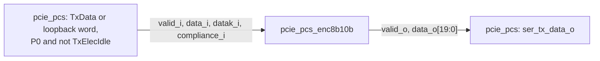

# pcie_pcs_enc8b10b MAS

`pcie_pcs_enc8b10b` is the transmit encoder of [`pcie_pcs`](../../arch/pcs/HAS.md).
Each `clk_i` cycle it encodes two bytes with their K flags into two 10-bit
symbols with the [8b/10b code](../../arch/pcs/8B10B.md). It keeps the
transmit running disparity, applies TxCompliance and sends any unsupported
K byte as EDB. As a sub-IP it has no HAS of its own: its role is in the
parent's [sub-IP table](../../arch/pcs/HAS.md#position), and this page owns
its interface, behavior and structure.

It does not choose what to send (the parent's loopback select), drive
electrical idle on the line or know the PowerDown state; the parent does
all three ([PIPE control](../../arch/pcs/PIPE_CONTROL.md#transmit-path)).

## Position

No sub-IPs. Until the `pcs` top ([#85](https://github.com/amichai-bd/pcie-factory/issues/85))
connects it, the `pcs` shell instantiates it with its outputs unused
([`pcs` MAS](../pcs/MAS.md)).

## Interfaces

One clock, `clk_i`; every input is sampled and every register updates on
its rising edge. Bits `[7:0]` (`[9:0]`) are the earlier byte (symbol) on the
line, as on the [`pcs` interfaces](../../arch/pcs/HAS.md#interfaces).

| Port | Dir | Width | Clock | Description |
| --- | --- | --- | --- | --- |
| `clk_i` | in | 1 | - | Core clock. |
| `rst_i` | in | 1 | `clk_i` | Synchronous, active-high reset. The parent drives it in every cycle the PCS `clk_i` side is in reset (`rst_i` or not `pipe_reset_ni`). |
| `valid_i` | in | 1 | `clk_i` | A word to send. 0: no word (electrical idle); the running disparity holds and the other inputs are ignored. |
| `data_i` | in | 16 | `clk_i` | Two bytes, `HGFEDCBA` each. |
| `datak_i` | in | 2 | `clk_i` | Bit i marks byte i as a K symbol. |
| `compliance_i` | in | 1 | `clk_i` | With a valid word: set the running disparity negative before the `[7:0]` symbol. |
| `valid_o` | out | 1 | `clk_i` | `valid_i` two cycles later; 0 in and after reset. |
| `data_o` | out | 20 | `clk_i` | The two codes of the word, `[9:0]` first; bit 0 of each is line bit `a`. Don't care while `valid_o` is 0. |

## Parameters

None.

## Behavior

- **Code.** Each byte is encoded by the rules of the
  [8b/10b code](../../arch/pcs/8B10B.md): the 6b sub-block from the
  running disparity (RD) before the symbol, the 4b sub-block from the RD
  after the 6b sub-block, the A7 rule, and the K28 and `Kx.7` forms.
- **Unsupported K.** A K flag on a byte that is not one of the
  [valid K codes](../../arch/pcs/8B10B.md#k-symbols) (K28.0 to K28.7,
  K23.7, K27.7, K29.7, K30.7) sends EDB (K30.7, `0xFE`), as
  [PIPE control](../../arch/pcs/PIPE_CONTROL.md#transmit-path) says. The
  other valid K codes, K28.4, K28.6 and K28.7 included, are encoded as
  given; not sending K28.7 is the MAC's part
  ([`pcs` targets](../../arch/pcs/HAS.md#targets)).
- **Running disparity.** The `[7:0]` symbol is encoded at the transmit RD,
  the `[15:8]` symbol at the RD after it, and the transmit RD becomes the
  RD after the `[15:8]` symbol. A word with `compliance_i` 1 sets RD
  negative before its `[7:0]` symbol. A cycle with `valid_i` 0 leaves RD
  unchanged, so RD is kept across electrical idle.
- **Latency.** A word sampled with `valid_i` 1 in cycle n is on `data_o`,
  with `valid_o` 1, in cycle n + 2: the whole
  [TX latency](../../arch/pcs/HAS.md#targets) of the PCS.
- **Reset.** An edge that sees `rst_i` 1 sets RD negative and drops the
  words in flight: `valid_o` is 0 from that edge until the first word
  sampled after reset arrives, two cycles after it.

## Microarchitecture

Two stages:

1. **Input register:** `in_valid_q` (reset 0), `in_data_q`, `in_datak_q`,
   `in_compliance_q` (not reset).
2. **Encode and output register:** two instances of the combinational
   per-symbol leaf `pcie_pcs_enc8b10b_sym` (`u_sym0`, `u_sym1`), chained
   through the RD: `u_sym0` takes `rd_q`, or negative under compliance, and
   `u_sym1` takes `u_sym0`'s RD out. `rd_q` (reset negative) loads
   `u_sym1`'s RD out when `in_valid_q` is 1. `out_valid_q` (reset 0)
   follows `in_valid_q`; `out_data_q` loads both codes when `in_valid_q`
   is 1.

The leaf computes one symbol from the rules, not from a stored code table:

- It replaces an unsupported K byte with `pcie_pcs_enc8b10b_pkg::K_EDB`.
- The RD- form of the 6b sub-block is EDCBA with `i` set for two ones, or
  the fixed form of the exception table, or `001111` for K28.
- The RD- form of the 4b sub-block is FGH with `j` set for one one, or the
  fixed form of `y` = 0, 4 or 7 (P7, or A7 for any K and by the A7 rule).
- A sub-block's RD- form is complemented at RD+ when it is unbalanced or
  `111000` / `1100`. Only an unbalanced sub-block flips the RD.
- At RD+ a K28 code is the complement of its whole RD- code, so its
  balanced 4b sub-blocks (K28.1, .2, .5, .6) are complemented too.

**Assertions** (`COMMON_ASSERT_CLOCKED_WHEN`, guarded by `in_valid_q`):

| Label | Invariant |
| --- | --- |
| `a_lane0_disparity`, `a_lane1_disparity` | A code holds five ones and keeps RD, six ones from RD- to RD+, or four ones from RD+ to RD-. |
| `a_run_length` | No six equal bits in a row across the two codes of a word (`run6`, read only by this assertion). |

## Decisions

| Choice | Rationale | Rejected |
| --- | --- | --- |
| Both TX latency cycles in the encoder, inputs and outputs registered | The parent then needs only to delay its electrical-idle output by two cycles, and the RD chain of two symbols sits between two registers. | One stage in the encoder and the other in the parent (the latency split across two pages). |
| Code computed from the rules in a per-symbol leaf, two instances | The rules on the [code page](../../arch/pcs/8B10B.md) map line by line onto the RTL; one leaf serves both lanes. | A 512-entry code table (opaque, and a second copy of the code). |
| `valid_i` holds the RD | The HAS keeps RD across electrical idle, when `pipe_tx_data_i` is don't care. | Encoding every cycle (RD would drift on idle data). |
| Own package with `K_EDB`, no `pcie_pcs_pkg` | The [RTL BKM](../../../bkm/rtl.md#types-and-constants-live-in-packages) keeps a sub-IP's filelist standalone; the decoder holds the same constant by design until a shared package-only block ([#133](https://github.com/amichai-bd/pcie-factory/issues/133)). | Using the parent's package (its filelist would no longer stand alone). |

## Timing

- Two cycles from input to output, one word per cycle, no stall.
- The critical path is stage 2: the 6b and 4b logic of `u_sym0`, then the
  same for `u_sym1` through the RD chain, into `out_data_q` and `rd_q`.
- One clock, no crossing.

## Targets

| Item | Target |
| --- | --- |
| Throughput | Two symbols per `clk_i` cycle at 125 MHz. |
| Latency | 2 cycles ([`pcs` TX latency](../../arch/pcs/HAS.md#targets)). |
| Code | Every data byte and valid K code at either RD matches the [architecture model](../../../../src/arch/pcs/pcie_pcs_8b10b.py); no run of more than five equal bits. |

## Files

| File | Holds |
| --- | --- |
| [`pcie_pcs_enc8b10b_pkg.sv`](../../../../src/rtl/pcs_enc8b10b/pcie_pcs_enc8b10b_pkg.sv) | `t_sym10` (one symbol) and `K_EDB` (`8'hFE`, the EDB row of the [K-symbol table](../../arch/pcs/8B10B.md#k-symbols)). |
| [`pcie_pcs_enc8b10b_sym.sv`](../../../../src/rtl/pcs_enc8b10b/pcie_pcs_enc8b10b_sym.sv) | The combinational per-symbol leaf. |
| [`pcie_pcs_enc8b10b.sv`](../../../../src/rtl/pcs_enc8b10b/pcie_pcs_enc8b10b.sv) | The two-stage, two-lane module and its assertions. |
| [`pcs_enc8b10b.rtl.f`](../../../../src/rtl/pcs_enc8b10b/pcs_enc8b10b.rtl.f) | `-F ../common/common_macros.rtl.f`, the package, the leaf, then the module. |
