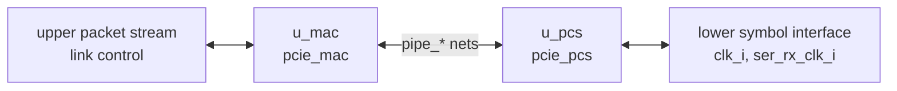

# pcie_phy MAS

How `pcie_phy` implements its [HAS](../../arch/phy/HAS.md): the `pcie_mac`
and `pcie_pcs` instances joined by the
[PIPE nets](../../arch/phy/PIPE.md#signals), with no logic of its own.

## Microarchitecture

- **`u_mac` (`pcie_mac`)** takes `clk_i`, `rst_i`, `port_role_i`, the
  upper packet stream, link control and status, and its MAC-to-PCS side of
  PIPE. `TIMEOUT_DIV` passes through. The other `pcie_mac` parameters
  (`ERR_TIMEOUT_DIV`, `N_FTS`, `L0S_IDLE_CYCLES`) keep their defaults, so
  the phy HAS parameter table is unchanged.
- **`u_pcs` (`pcie_pcs`)** takes `clk_i`, `rst_i`, its PCS-to-MAC side
  of PIPE, and the whole lower symbol interface, including `ser_rx_clk_i`.
- **PIPE nets.** There is one `logic` net per PIPE signal, named
  `pipe_<x>` after the stack net on the PIPE page. Each is driven by
  `pipe_<x>_o` of one IP and read as `pipe_<x>_i` by the other. They stay
  flat because they mirror an external interface, the PIPE specification
  ([structs](../../../bkm/rtl.md#structs-at-interfaces)).
- **Reset.** `rst_i` goes to both IPs. The MAC also holds the PCS in
  reset through `pipe_reset_n`. The PCS derives the RX-domain reset itself
  (`pcs` HAS, Clocks and reset).

## Timing

`pcie_phy` adds no registers and no combinational logic, so the stack
latency is the sum of the `mac` and `pcs` budgets
([HAS targets](../../arch/phy/HAS.md#targets)). The only clock-domain
crossings are inside `pcie_pcs`. Every phy input carries a `cdc-domain`
annotation: `ser_rx_data_i` and `ser_rx_elec_idle_i` are on
`ser_rx_clk_i`, every other input on `clk_i`. `ser_rx_elec_idle_i` passes
straight to `pcie_pcs` with the HAS contract: 1 for any word that holds an
idle bit, whose bits before the idle are still line data. The `pcs` reset nets have
`SYNCASYNCNET` lint waivers seen from the phy top, mirroring the `pcs`
ones (`src/lint_waivers.yaml`).

## Files

| File | Holds |
| --- | --- |
| [`pcie_phy.sv`](../../../../src/rtl/phy/pcie_phy.sv) | The stack top: `u_mac`, `u_pcs` and the PIPE nets. |
| [`phy.rtl.f`](../../../../src/rtl/phy/phy.rtl.f) | `-F ../mac/mac.rtl.f`, then `-F ../pcs/pcs.rtl.f`, then `pcie_phy.sv`. The shared vocabulary and `common_pkg` come in through those two filelists, each flattened once. |
