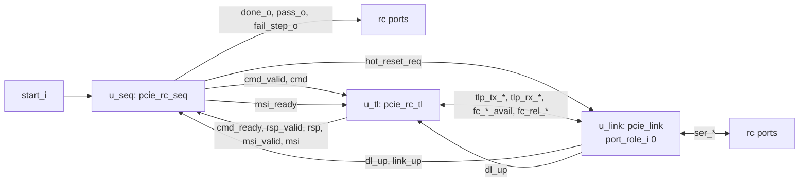

# pcie_rc MAS

How `pcie_rc` implements its [HAS](../../arch/rc/HAS.md): the integration
of the sub-IPs [`pcie_rc_tl`](../rc_tl/MAS.md) and
[`pcie_rc_seq`](../rc_seq/MAS.md) over the unchanged `pcie_link`, by the
[tl-seq interface](../../arch/rc/TL_SEQ.md) and the
[downstream role](../../arch/rc/HAS.md#downstream-role). `rc` adds no
logic of its own: every register and every rule lives in a sub-IP or in
`link`. How it is verified is in the [DV plan](../../dv/rc/DV_PLAN.md).

## Microarchitecture

| Instance | Module | Parameters | Notes |
| --- | --- | --- | --- |
| `u_seq` | `pcie_rc_seq` | `PROGRAM` | `start_i`, `done_o`, `pass_o`, `fail_step_o` are `rc`'s ports. |
| `u_tl` | `pcie_rc_tl` | `FC_NPH`, `CPL_TIMEOUT_DIV`, `HOST_MEM_ADDR_W`, `HOST_MEM_BASE`, `MSI_ADDR`, `VENDOR_ID`, `DEVICE_ID`, `REVISION_ID` | Its link side on `u_link`'s upper stream, credits and credit release. |
| `u_link` | `pcie_link` | `FC_PH`, `FC_PD`, `FC_NPH`, `FC_NPD`, `TIMEOUT_DIV`, `ERR_TIMEOUT_DIV`, `LOWER`, `GPIO_CLK_DIV`; fixed `FC_CPLH` 0, `FC_CPLD` 0, `FC_RELEASE` 1, `REPLAY_TIMEOUT` at its default | `port_role_i` 0; `retrain_req_i`, `disable_req_i`, `loopback_req_i` 0; `hot_reset_req_i` from `u_seq` ([downstream role](../../arch/rc/HAS.md#downstream-role)). Its status, lower symbol and GPIO ports are `rc`'s. |

Every parameter is passed unchanged to the instance that owns its range
check; `rc` itself checks only the credit ranges `link` alone would not
refuse (0, infinite, is not allowed for `rc`; HAS parameters), with
`COMMON_ASSERT_PARAM`. `rst_i` resets all three; `rc_tl` and `rc_seq`
see the link down only through `dl_up` ([HAS link down](../../arch/rc/HAS.md#link-down)).

### Nets

The nets between the three instances, by the names the
[tl-seq page](../../arch/rc/TL_SEQ.md#signals) and the
[`dll` upper stream](../../arch/dll/HAS.md#upper-tlp-stream) give them.
The e2e testbench taps these (and only these) for the host model shadow
([DV plan](../../dv/rc/DV_PLAN.md#strategy)).

| Net | Width | From, to |
| --- | --- | --- |
| `cmd_valid`, `cmd_ready`, `cmd` | 1, 1, `common_pkg::t_rc_cmd` | `u_seq` and `u_tl`: the commands. |
| `rsp_valid`, `rsp` | 1, `common_pkg::t_rc_rsp` | `u_tl` to `u_seq`: the result beats. |
| `msi_valid`, `msi_ready`, `msi` | 1, 1, `common_pkg::t_rc_msi` | `u_tl` and `u_seq`: the MSI captures. |
| `hot_reset_req` | 1 | `u_seq` to `u_link` `hot_reset_req_i`. |
| `tlp_tx_valid`, `tlp_tx_ready`, `tlp_tx_data`, `tlp_tx_sop`, `tlp_tx_eop` | 1, 1, 32, 1, 1 | `u_tl` and `u_link`: TLPs to the endpoint. |
| `tlp_rx_valid`, `tlp_rx_ready`, `tlp_rx_data`, `tlp_rx_sop`, `tlp_rx_eop` | 1, 1, 32, 1, 1 | `u_link` and `u_tl`: TLPs from the endpoint. |
| `fc_ph_avail` to `fc_cpld_avail`, `fc_rel_p`, `fc_rel_pd`, `fc_rel_np`, `fc_rel_npd` | as the `link` ports | Credits available and released. |
| `dl_up`, `link_up` | 1, 1 | `u_link`'s `dl_up_o` and `link_up_o`, also `rc`'s ports. |

## Timing

No logic in `rc`: every latency is a sub-IP's or `link`'s
([`rc_tl` timing](../rc_tl/MAS.md#timing),
[`rc_seq` timing](../rc_seq/MAS.md#timing)). The targets are in the
[HAS targets](../../arch/rc/HAS.md#targets).

Clocks: `clk_i`, plus `link`'s receive clock, `ser_rx_clk_i` at `LOWER` 0
or `gpio_rx_clk_i` at `LOWER` 1; `rc` adds no crossing. Both clock inputs
carry a `cdc-domain` annotation naming themselves, and the top declares
`// cdc-params: LOWER=1`, so the CDC check analyzes the board build as
well as the default ([`link` MAS](../link/MAS.md#timing)).

## Decisions

| Choice | Rationale | Rejected |
| --- | --- | --- |
| The credit ranges checked in `rc` (#377) | `link` accepts 0 (infinite) for its posted and non-posted credits, which the `rc` HAS ranges exclude: `rc_tl` returns credits and sizes its queue by them. | Leaving the check to `link` (0 would elaborate). |
| `REPLAY_TIMEOUT` left at the `link` default, not an `rc` parameter (#377) | The `rc` HAS lists no such parameter; the full-phy e2e meets the default. The board build's adapter ([#378](https://github.com/amichai-bd/pcie-factory/issues/378)) owns any change. | A new `rc` parameter with no HAS row. |
| The e2e taps the nets above, which this page names (#377) | The host model shadow must see what `rc_tl` gives `rc_seq` and puts on the link ([HOST shadow mode](../../dv/core/HOST.md#shadow-mode)); no `rc` port carries them. | Extra debug ports on `rc`. |

## Files

| File | Holds |
| --- | --- |
| [`pcie_rc.sv`](../../../../src/rtl/rc/pcie_rc.sv) | The top: the credit range checks and the three instances. |
| [`rc.rtl.f`](../../../../src/rtl/rc/rc.rtl.f) | `-F ../rc_tl/rc_tl.rtl.f`, `-F ../rc_seq/rc_seq.rtl.f`, `-F ../link/link.rtl.f`, then `pcie_rc.sv`. |
