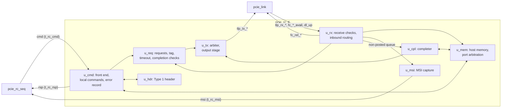

# pcie_rc_tl MAS

`pcie_rc_tl` is the root-port transaction layer, a sub-IP of
[`pcie_rc`](../../arch/rc/HAS.md) approved by OP1 (decision record
[0005](../../decisions/0005-m4-grill.md#decisions)). It takes `rc_seq`'s
commands and turns the endpoint ones into TLPs on `link`; it serves the
endpoint's DMA from host memory, captures its MSIs, records every error,
and holds the root port's Type 1 header. A sub-IP has no HAS, so this page
owns its purpose, ports, parameters and behavior as well as its structure.
It implements, exactly, the rows the `rc` HAS gives it
([outbound](../../arch/rc/HAS.md#outbound-routing),
[inbound](../../arch/rc/HAS.md#inbound-routing),
[host memory](../../arch/rc/HAS.md#host-memory),
[MSI window](../../arch/rc/HAS.md#msi-window),
[credits](../../arch/rc/HAS.md#credits),
[link down](../../arch/rc/HAS.md#link-down)) and the
[tl-seq interface](../../arch/rc/TL_SEQ.md); it decides what those leave
to it: tags and outstanding requests, the maximum read request, the
completion timeout, byte-enable legality, the malformed checks, the host
memory sharing, the MSI capture depth and the leaf-block split. M2 Q6
holds: 128-byte maximum payload, VC0 only, no ECRC. How it is verified is
in the [DV plan](../../dv/rc_tl/DV_PLAN.md). Rules from the PCIe Base
Spec rev 3.0 are paraphrased and cited, never copied
([`pcie-base`](../../references.md#pcie-base)).

## Position

`rc` wires it between `rc_seq` and `link` ([`rc` position](../../arch/rc/HAS.md#position)).
The blocks above are the planned [leaf blocks](#leaf-blocks); today the
module is a [shell](#files).

## Interfaces

One clock, `clk_i`. The `link`-side ports mirror the `link` interfaces of
the same names and stay flat ([RTL BKM](../../../bkm/rtl.md#structs-at-interfaces));
the `rc_seq`-side bundles are the `common_pkg` structs of the
[tl-seq interface](../../arch/rc/TL_SEQ.md#signals).

| Port | Dir | Width | Clock | Handshake and meaning |
| --- | --- | --- | --- | --- |
| `clk_i` | in | 1 | - | 125 MHz. |
| `rst_i` | in | 1 | `clk_i` | Synchronous, active high ([reset](#reset-and-link-down)). |
| `cmd_valid_i` | in | 1 | `clk_i` | A command is offered; `cmd_i` holds while it is 1. |
| `cmd_ready_o` | out | 1 | `clk_i` | Taken at an edge where both are 1 ([commands](#commands)). |
| `cmd_i` | in | 82 | `clk_i` | `common_pkg::t_rc_cmd`: `op` (4), `addr` (32), `len` (6), `first_be` (4), `last_be` (4), `data` (32). |
| `rsp_valid_o` | out | 1 | `clk_i` | One-cycle pulse per result beat; no ready, `rc_seq` takes every beat. |
| `rsp_o` | out | 36 | `clk_i` | `common_pkg::t_rc_rsp`: `status` (`t_rc_status`, 3), `data` (32), `last` (1). |
| `msi_valid_o` | out | 1 | `clk_i` | The oldest capture is offered. |
| `msi_ready_i` | in | 1 | `clk_i` | Taken (removed) at an edge where both are 1. |
| `msi_o` | out | 42 | `clk_i` | `common_pkg::t_rc_msi`: `offset` (10), `data` (32). |
| `tlp_tx_valid_o`, `tlp_tx_ready_i` | out, in | 1, 1 | `clk_i` | [`dll` upper TLP stream](../../arch/dll/HAS.md#upper-tlp-stream), transmit: a beat goes at an edge where both are 1. |
| `tlp_tx_data_o`, `tlp_tx_sop_o`, `tlp_tx_eop_o` | out | 32, 1, 1 | `clk_i` | One DW, header byte 0 in `[7:0]` of the `sop` beat; held while not taken. |
| `tlp_rx_valid_i`, `tlp_rx_ready_o` | in, out | 1, 1 | `clk_i` | Receive; `tlp_rx_ready_o` is 1 whenever `rst_i` is 0 ([credits](INBOUND.md#credits)). |
| `tlp_rx_data_i`, `tlp_rx_sop_i`, `tlp_rx_eop_i` | in | 32, 1, 1 | `clk_i` | One DW of a received TLP. |
| `fc_ph_avail_i`, `fc_pd_avail_i` | in | 8, 12 | `clk_i` | [Credits available](../../arch/dll/HAS.md#credits-available), posted; all ones is infinite. |
| `fc_nph_avail_i`, `fc_npd_avail_i` | in | 8, 12 | `clk_i` | Non-posted. |
| `fc_cplh_avail_i`, `fc_cpld_avail_i` | in | 8, 12 | `clk_i` | Completion. |
| `fc_rel_p_o`, `fc_rel_pd_o` | out | 1, 4 | `clk_i` | [Credit release](../../arch/dll/HAS.md#credit-release), posted: one-cycle pulse, 1 header and 0 to 8 data credits. |
| `fc_rel_np_o`, `fc_rel_npd_o` | out | 1, 4 | `clk_i` | Non-posted. |
| `dl_up_i` | in | 1 | `clk_i` | `link`'s `dl_up_o`. |

`common_pkg` also holds `t_rc_op` (the `op` codes `RC_OP_CFG_RD` 0 to
`RC_OP_ERR_CLR` 9) and `t_rc_status` (`RC_ST_OK` 0 to `RC_ST_BAD` 7), with
the [TL_SEQ](../../arch/rc/TL_SEQ.md#commands) values. `cmd_i.op` is a raw
4-bit field, since an undefined code must be refused, not cast.

## Parameters

| Name | Type | Default | Range | Effect |
| --- | --- | --- | --- | --- |
| `FC_NPH` | `int unsigned` | 8 | 1 to 127 | The non-posted header credits `rc` advertises: sizes the [non-posted queue](INBOUND.md#completer). |
| `CPL_TIMEOUT_DIV` | `int unsigned` | 1 | 1 to 1024 | Divides the [completion timeout](REQUESTER.md#completion-timeout). |
| `HOST_MEM_ADDR_W` | `int unsigned` | 12 | 8 to 16 | Host memory is 2^`HOST_MEM_ADDR_W` bytes. |
| `HOST_MEM_BASE` | `logic [31:0]` | 32'h0 | aligned to the host memory size | System address of host memory byte 0. |
| `MSI_ADDR` | `logic [31:0]` | 32'hFEE0_0000 | 4 KiB aligned, disjoint from host memory | The MSI window. |
| `VENDOR_ID`, `DEVICE_ID` | `logic [15:0]` | 16'h0 | `VENDOR_ID` not 16'hFFFF | The [Type 1 header](#type-1-header) IDs. |
| `REVISION_ID` | `logic [7:0]` | 8'h0 | any | The header's Revision ID. |

These are the `rc` parameters of the same names, passed through. Each
range is a `COMMON_ASSERT_PARAM`; the overlap check compares both bases
above bit max(`HOST_MEM_ADDR_W`, 12).

## Reset and link down

Two resets: `rst` (`rst_i`) and the link reset `lrst` (`rst_i` or
`dl_up_i` 0).

| Reset by | State |
| --- | --- |
| `rst` only | The front end and the command in progress, the tag counter, the Type 1 header, the error record, the MSI capture. |
| `lrst` | The receive parser (a TLP in progress is dropped with no event), the non-posted queue and the completer (every inbound request held is dropped with no completion and no release), the transmit arbiter and output stage (a TLP in progress is abandoned), the pending credit releases. |

Host memory is never reset. Out of `rst` every output is 0 but
`tlp_rx_ready_o`, which is 1. While `dl_up_i` is 0 the outstanding
endpoint request ends with `LINK_DOWN`, and every endpoint command taken
gets `LINK_DOWN` at once ([commands](#commands)); local commands are
unaffected. This is the [`rc` link-down rule](../../arch/rc/HAS.md#link-down):
`link` has abandoned every TLP it held and restarts every credit, so
nothing held below `lrst` can be answered or released.

## Behavior

The front end, the header and the error record are here; the endpoint
requests, completion checks, timeout and transmit arbiter are on the
[requester page](REQUESTER.md); the receive checks, completer, host
memory, MSI capture and credits on the [inbound page](INBOUND.md).

### Commands

- **Take.** `cmd_ready_o` is 1 while `rst_i` is 0 and no command is in
  progress. A command is in progress from the edge that takes it to its
  last result beat, so at most **one command, and one endpoint request,
  is outstanding**; `cmd_ready_o` is 1 again in the cycle after the last
  beat.
- **Checks,** at the take, in order; the first that fails finishes the
  command with one beat in the next cycle, nothing sent or changed:

| # | Check | Fails |
| --- | --- | --- |
| 1 | An endpoint command (`CFG_*`, `MEM_*`) with `dl_up_i` 1. | `LINK_DOWN` |
| 2 | `op` is 0 to 9. | `LOCAL_UR` |
| 3 | `len` 1 to 32 for `MEM_RD`, 1 otherwise. | `LOCAL_UR` |
| 4 | `addr` bits outside the op's fields 0: `[31:28]` and `[1:0]` for `CFG_*`; `[1:0]` for `MEM_*`; `[31:12]` and `[1:0]` for `HDR_*`; bits `HOST_MEM_ADDR_W` and up, and `[1:0]`, for `HOST_*`; none for `ERR_*`. | `LOCAL_UR` |
| 5 | A `MEM_RD` stays inside one aligned 4 KiB block [cite: PCIe Base Spec, rev 3.0, §2.2.7]. | `LOCAL_UR` |
| 6 | [Byte enables](REQUESTER.md#byte-enables) legal. | `LOCAL_UR` |
| 7 | [Outbound routing](../../arch/rc/HAS.md#outbound-routing): `CFG_*` bus equal to Secondary Bus Number and device 0; `MEM_*` with Memory Space Enable 1 and `addr[31:20]` inside the memory window (a request in one 4 KiB block never crosses a 1 MiB boundary). | `LOCAL_UR` |

- **Local commands** finish `OK` with one beat: `HDR_*` and `ERR_*` in
  the cycle after the take; `HOST_*` once [host memory](INBOUND.md#host-memory)
  grants it. `ERR_RD` returns the error record; `ERR_CLR` clears the bits
  set in `data` (an event setting a bit at the same edge wins).
- **Endpoint commands** go to the [requester](REQUESTER.md#requests).

### Type 1 header

The registers of the [`rc` header table](../../arch/rc/HAS.md#type-1-header):
Memory Space Enable, Bus Master Enable, Cache Line Size, the three bus
numbers, Memory Base and Memory Limit bits 15:4; every other field is a
constant. `HDR_RD` and `HDR_WR` follow [header access](../../arch/rc/TL_SEQ.md#header-access).
The header drives, to the other blocks, a registered `t_hdr_st`: the two
enables, Primary and Secondary Bus Numbers and the window's base and
limit, so a write affects the routing of the next command and of every
TLP whose last header DW arrives after the write's edge.

### Error record and Q2 cases

The record ([bits](../../arch/rc/TL_SEQ.md#error-record)) lives in the
front end. Each [Q2](../../arch/rc/HAS.md#q2-observability) error and
recovery case, and what records it:

| Case | Result status | Error record bit |
| --- | --- | --- |
| Endpoint completes with Unsupported Request | `UR` | 0 |
| Endpoint completes with Completer Abort | `CA` | 1 |
| Configuration Request Retry Status | `CRS` | 2 |
| Completion timeout | `TIMEOUT` | 3 |
| Completion matching no request | none | 4 |
| Poisoned completion for the request | `BAD` | 5 |
| Poisoned request or message received | none | 5 |
| Malformed or reserved-status completion for the request | `BAD` | 6 |
| Malformed TLP received | none | 6 |
| ERR_COR, ERR_NONFATAL, ERR_FATAL received | none | 7, 8, 9 |
| Any other message received | none | 10 |
| Inbound request handled as Unsupported Request | none | 11 |
| MSI dropped, capture full | none | 12 |
| Command refused locally | `LOCAL_UR` | none |
| Link down or Hot Reset with a request outstanding, or an endpoint command while down | `LINK_DOWN` | none |
| Injected link error | none: `link` replays it, no TLP lost | none (`dl_err_o`, `rcv_err_o` on `rc`) |

## Microarchitecture

### Leaf blocks

| File | Block | Holds | Built by |
| --- | --- | --- | --- |
| `pcie_rc_tl_pkg.sv` | package | `t_np_ent`, `t_hdr_st`, the decoded header, block states, error bit numbers | [#373](https://github.com/amichai-bd/pcie-factory/issues/373) |
| `pcie_rc_tl_cmd.sv` | `u_cmd` | [Commands](#commands), [byte enables](REQUESTER.md#byte-enables), local commands, result mux, [error record](#error-record-and-q2-cases) | #373 |
| `pcie_rc_tl_req.sv` | `u_req` | [Requests](REQUESTER.md#requests), tag, [timeout](REQUESTER.md#completion-timeout), [completion matching](REQUESTER.md#completion-matching) | #373 |
| `pcie_rc_tl_tx.sv` | `u_tx` | [Transmit](REQUESTER.md#transmit) | #373 |
| `pcie_rc_tl_rx.sv` | `u_rx` | [Receive checks](INBOUND.md#receive-checks), posted [release](INBOUND.md#credits); completions in #373, requests and messages in #375 | #373, [#375](https://github.com/amichai-bd/pcie-factory/issues/375) |
| `pcie_rc_tl_hdr.sv` | `u_hdr` | [Type 1 header](#type-1-header) | [#374](https://github.com/amichai-bd/pcie-factory/issues/374) |
| `pcie_rc_tl_mem.sv` | `u_mem` | [Host memory](INBOUND.md#host-memory) and its port | #375 |
| `pcie_rc_tl_cpl.sv` | `u_cpl` | [Completer](INBOUND.md#completer), non-posted queue and release | #375 |
| `pcie_rc_tl_msi.sv` | `u_msi` | [MSI capture](INBOUND.md#msi-capture) | #375 |
| `pcie_rc_tl.sv` | top | Parameter checks, `rst` and `lrst`, the blocks | today the shell |

### Reuse of tl blocks

`rc_tl` copies no `tl` file. It reuses two things, after
[#385](https://github.com/amichai-bd/pcie-factory/issues/385) moves them
to `common` (that move blocks #373):

- `tl`'s first-word-fall-through [queue](../tl/MAS.md#queue), as a shared
  RAM-group block: the non-posted queue and the completion data queue.
- The pure TLP helpers of [`pcie_tl_pkg`](../tl/MAS.md#package) whose
  arguments are plain vectors (kinds, byte-enable and 4 KiB checks,
  message TC, byte totals, credits), into `common_pkg`: the receive checks
  and the completer's byte counts.

Not reused: `tl`'s tracker (eight application tags, a prescaler and an rc
buffer, where `rc_tl` has one request and streams results), its two
completion formers (`tl` types, two sources), its receive queues and
epochs (endpoint routing, BAR decode) and its three-line arbiter.

## Decisions

Firstmate delegate decisions under the epic's
[delegated sign-off](https://github.com/amichai-bd/pcie-factory/issues/357#issuecomment-6267954374);
the captain may override any.

| Choice | Rationale | Rejected |
| --- | --- | --- |
| One command, so one endpoint request, outstanding | Results come in command order with no reorder buffer; programs check step by step and M4 has no throughput target. | Up to 8 tags outstanding (a reorder buffer for results, for no M4 goal). |
| 5-bit rolling tag | Legal without Extended Tag; makes a late completion unexpected instead of matching the next request. | A fixed tag 0 (a late completion would match); 8 bits (needs Extended Tag). |
| Maximum read request 128 bytes, one TLP | M2 Q6; `cmd.len` is at most 32. | Splitting longer reads (no command asks for one). |
| Timeout N = ⌊2^21 / div⌋ cycles, one counter, no disable | 16.8 ms: inside 50 µs to 50 ms and above 10 ms; one request needs no prescaler. | `tl`'s 16 to 17 prescaler steps per tag (eight tags' worth of state). |
| Byte enables: the endpoint's receive rule, less zero-length writes and configuration accesses | Nothing `rc_tl` sends can be malformed at `core`; no program needs a zero-length write. | Every legal combination (zero-length writes, no M4 user). |
| A failing completion ends its request at once | One rule for every `BAD`; the program sees the failure on the step. | Keep waiting after a malformed completion, as `tl` does (ends only by timeout). |
| Posted requests applied as they arrive, no posted queue | The write always wins the memory port, so nothing waits; release is immediate and exact, ordering with captures and completions is arrival order. | A posted queue sized by `FC_PH` and `FC_PD` (RAM and ordering logic for no gain). |
| Every non-posted TLP through the queue, drops included | One release per cycle at most, no owed counters. | Releasing drops at the `eop` (two releases in a cycle). |
| One single-port RAM, received writes first, the other two alternating | Maps to one block RAM; a write beat never waits, so no data buffer. | A two-port RAM (two writers to arbitrate per word anyway). |
| MSI capture of 4 flop entries | The TL_SEQ minimum; a program waits for each MSI before the next. | A deeper queue (no program queues MSIs). |
| Reuse the queue and the TLP helpers through #385 | A second user exists; the layout rule moves shared logic to `common`, never by copy. | Copying `pcie_tl_fifo` (forbidden); reusing `tl`'s tracker or formers (endpoint structure). |

## Timing

- One clock, `clk_i`; resets `rst` and `lrst`, synchronous; no crossing.
- A command taken at edge E: a refusal, `LINK_DOWN`, `HDR_*` or `ERR_*`
  beat pulses in the cycle after E; a request is offered on `tlp_tx_*`
  from the third cycle after E (request flops, arbiter, output stage)
  when it may go.
- Received: one beat per cycle. A posted write DW is written at the edge
  after it is taken; the release and every event of a TLP come in the
  cycle after its `eop`; a completion data beat on `rsp` in the cycle
  after its DW.
- Transmitted: one beat per cycle while the link takes them; the output
  stage adds one cycle of latency and none of throughput.
- Combinational outputs: `tlp_rx_ready_o` (`rst_i` only); `cmd_ready_o`
  from flops.

## Targets

The [`rc` targets](../../arch/rc/HAS.md#targets) apply through `rc`; this
page owns the completion-timeout value above. No area or throughput
target: FPGA resources are reported with `rc`
([#379](https://github.com/amichai-bd/pcie-factory/issues/379)).

## Files

| File | Holds |
| --- | --- |
| [`pcie_rc_tl.sv`](../../../../src/rtl/rc_tl/pcie_rc_tl.sv) | The shell: every [port](#interfaces) and [parameter](#parameters) with its range checks; every output at its [reset value](#reset-and-link-down) and `tlp_rx_ready_o` 1 out of reset (taken beats are dropped). |
| [`rc_tl.rtl.f`](../../../../src/rtl/rc_tl/rc_tl.rtl.f) | The shared vocabulary, `common_pkg`, `pcie_rc_tl.sv`. `rc.rtl.f` reaches it with `-F`. |

## Open items

| Item | Owner |
| --- | --- |
| The cited sections, checked against rev 3.0 (the Base Spec is not in the local cache). | [#357](https://github.com/amichai-bd/pcie-factory/issues/357): the captain, with a local copy |
| The queue and helper move. | [#385](https://github.com/amichai-bd/pcie-factory/issues/385) |
