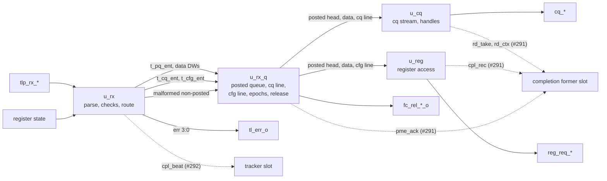

# pcie_tl MAS

How `pcie_tl` implements its [HAS](../../arch/tl/HAS.md). Wave 2 builds it
in three issues: the receive path
([#290](https://github.com/amichai-bd/pcie-factory/issues/290), built),
the transmit path with completions and MSI/MSI-X writes
([#291](https://github.com/amichai-bd/pcie-factory/issues/291)), and
completion tracking and timeout
([#292](https://github.com/amichai-bd/pcie-factory/issues/292)). Each
block is a file of the one `tl` IP; the blocks not built yet attach at the
[slots](#slots) without reworking the receive path. The HAS and its pages
([TLP formats](../../arch/tl/TLP.md), [routing](../../arch/tl/ROUTING.md),
[completions](../../arch/tl/COMPLETIONS.md),
[ordering](../../arch/tl/ORDERING.md)) own the rules; this page owns how
the blocks apply them.

## Top

**Reset.** `tl` is in reset while `rst_i` is 1 or `dl_up_i` is 0
([HAS, reset](../../arch/tl/HAS.md#reset)): the top forms `rst` from both
and every block takes it as its synchronous reset. Every handshake
output (`tlp_rx_ready_o`, `cq_valid_o`, `reg_req_valid_o`, `fc_rel_p_o`,
`fc_rel_np_o`, `tl_err_o`) is also gated by `rst` at the top, so it is 0
in the first cycle `dl_up_i` falls, before the registers clear. The ready
and valid inputs reach the blocks gated the same way.

**Ports.** The top ports are the HAS ports, flat (they mirror the `link`,
tl-cfg and application interfaces the HAS names). Inside, the blocks
exchange the packed structs of the [package](#package). The parameters
keep the HAS ranges (`COMMON_ASSERT_PARAM`, one per parameter).

### Slots

What the blocks not built yet connect to, and the tie each slot carries
until then. Every slot net is MAS-named; the testbench's bind tap reads
the outgoing ones ([DV plan](../../dv/tl/DV_PLAN.md)).

| Slot net (top) | Type | Direction | Owner | Tie until then | Contract |
| --- | --- | --- | --- | --- | --- |
| `cpl_rec_valid`, `cpl_rec` | `logic`, `t_cpl_rec` | `u_reg` to completion former | #291 | unread | One record per completion to form: an Unsupported Request (at once), a configuration write or read (when `reg_cpl_valid` pulses, with the DW), each BAR2 read DW (with its index and last flag). Records come in the order the completions must be formed per request; `cpl_rec.mem`, `locked`, `addr`, `dw_len`, `fbe`, `lbe` give Byte Count and Lower Address ([COMPLETIONS](../../arch/tl/COMPLETIONS.md#byte-count-and-lower-address)). |
| `cpl_room` | `logic` | completion former to `u_reg` | #291 | 1 | Room for one more record: `u_reg` hands an Unsupported Request, or offers an access whose result makes a record, only while it is 1, and the former must take every record that follows. |
| `rd_take`, `rd_ctx` | `logic`, `t_hd_ctx` | `u_cq` to completion former | #291 | unread | A BAR0 read taken on `cq`: its handle and the context its completions need ([read handles](../../arch/tl/COMPLETIONS.md#read-handles)). |
| `hd_free`, `hd_free_idx` | `logic`, 3 bits | completion former to `u_cq` | #291 | 0 | Frees a handle when the `eop` of its `cc` packet is taken. Until #291 no handle is freed, so at most eight BAR0 reads are offered per link-up. |
| `pme_ack`, `pme_room` | `logic`, `logic` | `u_rx_q` to and from completion former | #291 | unread, 1 | A PME_Turn_Off left the posted queue: send PME_TO_Ack on the transmit posted line. It leaves only while `pme_room` is 1. |
| `cpl_beat` | `t_rx_beat` | `u_rx` to tracker | #292 | unread | Every beat of a received completion with a defined Fmt, `sop` to `eop`, in the cycle it arrives, a digest DW included (the tracker reads Length data DWs). `tl` never stalls them. |
| `rc_arrive`, `rc_ep`, `p_none`, `p_known`, the posted head's `ep[LINE_RC]` | | tracker and `u_rx_q` | #292 | `rc_arrive` 0 | The rc line's ordering: a completion that arrives takes `rc_ep` and arms the line; it may be offered on `rc` once `p_none`, or `p_known` and the posted head's rc epoch is after it ([receive queues](#receive-queues)). `rc_arrive` in the same cycle as a posted push counts as after that posted request. While a later posted request loads into an empty posted queue, `p_none` and `p_known` are both 0 for a cycle, so the tracker latches a completion's eligibility once earned, as the cq and cfg lines do (`ok_q`), and an `rc` offer once up stays up until taken (APP). |
| `trk_err` | 9 bits | tracker to the top | #292 | 0 | ORed into `tl_err_o` (bits 2 and 4 to 8). |
| Transmit and requester outputs | | | #291, #292 | reset values | `tlp_tx_*`, `msg_ready_o`, `cc_ready_o`, `rq_ready_o`, `rc_*`, `tl_np_pending_o`. |

## Package

[`pcie_tl_pkg`](../../../../src/rtl/tl/pcie_tl_pkg.sv) holds the Fmt,
Type and message codes, the `tl_err_o` bit numbers, the enums (`t_cls`
credit class, `t_out` receive outcome, `t_pkind` posted entry kind,
`t_ckind` cfg line kind, `t_crkind` record kind, `t_reg_st`), the structs
(the decoded header `t_hdr`, the TLP being received `t_rx_cur`, the queue
entries `t_pq_ent`, `t_cq_ent`, `t_cfg_ent`, the slot types `t_hd_ctx`,
`t_cpl_rec`, `t_rx_beat`, and each block's state), and the pure helpers:

| Helper | Does |
| --- | --- |
| `be_word`, `hdr_decode` | A big-endian header DW as an address word; every header field from the stream DWs ([TLP formats](../../arch/tl/TLP.md)). |
| `credit_class`, `data_credits` | The class and data credits the `dll` counted ([credit release](../../arch/tl/HAS.md#credit-release)). |
| `kind_known`, `is_cpl` | Step 1 of the [checks](../../arch/tl/ROUTING.md#checks); a completion with a defined Fmt. |
| `be_ok`, `cross_4k`, `msg_tc0`, `msg_silent` | Steps 3, 4 and 6; the messages dropped without an error. |
| `lowest_free` | The lowest free read handle. |
| `ep_after` | The [epoch](#receive-queues) comparison. |

## Receive parser

[`pcie_tl_rx`](../../../../src/rtl/tl/pcie_tl_rx.sv) takes every beat the
`link` delivers (`tlp_rx_ready_o` is 1 out of reset). Its state
(`t_rx_state`) counts the beats of the TLP and keeps the header size and
whether it is a completion; DW 0 to 2 are captured. At the last header
DW (beat 2 or 3) the header, the captured DWs and the beat on the stream,
is judged combinationally by the [checks](../../arch/tl/ROUTING.md#checks)
in order and the [routing](../../arch/tl/ROUTING.md#routing), with the
register state of that cycle, and the result is registered as `cur_q`
(`t_rx_cur`): the outcome, the error bit, the class and data credits, and
the fields the entries need. The BAR decode compares the address bits
from 31 down to the BAR's size (a mask from `BAR0_ADDR_W`, 12 for BAR2).

Data beats are the Length DWs after the header of a TLP with data. Those
of a BAR0 or BAR2 write go to the posted data queue as they arrive; the
first of a configuration write is kept in `cur_q`. A digest DW after them
(TD 1, [TLP formats](../../arch/tl/TLP.md#common-fields)) is never stored.
Every other TLP's data is not stored.

In the cycle after the `eop` the TLP's entry is pushed: a posted TLP into
the posted queue (kind `PK_CQ`, `PK_BAR2`, `PK_PME`, or `PK_DISCARD` for
an Unsupported Request, a dropped message, a malformed or a poisoned
request), a BAR0 read into the cq line, a configuration request, a BAR2
read or a non-posted Unsupported Request into the cfg line, and a
malformed non-posted TLP straight to the release (it leaves at once). Its
error event pulses on `tl_err_o` bits 3 to 0 in the same cycle. A
completion with a defined Fmt pushes nothing: its beats went to the
tracker slot as they arrived. Assertions: `a_beat_outside_tlp`,
`a_sop_inside_tlp`, `a_short_tlp` (the `dll`'s whole-TLP contract) and
`a_rel_data_max`.

## Receive queues

[`pcie_tl_rx_q`](../../../../src/rtl/tl/pcie_tl_rx_q.sv) holds the
[receive queues](../../arch/tl/ORDERING.md#receive-queues):

| Queue | Entry | Size |
| --- | --- | --- |
| Posted | `t_pq_ent` | 2^⌈log2 `FC_PH`⌉ + 1 entries |
| Posted data | a DW | 2^⌈log2 (4 × `FC_PD`)⌉ + 1 DWs |
| Non-posted, cq line | `t_cq_ent` | 2^⌈log2 `FC_NPH`⌉ + 1 entries |
| Non-posted, cfg line | `t_cfg_ent` | the same |

Each holds at least what the advertised credits allow (a data credit is 4
DWs), so a credit-correct host never fills one (`a_*_overflow`). Each is
a [queue](#queue). An entry stays at its queue's head until it leaves, so
the head of the posted queue is always the oldest posted request held.

**Epochs.** A non-posted request, and a received completion (#292), may
leave only once every posted request received before it has left. Each
line l (cq, cfg, rc) has an epoch counter `ep_q[l]` and an arm flag. A
line entry takes its line's epoch and arms the line; a posted entry
pushed while a line is armed first steps that line's epoch and disarms
it, and records the epoch of every line. So a line entry's epoch is at
least that of every posted request received before it, and less than
that of every one after. Its head may go when no posted request is held,
or the posted head's epoch for its line is after its own (`ep_after`).
Right after a push into an empty posted queue the head is still loading
and no line goes then; a head that has once been free to go stays free
(`ok_q`) until it leaves, so a later posted request never holds it back.

The comparison is modulo 2^9 and exact: the held posted requests span at
most `FC_PH` epochs behind a line head, and its line's epoch can step at
most once per entry of that line received after it, which hold
non-posted credits while they wait, so at most `FC_NPH` (the tracker: at
most 24 completions outstanding). Counting the posted requests instead
would wrap: a BAR0 read can wait for a handle while any number of posted
requests pass it.

**Posted head.** A `PK_DISCARD` head leaves at once; a `PK_PME` head
leaves while `pme_room` is 1 and pulses `pme_ack`. A `PK_CQ` head leaves
when `u_cq` takes its `eop` beat, a `PK_BAR2` head when `u_reg` sees cfg
take its last access. Assertions: one posted request leaves per cycle,
each by its own owner; the lines leave only when free to go.

### Credit release

The release is registered: a request that leaves at an edge is released
in the next cycle ([HAS, credit release](../../arch/tl/HAS.md#credit-release)).
One posted request leaves per cycle at most, so `fc_rel_p_o` and
`fc_rel_pd_o` are the registered leave and its data credits. Up to three
non-posted requests leave in one cycle (a cq read, a cfg-line request and
a malformed TLP), so the headers and data credits that leave are added to
`owe_h_q` and `owe_d_q`, and `fc_rel_np_o` pulses while any header is
owed, each pulse with up to 8 owed data credits. The data owed is never
above 8 per header owed (`a_owed_data`), and the headers owed never above
`FC_NPH` (`a_owed_bound`).

### Queue

[`pcie_tl_fifo`](../../../../src/rtl/tl/pcie_tl_fifo.sv) is a
first-word-fall-through queue: 2^`ADDR_W` entries in a
[`common_sdp_ram`](../common/ram/common_sdp_ram.md), the head in its read
register. The next entry loads into the head when the head is empty or
popped and the RAM holds an entry written at an earlier edge, so a read
never meets a write, a push shows at the head two edges later, and the
head can be popped every cycle. `empty_o` covers the head and the RAM.

## cq stream

[`pcie_tl_cq`](../../../../src/rtl/tl/pcie_tl_cq.sv) offers the
[completer requests](../../arch/core/APP.md#completer-requests). With no
packet in progress it picks the cq line's head when it is free to go and
a handle is free (an eligible read is older than every waiting write),
else a `PK_CQ` posted head, and offers it in the same cycle; `t_cq_state`
then holds the choice and the handle until the `eop` is taken, so an
offered beat never changes. The header fields come from the queue head,
which stays put until the packet leaves; a write's data beats come from
the posted data head, valid only while a DW is there. A read is one beat
with the lowest free handle (`lowest_free`); its take marks the handle
busy and pulses `rd_take`. Assertions: `a_free_idle_handle`,
`a_read_without_handle`, and that the offered packet's head stays.

## Register access

[`pcie_tl_reg`](../../../../src/rtl/tl/pcie_tl_reg.sv) serves the
[register access](../../arch/core/TL_CFG.md#register-access) one access
at a time (`t_reg_state`: idle, offering, waiting for `reg_cpl_valid`).
In idle it takes the cfg line's head when it is free to go, else a
`PK_BAR2` posted head (an eligible cfg-line request is older than every
waiting posted write). An Unsupported Request makes its record at once
and leaves. Any other request is copied into `cur_q` and offered access
by access: a configuration request in one access with the request's
register, byte enables, data and, for a write, Bus and Device Number; a
BAR2 request one access per DW at the first DW index plus one per DW,
with the first DW's byte enables first, the last DW's last and all four
between. A BAR2 write's data comes from the posted data head. The offer
waits for `cpl_room` (a record will follow) or the data DW, and once up
stays up until taken (`a_offer_dropped`). The request leaves when cfg
takes its last access; each `reg_cpl_valid` of a configuration access or
a BAR2 read DW makes a record with the DW. `a_cpl_without_access` checks
cfg's side of the one-access rule.

## Decisions

| Choice | Rationale | Rejected |
| --- | --- | --- |
| Judge at the last header DW, push in the cycle after the `eop` | Data is routed as it arrives, so only the writes served are stored and a digest never is; the push needs no data-complete tracking. | Judging after the `eop` (every TLP's data stored, then skipped one DW per cycle). |
| Entries stay at the queue head until they leave | The posted head is the oldest posted request held, which is all the ordering needs; the cq stream's fields stay put without a copy. | Popping on start and keeping an in-flight copy per consumer. |
| Per-line epochs for ordering | Exact in 9 bits by the credit bounds; one comparison at each head. | Arrival counters (wrap while a read waits for a handle); a flag per waiting entry (cannot be updated in a RAM). |
| Release registered, non-posted releases owed and merged | A request leaves on handshakes `tl` does not control (`cq_ready_i`, `reg_req_ready_i`), so three can leave in one cycle; the `dll` only adds the credits, so merging them is exact. | Holding one handshake back (`cfg` would wait on the application). |
| Queues sized by the advertised credits, in RAM | The HAS sizing; up to 127 headers and 8188 data DWs. | Flop arrays. |
| Completion beats passed raw to the tracker slot | #292 owns the completion checks and buffer; the receive path keeps no completion state. | Parsing completion headers here. |
| Read handles: busy flags here, context to #291 | The take is here; the context is the completion former's to keep. | A handle table read by #291 through this block. |

## Timing

- One clock, `clk_i`; reset synchronous (`rst`); no crossing.
- A TLP whose `eop` is taken at edge E: its error event pulses and its
  entry is pushed in the cycle after E; it reaches its queue head two
  edges later, so a request with nothing ahead of it is offered on `cq`,
  or handed on as an Unsupported Request, in the third cycle after E,
  and offered on `reg_req` in the fourth.
- A BAR0 write goes out on `cq` one beat per cycle while the application
  takes every beat; a BAR0 read is one beat, and reads follow each other
  in back-to-back cycles while handles are free.
- A register access is offered in the cycle after `u_reg` starts its
  request and after each `reg_cpl_valid` of a multi-DW BAR2 request.
- A request that leaves at edge E is released in the cycle after E, a
  non-posted one later when another is released then.
- Outputs that depend on inputs combinationally: only the gating by `rst`
  (`rst_i`, `dl_up_i`). The critical path is the receive judgment, from
  `tlp_rx_data_i` through `hdr_decode`, the BAR compares (32-bit masked
  equality), the 4 KiB check (a 13-bit add) and the outcome mux into
  `cur_q`.

## Files

| File | Holds |
| --- | --- |
| [`pcie_tl_pkg.sv`](../../../../src/rtl/tl/pcie_tl_pkg.sv) | [Package](#package). |
| [`pcie_tl_fifo.sv`](../../../../src/rtl/tl/pcie_tl_fifo.sv) | [Queue](#queue). |
| [`pcie_tl_rx.sv`](../../../../src/rtl/tl/pcie_tl_rx.sv) | [Receive parser](#receive-parser). |
| [`pcie_tl_rx_q.sv`](../../../../src/rtl/tl/pcie_tl_rx_q.sv) | [Receive queues](#receive-queues), epochs, [credit release](#credit-release). |
| [`pcie_tl_cq.sv`](../../../../src/rtl/tl/pcie_tl_cq.sv) | [cq stream](#cq-stream). |
| [`pcie_tl_reg.sv`](../../../../src/rtl/tl/pcie_tl_reg.sv) | [Register access](#register-access). |
| [`pcie_tl.sv`](../../../../src/rtl/tl/pcie_tl.sv) | [Top](#top): parameter checks, reset, the blocks, the [slots](#slots). |
| [`tl.rtl.f`](../../../../src/rtl/tl/tl.rtl.f) | The shared vocabulary, the shared RAM, the package, the blocks, the top. |
