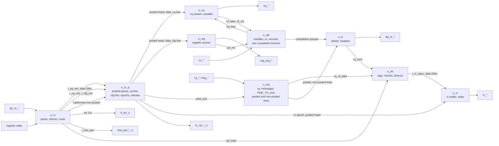

# pcie_tl MAS

How `pcie_tl` implements its [HAS](../../arch/tl/HAS.md). Wave 2 built it
in three issues: the receive path
([#290](https://github.com/amichai-bd/pcie-factory/issues/290)), the
transmit path with completions and MSI/MSI-X writes
([#291](https://github.com/amichai-bd/pcie-factory/issues/291)), and
completion tracking and timeout
([#292](https://github.com/amichai-bd/pcie-factory/issues/292)). Each
block is a file of the one `tl` IP; the tracker attaches at the
[tracker nets](#tracker-nets). The HAS and its pages
([TLP formats](../../arch/tl/TLP.md), [routing](../../arch/tl/ROUTING.md),
[completions](../../arch/tl/COMPLETIONS.md),
[ordering](../../arch/tl/ORDERING.md)) own the rules; this page owns how
the blocks apply them.

## Top

**Reset.** `tl` is in reset while `rst_i` is 1 or `dl_up_i` is 0
([HAS, reset](../../arch/tl/HAS.md#reset)): the top forms `rst` from both
and every block takes it as its synchronous reset. Every handshake
output (`tlp_rx_ready_o`, `tlp_tx_valid_o`, `cq_valid_o`, `cc_ready_o`,
`rq_ready_o`, `msg_ready_o`, `reg_req_valid_o`, `fc_rel_p_o`,
`fc_rel_np_o`, `tl_err_o`, `slot_pwr_valid_o`, `rc_valid_o`,
`tl_np_pending_o`) is also gated by `rst` at the top, so it is 0
in the first cycle `dl_up_i` falls, before the registers clear. The ready
and valid inputs reach the blocks gated the same way.

**Ports.** The top ports are the HAS ports, flat (they mirror the `link`,
tl-cfg and application interfaces the HAS names). Inside, the blocks
exchange the packed structs of the [package](#package). The parameters
keep the HAS ranges (`COMMON_ASSERT_PARAM`, one per parameter).

### Tracker nets

The nets between the receive and transmit blocks and the
[tracker](#completion-tracker); the testbench's bind tap reads
`cpl_beat`, `rq_rd_take`, `rq_rd_ctx`, `rq_sent` and `rq_sent_tag`, and
also the block nets `cpl_rec`, `rd_take`, `rd_ctx` and `pme_ack`
([DV plan](../../dv/tl/DV_PLAN.md)).

| Net (top) | Type | From, to | Contract |
| --- | --- | --- | --- |
| `cpl_beat` | `t_rx_beat` | `u_rx` to `u_trk` | Every beat of a received completion with a defined Fmt, `sop` to `eop`, in the cycle it arrives, a digest DW included (the tracker reads Length data DWs). `tl` never stalls them. |
| `rq_rd_take`, `rq_rd_ctx` | `logic`, `t_rq_ctx` | `u_txq` to `u_trk` | A read taken on `rq` (its `sop` beat): its tag, address bits 11:2, length and byte enables. The tag is in use from then ([requester tags](../../arch/tl/COMPLETIONS.md#requester-tags)). |
| `rq_sent`, `rq_sent_tag` | `logic`, 3 bits | `u_tx` to `u_trk` | The link took the `sop` beat of that read's TLP: its timer starts ([completion timeout](../../arch/tl/COMPLETIONS.md#completion-timeout)) and completions for it may match. |
| `rc_arrive` | `logic` | `u_trk` to `u_rx_q`, `u_rc` | A packet is queued for `rc`: it takes `rc_ep` and arms the rc line ([receive queues](#receive-queues)). A posted push in the same cycle counts as after it. |
| `rc_ep`, `p_none`, `p_known`, the posted head's `ep[LINE_RC]` | | `u_rx_q` to `u_rc` | The rc line's ordering: a packet may be offered on `rc` once `p_none`, or `p_known` and the posted head's rc epoch is after its own. |
| `trk_err` | 9 bits | `u_trk` to the top | ORed into `tl_err_o` (bits 2 and 4 to 8). |
| `rc_free`, `rc_free_tag` | `logic`, 3 bits | `u_rc` to `u_trk` | A read's `rc_done` beat was taken: its tag is no longer in use (for `a_tag_in_use`). |

## Package

[`pcie_tl_pkg`](../../../../src/rtl/tl/pcie_tl_pkg.sv) holds the
message, routing and completion status codes, the `tl_err_o` bit
numbers, the enums (`t_out` receive outcome,
`t_pkind` posted entry kind, `t_ckind` cfg line kind, `t_crkind` record
kind, `t_reg_st`, `t_pxkind` transmit posted entry kind, `t_txsel` the
arbiter's choice), the structs (the decoded header `t_hdr`, the TLP being
received `t_rx_cur`, the queue entries `t_pq_ent`, `t_cq_ent`,
`t_cfg_ent`, `t_txp_ent`, `t_txnp_ent`, the queued completion
`t_cpl_desc`, the former's read context `t_cpl_ctx`, the transmit
output stage's beat `t_tx_beat`, the block nets
`t_hd_ctx`, `t_cpl_rec`, the tracker nets `t_rx_beat`, `t_rq_ctx`, the
rc packet `t_rc_desc`, a tracked read `t_trk_tag`, the slot power payload
`t_slot_pwr`, and each
block's state), and the helpers that need its types or are `tl`'s alone:

| Helper | Does |
| --- | --- |
| `hdr_decode` | Every header field from the stream DWs ([TLP formats](../../arch/tl/TLP.md)). |
| `msg_silent` | The messages dropped without an error ([checks](../../arch/tl/ROUTING.md#checks), step 6). |
| `lowest_free` | The lowest free read handle. |
| `ep_after` | The [epoch](#receive-queues) comparison (also the [transmit epochs](#transmit-lines)). |
| `tx_dw0`, `tx_dw1_req` | Header DW 0 and a request's DW 1 as they sit on the stream ([TLP formats](../../arch/tl/TLP.md)). |

The Type codes (`t_tlp_type`: `T_MEM` to `T_CAS`), the credit class
(`t_cls`: `CLS_P`, `CLS_NP`, `CLS_CPL`, the type of `t_rx_cur.cls`) and the
pure TLP helpers live in the shared package
([`common_pkg`, TLP helpers](../common/common_pkg.md#tlp-helpers)), so
`rc_tl` reuses them ([#385](https://github.com/amichai-bd/pcie-factory/issues/385)).
`tl` uses them as `common_pkg::<name>`:

| Helper | Use in `tl` |
| --- | --- |
| `be_word` | A big-endian header DW as an address word (`hdr_decode`, the transmit headers). |
| `credit_class`, `data_credits` | The class and data credits the `dll` counted, for the release ([credit release](../../arch/tl/HAS.md#credit-release)). |
| `kind_known`, `is_cpl` | Step 1 of the [checks](../../arch/tl/ROUTING.md#checks); a completion's beats to the tracker. |
| `be_ok`, `cross_4k`, `msg_tc0` | Steps 3, 4 and 6. |
| `be_lo`, `be_hi`, `byte_total`, `be_mask` | The lowest and highest enabled byte, a read's total bytes T (also a tracked read's first bytes due), a byte-enable mask ([byte count](../../arch/tl/COMPLETIONS.md#byte-count-and-lower-address)). |
| `dw_credits` | Data credits of a TLP sent. |

## Receive parser

[`pcie_tl_rx`](../../../../src/rtl/tl/pcie_tl_rx.sv) takes every beat the
`link` delivers (`tlp_rx_ready_o` is 1 out of reset). The shared receive
beat tracker [`common_tlp_rx_track`](../common/common_tlp_rx_track.md)
(`u_beats`, [#400](https://github.com/amichai-bd/pcie-factory/issues/400))
counts the beats of the TLP, keeps the header size (Fmt bit 0, stream bit
5 of the `sop` beat) and gives the header DW enables and the last header
DW; DW 0 to 2 are captured with those enables. The parser's own state
(`t_rx_state`) keeps whether the TLP is a completion and the push of its
entry. At the last header
DW (beat 2 or 3) the header, the captured DWs and the beat on the stream,
is judged combinationally by the [checks](../../arch/tl/ROUTING.md#checks)
in order and the [routing](../../arch/tl/ROUTING.md#routing), with the
register state of that cycle, and the result is registered as `cur_q`
(`t_rx_cur`): the outcome, the error bit, the class and data credits, and
the fields the entries need. The BAR decode compares the address bits
from 31 down to the BAR's size (a mask from `BAR0_ADDR_W`, 12 for BAR2).

Data beats are the Length DWs after the header of a TLP with data. Those
of a BAR0 or BAR2 write go to the posted data queue as they arrive; the
first of a configuration write or a message is kept in `cur_q`. A digest DW after them
(TD 1, [TLP formats](../../arch/tl/TLP.md#common-fields)) is never stored.
Every other TLP's data is not stored.

In the cycle after the `eop` the TLP's entry is pushed: a posted TLP into
the posted queue (kind `PK_CQ`, `PK_BAR2`, `PK_PME`, or `PK_DISCARD` for
an Unsupported Request, a dropped message, a malformed or a poisoned
request), a BAR0 read into the cq line, a configuration request, a BAR2
read or a non-posted Unsupported Request into the cfg line, and a
malformed non-posted TLP straight to the release (it leaves at once). Its
error event pulses on `tl_err_o` bits 3 to 0 in the same cycle. A
Set_Slot_Power_Limit with data that passed steps 1 to 6 and is not
poisoned is judged with `cur_q.spl` set; it pulses `slot_pwr_valid_o` in
that cycle too, with `t_slot_pwr` from the kept data DW (bits 7:0 the
value, 9:8 the scale), and is a `PK_DISCARD` entry like any dropped
message ([slot power limit](../../arch/core/TL_CFG.md#slot-power-limit)). A
completion with a defined Fmt pushes nothing: its beats went to the
tracker as they arrived. Assertions: `a_rel_data_max`, and in `u_beats`
`a_beat_outside_tlp`, `a_sop_inside_tlp` and `a_short_tlp` (the `dll`'s
whole-TLP contract).

## Receive queues

[`pcie_tl_rx_q`](../../../../src/rtl/tl/pcie_tl_rx_q.sv) holds the
[receive queues](../../arch/tl/ORDERING.md#receive-queues):

| Queue | Entry | Size |
| --- | --- | --- |
| Posted | `t_pq_ent` | 2^⌈log2 `FC_PH`⌉ + 1 entries |
| Posted data | a DW | 2^⌈log2 (4 × `FC_PD`)⌉ + 1 DWs |
| Non-posted, cq line | `t_cq_ent` | 2^⌈log2 `FC_NPH`⌉ + 1 entries |
| Non-posted, cfg line | `t_cfg_ent` | the same |

Each holds at least what the advertised credits allow (a data credit is 4
DWs), so a credit-correct host never fills one (`a_*_overflow`). Each is
a [queue](#queue). An entry stays at its queue's head until it leaves, so
the head of the posted queue is always the oldest posted request held.

**Epochs.** A non-posted request, and a received completion, may
leave only once every posted request received before it has left. Each
line l (cq, cfg, rc) has an epoch counter `ep_q[l]` and an arm flag. A
line entry takes its line's epoch and arms the line; a posted entry
pushed while a line is armed first steps that line's epoch and disarms
it, and records the epoch of every line. So a line entry's epoch is at
least that of every posted request received before it, and less than
that of every one after. Its head may go when no posted request is held,
or the posted head's epoch for its line is after its own (`ep_after`).
Right after a push into an empty posted queue the head is still loading
and no line goes then; a head that has once been free to go stays free
(`ok_q`) until it leaves, so a later posted request never holds it back.

The comparison is modulo 2^9 and exact: the held posted requests span at
most `FC_PH` epochs behind a line head, and its line's epoch can step at
most once per entry of that line received after it, which hold
non-posted credits while they wait, so at most `FC_NPH` (the rc line: at
most 24 packets held, [rc stream](#rc-stream)). Counting the posted requests instead
would wrap: a BAR0 read can wait for a handle while any number of posted
requests pass it.

**Posted head.** A `PK_DISCARD` head leaves at once; a `PK_PME` head
leaves while `pme_room` is 1 and pulses `pme_ack`. A `PK_CQ` head leaves
when `u_cq` takes its `eop` beat, a `PK_BAR2` head when `u_reg` sees cfg
take its last access. Assertions: one posted request leaves per cycle,
each by its own owner; the lines leave only when free to go.

### Credit release

The release is registered: a request that leaves at an edge is released
in the next cycle ([HAS, credit release](../../arch/tl/HAS.md#credit-release)).
One posted request leaves per cycle at most, so `fc_rel_p_o` and
`fc_rel_pd_o` are the registered leave and its data credits. Up to three
non-posted requests leave in one cycle (a cq read, a cfg-line request and
a malformed TLP), so the headers and data credits that leave are added to
`owe_h_q` and `owe_d_q`, and `fc_rel_np_o` pulses while any header is
owed, each pulse with up to 8 owed data credits. The data owed is never
above 8 per header owed (`a_owed_data`), and the headers owed never above
`FC_NPH` (`a_owed_bound`).

### Queue

Every RAM queue of `tl` is the shared block
[`common_sdp_ram_fifo`](../common/ram/common_sdp_ram_fifo.md), which owns
its contract: a first-word-fall-through queue of 2^`ADDR_W` entries in a
`common_sdp_ram` plus the head in its read register, so a push shows at
the head two edges later and the head can be popped every cycle.

## cq stream

[`pcie_tl_cq`](../../../../src/rtl/tl/pcie_tl_cq.sv) offers the
[completer requests](../../arch/core/APP.md#completer-requests). With no
packet in progress it picks the cq line's head when it is free to go and
a handle is free (an eligible read is older than every waiting write),
else a `PK_CQ` posted head, and offers it in the same cycle; `t_cq_state`
then holds the choice and the handle until the `eop` is taken, so an
offered beat never changes. The header fields come from the queue head,
which stays put until the packet leaves; a write's data beats come from
the posted data head, valid only while a DW is there. A read is one beat
with the lowest free handle (`lowest_free`); its take marks the handle
busy and pulses `rd_take`. Assertions: `a_free_idle_handle`,
`a_read_without_handle`, and that the offered packet's head stays.

## Register access

[`pcie_tl_reg`](../../../../src/rtl/tl/pcie_tl_reg.sv) serves the
[register access](../../arch/core/TL_CFG.md#register-access) one access
at a time (`t_reg_state`: idle, offering, waiting for `reg_cpl_valid`).
In idle it takes the cfg line's head when it is free to go, else a
`PK_BAR2` posted head (an eligible cfg-line request is older than every
waiting posted write). An Unsupported Request makes its record at once
and leaves. Any other request is copied into `cur_q` and offered access
by access: a configuration request in one access with the request's
register, byte enables, data and, for a write, Bus and Device Number; a
BAR2 request one access per DW at the first DW index plus one per DW,
with the first DW's byte enables first, the last DW's last and all four
between. A BAR2 write's data comes from the posted data head. The offer
waits for `cpl_room` (a record will follow) or the data DW, and once up
stays up until taken (`a_offer_dropped`). The request leaves when cfg
takes its last access; each `reg_cpl_valid` of a configuration access or
a BAR2 read DW makes a record with the DW. `a_cpl_without_access` checks
cfg's side of the one-access rule.

## Completions

[`pcie_tl_cpl`](../../../../src/rtl/tl/pcie_tl_cpl.sv) turns the
[completer completions](../../arch/tl/COMPLETIONS.md#completer-completions)
into queued completions through two [completion formers](#completion-former):
`u_cc` for `cc`, `u_cf` for the register engine's records.

- **Handles.** Each `rd_take` writes the read's context (`t_cpl_ctx`:
  Requester ID, Tag, TC, Attr, address bits 6:2, Length, byte enables)
  into an 8-entry memory at its handle; `cc` reads it combinationally at
  the handle of the packet's `sop` beat, then at the handle kept in
  `t_cc_state` until the `eop`. The `eop` take pulses `hd_free` with the
  handle, which `u_cq` frees at that edge.
- **cc.** `cc_ready_o` is the former's room: 1 inside a completion, and at
  a beat that starts one only with room for the longest completion. Each
  beat taken goes to `u_cc` with the read's context. The packet's epoch
  is the cc line's at its `sop` beat (`t_cc_state.ep`), and the `sop`
  arms that line, so every completion of the packet waits for the posted
  requests taken before the `sop` and for none after
  ([APP ordering](../../arch/core/APP.md#ordering)).
- **Records.** A configuration write or an Unsupported Request is one
  completion without data, Byte Count and Lower Address formed here (T
  and B[6:0] for an Unsupported Request of a memory read, else 4 and 0;
  the locked kind for a locked read); a configuration read is one DW
  with Byte Count 4 and Lower Address 0 (`fixed4`); a BAR2 read's DWs go
  through the same split as a BAR0 read's. Each completion takes the cfg
  line epoch when it is queued and arms that line. `cpl_room` is
  `u_cf`'s room.
- Assertions: `a_cc_handle_idle` (a packet answers a handle taken and not
  yet answered), `a_cc_sop`, `a_cc_eop` (exactly the read's DWs),
  `a_rec_order` (BAR2 read records in DW order).

### Completion former

[`pcie_tl_cplf`](../../../../src/rtl/tl/pcie_tl_cplf.sv) takes a read's
DWs in address order, with its context, and queues its completions; or
takes a completion without data formed outside. Its state
(`t_cplf_state`) holds the next DW's index k in the read, the DWs still
due in the open completion, the bytes from the next completion's first
byte to the read's end (rb), and the open completion's Byte Count, Lower
Address and length.

At a DW that opens a completion (none open), the completion's length n
is the rest of the read when it is at most 32 DWs, else 32 less the DW
address bits 5:2 of that DW, which ends it on the highest 64-byte
boundary within 128 bytes ([splitting](../../arch/tl/COMPLETIONS.md#splitting)).
Its Byte Count is T for the read's first completion and rb for a later
one, its Lower Address the first enabled byte's address bits 6:0 for
the first and the DW's for a later one; rb then drops by 4n, less the
disabled bytes before the first enabled one for the first completion.
Every DW goes to a 64-DW data queue with the bytes the request did not
enable as 0 (the first DW by F, the last of a longer read by L); the
descriptor (`t_cpl_desc`) goes to a 4-entry queue with the completion's
last DW, so a queued descriptor always has all its data. Both queues are
[queues](#queue).

`room_o` is 1 while a completion is open, else while the data queue's
RAM holds at most 64 − 32 DWs and the descriptor queue is not full: a
completion that opens always fits whole, and the queue holds two of the
longest. Assertions: a DW only with room, a completion without data only
with none open, and a read never ending inside a completion.

## Transmit lines

[`pcie_tl_txq`](../../../../src/rtl/tl/pcie_tl_txq.sv) holds the
transmit posted line, its data, and the non-posted line
([ordering](../../arch/tl/ORDERING.md#ordering)).

| Line | Holds | Storage |
| --- | --- | --- |
| Posted | `t_txp_ent`: rq writes (`PX_RQ`), interrupt writes with their DW (`PX_IRQ`), error messages and PME_TO_Ack (`PX_MSG`) | 4 entries of flops; up to three go in at one edge, the head shows at the next |
| Posted data | rq write DWs | a 64-DW [queue](#queue) |
| Non-posted | `t_txnp_ent`: rq reads | a 4-entry [queue](#queue) |

- **rq.** On a `sop` beat, `rq_ready_o` is 1 when Bus Master Enable is 1,
  the function is in D0, and its line has room: a write needs a posted
  count of at most 1 and room for 32 data DWs, a read a free non-posted
  entry. A write's entry goes in at its `sop` beat, in the order taken,
  and its DWs into the posted data queue as they come; its later beats
  are always taken (`t_rq_state` counts them). A read is one beat; it
  goes into the non-posted line with the non-posted epoch, arms that
  line, and pulses `rq_rd_take`.
- **Messages.** `msg_ready_o` is 1 while the posted count is at most 2;
  `pme_room` while it is at most 3. Each source checks room for itself
  and the sources that may go in with it (rq, then messages, then
  PME_TO_Ack, in that order at one edge), so the line never overflows
  (`a_p_overflow`). Neither depends on any other handshake
  ([no-wait rule](../../arch/core/TL_CFG.md#messages)).
- **Epochs.** As in the [receive queues](#receive-queues): the
  non-posted line and the two completion queues each have an epoch and
  an arm flag; a posted entry steps every armed line's epoch and records
  them all. An entry of a line may go when the posted line is empty or
  the posted head's epoch for its line is after its own. The posted head
  is a flop, so there is no loading cycle; the comparison is exact since
  a line's epoch steps at most once per entry of that line still held.
- **Ready.** The posted head may go once all its data is queued: an rq
  write when the posted data queue holds at least its length (its data
  is first there, since earlier writes have gone).
- Assertions: the rq obligations of [APP](../../arch/core/APP.md#requester-requests)
  (length 1 to 32, one 4 KiB block, a read one beat, `sop` and `eop` in
  place); room as checked.

## Transmit arbiter

[`pcie_tl_tx`](../../../../src/rtl/tl/pcie_tl_tx.sv) sends one TLP at a
time ([transmit arbiter](../../arch/tl/ORDERING.md#ordering)). A head is
eligible when its order allows it (the epoch rule) and the link shows 1
header credit and its data credits for its class (`>=` passes all ones).
Round robin over the posted line, the non-posted line and the completion
queue picks one; the completion queue is the two completion formers'
queues, which alternate when both are eligible (`cf_turn`). The choice
is held in `t_tx_state` from the `sop` beat to the `eop` beat, so a beat
offered to the output stage never changes. Header DWs are formed from the head entry
([TLP formats](../../arch/tl/TLP.md)): a 3-DW memory request header when
address bits 63:32 are 0, a 4-DW one otherwise; a message's 4-DW header;
a completion's 3-DW header with the request's TC and Attr bits 1:0. Data
DWs come from the line's data queue (an interrupt write's from its
entry). The head and its data leave when the output stage takes the
`eop` beat. Assertion: the line sent keeps its head.

**Output stage.** `tlp_tx_*` come from flops, so no path runs from a
queue head through the arbiter into the `link`
([#295](https://github.com/amichai-bd/pcie-factory/issues/295)). The
stage is the shared [`common_skid_stage`](../common/common_skid_stage.md)
(`u_out`, [#400](https://github.com/amichai-bd/pcie-factory/issues/400))
on `t_tx_beat` (data, `sop`, `eop`, the DW 1 flag, and an rq read's `sop`
flag and tag): `out` is the beat offered on `tlp_tx_*`, and `skid` takes the arbiter's
beat in a cycle where `out` is held. The arbiter is ready while `skid` is
empty, a register, so `tlp_tx_ready_i` reaches only the stage. While the
link takes every beat `skid` stays empty and a TLP still goes out with no
gap; an offered beat stays unchanged until taken. The ID (`bus_num_i`,
`dev_num_i`) is captured in the cycle a `sop` beat is first offered on
`tlp_tx_*` (the stage's `out_new_o`) and fills bits 15:0 of DW 1, which the arbiter leaves 0 and
the stage offers only after the `sop` is taken; `rq_sent` pulses when the
link takes an rq read's `sop` beat. Assertions, in the stage: a held
beat is stable, `skid` holds a beat only behind `out`.

## Completion tracker

[`pcie_tl_trk`](../../../../src/rtl/tl/pcie_tl_trk.sv) keeps the
application's reads and judges every received completion
([requester completions](../../arch/tl/COMPLETIONS.md#requester-completions)).

- **Reads.** One `t_trk_tag` per tag, in flops: `act` (taken, not yet
  ended), `snt` (sent), `held` (its `rc_done` beat not yet taken),
  `failed`, the pulse count `cnt`, the bytes still due `left` (at most
  128) and the next byte's address bits 6:0 `nxt`. `rq_rd_take` loads
  `left` with `byte_total` and `nxt` with address bits 6:2 and `be_lo`
  of F; `rq_sent` sets `snt`. `tl_np_pending_o` is the OR of `act`.
- **Header.** The completion's DW 0 and 1 are captured (`t_trk_rx`); at
  its third header DW, in the cycle it arrives, the [matching and
  checks](../../arch/tl/COMPLETIONS.md#checks) are made combinationally
  against that tag's read, and the read is updated at that edge: an
  error status ends it; a completion that passes the checks advances
  `left` and `nxt` by its span (4n less `nxt` bits 1:0, from the next
  byte to the data's end), marks it `failed` when poisoned, and ends it
  when the span covers `left`. The checks need only `nxt` bits 6:0: the
  Lower Address is bits 6:0, the 64-byte boundary is `nxt` bits 5:2 plus
  n, modulo 16, being 0. The decision (`t_trk_cur`: error bits, the rc
  packet, whether its data is delivered) is registered.
- **Data.** The data DWs of a delivered completion are pushed to the rc
  data queue as they arrive, n of them; a digest DW is not.
- **Apply.** In the cycle after the completion's `eop` the error bits
  pulse on `trk_err` and its rc packet, if any, is queued (`rc_arrive`),
  so both come one cycle after the `eop`, as the receive errors do.
- **Timeout.** One prescaler counts P = 2^21 / (16 × `CPL_TIMEOUT_DIV`)
  cycles (rounded down) and pulses in its last. At a pulse each read
  sent counts one; at the pulse that finds 16 counted the read ends
  (`expire`), so it times out at the 17th pulse after the edge it was
  sent: between 16P and 17P cycles. Bit 6 pulses in that cycle (one
  pulse for every read ending then). `cpl_timeout_dis_i` is registered
  (`dis_q`); while `dis_q` is 1 every count is cleared and no read
  expires. A read expiring at an edge is not matched at that edge.
- **Timeout beats.** An expired tag is pending (`tmo_q`) until its
  failed beat is queued: in a cycle with no completion packet queued,
  the lowest pending tag whose completion is not between its decision
  and its packet, so a read's data packets always go before its failed
  beat.
- Assertions: `a_tag_in_use` (the application reuses no tag before the
  edge that takes its `rc_done` beat; at that edge the take of the new
  read wins over the free), `a_sent_unknown`, `a_cpl_len` (a completion that
  passes the checks has at most 32 DWs).

## rc stream

[`pcie_tl_rc`](../../../../src/rtl/tl/pcie_tl_rc.sv) holds the queued
packets until the application takes them
([APP requester completions](../../arch/core/APP.md#requester-completions)).

| Queue | Entry | Size |
| --- | --- | --- |
| Packets | `t_rc_desc`: tag, status, done, data length (0 for a status beat), the rc epoch when queued | 2^5 + 1 |
| Data | a DW | 2^8 + 1 |

Both are [queues](#queue). A read gets at most 32 DWs and 3 packets: a
packet that passes the checks and leaves data due ends on a 64-byte
boundary, and a 128-byte read spans at most three 64-byte blocks. A tag
is reused only after its `rc_done` beat is taken, after every packet of
the read before it, so at most 8 × 32 DWs (1 KiB) and 24 packets are
held (`a_rc_hq_overflow`, `a_rc_dq_overflow`); 24 packets also bound the
rc line's epoch steps ([receive queues](#receive-queues)).

The head packet may go once `p_none`, or `p_known` and the posted head's
rc epoch is after its own; once it may, it stays free to go (`ok`) until
it leaves, as the cq and cfg lines do. It is offered while free to go,
and for data while the data head holds a DW. `t_rc_state` counts its
beats: `sop` at beat 0, `eop` at its last data DW or on a status beat,
`rc_done_o` with `eop` when the packet ends the read. A taken `rc_done`
beat frees its tag (`rc_free`).

## Decisions

| Choice | Rationale | Rejected |
| --- | --- | --- |
| Judge at the last header DW, push in the cycle after the `eop` | Data is routed as it arrives, so only the writes served are stored and a digest never is; the push needs no data-complete tracking. | Judging after the `eop` (every TLP's data stored, then skipped one DW per cycle). |
| Entries stay at the queue head until they leave | The posted head is the oldest posted request held, which is all the ordering needs; the cq stream's fields stay put without a copy. | Popping on start and keeping an in-flight copy per consumer. |
| Per-line epochs for ordering | Exact in 9 bits by the credit bounds; one comparison at each head. | Arrival counters (wrap while a read waits for a handle); a flag per waiting entry (cannot be updated in a RAM). |
| Release registered, non-posted releases owed and merged | A request leaves on handshakes `tl` does not control (`cq_ready_i`, `reg_req_ready_i`), so three can leave in one cycle; the `dll` only adds the credits, so merging them is exact. | Holding one handshake back (`cfg` would wait on the application). |
| Queues sized by the advertised credits, in RAM | The HAS sizing; up to 127 headers and 8188 data DWs. | Flop arrays. |
| Completion beats passed raw to the tracker | The tracker owns the completion checks and buffer; the receive path keeps no completion state. | Parsing completion headers in the receive parser. |
| Judge a completion at its third header DW, apply it after its `eop` | The decision is known before any data DW, so only delivered data is stored; the error and the packet come one cycle after the `eop` like every receive error, and the dll's whole-TLP rule means a decided completion always ends. | Judging at the `eop` (every completion's data stored, then dropped). |
| The read's state per tag in flops, the tracked address as bits 6:0 | Eight tags; Lower Address and the 64-byte boundary need only bits 6:0, and a read never crosses 4 KiB. | The full address per tag. |
| One prescaler, a 5-bit count per tag | The HAS's 16 steps; 8 × 5 bits instead of 8 × 21. | A counter per tag. |
| The disable registered | No path from `cpl_timeout_dis_i` to `tl_err_o`. | Using the input in the expiry. |
| Timeout beats queued when no completion packet is, behind the tag's completion in flight | One push port into the packet queue; a read's data stays before its failed beat. | Two push ports. |
| rc packets in two queues sized by the 8 reads (1 KiB, 24 packets) | The bound comes from the protocol: no back-pressure on the receive stream is needed. | A credit for completions (`tl` advertises infinite completion credits). |
| Read handles: busy flags in `u_cq`, context in `u_cpl` | The take is in `u_cq`; the context is what the completions need. | A handle table in `u_cq` read by `u_cpl`. |
| Two completion formers, one queue each, alternating in the completion turn | `cc` and cfg records arrive independently; one data queue would interleave their DWs. Completions of different requests have no order between them. | One former with a merge buffer in front. |
| Room for the longest completion at a completion's first DW | `cc_ready_o` and `cpl_room` then need no input combinationally; a 64-DW queue still holds two completions. | Room for the completion's own length (a path from `cc_handle_i` to `cc_ready_o`). |
| Transmit posted line in flops, up to three entries at one edge | An rq write, a message and a PME_TO_Ack can be taken together; none waits on another, and the head is visible at the next edge for the epoch rule. | A RAM queue with a holding register per source (a held message would be taken before an rq write but enter after it). |
| An rq write enters the posted line at its `sop` beat and goes out whole | The order taken is the `sop` order (APP); a write never stalls the link mid-TLP waiting for the application. It relies on the application finishing a started write without waiting on `cc`, the interrupt port or `cq` ([APP](../../arch/core/APP.md#write-completion), [#291](https://github.com/amichai-bd/pcie-factory/issues/291#issuecomment-6250061556)). | Entering at its `eop` (a message taken during the write's data would pass it); cut-through. |
| The ID captured as the `sop` is first offered on `tlp_tx_*`, filled into DW 1 at the output stage | A configuration write may change `bus_num_i` while a TLP waits for the link; an offered beat must not change, and the [TLP formats](../../arch/tl/TLP.md) give the ID as the `sop` is first offered. | Forming DW 1 when it is taken; capturing the ID at the arbiter (a cycle before the offer). |
| A registered transmit output stage with a skid slot ([#295](https://github.com/amichai-bd/pcie-factory/issues/295)) | The first DE2-115 fit ran from a completion descriptor RAM through the arbiter and `tlp_tx_data` into the `dll` CRC in one cycle (36 MHz); the stage cuts it at `tl`'s edge for one cycle of latency and no throughput. | A plain register with `tlp_tx_ready_i` passed through to the arbiter (a combinational ready path); registering inside the `dll` (a signed interface's other side). |
| The output stage and the receive beat tracking are shared blocks, `common_skid_stage` and `common_tlp_rx_track` ([#400](https://github.com/amichai-bd/pcie-factory/issues/400)) | `rc_tl` needs both on the same stream; the RTL BKM puts shared logic in `common`, never a copy per IP. The move kept `tl`'s behavior: the ID capture and the completion flag stay in `tl`. | Re-implementing them in `rc_tl` after `tl`. |

## Timing

- One clock, `clk_i`; reset synchronous (`rst`); no crossing.
- A TLP whose `eop` is taken at edge E: its error event and slot power
  event pulse and its entry is pushed in the cycle after E; it reaches its queue head two
  edges later, so a request with nothing ahead of it is offered on `cq`,
  or handed on as an Unsupported Request, in the third cycle after E,
  and offered on `reg_req` in the fourth.
- A BAR0 write goes out on `cq` one beat per cycle while the application
  takes every beat; a BAR0 read is one beat, and reads follow each other
  in back-to-back cycles while handles are free.
- A register access is offered in the cycle after `u_reg` starts its
  request and after each `reg_cpl_valid` of a multi-DW BAR2 request.
- A request that leaves at edge E is released in the cycle after E, a
  non-posted one later when another is released then.
- A completion queued at edge E is offered on `tlp_tx_*` from the third
  cycle after E (its descriptor queue head, then the output stage), when
  nothing else is being sent and it is its turn; a configuration read's
  completion therefore starts three cycles after the cycle of its
  `reg_cpl_valid`. An rq request taken at edge E is offered from the
  second cycle (posted, once all its data is queued) or the third
  (non-posted). Back-to-back 32-DW `rq` writes
  keep the link busy: the next write is taken while the posted count is
  at most 1 and the posted data RAM holds at most 32 DWs, so it fills
  while the one before is sent; the application waits about 3 cycles per
  write (35 beats sent against 32 taken), and the store-and-forward cost
  is one TLP of latency. A TLP goes out one beat per cycle
  while the link takes them, with no gap, and the next starts in the
  cycle after its `eop` is taken; the output stage adds one cycle to
  every TLP's latency and none to throughput.
- A completion whose third header DW arrives in cycle C is matched and
  its read updated at the edge ending C; its error event pulses, and its
  rc packet is queued, in the cycle after its `eop`; the packet reaches
  the head two edges later, so a completion with nothing ahead of it is
  offered on `rc` from the third cycle after its `eop`, one beat per
  cycle while the application takes them. A read taken on `rq` at edge
  E is pending from the cycle after E; a read sent at edge S (the cycle
  `rq_sent` pulses) times out at the 17th prescaler pulse after S, in a
  cycle T with 16P < T − S ≤ 17P, its bit 6 pulsing in T.
- Outputs that depend on inputs combinationally: the gating by `rst`
  (`rst_i`, `dl_up_i`); `rq_ready_o` on a `sop` beat, from `rq_write_i`
  (which line's room), `bus_master_en_i` and `d_state_i`. `tlp_tx_*` come
  from the output stage's flops. On the DE2-115 at 50 MHz
  ([`core` FPGA](../../fpga/core/FPGA.md#results)) the worst path is in
  the transmit side: from a completion former's descriptor queue head
  (its RAM read register) through the eligibility and round robin into
  the other former's descriptor read pointer (the pop), with +1.065 ns
  of slack.

## Files

| File | Holds |
| --- | --- |
| [`pcie_tl_pkg.sv`](../../../../src/rtl/tl/pcie_tl_pkg.sv) | [Package](#package). |
| [`pcie_tl_rx.sv`](../../../../src/rtl/tl/pcie_tl_rx.sv) | [Receive parser](#receive-parser). |
| [`pcie_tl_rx_q.sv`](../../../../src/rtl/tl/pcie_tl_rx_q.sv) | [Receive queues](#receive-queues), epochs, [credit release](#credit-release). |
| [`pcie_tl_cq.sv`](../../../../src/rtl/tl/pcie_tl_cq.sv) | [cq stream](#cq-stream). |
| [`pcie_tl_reg.sv`](../../../../src/rtl/tl/pcie_tl_reg.sv) | [Register access](#register-access). |
| [`pcie_tl_cplf.sv`](../../../../src/rtl/tl/pcie_tl_cplf.sv) | [Completion former](#completion-former). |
| [`pcie_tl_cpl.sv`](../../../../src/rtl/tl/pcie_tl_cpl.sv) | [Completions](#completions): handles, `cc`, records. |
| [`pcie_tl_txq.sv`](../../../../src/rtl/tl/pcie_tl_txq.sv) | [Transmit lines](#transmit-lines), `rq`, messages, transmit epochs. |
| [`pcie_tl_tx.sv`](../../../../src/rtl/tl/pcie_tl_tx.sv) | [Transmit arbiter](#transmit-arbiter), headers. |
| [`pcie_tl_trk.sv`](../../../../src/rtl/tl/pcie_tl_trk.sv) | [Completion tracker](#completion-tracker): reads by tag, checks, timeout. |
| [`pcie_tl_rc.sv`](../../../../src/rtl/tl/pcie_tl_rc.sv) | [rc stream](#rc-stream): the rc queues and their order. |
| [`pcie_tl.sv`](../../../../src/rtl/tl/pcie_tl.sv) | [Top](#top): parameter checks, reset, the blocks, the [tracker nets](#tracker-nets). |
| [`tl.rtl.f`](../../../../src/rtl/tl/tl.rtl.f) | The shared vocabulary, `common_pkg`, the shared [queue](#queue) (which reaches the shared RAM), the shared [output stage](../common/common_skid_stage.md) and [receive beat tracker](../common/common_tlp_rx_track.md), the package, the blocks, the top. |
