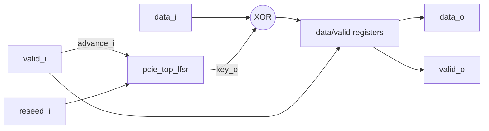

# pcie_top MAS

`pcie_top` is the top IP of the PCI Express controller. For now it is a
seed datapath: a byte-stream scrambler that XORs each valid data byte with
the Gen1/Gen2 scrambler key from its sub-IP [`pcie_top_lfsr`](lfsr/MAS.md).
It gives the factory a real two-level IP (a parent that includes a sub-IP
through `-F` and has its own end-to-end tests) before the controller's
architecture is defined.

It is not a physical layer: no 8b/10b coding, no K-code bypass, no SKP
handling and no lanes. `reseed_i` plays the role of a COM only in part:
like a COM, the next byte uses the seed key; unlike a COM (a K code, which is
never scrambled), the byte in the re-seed cycle is scrambled with the
current key.

## Position

Sub-IPs: [`lfsr`](lfsr/MAS.md).

## Decisions

| Choice | Rationale | Rejected |
| --- | --- | --- |
| Registered outputs, one-cycle latency | Keeps the key XOR inside one register-to-register stage. | Combinational output (hands the XOR depth to the consumer). |
| The LFSR advances only on valid bytes | Bubbles do not consume key, as a cycle with no symbol would not. | Free-running LFSR. |
| Re-seed applies from the next byte | The byte in the re-seed cycle uses the current key and the next byte the seed key, so `reseed_i` needs no data bypass. | Re-seed before the byte; a K-code bypass (out of scope for this seed). |
| No package of its own | Port types come from `pcie_top_lfsr_pkg`; the top defines no types the sub-IP lacks. | A top package duplicating `t_byte`. |

## Targets

| Item | Target |
| --- | --- |
| Throughput | One byte per clock, back to back. |
| Latency | One cycle from `valid_i` to `valid_o`. |
| Area | The LFSR plus 9 flops and 8 XORs. |
